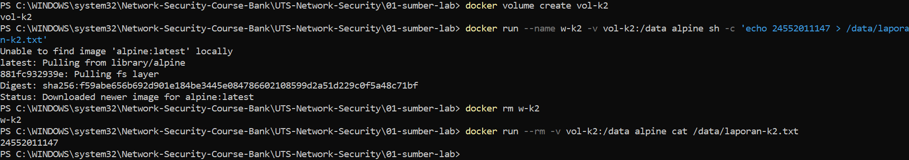
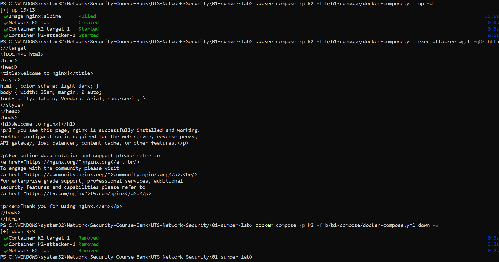

# HASIL TUGAS 1 (PERTEMUAN 1)
# DOCKER DAN VOLUME — KASUS 2 (K2)

## IDENTITAS DAN PARAMETER PENGUJIAN

| Keterangan | Informasi |
|---|---|
| Nama | Insanul Firas |
| NIM | 24552011147 |
| Mata Kuliah | Keamanan Jaringan (Security Network) |
| Pertemuan | Pertemuan 1 |
| Tugas | Docker dan Volume |
| Kasus | Kasus 2 (`k2`) |
| Sistem Operasi Host | Windows |
| Terminal | Windows PowerShell |
| Lingkungan Pengujian | Docker Desktop |
| Docker Image | `alpine`, `nginx:alpine` |
| Docker Compose Project | `k2` |
| Nama Docker Volume | `vol-k2` |
| Nama Container | `w-k2`, `k2-target-1`, `k2-attacker-1` |

---

# 1. PENDAHULUAN

## 1.1 Latar Belakang

Docker merupakan platform yang digunakan untuk menjalankan aplikasi di dalam lingkungan terisolasi yang disebut container. Dengan menggunakan Docker, aplikasi dapat dijalankan tanpa harus melakukan instalasi seluruh dependensi secara langsung pada sistem operasi utama.

Dalam pengelolaan container, terdapat beberapa konsep penting yang perlu dipahami, salah satunya adalah Docker Volume. Docker Volume digunakan untuk menyimpan data secara persisten sehingga data tidak hilang ketika container dihentikan atau dihapus.

Selain Docker Volume, Docker Compose juga memiliki peran penting dalam pengelolaan beberapa container sekaligus. Docker Compose memungkinkan pengguna mendefinisikan layanan, jaringan, serta konfigurasi container melalui sebuah file YAML.

Pada praktikum ini dilakukan dua pengujian utama. Pengujian pertama bertujuan untuk membuktikan bahwa data yang disimpan menggunakan Docker Volume tetap tersedia meskipun container pembuatnya telah dihapus.

Pengujian kedua bertujuan untuk menjalankan komunikasi antarkontainer menggunakan Docker Compose. Dalam simulasi ini digunakan dua layanan, yaitu container target yang menjalankan Nginx dan container attacker yang bertugas mengakses layanan web pada container target.

Melalui kedua pengujian tersebut, dapat dipahami bagaimana Docker mengelola penyimpanan data, container, jaringan internal, serta komunikasi antarlayanan.

## 1.2 Tujuan Praktikum

Adapun tujuan dari praktikum ini adalah:

1. Memahami konsep dasar Docker dan container.
2. Memahami fungsi Docker Volume sebagai media penyimpanan persisten.
3. Membuat dan menggunakan Docker Volume.
4. Membuktikan bahwa data tetap tersimpan setelah container dihapus.
5. Memahami penggunaan Docker Compose untuk menjalankan beberapa container.
6. Mengetahui cara kerja komunikasi antarkontainer melalui jaringan internal Docker.
7. Memahami fungsi container sebagai server dan client dalam simulasi jaringan.
8. Menguji konektivitas HTTP menggunakan perintah `wget`.
9. Memahami proses pembuatan dan penghapusan container serta network menggunakan Docker Compose.

## 1.3 Dasar Teori

### A. Docker

Docker merupakan platform containerization yang memungkinkan aplikasi dijalankan dalam lingkungan terisolasi.

Container menggunakan image sebagai dasar untuk menjalankan aplikasi beserta dependensinya.

Berbeda dengan virtual machine yang membutuhkan sistem operasi tersendiri, container menggunakan kernel dari sistem operasi host melalui mekanisme isolasi.

Beberapa komponen utama Docker adalah:

- **Docker Image:** template yang digunakan untuk membuat container.
- **Docker Container:** instance yang berjalan berdasarkan Docker Image.
- **Docker Volume:** media penyimpanan data persisten.
- **Docker Network:** jaringan yang menghubungkan container.
- **Docker Compose:** alat untuk mengelola beberapa container melalui konfigurasi YAML.

### B. Docker Container

Container merupakan lingkungan eksekusi aplikasi yang bersifat terisolasi.

Container dapat dibuat, dijalankan, dihentikan, dan dihapus sesuai kebutuhan.

Pada praktikum ini digunakan container berbasis image Alpine dan Nginx.

Image Alpine dipilih karena memiliki ukuran yang relatif kecil dan cocok digunakan untuk pengujian sederhana.

Sementara itu, Nginx digunakan sebagai web server untuk menyediakan halaman HTTP yang dapat diakses oleh container lain.

### C. Docker Volume

Docker Volume merupakan mekanisme penyimpanan data yang dikelola oleh Docker dan memiliki siklus hidup terpisah dari container.

Secara umum, data yang hanya disimpan pada filesystem internal container dapat hilang ketika container dihapus.

Namun, apabila data disimpan pada Docker Volume, data tersebut tetap tersedia meskipun container yang menggunakannya sudah dihapus.

Keuntungan penggunaan Docker Volume antara lain:

1. Menyimpan data secara persisten.
2. Memungkinkan data digunakan oleh container yang berbeda.
3. Memisahkan penyimpanan data dari siklus hidup container.
4. Mempermudah proses pencadangan dan pemulihan data.
5. Memungkinkan beberapa container mengakses penyimpanan yang sama.

### D. Docker Compose

Docker Compose merupakan alat untuk mendefinisikan dan menjalankan aplikasi yang terdiri dari beberapa container.

Konfigurasi Docker Compose disimpan dalam file YAML, biasanya menggunakan nama `docker-compose.yml`.

Melalui satu file konfigurasi, pengguna dapat menentukan:

- Nama dan image container.
- Layanan yang dijalankan.
- Network yang digunakan.
- Port dan konfigurasi komunikasi.
- Volume penyimpanan.
- Ketergantungan antarlayanan.

Pada praktikum ini Docker Compose digunakan untuk menjalankan container target dan attacker dalam satu jaringan internal.

### E. Docker Network

Docker Network merupakan mekanisme yang memungkinkan container saling berkomunikasi.

Container yang berada dalam jaringan Docker yang sama dapat mengakses layanan container lainnya menggunakan nama layanan atau nama container sesuai konfigurasi jaringan.

Pada praktikum ini, komunikasi dilakukan antara container attacker dan target menggunakan alamat:

```text
http://target
```

Nama `target` digunakan sebagai hostname yang dapat dikenali melalui DNS internal Docker Compose.

### F. HTTP dan Nginx

HTTP (Hypertext Transfer Protocol) merupakan protokol komunikasi yang digunakan untuk pertukaran data antara client dan server web.

Nginx merupakan web server yang dapat digunakan untuk menyajikan halaman web melalui protokol HTTP.

Dalam praktikum ini, Nginx dijalankan pada container target.

Container attacker bertindak sebagai client yang melakukan permintaan HTTP menggunakan perintah `wget`.

Apabila komunikasi berhasil, server akan mengirimkan respons berupa halaman HTML.

---

# 2. PERSIAPAN LINGKUNGAN PENGUJIAN

## 2.1 Tools yang Digunakan

| Tools | Fungsi |
|---|---|
| Windows PowerShell | Menjalankan perintah Docker |
| Docker Desktop | Menjalankan dan mengelola container |
| Docker Engine | Menjalankan container dan mengelola resource Docker |
| Alpine Linux | Image ringan untuk pengujian Docker Volume |
| Nginx Alpine | Web server pada container target |
| Docker Compose | Mengelola beberapa container |
| wget | Menguji komunikasi HTTP antarkontainer |

## 2.2 Lingkungan Pengujian

Seluruh pengujian dilakukan pada komputer lokal menggunakan Windows PowerShell dan Docker Desktop.

Docker digunakan untuk menjalankan container yang diperlukan tanpa melakukan instalasi layanan secara langsung pada sistem operasi utama.

Terdapat dua skenario pengujian:

1. Pengujian persistensi data menggunakan Docker Volume.
2. Pengujian komunikasi antarkontainer menggunakan Docker Compose.

## 2.3 Parameter Pengujian

Berikut parameter yang digunakan dalam praktikum:

| Parameter | Nilai |
|---|---|
| Docker Volume | `vol-k2` |
| Container Penyimpanan | `w-k2` |
| File yang Disimpan | `laporan-k2.txt` |
| Isi File | `24552011147` |
| Direktori Mount | `/data` |
| Image Penyimpanan | `alpine` |
| Docker Compose Project | `k2` |
| Compose File | `b/b1-compose/docker-compose.yml` |
| Container Target | `k2-target-1` |
| Container Attacker | `k2-attacker-1` |
| Web Server | Nginx |
| Protokol Pengujian | HTTP |

---

# 3. PENGUJIAN DOCKER VOLUME

## 3.1 Tujuan Pengujian

Pengujian pertama bertujuan untuk membuktikan bahwa Docker Volume mampu mempertahankan data meskipun container yang membuat data tersebut telah dihapus.

Pada pengujian ini dibuat sebuah Docker Volume dengan nama `vol-k2`.

Selanjutnya, sebuah container Alpine digunakan untuk membuat file bernama `laporan-k2.txt` di dalam direktori `/data` yang telah dihubungkan dengan Docker Volume.

Setelah file berhasil dibuat, container pertama dihapus.

Pengujian kemudian dilanjutkan dengan membuat container Alpine baru untuk membaca kembali file yang sebelumnya disimpan.

Apabila isi file masih dapat dibaca, berarti Docker Volume berhasil mempertahankan data di luar siklus hidup container.

## 3.2 Tahap Pertama: Membuat Docker Volume

Perintah yang digunakan:

```powershell
docker volume create vol-k2
```

Penjelasan perintah:

| Parameter | Fungsi |
|---|---|
| `docker volume` | Mengelola Docker Volume |
| `create` | Membuat volume baru |
| `vol-k2` | Nama volume yang dibuat |

Hasil eksekusi:

```text
vol-k2
```

Output tersebut menunjukkan bahwa Docker berhasil membuat volume dengan nama `vol-k2`.

Volume ini nantinya digunakan sebagai media penyimpanan data yang terpisah dari filesystem container.

## 3.3 Tahap Kedua: Membuat Container dan Menyimpan Data

Setelah Docker Volume berhasil dibuat, langkah berikutnya adalah menjalankan container Alpine untuk membuat file pada volume tersebut.

Perintah yang digunakan:

```powershell
docker run --name w-k2 -v vol-k2:/data alpine sh -c 'echo 24552011147 > /data/laporan-k2.txt'
```

Penjelasan perintah:

| Parameter | Fungsi |
|---|---|
| `docker run` | Membuat dan menjalankan container |
| `--name w-k2` | Memberikan nama container `w-k2` |
| `-v vol-k2:/data` | Menghubungkan volume `vol-k2` ke direktori `/data` |
| `alpine` | Menggunakan image Alpine Linux |
| `sh -c` | Menjalankan perintah melalui shell |
| `echo 24552011147` | Menuliskan NIM ke dalam file |
| `>` | Mengarahkan output ke file |
| `/data/laporan-k2.txt` | Lokasi file yang disimpan pada volume |

Perintah tersebut menghasilkan file:

```text
laporan-k2.txt
```

Dengan isi:

```text
24552011147
```

File tersebut disimpan di dalam direktori `/data`, yang telah terhubung dengan Docker Volume `vol-k2`.

Oleh karena itu, data tidak hanya tersimpan pada filesystem internal container, melainkan pada volume yang dikelola oleh Docker.

## 3.4 Tahap Ketiga: Menghapus Container Pertama

Setelah file berhasil dibuat, container `w-k2` dihapus menggunakan perintah:

```powershell
docker rm w-k2
```

Penjelasan:

- `docker rm` digunakan untuk menghapus container.
- `w-k2` merupakan nama container yang akan dihapus.

Hasil eksekusi:

```text
w-k2
```

Output tersebut menunjukkan bahwa container `w-k2` berhasil dihapus.

Pada tahap ini, container yang sebelumnya membuat file sudah tidak tersedia.

Namun, Docker Volume `vol-k2` tidak ikut terhapus karena volume memiliki siklus hidup tersendiri dan tidak otomatis dihapus ketika container biasa dihapus menggunakan `docker rm`.

## 3.5 Tahap Keempat: Membaca Data Menggunakan Container Baru

Setelah container pertama dihapus, dilakukan pengujian untuk memastikan apakah data masih tersedia.

Perintah yang digunakan:

```powershell
docker run --rm -v vol-k2:/data alpine cat /data/laporan-k2.txt
```

Penjelasan perintah:

| Parameter | Fungsi |
|---|---|
| `docker run` | Membuat dan menjalankan container baru |
| `--rm` | Menghapus container setelah perintah selesai |
| `-v vol-k2:/data` | Menghubungkan kembali volume `vol-k2` ke direktori `/data` |
| `alpine` | Menggunakan image Alpine Linux |
| `cat` | Membaca isi file |
| `/data/laporan-k2.txt` | Lokasi file yang akan dibaca |

Hasil eksekusi:

```text
24552011147
```

Output tersebut menunjukkan bahwa file `laporan-k2.txt` masih dapat dibaca menggunakan container baru meskipun container `w-k2` sebelumnya sudah dihapus.

Hal ini membuktikan bahwa data berhasil dipertahankan oleh Docker Volume.

## 3.6 Hasil Pengujian Docker Volume

Berdasarkan seluruh tahapan yang telah dilakukan, diperoleh hasil berikut:

| Tahapan | Hasil |
|---|---|
| Membuat volume `vol-k2` | Berhasil |
| Membuat container `w-k2` | Berhasil |
| Menyimpan file `laporan-k2.txt` | Berhasil |
| Mengisi file dengan NIM | Berhasil |
| Menghapus container `w-k2` | Berhasil |
| Membuat container baru | Berhasil |
| Membaca file dari volume | Berhasil |
| Data tetap tersedia | Ya |

Isi file yang berhasil dibaca kembali:

```text
24552011147
```

## 3.7 Analisis Hasil Docker Volume

Berdasarkan hasil pengujian, Docker Volume berhasil mempertahankan data meskipun container yang digunakan untuk membuat data tersebut telah dihapus.

Pada tahap awal, file `laporan-k2.txt` dibuat di dalam container `w-k2` dan disimpan pada direktori `/data`.

Direktori tersebut telah dihubungkan dengan Docker Volume `vol-k2` menggunakan parameter `-v`.

Setelah container `w-k2` dihapus, dilakukan pengujian menggunakan container Alpine baru.

Container baru tersebut menghubungkan kembali volume yang sama dan membaca file menggunakan perintah `cat`.

Hasilnya menunjukkan bahwa isi file masih tersedia dan menampilkan NIM:

```text
24552011147
```

Hal ini menunjukkan bahwa Docker Volume tidak bergantung pada keberadaan container yang pertama kali membuat data.

Dengan demikian, fungsi persistensi penyimpanan pada Docker Volume berhasil dibuktikan.

Pengujian ini juga menunjukkan bahwa Docker Volume dapat digunakan untuk menyimpan data penting seperti dokumen, database, konfigurasi, dan file aplikasi yang perlu dipertahankan meskipun container dihentikan atau diganti.

## 3.8 Dokumentasi Screenshot Docker Volume



**Gambar 1.** Proses pembuatan Docker Volume `vol-k2`, penyimpanan file `laporan-k2.txt` menggunakan container `w-k2`, penghapusan container pertama, serta pembacaan kembali file menggunakan container Alpine baru.

Screenshot tersebut menunjukkan bahwa data dengan isi `24552011147` tetap tersedia setelah container pembuatnya dihapus.

---

# 4. PENGUJIAN DOCKER COMPOSE DAN KOMUNIKASI ANTARKONTAINER

## 4.1 Tujuan Pengujian

Pengujian kedua bertujuan untuk memahami penggunaan Docker Compose dalam menjalankan beberapa container yang saling terhubung melalui jaringan internal Docker.

Pada pengujian ini digunakan dua layanan utama, yaitu:

1. **Target:** container yang menjalankan web server Nginx.
2. **Attacker:** container yang bertindak sebagai client untuk mengakses layanan HTTP pada target.

Kedua container dijalankan melalui file konfigurasi Docker Compose.

Selanjutnya, dilakukan pengujian komunikasi HTTP menggunakan perintah `wget` dari container attacker menuju container target.

Keberhasilan pengujian ditandai dengan diterimanya halaman HTML default dari Nginx.

## 4.2 Konfigurasi Docker Compose

File konfigurasi yang digunakan:

```text
b/b1-compose/docker-compose.yml
```

Docker Compose digunakan untuk mendefinisikan layanan container target dan attacker beserta jaringan yang digunakan.

Dalam pengujian ini, kedua container dijalankan dalam satu proyek Docker Compose dengan nama proyek `k2`.

Nama layanan `target` digunakan sebagai alamat tujuan komunikasi dari container attacker.

## 4.3 Tahap Pertama: Menjalankan Docker Compose

Perintah yang digunakan:

```powershell
docker compose -p k2 -f b/b1-compose/docker-compose.yml up -d
```

Penjelasan perintah:

| Parameter | Fungsi |
|---|---|
| `docker compose` | Menjalankan pengelolaan container menggunakan Docker Compose |
| `-p k2` | Menentukan nama proyek Docker Compose |
| `-f` | Menentukan file konfigurasi Compose |
| `b/b1-compose/docker-compose.yml` | Lokasi file konfigurasi |
| `up` | Membuat dan menjalankan layanan |
| `-d` | Menjalankan container di background |

Berdasarkan hasil eksekusi, diperoleh output:

```text
[+] up 13/13

Image nginx:alpine Pulled
Network k2_lab Created
Container k2-target-1 Started
Container k2-attacker-1 Started
```

Hasil tersebut menunjukkan bahwa:

1. Image `nginx:alpine` berhasil diunduh.
2. Network `k2_lab` berhasil dibuat.
3. Container `k2-target-1` berhasil dijalankan.
4. Container `k2-attacker-1` berhasil dijalankan.

Dengan demikian, lingkungan pengujian Docker Compose berhasil dibuat dan kedua layanan telah berjalan.

## 4.4 Tahap Kedua: Mengakses Web Server dari Container Attacker

Setelah kedua container berhasil dijalankan, dilakukan pengujian komunikasi HTTP dari container attacker menuju container target.

Perintah yang digunakan:

```powershell
docker compose -p k2 -f b/b1-compose/docker-compose.yml exec attacker wget -qO- http://target
```

Penjelasan perintah:

| Parameter | Fungsi |
|---|---|
| `docker compose` | Menjalankan perintah melalui Docker Compose |
| `-p k2` | Menggunakan proyek Compose bernama `k2` |
| `-f` | Menentukan file konfigurasi Compose |
| `exec` | Menjalankan perintah pada container yang sedang berjalan |
| `attacker` | Menentukan layanan yang menjalankan perintah |
| `wget` | Mengirim permintaan HTTP ke server tujuan |
| `-q` | Menjalankan wget dalam mode quiet |
| `-O-` | Menampilkan hasil respons langsung ke terminal |
| `http://target` | Alamat layanan web yang diakses |

Pada tahap ini, container attacker mengirimkan permintaan HTTP menuju layanan `target`.

Nama `target` digunakan sebagai hostname internal Docker Compose sehingga tidak perlu menuliskan alamat IP container secara manual.

Apabila DNS internal Docker berhasil melakukan resolusi nama, container attacker dapat menemukan layanan target dan mengirimkan permintaan HTTP.

## 4.5 Hasil Pengujian Komunikasi HTTP

Berdasarkan hasil eksekusi, container attacker berhasil memperoleh respons HTML dari web server Nginx.

Bagian output yang diperoleh:

```html
<!DOCTYPE html>
<html>
<head>
<title>Welcome to nginx!</title>
<style>
html { color-scheme: light dark; }
body { width: 35em; margin: 0 auto;
font-family: Tahoma, Verdana, Arial, sans-serif; }
</style>
</head>
<body>
<h1>Welcome to nginx!</h1>
<p>If you see this page, nginx is successfully installed and working.
Further configuration is required for the web server, reverse proxy,
API gateway, load balancer, content cache, or other features.</p>
</body>
</html>
```

Output tersebut merupakan halaman HTML default dari Nginx.

Bagian penting yang menunjukkan keberhasilan pengujian adalah:

```html
<h1>Welcome to nginx!</h1>
```

Pesan tersebut menunjukkan bahwa permintaan HTTP dari container attacker berhasil mencapai web server Nginx pada container target dan mendapatkan respons berupa halaman HTML.

Dengan demikian, komunikasi antara kedua container berhasil dilakukan melalui jaringan internal Docker.

## 4.6 Analisis Komunikasi Antarkontainer

Berdasarkan hasil pengujian, Docker Compose berhasil menjalankan dua container yang memiliki peran berbeda dalam simulasi jaringan.

Container target menjalankan Nginx sebagai web server yang menyediakan layanan HTTP.

Sementara itu, container attacker menjalankan perintah `wget` untuk mengakses layanan web yang tersedia pada container target.

Komunikasi dilakukan menggunakan alamat:

```text
http://target
```

Penggunaan hostname `target` menunjukkan bahwa Docker Compose menyediakan mekanisme resolusi nama layanan melalui DNS internal pada jaringan yang sama.

Dengan mekanisme tersebut, container tidak harus mengetahui alamat IP tujuan secara langsung.

Setelah permintaan dikirimkan, Nginx memberikan respons berupa halaman HTML default.

Hal ini membuktikan bahwa:

1. Container attacker berhasil berkomunikasi dengan container target.
2. DNS internal Docker berhasil mengenali hostname `target`.
3. Web server Nginx berjalan dan dapat diakses.
4. Permintaan HTTP berhasil diproses oleh layanan target.
5. Jaringan internal Docker Compose berfungsi dengan baik.

## 4.7 Tahap Ketiga: Menghentikan dan Membersihkan Lingkungan Pengujian

Setelah pengujian komunikasi berhasil dilakukan, seluruh resource Docker Compose dibersihkan menggunakan perintah:

```powershell
docker compose -p k2 -f b/b1-compose/docker-compose.yml down -v
```

Penjelasan perintah:

| Parameter | Fungsi |
|---|---|
| `docker compose` | Mengelola layanan Docker Compose |
| `-p k2` | Menentukan proyek yang akan dihentikan |
| `-f` | Menentukan file konfigurasi Compose |
| `down` | Menghentikan dan menghapus container serta network proyek |
| `-v` | Menghapus volume yang dikelola oleh konfigurasi Compose |

Berdasarkan hasil eksekusi, diperoleh output:

```text
[+] down 3/3

Container k2-target-1 Removed
Container k2-attacker-1 Removed
Network k2_lab Removed
```

Hasil tersebut menunjukkan bahwa kedua container dan jaringan internal berhasil dihapus.

Pembersihan dilakukan agar resource yang digunakan selama praktikum tidak terus berjalan setelah pengujian selesai.

**Catatan:** Perintah `down -v` membersihkan volume yang dikelola oleh proyek Compose. Docker Volume eksternal `vol-k2` yang dibuat pada pengujian pertama tidak otomatis terhapus oleh perintah ini karena merupakan volume terpisah yang dibuat secara manual.

## 4.8 Hasil Pengujian Docker Compose

Berikut rangkuman hasil pengujian komunikasi antarkontainer:

| Tahapan | Hasil |
|---|---|
| Menjalankan Docker Compose | Berhasil |
| Mengunduh image `nginx:alpine` | Berhasil |
| Membuat network `k2_lab` | Berhasil |
| Menjalankan container target | Berhasil |
| Menjalankan container attacker | Berhasil |
| Mengakses `http://target` | Berhasil |
| Menerima respons HTML Nginx | Berhasil |
| Menghentikan container | Berhasil |
| Menghapus network | Berhasil |

## 4.9 Dokumentasi Screenshot Docker Compose



**Gambar 2.** Proses menjalankan Docker Compose, pembuatan jaringan internal `k2_lab`, menjalankan container target dan attacker, serta pengujian komunikasi HTTP menggunakan `wget`.

Screenshot menunjukkan bahwa container attacker berhasil mendapatkan halaman HTML default dari Nginx yang berjalan pada container target.

Selain itu, terlihat proses pembersihan container dan network menggunakan perintah `docker compose down -v`.

---

# 5. ANALISIS KESELURUHAN PRAKTIKUM

## 5.1 Rekapitulasi Hasil Pengujian

Berdasarkan seluruh tahapan praktikum, diperoleh hasil sebagai berikut:

| No. | Pengujian | Hasil |
|---|---|---|
| 1 | Membuat Docker Volume `vol-k2` | Berhasil |
| 2 | Membuat container Alpine `w-k2` | Berhasil |
| 3 | Menyimpan file `laporan-k2.txt` | Berhasil |
| 4 | Menghapus container pembuat file | Berhasil |
| 5 | Membaca kembali file menggunakan container baru | Berhasil |
| 6 | Membuktikan persistensi data | Berhasil |
| 7 | Menjalankan Docker Compose | Berhasil |
| 8 | Membuat jaringan internal `k2_lab` | Berhasil |
| 9 | Menjalankan container target dan attacker | Berhasil |
| 10 | Mengakses layanan HTTP menggunakan `wget` | Berhasil |
| 11 | Menerima halaman HTML dari Nginx | Berhasil |
| 12 | Membersihkan container dan network | Berhasil |

## 5.2 Perbandingan Kedua Pengujian

Praktikum ini memiliki dua fokus utama yang berbeda, yaitu pengelolaan penyimpanan dan komunikasi jaringan antarkontainer.

| Aspek | Docker Volume | Docker Compose |
|---|---|---|
| Tujuan | Menyimpan data secara persisten | Mengelola beberapa container |
| Komponen Utama | Docker Volume | Container dan Docker Network |
| Resource | `vol-k2` | `k2_lab` |
| Container | `w-k2` dan container Alpine baru | `k2-target-1` dan `k2-attacker-1` |
| Pengujian | Membuat dan membaca file | Mengakses layanan HTTP |
| Hasil | Data tetap tersedia setelah container dihapus | Komunikasi HTTP berhasil |
| Bukti | Isi file `24552011147` | Halaman HTML Nginx |

## 5.3 Analisis Penerapan Docker dalam Keamanan Jaringan

Berdasarkan praktikum yang telah dilakukan, Docker memiliki peran penting dalam menyediakan lingkungan pengujian yang terisolasi.

Melalui Docker Volume, data dapat dipisahkan dari siklus hidup container sehingga informasi penting tetap tersedia meskipun container mengalami penghapusan atau penggantian.

Sementara itu, Docker Compose memungkinkan beberapa layanan dijalankan dalam satu lingkungan jaringan yang terorganisasi.

Dalam simulasi ini, container attacker dan target dapat berkomunikasi melalui jaringan internal menggunakan hostname layanan.

Pengujian HTTP membuktikan bahwa komunikasi tersebut berhasil dilakukan tanpa perlu mengakses alamat IP container secara manual.

Dari sudut pandang keamanan jaringan, kemampuan mengisolasi container dan mengatur komunikasi antarlayanan merupakan hal penting.

Pengelolaan network dapat digunakan untuk membatasi komunikasi hanya pada layanan yang diperlukan, sedangkan pengelolaan volume membantu menjaga data agar tidak bergantung pada keberadaan container tertentu.

Namun, penggunaan Docker tidak secara otomatis menjamin keamanan seluruh layanan. Pengaturan hak akses, konfigurasi jaringan, pengelolaan data sensitif, dan pembatasan komunikasi tetap diperlukan.

---

# 6. KESIMPULAN

Berdasarkan pelaksanaan Tugas 1 (Pertemuan 1) mengenai Docker dan Volume pada Kasus 2 (`k2`), dapat disimpulkan bahwa seluruh tahapan praktikum berhasil dilakukan menggunakan Docker Desktop.

Pada pengujian pertama, Docker Volume dengan nama `vol-k2` berhasil dibuat dan digunakan sebagai media penyimpanan file `laporan-k2.txt`.

File tersebut diisi dengan NIM `24552011147` melalui container Alpine bernama `w-k2`.

Setelah container pertama dihapus, dilakukan pengujian menggunakan container Alpine baru untuk membaca kembali file yang telah disimpan.

Hasilnya menunjukkan bahwa isi file tetap tersedia dan dapat dibaca dengan benar.

Hal ini membuktikan bahwa Docker Volume mampu mempertahankan data meskipun container yang sebelumnya digunakan untuk membuat data telah dihapus.

Pada pengujian kedua, Docker Compose berhasil digunakan untuk menjalankan container target dan attacker dalam satu jaringan internal bernama `k2_lab`.

Container target menjalankan web server Nginx, sedangkan container attacker digunakan untuk mengirimkan permintaan HTTP menggunakan perintah `wget`.

Hasil pengujian menunjukkan bahwa attacker berhasil mengakses layanan `http://target` dan menerima respons berupa halaman HTML default Nginx.

Hal tersebut membuktikan bahwa komunikasi antarkontainer melalui jaringan internal Docker Compose berhasil dilakukan.

Secara keseluruhan, praktikum ini memberikan pemahaman mengenai dua konsep penting dalam Docker, yaitu persistensi data menggunakan Docker Volume dan komunikasi antarkontainer menggunakan Docker Compose.

Kedua konsep tersebut memiliki peran penting dalam pengelolaan aplikasi berbasis container, baik dari sisi penyimpanan data maupun komunikasi jaringan.

---

# 7. LAMPIRAN DAN DOKUMENTASI

## 7.1 Daftar File dan Resource Pengujian

| No. | Nama | Keterangan |
|---|---|---|
| 1 | `vol-k2` | Docker Volume untuk penyimpanan persisten |
| 2 | `w-k2` | Container Alpine pembuat file |
| 3 | `laporan-k2.txt` | File yang berisi NIM |
| 4 | `b/b1-compose/docker-compose.yml` | File konfigurasi Docker Compose |
| 5 | `k2-target-1` | Container web server Nginx |
| 6 | `k2-attacker-1` | Container penguji komunikasi HTTP |
| 7 | `k2_lab` | Network internal Docker Compose |

## 7.2 Daftar Screenshot

| No. | Nama Screenshot | Keterangan |
|---|---|---|
| 1 | `01.png` | Bukti pembuatan volume, penyimpanan file, penghapusan container, dan pembacaan kembali data |
| 2 | `02.png` | Bukti menjalankan Docker Compose, komunikasi HTTP, dan pembersihan container |

## 7.3 Dokumentasi Screenshot

### A. Pengujian Docker Volume


**Gambar 1.** Dokumentasi pengujian Docker Volume. Proses dimulai dari pembuatan volume `vol-k2`, penyimpanan NIM ke dalam file `laporan-k2.txt`, penghapusan container `w-k2`, hingga pembacaan kembali file menggunakan container baru.

Hasil pengujian memperlihatkan bahwa data tetap tersimpan meskipun container pembuatnya sudah dihapus.

### B. Pengujian Docker Compose dan Komunikasi HTTP


**Gambar 2.** Dokumentasi pengujian Docker Compose. Screenshot memperlihatkan proses pembuatan network, menjalankan container target dan attacker, mengakses web server Nginx melalui HTTP, serta membersihkan resource setelah pengujian selesai.

Hasil pengujian memperlihatkan bahwa container attacker berhasil mendapatkan halaman HTML dari web server Nginx pada container target.

