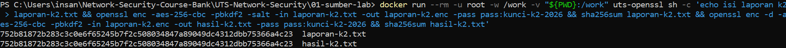
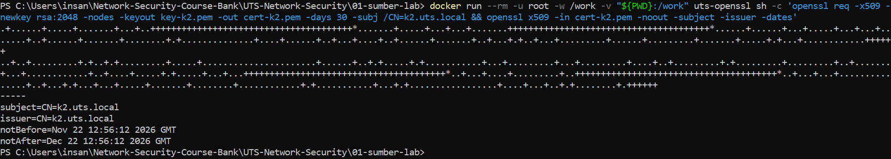

# HASIL TUGAS 2 (PERTEMUAN 2)
# KRIPTOGRAFI — KASUS 2 (K2)

## IDENTITAS DAN PARAMETER PENGUJIAN

| Keterangan | Informasi |
|---|---|
| Nama | Insanul Firas |
| NIM | 24552011147 |
| Mata Kuliah | Keamanan Jaringan (Security Network) |
| Pertemuan | Pertemuan 2 |
| Tugas | Kriptografi |
| Kasus | Kasus 2 (`k2`) |
| Sistem Operasi Host | Windows |
| Terminal | Windows PowerShell |
| Lingkungan Pengujian | Docker Desktop |
| Docker Image | `uts-openssl` |
| Algoritma Enkripsi | AES-256-CBC |
| Algoritma Hash | SHA-256 |
| Algoritma Kunci Publik | RSA 2048-bit |
| Format Sertifikat | X.509 |
| Common Name (CN) | `k2.uts.local` |

---

# 1. PENDAHULUAN

## 1.1 Latar Belakang

Kriptografi merupakan salah satu aspek penting dalam keamanan informasi dan jaringan komputer. Kriptografi digunakan untuk melindungi informasi agar tidak dapat dibaca atau dimodifikasi oleh pihak yang tidak memiliki hak akses.

Dalam penerapannya, kriptografi memiliki beberapa fungsi utama, yaitu menjaga kerahasiaan data (*confidentiality*), memastikan integritas informasi (*integrity*), serta mendukung autentikasi identitas melalui mekanisme sertifikat digital.

Pada praktikum ini dilakukan pengujian menggunakan OpenSSL melalui lingkungan Docker. Pengujian dibagi menjadi dua bagian utama, yaitu enkripsi simetris menggunakan AES-256-CBC dan pembuatan sertifikat digital X.509 menggunakan algoritma RSA.

Selain proses enkripsi dan dekripsi, dilakukan pula pemeriksaan nilai hash menggunakan SHA-256 untuk membandingkan isi dokumen sebelum dan sesudah proses enkripsi.

Pengujian ini bertujuan untuk memahami bagaimana data dapat dilindungi menggunakan algoritma kriptografi serta bagaimana sertifikat digital digunakan untuk merepresentasikan identitas suatu entitas.

## 1.2 Tujuan Praktikum

Adapun tujuan dari praktikum ini adalah:

1. Memahami konsep dasar kriptografi dan penerapannya dalam keamanan informasi.
2. Memahami mekanisme enkripsi dan dekripsi menggunakan algoritma AES-256-CBC.
3. Mengetahui fungsi password sebagai dasar pembentukan kunci enkripsi.
4. Memahami penggunaan PBKDF2 dalam proses derivasi kunci.
5. Melakukan pemeriksaan integritas data menggunakan SHA-256.
6. Membandingkan nilai hash sebelum dan sesudah proses enkripsi-dekripsi.
7. Membuat pasangan kunci privat dan sertifikat digital menggunakan OpenSSL.
8. Memahami struktur sertifikat digital X.509.
9. Mengidentifikasi informasi Subject, Issuer, dan masa berlaku sertifikat.
10. Memahami perbedaan sertifikat yang diterbitkan oleh Certificate Authority (CA) dengan sertifikat *self-signed*.

## 1.3 Dasar Teori

### A. Kriptografi

Kriptografi merupakan teknik pengamanan informasi dengan mengubah data asli menjadi bentuk yang tidak dapat dibaca secara langsung oleh pihak yang tidak memiliki kunci yang sesuai.

Secara umum, kriptografi memiliki dua proses utama:

- **Enkripsi:** proses mengubah plaintext menjadi ciphertext.
- **Dekripsi:** proses mengembalikan ciphertext menjadi plaintext menggunakan kunci yang sesuai.

Dalam praktikum ini, kriptografi digunakan untuk melindungi isi dokumen melalui algoritma AES-256-CBC.

### B. AES-256-CBC

Advanced Encryption Standard (AES) merupakan algoritma kriptografi simetris yang menggunakan kunci yang sama untuk proses enkripsi dan dekripsi.

AES memiliki tiga ukuran kunci, yaitu 128-bit, 192-bit, dan 256-bit.

Pada praktikum ini digunakan AES-256-CBC, yaitu AES dengan panjang kunci 256-bit dan mode operasi Cipher Block Chaining (CBC).

Mode CBC bekerja dengan menggabungkan setiap blok plaintext dengan ciphertext dari blok sebelumnya sebelum dilakukan proses enkripsi.

Untuk blok pertama, digunakan Initialization Vector (IV) sebagai nilai awal.

Penggunaan IV dan salt membantu menghasilkan proses enkripsi yang menggunakan parameter acak sehingga plaintext yang sama tidak selalu menghasilkan ciphertext yang sama.

### C. PBKDF2

Password-Based Key Derivation Function 2 (PBKDF2) merupakan mekanisme untuk menghasilkan kunci kriptografi dari sebuah password.

PBKDF2 menggunakan proses iterasi untuk meningkatkan biaya komputasi dalam pembentukan kunci.

Pada perintah OpenSSL, opsi `-pbkdf2` digunakan agar password diproses melalui mekanisme derivasi kunci tersebut sebelum digunakan dalam proses enkripsi maupun dekripsi.

### D. SHA-256

Secure Hash Algorithm 256-bit (SHA-256) merupakan algoritma hash kriptografi yang menghasilkan nilai hash sepanjang 256 bit atau 64 karakter hexadecimal.

SHA-256 digunakan untuk menghasilkan sidik digital dari suatu data.

Apabila isi data berubah, nilai hash yang dihasilkan umumnya juga akan berbeda.

Pada praktikum ini, SHA-256 digunakan untuk membandingkan file plaintext sebelum enkripsi dengan file hasil dekripsi.

### E. Sertifikat Digital X.509

X.509 merupakan standar format sertifikat digital yang digunakan dalam infrastruktur kunci publik atau Public Key Infrastructure (PKI).

Sertifikat digital berisi informasi identitas suatu entitas serta kunci publik yang terkait dengan identitas tersebut.

Beberapa informasi penting dalam sertifikat X.509 meliputi:

- Subject: identitas pemilik sertifikat.
- Issuer: pihak yang menerbitkan atau menandatangani sertifikat.
- Validity: masa berlaku sertifikat.
- Public Key: kunci publik yang terdapat dalam sertifikat.
- Signature: tanda tangan digital yang digunakan untuk memverifikasi sertifikat.

Pada praktikum ini dibuat sertifikat *self-signed*, yaitu sertifikat yang ditandatangani menggunakan kunci privat milik pembuat sertifikat itu sendiri.

---

# 2. PERSIAPAN LINGKUNGAN PENGUJIAN

## 2.1 Tools yang Digunakan

Praktikum dilakukan menggunakan Docker Desktop dan Docker Image `uts-openssl`.

Image tersebut menyediakan OpenSSL dan tools pendukung yang dibutuhkan untuk menjalankan proses kriptografi.

| Tools | Fungsi |
|---|---|
| Docker Desktop | Menjalankan lingkungan pengujian berbasis container |
| Windows PowerShell | Menjalankan perintah Docker |
| OpenSSL | Melakukan enkripsi, dekripsi, dan pembuatan sertifikat |
| SHA-256 | Menghasilkan nilai hash untuk pemeriksaan data |
| RSA | Membuat pasangan kunci publik dan privat |
| X.509 | Format sertifikat digital |

## 2.2 File yang Digunakan

Dalam praktikum ini terdapat beberapa file yang dihasilkan melalui proses pengujian.

| Nama File | Fungsi |
|---|---|
| `laporan-k2.txt` | File plaintext sebelum dienkripsi |
| `laporan-k2.enc` | File ciphertext hasil enkripsi |
| `hasil-k2.txt` | File plaintext hasil dekripsi |
| `key-k2.pem` | Kunci privat RSA |
| `cert-k2.pem` | Sertifikat digital X.509 |

Seluruh file tersebut disimpan pada direktori kerja host yang dihubungkan dengan container Docker melalui volume.

## 2.3 Penggunaan Docker Volume

Perintah pengujian menggunakan parameter:

```powershell
-v "${PWD}:/work"
```

Parameter tersebut menghubungkan direktori aktif PowerShell pada komputer host dengan direktori `/work` di dalam container.

Dengan mekanisme ini, file yang dibuat melalui OpenSSL di dalam container dapat disimpan pada direktori proyek di Windows.

Opsi `--rm` digunakan untuk menghapus container setelah proses selesai. Namun, file yang disimpan melalui volume tetap berada pada direktori host.

---

# 3. ENKRIPSI SIMETRIS AES-256-CBC DAN VERIFIKASI SHA-256

## 3.1 Tujuan Pengujian

Pengujian pertama bertujuan untuk menerapkan proses enkripsi dan dekripsi menggunakan algoritma AES-256-CBC.

Selain itu, dilakukan pemeriksaan nilai hash menggunakan SHA-256 untuk memastikan bahwa isi file hasil dekripsi sama dengan file plaintext sebelum dienkripsi.

Dengan demikian, pengujian ini mencakup dua aspek keamanan informasi, yaitu:

1. Kerahasiaan data melalui proses enkripsi.
2. Pemeriksaan kesamaan data melalui perbandingan nilai hash.

## 3.2 Perintah yang Digunakan

Perintah yang dijalankan melalui Windows PowerShell:

```powershell
docker run --rm -u root -w /work -v "${PWD}:/work" uts-openssl sh -c 'echo isi laporan k2 > laporan-k2.txt && openssl enc -aes-256-cbc -pbkdf2 -salt -in laporan-k2.txt -out laporan-k2.enc -pass pass:kunci-k2-2026 && sha256sum laporan-k2.txt && openssl enc -d -aes-256-cbc -pbkdf2 -in laporan-k2.enc -out hasil-k2.txt -pass pass:kunci-k2-2026 && sha256sum hasil-k2.txt'
```

## 3.3 Penjelasan Perintah

Perintah tersebut merupakan rangkaian proses yang dijalankan secara berurutan menggunakan operator `&&`.

Berikut penjelasan masing-masing bagian:

| Perintah | Fungsi |
|---|---|
| `docker run` | Menjalankan container Docker |
| `--rm` | Menghapus container setelah proses selesai |
| `-u root` | Menjalankan proses menggunakan user root |
| `-w /work` | Menentukan direktori kerja di dalam container |
| `-v "${PWD}:/work"` | Menghubungkan direktori host dengan container |
| `uts-openssl` | Image yang menyediakan OpenSSL |
| `echo isi laporan k2 > laporan-k2.txt` | Membuat file plaintext |
| `openssl enc` | Menjalankan fungsi enkripsi OpenSSL |
| `-aes-256-cbc` | Menggunakan algoritma AES-256 dengan mode CBC |
| `-pbkdf2` | Menggunakan PBKDF2 untuk derivasi kunci |
| `-salt` | Menggunakan salt dalam proses derivasi kunci |
| `-in laporan-k2.txt` | Menentukan file input |
| `-out laporan-k2.enc` | Menentukan file output ciphertext |
| `-pass pass:kunci-k2-2026` | Menentukan password enkripsi |
| `sha256sum` | Menghitung nilai hash SHA-256 |
| `-d` | Mengaktifkan mode dekripsi |

## 3.4 Tahap Pertama: Pembuatan Plaintext

Proses dimulai dengan membuat sebuah file teks menggunakan perintah:

```bash
echo isi laporan k2 > laporan-k2.txt
```

Perintah tersebut menghasilkan file bernama `laporan-k2.txt` dengan isi:

```text
isi laporan k2
```

File ini merupakan plaintext, yaitu data asli yang masih dapat dibaca secara langsung sebelum dilakukan proses enkripsi.

Plaintext tersebut akan digunakan sebagai input dalam proses enkripsi AES-256-CBC.

## 3.5 Tahap Kedua: Proses Enkripsi AES-256-CBC

Setelah file plaintext dibuat, proses berikutnya adalah mengenkripsi file menggunakan OpenSSL.

Perintah enkripsi:

```bash
openssl enc -aes-256-cbc -pbkdf2 -salt -in laporan-k2.txt -out laporan-k2.enc -pass pass:kunci-k2-2026
```

Pada tahap ini, OpenSSL memproses plaintext menggunakan algoritma AES-256-CBC dengan password:

```text
kunci-k2-2026
```

Password tersebut digunakan sebagai dasar pembentukan kunci melalui PBKDF2.

Opsi `-salt` digunakan untuk menambahkan nilai salt pada proses derivasi kunci.

Setelah proses enkripsi berhasil, akan terbentuk file:

```text
laporan-k2.enc
```

File tersebut merupakan ciphertext, yaitu data yang telah dienkripsi dan tidak lagi menampilkan isi plaintext secara langsung.

Dengan demikian, proses enkripsi berhasil mengubah dokumen asli menjadi bentuk ciphertext.

## 3.6 Tahap Ketiga: Menghitung Hash Plaintext

Sebelum proses dekripsi dilakukan, nilai hash dari file plaintext dihitung menggunakan:

```bash
sha256sum laporan-k2.txt
```

Perintah tersebut menghasilkan nilai hash SHA-256 sebagai representasi digital dari isi file.

Berdasarkan hasil pengujian, diperoleh:

```text
752b81872b283c3c0e6f65245b7f2c508034847a89049dc4312dbb75366a4c23  laporan-k2.txt
```

Nilai tersebut menjadi acuan untuk dibandingkan dengan hash file setelah proses dekripsi.

## 3.7 Tahap Keempat: Proses Dekripsi

Setelah ciphertext berhasil dibuat, dilakukan proses dekripsi untuk mengembalikan data ke bentuk plaintext.

Perintah yang digunakan:

```bash
openssl enc -d -aes-256-cbc -pbkdf2 -in laporan-k2.enc -out hasil-k2.txt -pass pass:kunci-k2-2026
```

Penjelasan:

- `-d`: mengaktifkan mode dekripsi.
- `-aes-256-cbc`: menggunakan algoritma AES-256-CBC yang sama.
- `-pbkdf2`: menggunakan mekanisme derivasi kunci yang sama.
- `-in laporan-k2.enc`: menentukan file ciphertext.
- `-out hasil-k2.txt`: menentukan file hasil dekripsi.
- `-pass`: menggunakan password yang sesuai dengan proses enkripsi.

Pada tahap ini, OpenSSL menggunakan password yang sama untuk memperoleh kunci yang diperlukan dalam proses dekripsi.

Apabila password dan parameter yang digunakan sesuai, file ciphertext dapat dikembalikan menjadi plaintext.

Hasil proses dekripsi disimpan dalam file:

```text
hasil-k2.txt
```

## 3.8 Tahap Kelima: Menghitung Hash Hasil Dekripsi

Setelah proses dekripsi berhasil, dilakukan perhitungan hash terhadap file hasil dekripsi menggunakan:

```bash
sha256sum hasil-k2.txt
```

Berdasarkan hasil pengujian, diperoleh:

```text
752b81872b283c3c0e6f65245b7f2c508034847a89049dc4312dbb75366a4c23  hasil-k2.txt
```

## 3.9 Hasil Perbandingan SHA-256

Berikut merupakan perbandingan nilai hash sebelum dan sesudah proses enkripsi-dekripsi.

| Keterangan | File | Nilai SHA-256 |
|---|---|---|
| Sebelum enkripsi | `laporan-k2.txt` | `752b81872b283c3c0e6f65245b7f2c508034847a89049dc4312dbb75366a4c23` |
| Setelah dekripsi | `hasil-k2.txt` | `752b81872b283c3c0e6f65245b7f2c508034847a89049dc4312dbb75366a4c23` |

**Hasil: Kedua hash identik.**

Kedua file menghasilkan nilai hash SHA-256 yang sama.

Hal tersebut menunjukkan bahwa isi file `hasil-k2.txt` sama dengan isi file `laporan-k2.txt` berdasarkan hasil pemeriksaan hash.

Dengan demikian, proses enkripsi dan dekripsi berhasil dilakukan menggunakan password serta parameter yang sesuai.

## 3.10 Analisis Hasil Enkripsi dan Dekripsi

Berdasarkan hasil pengujian, file `laporan-k2.txt` berhasil dienkripsi menjadi `laporan-k2.enc` menggunakan algoritma AES-256-CBC.

Selanjutnya, file ciphertext berhasil didekripsi menggunakan password yang sama sehingga menghasilkan file `hasil-k2.txt`.

Untuk memastikan bahwa proses tersebut mengembalikan data secara benar, dilakukan perbandingan nilai hash SHA-256 terhadap file plaintext awal dan file hasil dekripsi.

Hasil perbandingan menunjukkan bahwa kedua file memiliki nilai hash yang sama, yaitu:

```text
752b81872b283c3c0e6f65245b7f2c508034847a89049dc4312dbb75366a4c23
```

Kesamaan nilai hash tersebut membuktikan bahwa data hasil dekripsi identik dengan data awal berdasarkan pemeriksaan SHA-256.

Perlu diperhatikan bahwa SHA-256 pada pengujian ini digunakan untuk membandingkan kesamaan isi file, bukan sebagai mekanisme autentikasi ciphertext. AES-CBC sendiri tidak menyediakan autentikasi atau pemeriksaan integritas bawaan seperti mode enkripsi terautentikasi AES-GCM.

## 3.11 Dokumentasi Screenshot



**Gambar 1.** Hasil pengujian enkripsi dan dekripsi menggunakan AES-256-CBC. Screenshot memperlihatkan pembuatan file plaintext, proses enkripsi menggunakan password `kunci-k2-2026`, proses dekripsi ciphertext, serta hasil perbandingan SHA-256 antara `laporan-k2.txt` dan `hasil-k2.txt`.

---

# 4. PEMBUATAN DAN PEMERIKSAAN SERTIFIKAT DIGITAL X.509

## 4.1 Tujuan Pengujian

Pengujian kedua bertujuan untuk membuat sertifikat digital menggunakan OpenSSL dengan format X.509.

Sertifikat dibuat menggunakan algoritma RSA dengan panjang kunci 2048-bit.

Pada praktikum ini, sertifikat menggunakan metode *self-signed*, yaitu sertifikat yang ditandatangani menggunakan kunci privat milik pembuat sertifikat itu sendiri.

Selanjutnya, dilakukan pemeriksaan terhadap informasi Subject, Issuer, serta masa berlaku sertifikat.

Pengujian ini bertujuan untuk memahami bagaimana sertifikat digital dibuat dan bagaimana informasi identitas dapat diperiksa melalui OpenSSL.

## 4.2 Perintah yang Digunakan

Perintah yang dijalankan:

```powershell
docker run --rm -u root -w /work -v "${PWD}:/work" uts-openssl sh -c 'openssl req -x509 -newkey rsa:2048 -nodes -keyout key-k2.pem -out cert-k2.pem -days 30 -subj /CN=k2.uts.local && openssl x509 -in cert-k2.pem -noout -subject -issuer -dates'
```

## 4.3 Penjelasan Perintah

Perintah tersebut terdiri dari dua proses utama, yaitu pembuatan sertifikat dan pemeriksaan informasi sertifikat.

| Parameter | Fungsi |
|---|---|
| `openssl req` | Menjalankan perintah untuk membuat permintaan sertifikat atau sertifikat |
| `-x509` | Menghasilkan sertifikat X.509 secara langsung |
| `-newkey rsa:2048` | Membuat pasangan kunci RSA dengan panjang 2048-bit |
| `-nodes` | Tidak mengenkripsi kunci privat menggunakan password |
| `-keyout key-k2.pem` | Menentukan nama file kunci privat |
| `-out cert-k2.pem` | Menentukan nama file sertifikat |
| `-days 30` | Menentukan masa berlaku sertifikat selama 30 hari |
| `-subj /CN=k2.uts.local` | Menentukan identitas Subject sertifikat |
| `openssl x509` | Menjalankan perintah pemeriksaan sertifikat X.509 |
| `-in cert-k2.pem` | Menentukan file sertifikat yang diperiksa |
| `-noout` | Menampilkan informasi tanpa mencetak isi sertifikat dalam format PEM |
| `-subject` | Menampilkan identitas Subject |
| `-issuer` | Menampilkan identitas Issuer |
| `-dates` | Menampilkan masa berlaku sertifikat |

## 4.4 Tahap Pertama: Pembuatan Kunci Privat RSA

Proses dimulai dengan membuat pasangan kunci RSA 2048-bit menggunakan perintah:

```bash
openssl req -x509 -newkey rsa:2048
```

RSA merupakan algoritma kriptografi asimetris yang menggunakan sepasang kunci, yaitu:

- **Public Key:** kunci publik yang dapat dibagikan kepada pihak lain.
- **Private Key:** kunci privat yang harus dijaga kerahasiaannya oleh pemilik.

Pada praktikum ini, OpenSSL membuat pasangan kunci RSA dengan panjang 2048-bit.

Kunci privat kemudian disimpan dalam file:

```text
key-k2.pem
```

Parameter `-nodes` digunakan agar kunci privat tidak dienkripsi menggunakan password tambahan.

Oleh karena itu, file `key-k2.pem` harus disimpan dengan aman dan tidak dibagikan kepada pihak yang tidak memiliki hak akses.

## 4.5 Tahap Kedua: Pembuatan Sertifikat X.509

Setelah pasangan kunci RSA dibuat, OpenSSL menghasilkan sertifikat digital X.509.

Perintah yang digunakan memiliki parameter:

```bash
-x509 -days 30 -subj /CN=k2.uts.local
```

Penjelasan:

- `-x509`: menghasilkan sertifikat X.509 secara langsung.
- `-days 30`: menentukan masa berlaku selama 30 hari.
- `-subj /CN=k2.uts.local`: menentukan Common Name pada identitas sertifikat.

Nilai Common Name (CN) yang digunakan adalah:

```text
k2.uts.local
```

Dengan demikian, sertifikat dibuat menggunakan identitas tersebut.

Hasil pembuatan sertifikat disimpan dalam file:

```text
cert-k2.pem
```

Sertifikat tersebut merupakan sertifikat *self-signed* karena dibuat dan ditandatangani menggunakan kunci privat yang bersesuaian dengan kunci publik di dalam sertifikat.

## 4.6 Tahap Ketiga: Pemeriksaan Sertifikat

Setelah sertifikat berhasil dibuat, dilakukan pemeriksaan menggunakan perintah:

```bash
openssl x509 -in cert-k2.pem -noout -subject -issuer -dates
```

Perintah tersebut digunakan untuk menampilkan informasi penting yang terdapat di dalam sertifikat.

Informasi yang diperiksa meliputi:

1. Subject.
2. Issuer.
3. notBefore.
4. notAfter.

Hasil pemeriksaan dapat digunakan untuk mengetahui identitas sertifikat dan periode masa berlakunya.

## 4.7 Hasil Pemeriksaan Sertifikat

Berdasarkan hasil pengujian, diperoleh output:

```text
subject=CN=k2.uts.local
issuer=CN=k2.uts.local
notBefore=Nov 22 12:56:12 2026 GMT
notAfter=Dec 22 12:56:12 2026 GMT
```

Berikut merupakan rincian hasil pemeriksaan:

| Parameter | Hasil |
|---|---|
| Subject | `CN=k2.uts.local` |
| Issuer | `CN=k2.uts.local` |
| notBefore | Nov 22 12:56:12 2026 GMT |
| notAfter | Dec 22 12:56:12 2026 GMT |
| Algoritma Kunci | RSA |
| Panjang Kunci | 2048-bit |
| Masa Berlaku | 30 hari |

## 4.8 Analisis Subject dan Issuer

**Subject** merupakan informasi identitas entitas yang memiliki sertifikat digital.

Pada hasil pengujian, Subject memiliki nilai:

```text
subject=CN=k2.uts.local
```

Nilai tersebut menunjukkan bahwa Common Name yang digunakan dalam sertifikat adalah `k2.uts.local`.

Sementara itu, **Issuer** merupakan identitas pihak yang menerbitkan atau menandatangani sertifikat.

Hasil pemeriksaan menunjukkan:

```text
issuer=CN=k2.uts.local
```

Subject dan Issuer memiliki nilai yang sama.

Hal tersebut terjadi karena sertifikat dibuat menggunakan metode *self-signed*, yaitu sertifikat ditandatangani oleh pemilik kunci privat yang bersesuaian dengan sertifikat itu sendiri.

Dengan demikian, tidak terdapat Certificate Authority (CA) eksternal yang menerbitkan sertifikat tersebut.

## 4.9 Analisis Masa Berlaku Sertifikat

Berdasarkan hasil pemeriksaan, sertifikat memiliki informasi masa berlaku:

```text
notBefore=Nov 22 12:56:12 2026 GMT
notAfter=Dec 22 12:56:12 2026 GMT
```

Keterangan:

- `notBefore`: tanggal dan waktu mulai berlakunya sertifikat.
- `notAfter`: tanggal dan waktu berakhirnya masa berlaku sertifikat.

Sertifikat mulai berlaku pada 22 November 2026 pukul 12:56:12 GMT dan berakhir pada 22 Desember 2026 pukul 12:56:12 GMT.

Dengan demikian, masa berlaku sertifikat sesuai dengan parameter `-days 30` yang digunakan saat proses pembuatan.

## 4.10 Analisis Hasil Pembuatan Sertifikat

Berdasarkan hasil pengujian, OpenSSL berhasil menghasilkan pasangan kunci RSA 2048-bit dan sertifikat digital X.509.

Sertifikat menggunakan Common Name `k2.uts.local` sebagai identitas.

Hasil pemeriksaan menunjukkan bahwa nilai Subject dan Issuer sama-sama menggunakan identitas tersebut.

Kesamaan nilai tersebut menunjukkan bahwa sertifikat dibuat menggunakan metode *self-signed*.

Selain itu, masa berlaku sertifikat berhasil ditetapkan selama 30 hari, yaitu dari 22 November 2026 sampai 22 Desember 2026.

Pengujian ini memperlihatkan bahwa OpenSSL dapat digunakan untuk membuat sertifikat digital secara mandiri tanpa harus memperoleh sertifikat dari CA eksternal.

Namun, sertifikat *self-signed* tidak otomatis dipercaya oleh sistem atau browser lain. Kepercayaan terhadap sertifikat tersebut harus diberikan secara manual melalui mekanisme yang sesuai.

## 4.11 Dokumentasi Screenshot



**Gambar 2.** Hasil pembuatan sertifikat digital X.509 menggunakan OpenSSL dengan algoritma RSA 2048-bit. Screenshot memperlihatkan proses pembuatan kunci privat dan sertifikat, serta hasil pemeriksaan Subject, Issuer, dan masa berlaku sertifikat.

---

# 5. ANALISIS KESELURUHAN PRAKTIKUM

## 5.1 Rekapitulasi Hasil Pengujian

Berdasarkan seluruh tahapan yang telah dilakukan, diperoleh rangkuman sebagai berikut:

| No. | Pengujian | Hasil |
|---|---|---|
| 1 | Pembuatan file plaintext | Berhasil |
| 2 | Enkripsi AES-256-CBC | Berhasil |
| 3 | Pembuatan ciphertext | Berhasil |
| 4 | Perhitungan SHA-256 plaintext | Berhasil |
| 5 | Dekripsi ciphertext | Berhasil |
| 6 | Perhitungan SHA-256 hasil dekripsi | Berhasil |
| 7 | Perbandingan hash | Identik |
| 8 | Pembuatan kunci privat RSA 2048-bit | Berhasil |
| 9 | Pembuatan sertifikat X.509 | Berhasil |
| 10 | Pemeriksaan Subject dan Issuer | Berhasil |
| 11 | Pemeriksaan masa berlaku sertifikat | Berhasil |

## 5.2 Perbandingan Dua Pengujian Kriptografi

Praktikum ini terdiri dari dua pengujian dengan tujuan keamanan yang berbeda.

| Aspek | Enkripsi AES-256-CBC | Sertifikat X.509 |
|---|---|---|
| Jenis Kriptografi | Simetris | Asimetris |
| Algoritma | AES-256-CBC | RSA 2048-bit |
| Fungsi Utama | Melindungi kerahasiaan data | Merepresentasikan identitas dan kunci publik |
| Kunci | Menggunakan kunci yang sama untuk enkripsi dan dekripsi | Menggunakan pasangan kunci publik dan privat |
| Hasil | File ciphertext dan plaintext hasil dekripsi | Kunci privat dan sertifikat digital |
| Pemeriksaan | Perbandingan hash SHA-256 | Subject, Issuer, dan masa berlaku |

## 5.3 Analisis Keseluruhan

Berdasarkan hasil praktikum, kedua proses kriptografi berhasil dijalankan menggunakan OpenSSL.

Pada pengujian pertama, algoritma AES-256-CBC digunakan untuk mengenkripsi dokumen plaintext menjadi ciphertext.

Selanjutnya, ciphertext berhasil dikembalikan menjadi plaintext melalui proses dekripsi menggunakan password yang sama.

Keberhasilan proses tersebut diperiksa menggunakan SHA-256. Hasilnya menunjukkan bahwa hash file sebelum dan sesudah proses dekripsi memiliki nilai yang identik.

Pada pengujian kedua, OpenSSL berhasil membuat pasangan kunci RSA 2048-bit dan sertifikat digital X.509 dengan identitas `k2.uts.local`.

Pemeriksaan sertifikat menunjukkan bahwa Subject dan Issuer memiliki nilai yang sama karena sertifikat dibuat menggunakan metode *self-signed*.

Selain itu, masa berlaku sertifikat berhasil ditetapkan selama 30 hari sesuai dengan parameter yang digunakan.

Kedua pengujian tersebut memperlihatkan penerapan konsep kriptografi simetris dan asimetris dalam keamanan informasi.

AES digunakan untuk melindungi kerahasiaan dokumen, sedangkan RSA dan sertifikat X.509 digunakan untuk mendukung mekanisme identitas digital dan infrastruktur kunci publik.

---

# 6. KESIMPULAN

Berdasarkan pelaksanaan Tugas 2 (Pertemuan 2) mengenai Kriptografi pada Kasus 2 (`k2`), dapat disimpulkan bahwa seluruh tahapan pengujian berhasil dilaksanakan menggunakan OpenSSL di dalam lingkungan Docker.

Pada pengujian pertama, proses enkripsi dan dekripsi berhasil dilakukan menggunakan algoritma AES-256-CBC dengan password `kunci-k2-2026`.

File plaintext `laporan-k2.txt` berhasil dienkripsi menjadi `laporan-k2.enc`, kemudian didekripsi kembali menjadi `hasil-k2.txt`.

Hasil pemeriksaan SHA-256 menunjukkan bahwa kedua file plaintext memiliki nilai hash yang sama, yaitu:

`752b81872b283c3c0e6f65245b7f2c508034847a89049dc4312dbb75366a4c23`

Kesamaan nilai hash tersebut membuktikan bahwa isi file hasil dekripsi sama dengan isi file asli berdasarkan pemeriksaan SHA-256.

Pada pengujian kedua, pembuatan pasangan kunci RSA 2048-bit dan sertifikat digital X.509 berhasil dilakukan.

Sertifikat menggunakan identitas `CN=k2.uts.local` dan dibuat menggunakan metode *self-signed*.

Hasil pemeriksaan menunjukkan bahwa Subject dan Issuer memiliki nilai yang sama, yaitu `CN=k2.uts.local`.

Sertifikat juga memiliki masa berlaku selama 30 hari, mulai dari 22 November 2026 hingga 22 Desember 2026.

Melalui praktikum ini, dapat dipahami bahwa algoritma AES-256-CBC dapat digunakan untuk melindungi kerahasiaan dokumen, sedangkan RSA dan sertifikat X.509 berperan dalam penerapan kriptografi asimetris serta pengelolaan identitas digital.

Secara keseluruhan, praktikum ini memberikan pemahaman mengenai penerapan enkripsi simetris, proses dekripsi, pemeriksaan kesamaan data menggunakan SHA-256, serta pembuatan dan pemeriksaan sertifikat digital menggunakan OpenSSL.

---

# 7. LAMPIRAN DAN DOKUMENTASI

## 7.1 Daftar File Hasil Pengujian

| No. | Nama File | Keterangan |
|---|---|---|
| 1 | `laporan-k2.txt` | File plaintext asli |
| 2 | `laporan-k2.enc` | File ciphertext hasil enkripsi |
| 3 | `hasil-k2.txt` | File hasil dekripsi |
| 4 | `key-k2.pem` | Kunci privat RSA 2048-bit |
| 5 | `cert-k2.pem` | Sertifikat digital X.509 |

**Catatan keamanan:** File `key-k2.pem` merupakan kunci privat dan harus dijaga kerahasiaannya. Jangan mengunggah atau membagikan kunci privat tersebut secara publik.

## 7.2 Daftar Screenshot

| No. | Nama Screenshot | Keterangan |
|---|---|---|
| 1 | `01.png` | Bukti enkripsi AES-256-CBC, dekripsi, dan perbandingan hash SHA-256 |
| 2 | `02.png` | Bukti pembuatan sertifikat X.509 dan pemeriksaan Subject, Issuer, serta masa berlaku |

## 7.3 Dokumentasi Keseluruhan

### A. Enkripsi dan Dekripsi AES-256-CBC


**Gambar 1.** Proses enkripsi dan dekripsi dokumen menggunakan AES-256-CBC serta pemeriksaan kesamaan file melalui SHA-256.

### B. Pembuatan Sertifikat Digital X.509


**Gambar 2.** Proses pembuatan sertifikat digital menggunakan RSA 2048-bit dan pemeriksaan informasi Subject, Issuer, serta masa berlaku sertifikat.

