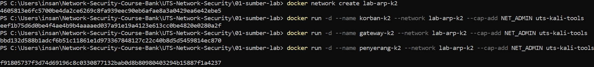
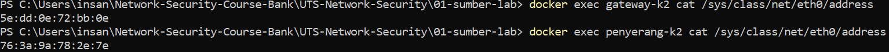
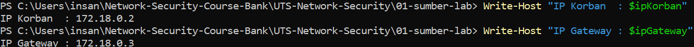
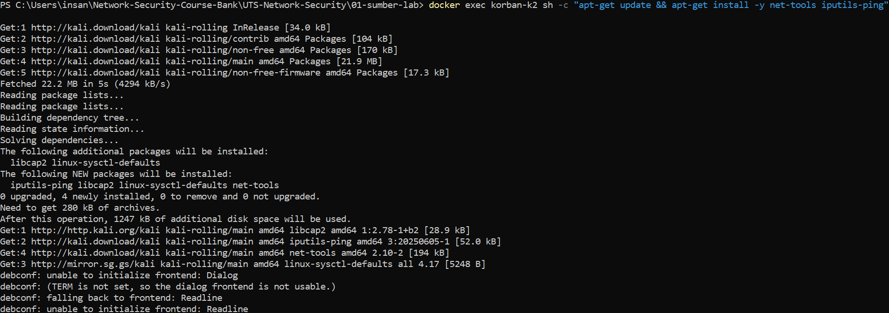
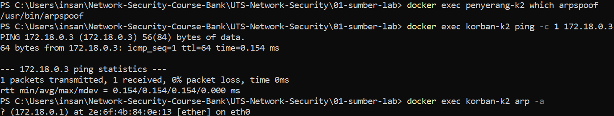
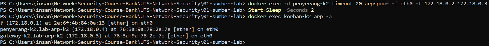
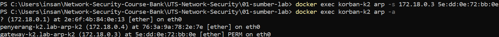
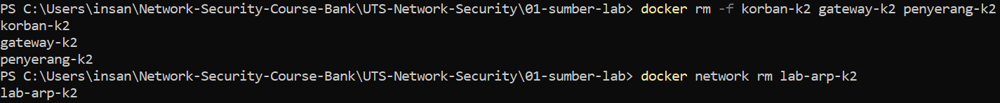

# TUGAS 3 (PERTEMUAN 3)
# ARP SPOOFING — KASUS 2 (K2)

## IDENTITAS DAN PARAMETER LAB

| Keterangan | Informasi |
|---|---|
| Nama | Insanul Firas |
| NIM | 24552011147 |
| Mata Kuliah | Keamanan Jaringan (Security Network) |
| Pertemuan | Pertemuan 3 |
| Tugas | ARP Spoofing |
| Kasus | Kasus 2 (`k2`) |
| Sistem Operasi Host | Windows |
| Terminal | Windows PowerShell |
| Virtualisasi Container | Docker Desktop |
| Docker Image | `uts-kali-tools` |
| Nama Jaringan Docker | `lab-arp-k2` |

### Topologi dan Identitas Perangkat

Pada praktikum ini digunakan tiga container Docker yang memiliki peran berbeda, yaitu perangkat korban (*victim*), gateway, dan penyerang (*attacker*). Ketiga container dihubungkan ke dalam satu jaringan Docker agar dapat saling berkomunikasi dan digunakan untuk melakukan simulasi serangan ARP Spoofing.

Berikut merupakan informasi alamat IP dan MAC Address masing-masing perangkat yang digunakan dalam pengujian.

| Perangkat | Container | IP Address | MAC Address |
|---|---|---|---|
| Korban | `korban-k2` | `172.18.0.2` | - |
| Gateway | `gateway-k2` | `172.18.0.3` | `5e:dd:0e:72:bb:0e` |
| Penyerang | `penyerang-k2` | `172.18.0.4` | `76:3a:9a:78:2e:7e` |

**Keterangan:**
- **Korban (`korban-k2`)** merupakan perangkat yang menjadi target simulasi serangan ARP Spoofing. Tabel ARP pada perangkat ini diamati untuk mengetahui perubahan pemetaan alamat IP ke MAC Address.
- **Gateway (`gateway-k2`)** merupakan perangkat yang alamat IP dan MAC Address-nya menjadi objek pemalsuan dalam simulasi.
- **Penyerang (`penyerang-k2`)** merupakan perangkat yang menjalankan utilitas `arpspoof` untuk mengirimkan paket ARP palsu kepada korban.

---

# 1. PEMBUATAN JARINGAN DOCKER DAN KONFIGURASI CONTAINER

## 1.1 Tujuan

Tahap pertama dilakukan untuk mempersiapkan lingkungan simulasi ARP Spoofing menggunakan Docker. Lingkungan ini terdiri dari tiga container yang berperan sebagai korban, gateway, dan penyerang.

Seluruh container ditempatkan pada jaringan Docker khusus bernama `lab-arp-k2`. Penggunaan jaringan terpisah bertujuan agar proses simulasi dapat dilakukan dalam lingkungan yang terisolasi tanpa mengganggu jaringan utama maupun perangkat lain.

Selain membuat jaringan dan container, dilakukan pula pemeriksaan alamat IP serta MAC Address untuk memastikan setiap perangkat memiliki identitas jaringan yang dapat digunakan selama pengujian.

## 1.2 Pembuatan Jaringan dan Container

Langkah pertama adalah membuat jaringan Docker menggunakan perintah berikut:

```powershell
docker network create lab-arp-k2
```

Setelah jaringan berhasil dibuat, tiga container dijalankan menggunakan Docker Image `uts-kali-tools`.

```powershell
# Membuat container korban
docker run -d --name korban-k2 --network lab-arp-k2 --cap-add NET_ADMIN uts-kali-tools

# Membuat container gateway
docker run -d --name gateway-k2 --network lab-arp-k2 --cap-add NET_ADMIN uts-kali-tools

# Membuat container penyerang
docker run -d --name penyerang-k2 --network lab-arp-k2 --cap-add NET_ADMIN uts-kali-tools
```

Keterangan perintah:

- `docker run -d` digunakan untuk menjalankan container dalam mode detached atau berjalan di latar belakang.
- `--name` digunakan untuk memberikan nama pada setiap container agar mudah dikenali.
- `--network lab-arp-k2` digunakan untuk menghubungkan container ke jaringan Docker yang telah dibuat.
- `--cap-add NET_ADMIN` memberikan kapabilitas administrasi jaringan yang diperlukan untuk menjalankan konfigurasi dan pengujian jaringan.
- `uts-kali-tools` merupakan Docker Image yang digunakan sebagai lingkungan praktikum.

Dengan konfigurasi tersebut, ketiga container dapat berkomunikasi melalui jaringan Docker yang sama.

## 1.3 Pemeriksaan MAC Address dan IP Address

Setelah seluruh container berhasil dijalankan, langkah selanjutnya adalah memperoleh MAC Address asli dari gateway dan penyerang.

Perintah yang digunakan:

```powershell
# Memeriksa MAC Address gateway
docker exec gateway-k2 cat /sys/class/net/eth0/address

# Memeriksa MAC Address penyerang
docker exec penyerang-k2 cat /sys/class/net/eth0/address
```

Selanjutnya, alamat IP korban dan gateway diperoleh menggunakan perintah `docker inspect`.

```powershell
# Mengambil IP Address korban
$ipKorban = docker inspect -f '{{(index .NetworkSettings.Networks "lab-arp-k2").IPAddress}}' korban-k2

# Mengambil IP Address gateway
$ipGateway = docker inspect -f '{{(index .NetworkSettings.Networks "lab-arp-k2").IPAddress}}' gateway-k2

# Menampilkan hasil IP Address
Write-Host "IP Korban  : $ipKorban"
Write-Host "IP Gateway : $ipGateway"
```

Perintah `docker inspect` digunakan untuk memperoleh informasi konfigurasi container, termasuk alamat IP yang diberikan oleh jaringan Docker.

Sementara itu, perintah `cat /sys/class/net/eth0/address` digunakan untuk membaca MAC Address dari interface jaringan `eth0` pada masing-masing container.

## 1.4 Hasil Pengujian

Berdasarkan hasil pemeriksaan melalui PowerShell, diperoleh output sebagai berikut:

```text
5e:dd:0e:72:bb:0e
76:3a:9a:78:2e:7e
IP Korban  : 172.18.0.2
IP Gateway : 172.18.0.3
```

Dari hasil tersebut dapat diketahui bahwa:

1. Gateway memiliki alamat IP `172.18.0.3` dengan MAC Address `5e:dd:0e:72:bb:0e`.
2. Penyerang memiliki alamat IP `172.18.0.4` dengan MAC Address `76:3a:9a:78:2e:7e`.
3. Korban memiliki alamat IP `172.18.0.2`.

Informasi tersebut menjadi parameter utama dalam pelaksanaan serangan. MAC Address asli gateway nantinya akan digunakan sebagai pembanding untuk mengetahui apakah serangan ARP Spoofing berhasil mengubah pemetaan alamat IP gateway pada tabel ARP korban.

## 1.5 Dokumentasi Screenshot



**Gambar 1.** Proses pembuatan jaringan Docker `lab-arp-k2` dan menjalankan tiga container yang berperan sebagai korban, gateway, dan penyerang.



**Gambar 2.** Pemeriksaan MAC Address asli pada container `gateway-k2` dan `penyerang-k2` menggunakan interface jaringan `eth0`.



**Gambar 3.** Hasil pemeriksaan IP Address korban dan gateway menggunakan perintah `docker inspect` melalui Windows PowerShell.

---

# 2. INSTALASI PAKET PENDUKUNG DAN PEMERIKSAAN TABEL ARP AWAL

## 2.1 Tujuan

Tahap kedua bertujuan untuk mempersiapkan perangkat korban dan penyerang agar seluruh proses pengujian ARP Spoofing dapat berjalan dengan baik.

Pada tahap ini dilakukan instalasi beberapa paket pendukung yang diperlukan untuk memeriksa tabel ARP dan menguji konektivitas jaringan.

Paket yang digunakan adalah:

- **net-tools:** menyediakan utilitas jaringan, termasuk perintah `arp`, yang digunakan untuk menampilkan dan mengelola tabel ARP.
- **iputils-ping:** menyediakan perintah `ping` yang digunakan untuk menguji konektivitas antara perangkat korban dan gateway.
- **arpspoof:** utilitas yang digunakan untuk melakukan simulasi pemalsuan paket ARP.

Selain instalasi paket, dilakukan pula pemeriksaan terhadap ketersediaan program `arpspoof` pada container penyerang.

## 2.2 Instalasi Paket pada Container Korban

Perintah berikut dijalankan melalui Windows PowerShell:

```powershell
docker exec korban-k2 sh -c "apt-get update && apt-get install -y net-tools iputils-ping"
```

Penjelasan perintah:

- `docker exec` digunakan untuk menjalankan perintah di dalam container yang sedang aktif.
- `apt-get update` digunakan untuk memperbarui daftar paket dari repository.
- `apt-get install -y` digunakan untuk memasang paket yang diperlukan tanpa meminta konfirmasi tambahan.
- `net-tools` menyediakan perintah `arp` untuk pemeriksaan tabel ARP.
- `iputils-ping` menyediakan utilitas pengujian konektivitas jaringan.

Selanjutnya, dilakukan pemeriksaan ketersediaan `arpspoof` pada container penyerang.

```powershell
docker exec penyerang-k2 which arpspoof
```

Perintah `which arpspoof` digunakan untuk mengetahui lokasi executable `arpspoof` apabila program tersebut tersedia di dalam container.

## 2.3 Pengujian Konektivitas dan Pemeriksaan ARP Awal

Sebelum serangan dilakukan, perangkat korban terlebih dahulu melakukan komunikasi dengan gateway menggunakan perintah berikut:

```powershell
docker exec korban-k2 ping -c 1 172.18.0.3
```

Perintah tersebut mengirimkan satu paket ICMP Echo Request ke alamat IP gateway `172.18.0.3`.

Pengujian ini dilakukan untuk memastikan bahwa korban dapat berkomunikasi dengan gateway sekaligus memicu proses resolusi ARP. Melalui proses tersebut, perangkat korban memperoleh MAC Address gateway dan menyimpannya ke dalam tabel ARP.

Setelah pengujian konektivitas selesai, tabel ARP diperiksa menggunakan perintah:

```powershell
docker exec korban-k2 arp -a
```

Perintah `arp -a` digunakan untuk menampilkan daftar pemetaan alamat IP dan MAC Address yang tersimpan pada tabel ARP perangkat korban.

## 2.4 Hasil Pengujian

Hasil pemeriksaan ketersediaan `arpspoof`:

```text
/usr/bin/arpspoof
```

Output tersebut menunjukkan bahwa program `arpspoof` tersedia pada container penyerang dan dapat digunakan untuk simulasi.

Hasil pengujian konektivitas menggunakan `ping`:

```text
PING 172.18.0.3 (172.18.0.3) 56(84) bytes of data.
64 bytes from 172.18.0.3: icmp_seq=1 ttl=64 time=0.154 ms

--- 172.18.0.3 ping statistics ---
1 packets transmitted, 1 received, 0% packet loss, time 0ms
rtt min/avg/max/mdev = 0.154/0.154/0.154/0.000 ms
```

Berdasarkan hasil tersebut, pengiriman paket ICMP berhasil dilakukan. Hal ini dibuktikan dengan adanya satu paket yang berhasil diterima dan tidak ditemukan packet loss.

Selanjutnya, diperoleh tabel ARP awal pada perangkat korban sebagai berikut:

```text
? (172.18.0.1) at 2e:6f:4b:84:0e:13 [ether] on eth0
gateway-k2.lab-arp-k2 (172.18.0.3) at 5e:dd:0e:72:bb:0e [ether] on eth0
```

Dari output tersebut dapat diketahui bahwa alamat IP gateway `172.18.0.3` telah dikenali oleh perangkat korban dan dipetakan ke MAC Address `5e:dd:0e:72:bb:0e`.

MAC Address tersebut sesuai dengan MAC Address asli yang diperoleh pada tahap sebelumnya.

Dengan demikian, kondisi tabel ARP sebelum serangan dapat dinyatakan normal karena pemetaan alamat IP gateway masih mengarah ke perangkat gateway yang sebenarnya.

## 2.5 Dokumentasi Screenshot



**Gambar 4.** Proses pembaruan repository dan instalasi paket `net-tools` serta `iputils-ping` pada container korban. Pada tahap ini juga dilakukan pemeriksaan ketersediaan utilitas `arpspoof` pada container penyerang.



**Gambar 5.** Hasil pengujian konektivitas menggunakan `ping` dan pemeriksaan tabel ARP sebelum serangan. Terlihat bahwa IP gateway `172.18.0.3` masih menggunakan MAC Address asli `5e:dd:0e:72:bb:0e`.

---

# 3. EKSEKUSI SERANGAN ARP SPOOFING

## 3.1 Tujuan

Tahap ketiga merupakan proses utama dalam praktikum, yaitu melakukan simulasi serangan ARP Spoofing menggunakan container penyerang.

ARP Spoofing merupakan teknik manipulasi protokol Address Resolution Protocol (ARP) dengan cara mengirimkan paket ARP palsu kepada perangkat target. Tujuannya adalah membuat perangkat korban mempercayai pemetaan alamat IP dan MAC Address yang tidak sesuai dengan kondisi sebenarnya.

Dalam praktikum ini, penyerang berusaha membuat perangkat korban menganggap bahwa MAC Address milik penyerang merupakan MAC Address dari gateway.

Apabila manipulasi berhasil, tabel ARP korban akan mengalami perubahan. Alamat IP gateway yang sebelumnya mengarah ke MAC Address asli akan berubah menjadi MAC Address milik penyerang.

## 3.2 Konfigurasi dan Eksekusi Serangan

Serangan dilakukan menggunakan utilitas `arpspoof` dari container `penyerang-k2`.

Perintah yang digunakan:

```powershell
docker exec -d penyerang-k2 timeout 20 arpspoof -i eth0 -t 172.18.0.2 172.18.0.3
```

Penjelasan parameter perintah:

- `docker exec`: menjalankan perintah di dalam container Docker.
- `-d`: menjalankan proses dalam mode detached atau latar belakang.
- `penyerang-k2`: container yang digunakan untuk melakukan serangan.
- `timeout 20`: membatasi waktu pelaksanaan proses maksimal selama 20 detik.
- `arpspoof`: menjalankan utilitas untuk mengirimkan paket ARP palsu.
- `-i eth0`: menentukan interface jaringan yang digunakan.
- `-t 172.18.0.2`: menentukan alamat IP korban sebagai target.
- `172.18.0.3`: menentukan alamat IP gateway yang menjadi identitas IP yang dipalsukan.

Dengan konfigurasi tersebut, penyerang mengirimkan informasi ARP palsu kepada korban agar alamat IP gateway dikenali menggunakan MAC Address penyerang.

Setelah proses dijalankan, diberikan jeda selama dua detik agar paket ARP spoofing memiliki waktu untuk diterima oleh perangkat korban.

```powershell
Start-Sleep -Seconds 2
```

Selanjutnya, tabel ARP pada perangkat korban diperiksa kembali menggunakan perintah:

```powershell
docker exec korban-k2 arp -a
```

Pemeriksaan ini bertujuan untuk mengetahui apakah terdapat perubahan pemetaan MAC Address pada alamat IP gateway setelah serangan dijalankan.

## 3.3 Hasil Pengujian

Berikut merupakan hasil pemeriksaan tabel ARP setelah proses ARP Spoofing dilakukan:

```text
? (172.18.0.1) at 2e:6f:4b:84:0e:13 [ether] on eth0
penyerang-k2.lab-arp-k2 (172.18.0.4) at 76:3a:9a:78:2e:7e [ether] on eth0
gateway-k2.lab-arp-k2 (172.18.0.3) at 76:3a:9a:78:2e:7e [ether] on eth0
```

Berdasarkan hasil tersebut, ditemukan perubahan pada pemetaan alamat IP gateway.

Sebelum serangan dilakukan, alamat IP gateway `172.18.0.3` dipetakan ke MAC Address asli:

```text
5e:dd:0e:72:bb:0e
```

Namun, setelah serangan ARP Spoofing dijalankan, pemetaan tersebut berubah menjadi:

```text
76:3a:9a:78:2e:7e
```

MAC Address tersebut merupakan MAC Address milik container `penyerang-k2`.

Perubahan ini menunjukkan bahwa perangkat korban telah menerima informasi ARP palsu sehingga MAC Address penyerang dikenali sebagai MAC Address gateway.

Dengan kata lain, penyerang berhasil memanipulasi tabel ARP pada sisi korban.

Hasil tersebut menjadi bukti utama keberhasilan simulasi ARP Spoofing karena terdapat perbedaan antara MAC Address gateway yang sebenarnya dengan MAC Address yang tercatat pada tabel ARP korban setelah serangan.

## 3.4 Analisis Hasil Serangan

Berdasarkan pengamatan terhadap tabel ARP, serangan berhasil mengubah pemetaan alamat IP gateway pada perangkat korban.

Kondisi tersebut menunjukkan salah satu kelemahan mekanisme ARP, yaitu perangkat dapat menerima pembaruan informasi pemetaan IP ke MAC Address tanpa mekanisme autentikasi yang memadai pada skenario jaringan yang diuji.

Apabila kondisi seperti ini terjadi pada jaringan yang lebih luas, penyerang berpotensi menempatkan dirinya di antara komunikasi korban dan gateway. Teknik tersebut dapat menjadi bagian dari serangan Man-in-the-Middle (MitM).

Namun, dalam praktikum ini pengujian difokuskan pada pembuktian perubahan tabel ARP. Pengujian penyadapan atau manipulasi lalu lintas komunikasi tidak dilakukan.

## 3.5 Dokumentasi Screenshot



**Gambar 6.** Hasil pemeriksaan tabel ARP pada container korban setelah serangan dijalankan. Terlihat bahwa alamat IP gateway `172.18.0.3` telah berubah menggunakan MAC Address penyerang `76:3a:9a:78:2e:7e`.

---

# 4. MITIGASI SERANGAN MENGGUNAKAN STATIC ARP

## 4.1 Tujuan

Setelah keberhasilan simulasi ARP Spoofing dibuktikan melalui perubahan tabel ARP, tahap selanjutnya adalah melakukan mitigasi untuk mengembalikan pemetaan alamat IP gateway ke MAC Address aslinya.

Salah satu metode mitigasi yang digunakan dalam praktikum ini adalah Static ARP.

Static ARP merupakan konfigurasi pemetaan alamat IP ke MAC Address secara manual. Berbeda dengan entri ARP dinamis yang dapat diperbarui melalui proses komunikasi jaringan, entri statis ditetapkan secara manual oleh administrator.

Pada praktikum ini, alamat IP gateway `172.18.0.3` akan dikunci agar selalu mengarah ke MAC Address asli gateway, yaitu `5e:dd:0e:72:bb:0e`.

## 4.2 Penerapan Konfigurasi Static ARP

Perintah berikut digunakan untuk menambahkan entri ARP statis pada perangkat korban:

```powershell
docker exec korban-k2 arp -s 172.18.0.3 5e:dd:0e:72:bb:0e
```

Penjelasan perintah:

- `docker exec korban-k2`: menjalankan perintah pada container korban.
- `arp -s`: menambahkan entri ARP secara statis.
- `172.18.0.3`: alamat IP gateway yang akan ditetapkan.
- `5e:dd:0e:72:bb:0e`: MAC Address asli milik gateway.

Melalui perintah tersebut, perangkat korban diberikan pemetaan tetap antara alamat IP gateway dengan MAC Address aslinya.

Setelah konfigurasi diterapkan, dilakukan pemeriksaan kembali menggunakan perintah:

```powershell
docker exec korban-k2 arp -a
```

Pemeriksaan dilakukan untuk memastikan bahwa entri gateway telah menggunakan MAC Address yang benar dan memiliki status permanen.

## 4.3 Hasil Pengujian

Berikut merupakan hasil pemeriksaan tabel ARP setelah mitigasi Static ARP diterapkan:

```text
? (172.18.0.1) at 2e:6f:4b:84:0e:13 [ether] on eth0
penyerang-k2.lab-arp-k2 (172.18.0.4) at 76:3a:9a:78:2e:7e [ether] on eth0
gateway-k2.lab-arp-k2 (172.18.0.3) at 5e:dd:0e:72:bb:0e [ether] PERM on eth0
```

Berdasarkan output tersebut, pemetaan alamat IP gateway telah kembali menggunakan MAC Address aslinya, yaitu `5e:dd:0e:72:bb:0e`.

Hal penting lainnya adalah munculnya atribut `PERM` pada entri gateway.

Atribut `PERM` menunjukkan bahwa entri ARP tersebut telah ditetapkan sebagai entri permanen atau statis, bukan entri dinamis biasa.

Dengan demikian, konfigurasi Static ARP berhasil diterapkan pada perangkat korban dan mengembalikan pemetaan alamat IP gateway ke MAC Address yang benar.

## 4.4 Analisis Mitigasi

Hasil pengujian memperlihatkan bahwa penggunaan Static ARP dapat membantu mencegah perubahan pemetaan IP dan MAC Address secara dinamis pada entri yang telah dikonfigurasi.

Sebelum mitigasi, penyerang berhasil mengubah pemetaan alamat IP gateway menjadi MAC Address miliknya. Setelah Static ARP diterapkan, pemetaan tersebut kembali menggunakan MAC Address asli gateway.

Dengan demikian, Static ARP dapat digunakan sebagai salah satu langkah perlindungan terhadap manipulasi ARP, khususnya pada perangkat atau jaringan yang memiliki kebutuhan pemetaan alamat tetap.

Meskipun demikian, konfigurasi Static ARP perlu dikelola dengan baik karena perubahan perangkat jaringan dapat mengharuskan administrator memperbarui pemetaan IP dan MAC Address secara manual.

## 4.5 Dokumentasi Screenshot



**Gambar 7.** Hasil pemeriksaan tabel ARP setelah penerapan Static ARP. Alamat IP gateway `172.18.0.3` kembali menggunakan MAC Address asli `5e:dd:0e:72:bb:0e` dengan status `PERM`.

---

# 5. PEMBERSIHAN LINGKUNGAN PRAKTIKUM

## 5.1 Tujuan

Setelah seluruh tahapan simulasi ARP Spoofing dan penerapan mitigasi selesai, dilakukan pembersihan terhadap lingkungan praktikum.

Pembersihan ini bertujuan untuk menghapus container Docker yang telah digunakan serta jaringan khusus yang dibuat untuk simulasi.

Langkah tersebut dilakukan agar lingkungan pengujian tidak meninggalkan container maupun jaringan yang sudah tidak diperlukan setelah praktikum selesai.

## 5.2 Penghapusan Container

Perintah berikut digunakan untuk menghapus ketiga container secara paksa:

```powershell
docker rm -f korban-k2 gateway-k2 penyerang-k2
```

Keterangan:

- `docker rm` digunakan untuk menghapus container.
- `-f` digunakan untuk menghentikan container terlebih dahulu apabila masih berjalan, kemudian menghapusnya.
- `korban-k2`, `gateway-k2`, dan `penyerang-k2` merupakan container yang digunakan selama praktikum.

## 5.3 Penghapusan Jaringan Docker

Setelah seluruh container berhasil dihapus, jaringan Docker yang digunakan dalam simulasi juga dihapus menggunakan perintah:

```powershell
docker network rm lab-arp-k2
```

Perintah tersebut digunakan untuk menghapus jaringan Docker bernama `lab-arp-k2`.

## 5.4 Hasil Pembersihan

Berikut merupakan output yang diperoleh setelah proses pembersihan dilakukan:

```text
korban-k2
gateway-k2
penyerang-k2
lab-arp-k2
```

Output tersebut menunjukkan bahwa ketiga container berhasil dihapus dan jaringan Docker `lab-arp-k2` berhasil dihapus dari lingkungan praktikum.

Dengan demikian, seluruh komponen yang dibuat khusus untuk simulasi ARP Spoofing telah dibersihkan setelah pengujian selesai.

## 5.5 Dokumentasi Screenshot



**Gambar 8.** Proses penghapusan container `korban-k2`, `gateway-k2`, `penyerang-k2`, serta jaringan Docker `lab-arp-k2` setelah seluruh pengujian selesai dilakukan.

---

# 6. REKAPITULASI DAN ANALISIS HASIL PENGUJIAN

## 6.1 Perbandingan Kondisi Tabel ARP

Berdasarkan seluruh tahapan pengujian, dilakukan perbandingan terhadap pemetaan alamat IP gateway pada tabel ARP perangkat korban.

Perbandingan ini bertujuan untuk memperlihatkan perubahan yang terjadi sebelum serangan, setelah serangan, dan setelah penerapan mitigasi Static ARP.

| Kondisi Pengujian | IP Gateway | MAC Address pada Tabel ARP Korban | Status |
|---|---|---|---|
| Sebelum ARP Spoofing | `172.18.0.3` | `5e:dd:0e:72:bb:0e` | Normal (MAC asli gateway) |
| Setelah ARP Spoofing | `172.18.0.3` | `76:3a:9a:78:2e:7e` | Berubah menjadi MAC penyerang |
| Setelah Mitigasi Static ARP | `172.18.0.3` | `5e:dd:0e:72:bb:0e` | Kembali ke MAC asli dengan status `PERM` |

## 6.2 Analisis Sebelum Serangan

Sebelum serangan dilakukan, tabel ARP pada perangkat korban menunjukkan bahwa alamat IP gateway `172.18.0.3` dipetakan ke MAC Address `5e:dd:0e:72:bb:0e`.

MAC Address tersebut sesuai dengan identitas asli container `gateway-k2` yang diperoleh pada tahap persiapan.

Kondisi ini menunjukkan bahwa proses resolusi ARP berjalan sesuai dengan pemetaan alamat IP dan MAC Address perangkat yang sebenarnya.

## 6.3 Analisis Setelah Serangan

Setelah perintah `arpspoof` dijalankan dari container `penyerang-k2`, terjadi perubahan pada tabel ARP perangkat korban.

Alamat IP gateway yang sebelumnya menggunakan MAC Address `5e:dd:0e:72:bb:0e` berubah menjadi `76:3a:9a:78:2e:7e`.

MAC Address tersebut merupakan identitas milik container penyerang.

Perubahan tersebut membuktikan bahwa paket ARP palsu yang dikirimkan oleh penyerang berhasil memengaruhi informasi pemetaan alamat IP dan MAC Address pada perangkat korban.

Dengan demikian, simulasi ARP Spoofing dinyatakan berhasil berdasarkan indikator perubahan MAC Address gateway pada tabel ARP korban.

## 6.4 Analisis Setelah Mitigasi

Setelah serangan berhasil disimulasikan, dilakukan penerapan Static ARP menggunakan perintah:

```powershell
docker exec korban-k2 arp -s 172.18.0.3 5e:dd:0e:72:bb:0e
```

Hasil pemeriksaan menunjukkan bahwa alamat IP gateway kembali menggunakan MAC Address asli `5e:dd:0e:72:bb:0e`.

Selain itu, terdapat atribut `PERM` yang menunjukkan bahwa entri tersebut telah ditetapkan secara permanen.

Hal ini membuktikan bahwa konfigurasi Static ARP berhasil diterapkan dan dapat digunakan sebagai mekanisme mitigasi terhadap perubahan pemetaan ARP pada skenario pengujian ini.

## 6.5 Ringkasan Hasil Praktikum

Berdasarkan seluruh proses yang telah dilakukan, diperoleh beberapa hasil utama:

1. Jaringan Docker `lab-arp-k2` berhasil dibuat sebagai lingkungan simulasi.
2. Tiga container berhasil dijalankan dengan peran sebagai korban, gateway, dan penyerang.
3. Alamat IP dan MAC Address setiap perangkat berhasil diidentifikasi.
4. Perangkat korban berhasil melakukan komunikasi dengan gateway sebelum serangan dilakukan.
5. Utilitas `arpspoof` berhasil dijalankan pada container penyerang.
6. Serangan ARP Spoofing berhasil mengubah pemetaan MAC Address gateway pada tabel ARP korban.
7. Mitigasi menggunakan Static ARP berhasil mengembalikan pemetaan gateway ke MAC Address aslinya.
8. Seluruh container dan jaringan Docker berhasil dihapus setelah praktikum selesai.

---

# 7. KESIMPULAN

Berdasarkan pelaksanaan praktikum Tugas 3 (Pertemuan 3) mengenai ARP Spoofing pada Kasus 2 (`k2`), dapat disimpulkan bahwa simulasi serangan ARP Spoofing berhasil dilakukan menggunakan tiga container Docker yang berperan sebagai korban, gateway, dan penyerang.

Pada kondisi awal, perangkat korban memiliki pemetaan alamat IP gateway `172.18.0.3` ke MAC Address asli `5e:dd:0e:72:bb:0e`. Setelah serangan dijalankan menggunakan utilitas `arpspoof`, pemetaan tersebut berubah menjadi MAC Address milik penyerang, yaitu `76:3a:9a:78:2e:7e`.

Perubahan ini menunjukkan bahwa penyerang berhasil memanipulasi tabel ARP pada perangkat korban dengan mengirimkan informasi ARP palsu. Kondisi tersebut memperlihatkan bagaimana kelemahan mekanisme ARP dapat dimanfaatkan untuk mengarahkan pemetaan alamat IP ke MAC Address yang tidak sesuai dengan perangkat sebenarnya.

Sebagai langkah mitigasi, diterapkan konfigurasi Static ARP pada perangkat korban menggunakan perintah `arp -s`. Setelah konfigurasi dilakukan, alamat IP gateway kembali dipetakan ke MAC Address asli `5e:dd:0e:72:bb:0e` dengan status `PERM`.

Dari hasil tersebut dapat diketahui bahwa Static ARP dapat menjadi salah satu metode mitigasi untuk mempertahankan pemetaan IP dan MAC Address yang telah ditentukan pada perangkat tertentu.

Secara keseluruhan, praktikum ini memberikan pemahaman mengenai mekanisme kerja ARP, proses terjadinya ARP Spoofing, dampak manipulasi tabel ARP, serta penerapan mitigasi menggunakan Static ARP.

Selain itu, penggunaan Docker memungkinkan simulasi dilakukan dalam lingkungan yang terisolasi sehingga proses pengujian dapat dilaksanakan tanpa harus menggunakan jaringan produksi atau mengganggu perangkat lain.

---

