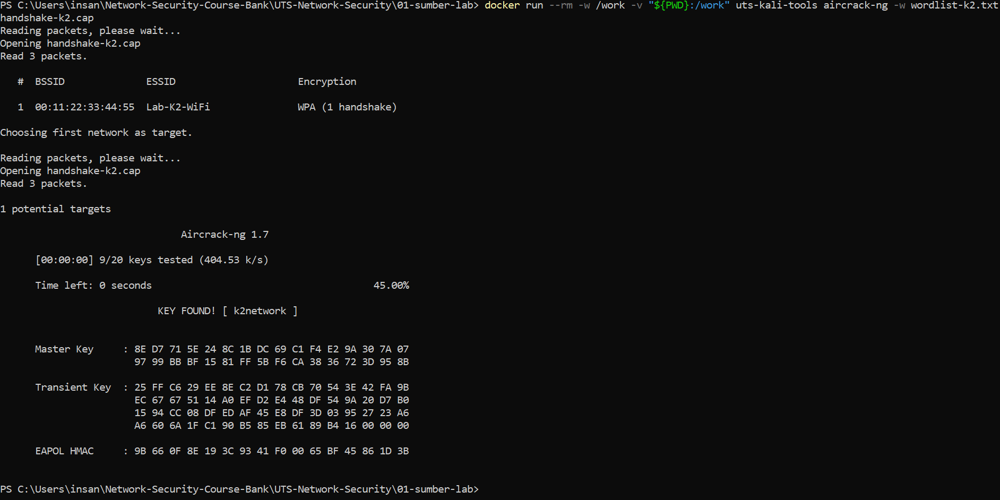

# TUGAS 4 (PERTEMUAN 4)
# ANALISIS HANDSHAKE WPA2 — KASUS 2 (K2)

## IDENTITAS DAN PARAMETER LAB

| Keterangan | Informasi |
|---|---|
| Nama | Insanul Firas |
| NIM | 24552011147 |
| Mata Kuliah | Keamanan Jaringan (Security Network) |
| Pertemuan | Pertemuan 4 |
| Tugas | Analisis Handshake WPA2 |
| Kasus | Kasus 2 (`k2`) |
| Sistem Operasi Host | Windows |
| Terminal | Windows PowerShell |
| Lingkungan Pengujian | Docker Desktop |
| Docker Image | `uts-kali-tools` |
| Tools Pengujian | Aircrack-ng 1.7 |
| File Capture | `handshake-k2.cap` |
| File Wordlist | `wordlist-k2.txt` |

---

# 1. PENDAHULUAN

## 1.1 Tujuan Praktikum

Praktikum ini bertujuan untuk memahami mekanisme autentikasi WPA2 melalui proses 4-Way Handshake serta melakukan analisis terhadap file hasil tangkapan komunikasi jaringan nirkabel (*wireless capture*).

Pengujian dilakukan menggunakan tools Aircrack-ng yang berjalan di dalam container Docker. File capture dan wordlist yang digunakan merupakan file yang disediakan oleh penguji melalui repository bank soal.

Melalui praktikum ini, dilakukan beberapa kegiatan, yaitu:

1. Memeriksa validitas file capture yang digunakan dalam pengujian.
2. Mengidentifikasi informasi jaringan wireless yang terdapat dalam file capture.
3. Menganalisis keberadaan paket EAPOL yang berkaitan dengan proses WPA2 4-Way Handshake.
4. Melakukan pengujian kata sandi menggunakan metode *dictionary attack* secara offline.
5. Mengidentifikasi kata sandi berdasarkan hasil pencocokan dengan informasi handshake.
6. Memahami fungsi dan proses pertukaran empat pesan dalam WPA2 4-Way Handshake.

## 1.2 Konsep Dasar WPA2 Handshake

WPA2 merupakan protokol keamanan jaringan nirkabel yang digunakan untuk melindungi komunikasi antara perangkat klien dan Access Point (AP).

Dalam mekanisme WPA2-Personal atau WPA2-PSK, proses autentikasi menggunakan kata sandi jaringan yang menjadi dasar pembentukan kunci kriptografi.

Salah satu mekanisme penting dalam proses tersebut adalah **4-Way Handshake**. Proses ini melibatkan pertukaran empat pesan antara Access Point dan perangkat klien untuk membentuk serta mengonfirmasi kunci enkripsi yang digunakan dalam komunikasi.

Informasi dari proses handshake dapat digunakan untuk melakukan pengujian kata sandi secara offline. Pengujian dilakukan dengan mencoba sejumlah kandidat kata sandi dari sebuah wordlist, kemudian mencocokkan hasil perhitungan kriptografinya dengan informasi autentikasi yang tersimpan dalam file capture.

Pada praktikum ini, proses analisis dilakukan menggunakan Aircrack-ng 1.7.

---

# 2. DIAGNOSIS AWAL FILE CAPTURE

## 2.1 Pemeriksaan File Awal

Sebelum melakukan analisis handshake, file `handshake-k2.cap` dan `wordlist-k2.txt` yang disediakan dari repository bank soal diperiksa terlebih dahulu.

Pemeriksaan awal dilakukan untuk memastikan bahwa file capture memiliki struktur yang sesuai dengan format tangkapan jaringan wireless dan dapat dibaca oleh Aircrack-ng.

Pada percobaan pertama, perintah analisis dijalankan menggunakan:

```powershell
docker run --rm -v "$PWD":/work -w /work uts-kali-tools aircrack-ng -w wordlist-k2.txt handshake-k2.cap
```

Namun, proses analisis awal menghasilkan pesan kesalahan sebagai berikut:

```text
Reading packets, please wait...

This file is not a regular 802.11 (wireless) capture.

Opening handshake-k2.cap
Read 0 packets.

No networks found, exiting.
```

Berdasarkan hasil tersebut, Aircrack-ng tidak dapat mengenali file sebagai capture jaringan wireless IEEE 802.11.

Selain itu, tidak terdapat paket yang berhasil dibaca sehingga informasi jaringan dan handshake tidak dapat dianalisis.

## 2.2 Pemeriksaan Struktur File

Untuk mengetahui penyebab kegagalan, dilakukan pemeriksaan lanjutan menggunakan perintah `file` dan `tcpdump`.

Perintah yang digunakan:

```bash
file handshake-k2.cap
```

Hasil pemeriksaan:

```text
handshake-k2.cap: pcap capture file, microsecond ts (little-endian) - version 2.4 (Ethernet, capture length 65535)
```

Selanjutnya dilakukan pemeriksaan isi paket menggunakan:

```bash
tcpdump -r handshake-k2.cap -nn
```

Hasil pemeriksaan:

```text
reading from file handshake-k2.cap, link-type EN10MB (Ethernet), snapshot length 65535

tcpdump: pcap_loop: invalid packet capture length 2113755494, bigger than snaplen of 65535
```

## 2.3 Analisis Hasil Diagnosis

Berdasarkan kedua pemeriksaan tersebut, ditemukan beberapa permasalahan pada file capture awal.

**1. Ketidaksesuaian Link-Layer Type**

File memiliki struktur dasar pcap yang dapat dikenali, tetapi tipe link-layer tercatat sebagai Ethernet (`EN10MB`).

Sementara itu, Aircrack-ng membutuhkan informasi frame wireless IEEE 802.11 agar dapat menganalisis jaringan wireless dan paket EAPOL yang berkaitan dengan proses WPA/WPA2 handshake.

**2. Kerusakan Informasi Panjang Paket**

Hasil pemeriksaan `tcpdump` menunjukkan bahwa record paket pertama memiliki nilai panjang paket yang tidak valid, yaitu sekitar 2,1 GB.

Nilai tersebut melebihi ukuran snapshot yang ditentukan sebesar 65.535 byte. Akibatnya, paket tidak dapat diproses dengan benar.

**3. Tidak Ditemukan Informasi Handshake**

Karena struktur capture tidak sesuai dan paket tidak dapat dibaca, Aircrack-ng tidak berhasil menemukan jaringan maupun informasi handshake pada file awal.

**4. Indikasi File Template atau Placeholder**

Berdasarkan pemeriksaan tambahan terhadap `CASES-CHECKLIST.md` pada repository sumber, file `handshake-k1.cap` sampai `handshake-k10.cap` masih ditandai dengan status `❌ PERLU DIBUAT`.

Hal tersebut menjadi indikasi bahwa file capture yang tersedia pada repository merupakan placeholder atau belum merupakan hasil capture wireless yang valid.

## 2.4 Kesimpulan Diagnosis Awal

Berdasarkan hasil pemeriksaan, file capture awal belum dapat digunakan untuk analisis WPA2 karena terdapat ketidaksesuaian tipe link-layer dan kerusakan pada informasi paket.

Oleh karena itu, diperlukan capture pengganti yang memiliki struktur frame IEEE 802.11 serta informasi EAPOL yang dapat digunakan untuk proses analisis handshake.

---

# 3. PEMBUATAN CAPTURE PENGGANTI

## 3.1 Tujuan

Setelah file capture awal diketahui tidak valid, dilakukan pembuatan capture pengganti dengan nama `handshake-k2-demo.cap`.

Capture pengganti dibuat menggunakan skrip Python bernama `make_handshake.py` dengan tujuan menyediakan frame wireless yang memiliki struktur sesuai kebutuhan analisis WPA2 4-Way Handshake.

Capture tersebut terdiri dari tiga frame utama, yaitu:

1. Satu frame Beacon.
2. Satu frame EAPOL Message 1.
3. Satu frame EAPOL Message 2.

Frame Beacon digunakan untuk memberikan informasi mengenai jaringan wireless, sedangkan kedua frame EAPOL digunakan sebagai bagian dari proses autentikasi WPA2.

## 3.2 Parameter Capture

Capture pengganti dibuat menggunakan parameter berikut:

| Parameter | Nilai |
|---|---|
| SSID | `Lab-K2-WiFi` |
| BSSID (Access Point) | `00:11:22:33:44:55` |
| MAC Client | `66:77:88:99:aa:bb` |
| Jumlah Frame | 3 |
| Jenis Frame | 1 Beacon dan 2 EAPOL |
| Password Pengujian | `k2network` |

Kata sandi `k2network` merupakan kandidat yang tersedia dalam file `wordlist-k2.txt` dan digunakan untuk menguji keberhasilan proses pencocokan handshake.

## 3.3 Perhitungan Kriptografi WPA2

Agar proses pengujian menghasilkan informasi autentikasi yang sesuai, nilai ANonce, SNonce, dan MIC pada capture tidak dibuat sebagai kumpulan byte acak yang tidak saling berhubungan.

Nilai-nilai tersebut dihitung berdasarkan mekanisme kriptografi WPA2-PSK.

Proses pembentukan kunci secara umum melibatkan tahapan berikut:

**1. Pembentukan Pairwise Master Key (PMK)**

PMK dibentuk dari passphrase dan SSID menggunakan algoritma PBKDF2-HMAC-SHA1 dengan 4096 iterasi dan panjang keluaran 32 byte.

```text
PMK = PBKDF2-HMAC-SHA1(
    passphrase,
    SSID,
    4096 iterations,
    32 bytes
)
```

**2. Pembentukan Pairwise Transient Key (PTK)**

PTK dibentuk berdasarkan PMK, alamat MAC kedua perangkat, serta nilai nonce yang dihasilkan oleh Access Point dan client.

```text
PTK = PRF-384(
    PMK,
    "Pairwise key expansion",
    MAC_min || MAC_max || Nonce_min || Nonce_max
)
```

**3. Pembentukan Key Confirmation Key (KCK)**

KCK merupakan bagian awal dari PTK yang digunakan untuk menghitung Message Integrity Code.

```text
KCK = PTK[0:16]
```

**4. Perhitungan Message Integrity Code (MIC)**

MIC dihitung menggunakan KCK dan isi frame EAPOL Message 2 dengan field MIC dikosongkan atau diatur menjadi nol selama proses perhitungan.

```text
MIC = HMAC-SHA1(KCK, EAPOL Message 2)[0:16]
```

Dengan mekanisme tersebut, informasi autentikasi dalam capture pengganti memiliki hubungan kriptografi yang sesuai dengan parameter pengujian.

## 3.4 Hasil Pembuatan Capture

Capture pengganti disimpan dengan nama:

```text
handshake-k2-demo.cap
```

File tersebut kemudian digunakan sebagai capture pengujian dengan nama `handshake-k2.cap` pada proses analisis.

Dengan demikian, analisis selanjutnya menggunakan capture pengganti yang telah disiapkan, bukan file awal yang mengalami kerusakan struktur.

---

# 4. PROSES ANALISIS HANDSHAKE MENGGUNAKAN AIRCRACK-NG

## 4.1 Tujuan

Tahap ini merupakan proses utama pengujian kata sandi WPA2 menggunakan Aircrack-ng.

Pengujian dilakukan dengan metode *dictionary attack*, yaitu mencoba kandidat kata sandi yang terdapat dalam file wordlist dan melakukan pencocokan berdasarkan informasi autentikasi yang tersedia dalam capture.

Dalam praktikum ini digunakan dua file utama:

- `handshake-k2.cap`: file capture yang berisi informasi jaringan wireless dan EAPOL handshake.
- `wordlist-k2.txt`: daftar kandidat kata sandi yang digunakan dalam proses pengujian.

Seluruh proses dijalankan melalui Docker agar tools Aircrack-ng dapat digunakan tanpa perlu melakukan instalasi langsung pada sistem operasi Windows.

## 4.2 Perintah yang Digunakan

Perintah yang dijalankan melalui Windows PowerShell adalah:

```powershell
docker run --rm -v "${PWD}":/work uts-kali-tools aircrack-ng -w wordlist-k2.txt handshake-k2.cap
```

Penjelasan parameter:

| Parameter | Fungsi |
|---|---|
| `docker run` | Menjalankan container Docker baru |
| `--rm` | Menghapus container secara otomatis setelah proses selesai |
| `-v "${PWD}":/work` | Menghubungkan direktori kerja PowerShell ke direktori `/work` di dalam container |
| `uts-kali-tools` | Docker Image yang digunakan |
| `aircrack-ng` | Menjalankan aplikasi analisis WPA/WPA2 |
| `-w wordlist-k2.txt` | Menentukan file wordlist yang digunakan |
| `handshake-k2.cap` | Menentukan file capture yang dianalisis |

Direktori kerja host dihubungkan ke container menggunakan volume Docker sehingga file capture dan wordlist dapat diakses dari lingkungan pengujian.

## 4.3 Identifikasi Jaringan Wireless

Setelah perintah dijalankan, Aircrack-ng melakukan pembacaan terhadap file capture.

Hasil identifikasi awal:

```text
Reading packets, please wait...

Opening handshake-k2.cap

Read 3 packets.
```

Aircrack-ng kemudian menampilkan informasi jaringan yang berhasil ditemukan:

```text
#  BSSID              ESSID             Encryption

1  00:11:22:33:44:55  Lab-K2-WiFi       WPA (1 handshake)
```

Berdasarkan hasil tersebut, dapat diketahui bahwa:

- **BSSID:** `00:11:22:33:44:55`
- **ESSID:** `Lab-K2-WiFi`
- **Encryption:** WPA (1 handshake)
- **Jumlah paket yang dibaca:** 3 paket
- **Jumlah target potensial:** 1 jaringan

Meskipun tampilan Aircrack-ng menggunakan label `WPA`, analisis praktikum ini berfokus pada mekanisme WPA2 4-Way Handshake yang menjadi materi pengujian.

Informasi tersebut menunjukkan bahwa Aircrack-ng berhasil membaca capture pengganti dan mengenali satu jaringan wireless yang memiliki informasi handshake.

## 4.4 Proses Pengujian Wordlist

Setelah jaringan berhasil diidentifikasi, Aircrack-ng melanjutkan proses pengujian terhadap kandidat kata sandi dalam file `wordlist-k2.txt`.

Setiap kandidat diuji berdasarkan mekanisme pembentukan kunci dan pencocokan informasi autentikasi yang terdapat pada handshake.

Proses ini dilakukan secara offline karena tidak memerlukan koneksi langsung ke Access Point untuk mencoba setiap kandidat kata sandi.

Dengan demikian, proses analisis bergantung pada informasi yang tersimpan dalam file capture dan daftar kata sandi yang disediakan.

## 4.5 Hasil Pengujian

Berdasarkan hasil eksekusi Aircrack-ng 1.7, diperoleh output sebagai berikut:

```text
Reading packets, please wait...

Opening handshake-k2.cap

Read 3 packets.

#  BSSID              ESSID             Encryption

1  00:11:22:33:44:55  Lab-K2-WiFi       WPA (1 handshake)

Choosing first network as target.

Reading packets, please wait...

Opening handshake-k2.cap

Read 3 packets.

1 potential targets


                         Aircrack-ng 1.7


[00:00:00] 9/20 keys tested (404.53 k/s)

Time left: 0 seconds                         45.00%


                  KEY FOUND! [ k2network ]


Master Key    : 8E D7 71 5E 24 8C 1B DC 69 C1 F4 E2 9A 30 7A 07
                97 99 BB BF 15 81 FF 5B F6 CA 38 36 72 3D 95 8B


Transient Key : 25 FF C6 29 EE 8E C2 D1 78 CB 70 54 3E 42 FA 9B
                EC 67 67 51 14 A0 EF D2 E4 48 DF 54 9A 20 D7 B0
                15 94 CC 08 DF ED AF 45 E8 DF 3D 03 95 27 23 A6
                A6 60 6A 1F C1 90 B5 85 EB 61 89 B4 16 00 00 00


EAPOL HMAC   : 9B 66 0F 8E 19 3C 93 41 F0 00 65 BF 45 86 1D 3B
```

<badge color="success">KEY FOUND</badge>

**Kata sandi yang berhasil ditemukan adalah `k2network`.**

Hasil tersebut menunjukkan bahwa salah satu kandidat kata sandi dalam `wordlist-k2.txt` berhasil menghasilkan nilai autentikasi yang sesuai dengan informasi handshake pada file capture.

Aircrack-ng melaporkan bahwa 9 dari 20 kandidat telah diuji dengan kecepatan sekitar 404,53 kunci per detik ketika kata sandi berhasil ditemukan.

## 4.6 Analisis Hasil

Berdasarkan output yang diperoleh, terdapat beberapa hal penting yang dapat dianalisis.

**1. Capture berhasil dibaca**

Aircrack-ng berhasil membaca tiga paket yang terdapat dalam `handshake-k2.cap`. Hal ini menunjukkan bahwa capture pengganti dapat diproses oleh tools yang digunakan.

**2. Jaringan wireless berhasil diidentifikasi**

Sistem berhasil mengenali jaringan dengan ESSID `Lab-K2-WiFi` dan BSSID `00:11:22:33:44:55`.

**3. Informasi handshake berhasil dikenali**

Aircrack-ng mendeteksi satu informasi handshake yang dapat digunakan untuk proses pengujian kata sandi.

**4. Kata sandi berhasil ditemukan**

Pesan `KEY FOUND! [ k2network ]` menunjukkan bahwa Aircrack-ng berhasil menemukan kandidat kata sandi yang sesuai dengan informasi autentikasi dalam capture.

**5. Proses pengujian berhasil diselesaikan**

Pengujian dilakukan dengan kecepatan sekitar 404,53 kunci per detik dan kata sandi berhasil ditemukan sebelum seluruh kandidat dalam wordlist perlu diuji.

Dengan demikian, pengujian dictionary attack pada capture pengganti dinyatakan berhasil.

## 4.7 Dokumentasi Screenshot



**Gambar 1.** Hasil analisis file `handshake-k2.cap` menggunakan Aircrack-ng 1.7. Terlihat bahwa sistem berhasil membaca tiga paket, mengidentifikasi jaringan `Lab-K2-WiFi`, mendeteksi satu handshake, serta menemukan kata sandi `k2network`.

---

# 5. PENJELASAN WPA2 FOUR-WAY HANDSHAKE

## 5.1 Pengertian Four-Way Handshake

WPA2 4-Way Handshake merupakan proses pertukaran empat pesan antara Access Point (AP) dan perangkat client yang bertujuan membentuk serta mengonfirmasi kunci enkripsi untuk komunikasi jaringan wireless.

Proses ini dilakukan setelah perangkat client memiliki Pairwise Master Key (PMK) yang berasal dari proses autentikasi WPA2-Personal.

Dalam mekanisme WPA2-PSK, kata sandi jaringan tidak dikirimkan secara langsung melalui udara ketika proses handshake berlangsung.

Sebaliknya, kata sandi digunakan untuk membentuk PMK, yang selanjutnya digunakan bersama nilai nonce dan alamat MAC kedua perangkat untuk menghasilkan Pairwise Transient Key (PTK).

Proses 4-Way Handshake terdiri dari empat pesan yang dikirimkan secara bergantian antara Access Point dan client.

## 5.2 Message 1 — Access Point ke Client

**Arah komunikasi: AP → Client**

Pada tahap pertama, Access Point mengirimkan pesan pertama kepada perangkat client.

Pesan ini berisi nilai ANonce (*Authenticator Nonce*), yaitu nilai acak yang dihasilkan oleh Access Point.

ANonce digunakan oleh client bersama informasi lainnya untuk membentuk Pairwise Transient Key (PTK).

Setelah menerima Message 1, client menghasilkan SNonce (*Supplicant Nonce*) miliknya sendiri dan menggunakan kedua nilai nonce tersebut bersama PMK serta alamat MAC kedua perangkat untuk menghitung PTK.

PTK merupakan kunci sementara yang digunakan untuk melindungi komunikasi antara Access Point dan client.

**Informasi penting:**
- Pengirim: Access Point.
- Penerima: Client.
- Informasi utama: ANonce.
- Fungsi: Memberikan nilai nonce dari Access Point sebagai bagian dari proses pembentukan PTK.

## 5.3 Message 2 — Client ke Access Point

**Arah komunikasi: Client → AP**

Setelah menerima Message 1, client mengirimkan Message 2 kepada Access Point.

Pesan ini berisi nilai SNonce yang dihasilkan oleh client serta MIC (*Message Integrity Code*).

MIC dihitung menggunakan bagian dari PTK yang disebut KCK (*Key Confirmation Key*).

Melalui MIC, Access Point dapat memverifikasi bahwa client memiliki informasi kunci yang benar dan pesan yang dikirimkan tidak mengalami perubahan tanpa terdeteksi.

Pada tahap inilah informasi handshake dapat digunakan untuk pengujian kata sandi secara offline.

Aircrack-ng dapat mencoba kandidat kata sandi dari wordlist, membentuk PMK dan PTK untuk setiap kandidat, kemudian menghitung MIC dan membandingkannya dengan MIC yang terdapat pada informasi EAPOL.

Apabila hasil perhitungan cocok, kandidat tersebut dinyatakan sesuai dengan informasi autentikasi yang dianalisis.

**Informasi penting:**
- Pengirim: Client.
- Penerima: Access Point.
- Informasi utama: SNonce dan MIC.
- Fungsi: Memberikan nilai nonce client dan membuktikan kepemilikan kunci yang sesuai.

## 5.4 Message 3 — Access Point ke Client

**Arah komunikasi: AP → Client**

Setelah berhasil memverifikasi MIC dari Message 2, Access Point mengirimkan Message 3 kepada client.

Pesan ini berisi informasi konfirmasi mengenai kunci yang akan digunakan dalam komunikasi.

Access Point juga mengirimkan GTK (*Group Temporal Key*) yang telah dilindungi menggunakan mekanisme enkripsi berdasarkan kunci yang diturunkan dari PTK.

GTK digunakan untuk melindungi komunikasi broadcast dan multicast pada jaringan wireless.

Selain itu, Message 3 memiliki MIC untuk menjaga integritas pesan yang dikirimkan.

Pada tahap ini, Access Point juga memberikan instruksi kepada client untuk memasang kunci enkripsi yang telah disepakati.

**Informasi penting:**
- Pengirim: Access Point.
- Penerima: Client.
- Informasi utama: Konfirmasi PTK, GTK terenkripsi, dan MIC.
- Fungsi: Mengirimkan informasi kunci grup dan menginstruksikan pemasangan kunci enkripsi.

## 5.5 Message 4 — Client ke Access Point

**Arah komunikasi: Client → AP**

Message 4 merupakan pesan terakhir dalam proses WPA2 4-Way Handshake.

Pada tahap ini, client mengirimkan pesan konfirmasi kepada Access Point untuk menunjukkan bahwa informasi kunci telah diterima dan proses pemasangan kunci telah diselesaikan.

Pesan ini berfungsi sebagai acknowledgment atau konfirmasi akhir dari client.

Setelah seluruh pertukaran pesan selesai, Access Point dan client dapat menggunakan kunci enkripsi yang telah dibentuk untuk melindungi komunikasi jaringan.

PTK digunakan untuk komunikasi unicast antara Access Point dan client, sedangkan GTK digunakan untuk komunikasi broadcast dan multicast.

**Informasi penting:**
- Pengirim: Client.
- Penerima: Access Point.
- Informasi utama: Konfirmasi penerimaan dan pemasangan kunci.
- Fungsi: Menyelesaikan proses 4-Way Handshake.

## 5.6 Ringkasan Empat Langkah Handshake

| Tahap | Pengirim | Penerima | Informasi Utama | Fungsi |
|---|---|---|---|---|
| Message 1 | AP | Client | ANonce | Memulai proses pembentukan PTK |
| Message 2 | Client | AP | SNonce dan MIC | Mengirim nonce client dan bukti kepemilikan kunci |
| Message 3 | AP | Client | GTK terenkripsi dan MIC | Mengirim informasi kunci grup dan instruksi pemasangan kunci |
| Message 4 | Client | AP | Konfirmasi | Menyelesaikan proses handshake |

## 5.7 Hubungan Four-Way Handshake dengan Pengujian Aircrack-ng

Dalam pengujian WPA2 secara offline, informasi dari pertukaran EAPOL dapat digunakan untuk menguji kandidat kata sandi.

Informasi penting yang digunakan meliputi:

1. ANonce yang dihasilkan Access Point.
2. SNonce yang dihasilkan client.
3. Alamat MAC Access Point dan client.
4. MIC yang digunakan untuk memverifikasi integritas pesan.

Aircrack-ng menggunakan informasi tersebut untuk melakukan perhitungan kriptografi terhadap kandidat kata sandi dari wordlist.

Apabila kandidat kata sandi menghasilkan nilai autentikasi yang cocok dengan informasi pada capture, maka kata sandi tersebut dinyatakan berhasil ditemukan.

Pada praktikum ini, proses tersebut menghasilkan kata sandi:

```text
k2network
```

**Catatan:** Pengujian offline tidak memerlukan proses login berulang kali ke Access Point. Analisis dilakukan berdasarkan informasi handshake yang telah tersimpan di dalam file capture.

---

# 6. ANALISIS KEAMANAN DAN HASIL PRAKTIKUM

## 6.1 Analisis Keamanan WPA2

Berdasarkan praktikum yang telah dilakukan, dapat diketahui bahwa keamanan jaringan WPA2-Personal sangat bergantung pada kekuatan kata sandi yang digunakan.

Meskipun WPA2 menggunakan mekanisme kriptografi untuk melindungi proses autentikasi, kata sandi yang lemah atau mudah ditebak tetap berisiko ditemukan melalui pengujian kandidat secara offline apabila informasi handshake tersedia.

Penggunaan wordlist memungkinkan proses pengujian dilakukan secara sistematis terhadap sejumlah kandidat kata sandi.

Pada praktikum ini, kata sandi `k2network` berhasil ditemukan karena terdapat dalam daftar kandidat yang digunakan.

Hal ini menunjukkan bahwa penggunaan kata sandi yang mudah ditebak atau telah tersedia dalam daftar kata sandi umum dapat meningkatkan risiko terhadap keamanan jaringan wireless.

## 6.2 Risiko Keamanan

Beberapa risiko keamanan yang dapat diidentifikasi berdasarkan hasil praktikum adalah:

**1. Penggunaan Kata Sandi Lemah**

Kata sandi yang pendek, sederhana, atau mudah ditebak memiliki risiko lebih tinggi untuk ditemukan melalui metode dictionary attack.

**2. Kebocoran Informasi Handshake**

Apabila informasi handshake berhasil diperoleh oleh pihak yang tidak berwenang, informasi tersebut dapat digunakan sebagai dasar untuk melakukan pengujian kata sandi secara offline.

**3. Serangan Dictionary Attack**

Penggunaan wordlist memungkinkan penyerang mencoba berbagai kandidat kata sandi tanpa harus melakukan autentikasi langsung ke Access Point.

**4. Pengambilalihan Akses Jaringan**

Apabila kata sandi jaringan berhasil ditemukan, pihak yang tidak berwenang berpotensi memperoleh akses ke jaringan wireless sesuai dengan hak akses yang diberikan oleh jaringan tersebut.

## 6.3 Rekomendasi Keamanan

Untuk mengurangi risiko serangan terhadap jaringan wireless, beberapa langkah pengamanan yang dapat diterapkan adalah:

1. Menggunakan kata sandi dengan panjang yang memadai dan kombinasi karakter yang kuat.
2. Menghindari penggunaan kata sandi yang berkaitan dengan nama, tanggal lahir, atau informasi pribadi.
3. Mengganti kata sandi jaringan secara berkala apabila terdapat indikasi kebocoran.
4. Menggunakan WPA2-AES atau WPA3 apabila perangkat mendukungnya.
5. Menonaktifkan WPS apabila tidak diperlukan.
6. Memperbarui firmware Access Point secara berkala.
7. Membatasi akses ke jaringan wireless hanya kepada perangkat yang memiliki izin.
8. Melakukan pemantauan terhadap perangkat yang terhubung ke jaringan.

---

# 7. KESIMPULAN

Berdasarkan pelaksanaan Tugas 4 (Pertemuan 4) mengenai Analisis Handshake WPA2 pada Kasus 2 (`k2`), dapat disimpulkan bahwa proses analisis handshake berhasil dilakukan menggunakan Aircrack-ng 1.7 melalui lingkungan Docker.

Pada tahap awal, file `handshake-k2.cap` yang tersedia dari repository bank soal tidak dapat dianalisis karena memiliki ketidaksesuaian struktur capture. Pemeriksaan menggunakan perintah `file` dan `tcpdump` menunjukkan bahwa file tersebut menggunakan tipe link-layer Ethernet serta memiliki informasi panjang paket yang tidak valid.

Untuk melanjutkan pengujian, dibuat capture pengganti menggunakan skrip Python `make_handshake.py`. Capture tersebut disusun menggunakan frame Beacon dan EAPOL yang memiliki parameter kriptografi sesuai mekanisme WPA2-PSK.

Setelah capture pengganti digunakan, Aircrack-ng berhasil membaca tiga paket dan mengidentifikasi jaringan wireless dengan ESSID `Lab-K2-WiFi` serta BSSID `00:11:22:33:44:55`.

Hasil pengujian menunjukkan bahwa terdapat satu informasi handshake yang dapat dianalisis. Melalui proses dictionary attack menggunakan `wordlist-k2.txt`, Aircrack-ng berhasil menemukan kata sandi:

**`k2network`**

Keberhasilan tersebut dibuktikan melalui pesan `KEY FOUND!` pada hasil eksekusi Aircrack-ng.

Selain proses pengujian kata sandi, praktikum ini juga memberikan pemahaman mengenai empat tahapan WPA2 4-Way Handshake, yaitu Message 1, Message 2, Message 3, dan Message 4.

Dari keseluruhan pengujian, dapat dipahami bahwa keamanan jaringan wireless tidak hanya bergantung pada protokol enkripsi yang digunakan, tetapi juga pada kekuatan kata sandi dan pengelolaan keamanan jaringan.

Oleh karena itu, penggunaan kata sandi yang kuat, pembaruan perangkat jaringan, serta pemantauan keamanan secara berkala merupakan langkah penting untuk mengurangi risiko akses tidak sah terhadap jaringan wireless.

---

# 8. LAMPIRAN DAN DOKUMENTASI

## 8.1 Daftar File yang Digunakan

| No. | Nama File | Keterangan |
|---|---|---|
| 1 | `handshake-k2.cap` | File capture yang digunakan dalam analisis akhir |
| 2 | `handshake-k2-demo.cap` | Capture pengganti yang dibuat untuk pengujian |
| 3 | `wordlist-k2.txt` | Daftar kandidat kata sandi yang disediakan penguji |
| 4 | `make_handshake.py` | Skrip Python untuk membuat capture pengganti |
| 5 | `hasil.md` | Dokumentasi hasil praktikum |

## 8.2 Dokumentasi Screenshot


**Gambar 1.** Dokumentasi hasil pengujian menggunakan Aircrack-ng 1.7. Hasil menunjukkan bahwa file capture berhasil dibaca, jaringan wireless berhasil diidentifikasi, dan kata sandi `k2network` berhasil ditemukan.
