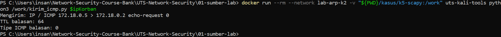

# TUGAS 5 (PERTEMUAN 5)
# ICMP DENGAN SCAPY — KASUS 2 (K2)

## IDENTITAS DAN PARAMETER LAB

| Keterangan | Informasi |
|---|---|
| Nama | Insanul Firas |
| NIM | 24552011147 |
| Mata Kuliah | Keamanan Jaringan (Security Network) |
| Pertemuan | Pertemuan 5 |
| Tugas | ICMP dengan Scapy |
| Kasus | Kasus 2 (`k2`) |
| Sistem Operasi Host | Windows |
| Terminal | Windows PowerShell |
| Lingkungan Pengujian | Docker Desktop |
| Docker Image | `uts-kali-tools` |
| Library | Scapy |
| Jaringan Docker | `lab-arp-k2` |
| Script Pengujian | `kirim_icmp.py` |

---

# 1. PENDAHULUAN

## 1.1 Tujuan Praktikum

Praktikum ini bertujuan untuk memahami mekanisme komunikasi menggunakan protokol Internet Control Message Protocol (ICMP) serta melakukan pengiriman dan analisis paket ICMP menggunakan library Scapy.

Scapy merupakan salah satu library Python yang digunakan untuk membuat, mengirimkan, menerima, dan menganalisis paket jaringan. Dengan menggunakan Scapy, pengguna dapat membentuk paket secara manual serta menentukan berbagai parameter protokol yang digunakan dalam komunikasi jaringan.

Pada praktikum ini, Scapy digunakan untuk mengirimkan paket ICMP Echo Request dari sebuah container Docker menuju container korban. Selanjutnya, respons yang diterima dianalisis berdasarkan nilai Time To Live (TTL) dan tipe pesan ICMP.

Selain melakukan pengujian komunikasi ICMP, praktikum ini juga membahas konsep Smurf Attack, yaitu salah satu jenis serangan Denial of Service (DoS) berbasis ICMP yang memanfaatkan teknik IP spoofing dan broadcast untuk menghasilkan efek amplifikasi lalu lintas jaringan.

Adapun tujuan khusus praktikum ini adalah:

1. Memahami fungsi protokol ICMP dalam komunikasi jaringan.
2. Memahami penggunaan library Scapy untuk membentuk dan mengirimkan paket ICMP.
3. Melakukan pengujian konektivitas antara container pengirim dan container korban.
4. Mengidentifikasi nilai TTL pada paket ICMP balasan.
5. Mengidentifikasi tipe pesan ICMP yang diterima.
6. Memahami mekanisme kerja Smurf Attack dan dampaknya terhadap jaringan.
7. Mengetahui langkah mitigasi untuk mengurangi risiko serangan berbasis ICMP.

## 1.2 Konsep Dasar ICMP

Internet Control Message Protocol (ICMP) merupakan protokol jaringan yang digunakan untuk mengirimkan pesan kontrol, informasi, dan laporan kesalahan dalam komunikasi IP.

ICMP sering digunakan dalam proses pemeriksaan konektivitas jaringan melalui utilitas seperti `ping` dan `traceroute`.

Salah satu jenis pesan ICMP yang umum digunakan adalah Echo Request dan Echo Reply.

- **ICMP Echo Request:** pesan yang dikirimkan oleh perangkat sumber untuk meminta respons dari perangkat tujuan.
- **ICMP Echo Reply:** pesan balasan yang dikirimkan oleh perangkat tujuan setelah menerima Echo Request.

Dalam komunikasi normal, perangkat sumber mengirimkan Echo Request kepada perangkat tujuan. Apabila perangkat tujuan menerima dan memproses permintaan tersebut, perangkat akan mengirimkan Echo Reply kembali kepada sumber.

Melalui proses ini, administrator dapat mengetahui apakah suatu perangkat dapat dijangkau melalui jaringan IP.

## 1.3 Konsep Dasar Scapy

Scapy merupakan library Python yang memungkinkan pengguna melakukan manipulasi paket jaringan secara fleksibel.

Scapy dapat digunakan untuk:

- Membuat paket IP dan ICMP secara manual.
- Menentukan alamat IP sumber dan tujuan.
- Mengirimkan paket melalui interface jaringan.
- Menerima dan membaca respons paket.
- Menganalisis informasi protokol yang terdapat pada paket jaringan.

Pada praktikum ini, Scapy digunakan melalui script `kirim_icmp.py` yang telah disediakan dalam direktori `kasus/k5-scapy`.

---

# 2. PERSIAPAN LINGKUNGAN PENGUJIAN

## 2.1 Topologi Pengujian

Pengujian dilakukan menggunakan lingkungan Docker yang telah dibuat pada praktikum sebelumnya.

Jaringan Docker yang digunakan bernama `lab-arp-k2`. Container korban yang digunakan pada pengujian sebelumnya memiliki alamat IP `172.18.0.2`.

Sementara itu, perintah pengujian dijalankan melalui container sementara menggunakan Docker Image `uts-kali-tools`.

Berikut merupakan informasi perangkat yang terlibat dalam pengujian berdasarkan hasil terminal:

| Perangkat | Identitas | IP Address | Peran |
|---|---|---|---|
| Container Pengirim | Container sementara Docker | `172.18.0.5` | Mengirim paket ICMP |
| Container Korban | `korban-k2` | `172.18.0.2` | Menerima dan membalas paket ICMP |

**Keterangan:**

1. Container pengirim menjalankan script Python `kirim_icmp.py` menggunakan Scapy.
2. Container korban merupakan tujuan pengiriman paket ICMP.
3. Kedua container terhubung melalui jaringan Docker `lab-arp-k2`.

Alamat IP `172.18.0.5` merupakan alamat sumber yang terlihat pada output pengujian. Karena container pengirim dijalankan tanpa nama khusus dan menggunakan opsi `--rm`, container tersebut bersifat sementara dan akan dihapus setelah proses selesai.

## 2.2 Persiapan File Praktikum

File yang digunakan dalam praktikum ini adalah:

| No. | Nama File | Fungsi |
|---|---|---|
| 1 | `kirim_icmp.py` | Script Python untuk mengirim paket ICMP menggunakan Scapy |
| 2 | `hasil.md` | Dokumentasi hasil praktikum |
| 3 | `01.png` | Screenshot hasil pengujian ICMP |

Script `kirim_icmp.py` berada di dalam direktori:

```text
kasus/k5-scapy/kirim_icmp.py
```

Direktori tersebut dihubungkan ke container Docker melalui volume agar script dapat dijalankan dari dalam lingkungan pengujian.

## 2.3 Pemeriksaan Parameter Pengujian

Sebelum menjalankan script, beberapa parameter harus diketahui terlebih dahulu, yaitu:

- Jaringan Docker yang digunakan: `lab-arp-k2`.
- Alamat IP korban: `172.18.0.2`.
- Direktori script: `kasus/k5-scapy`.
- Docker Image: `uts-kali-tools`.

Alamat IP korban diperoleh dari konfigurasi container yang telah dibuat pada praktikum sebelumnya.

Pada Windows PowerShell, alamat IP korban disimpan dalam variabel `$ipKorban` sehingga dapat digunakan kembali sebagai parameter ketika menjalankan script.

---

# 3. IMPLEMENTASI PENGIRIMAN ICMP MENGGUNAKAN SCAPY

## 3.1 Tujuan

Tahap ini merupakan proses utama praktikum, yaitu melakukan pengiriman paket ICMP Echo Request menggunakan Scapy dari container pengirim menuju container korban.

Pengujian dilakukan untuk memastikan bahwa paket ICMP dapat dikirimkan melalui jaringan Docker dan perangkat tujuan dapat memberikan respons.

Berbeda dengan perintah `ping` biasa yang menggunakan utilitas sistem operasi, pengujian ini menggunakan script Python sehingga proses pembentukan dan pengiriman paket dilakukan melalui library Scapy.

## 3.2 Perintah yang Digunakan

Perintah yang dijalankan melalui Windows PowerShell adalah:

```powershell
docker run --rm --network lab-arp-k2 -v "${PWD}/kasus/k5-scapy:/work" uts-kali-tools python3 /work/kirim_icmp.py $ipKorban
```

Penjelasan setiap parameter:

| Parameter | Fungsi |
|---|---|
| `docker run` | Menjalankan container Docker baru |
| `--rm` | Menghapus container secara otomatis setelah proses selesai |
| `--network lab-arp-k2` | Menghubungkan container pengirim ke jaringan Docker `lab-arp-k2` |
| `-v "${PWD}/kasus/k5-scapy:/work"` | Menghubungkan direktori script pada host ke direktori `/work` di dalam container |
| `uts-kali-tools` | Docker Image yang digunakan untuk menjalankan pengujian |
| `python3` | Menjalankan interpreter Python |
| `/work/kirim_icmp.py` | Menentukan lokasi script yang akan dijalankan |
| `$ipKorban` | Variabel PowerShell yang berisi alamat IP container korban |

Melalui perintah tersebut, Docker menjalankan container sementara yang terhubung ke jaringan `lab-arp-k2`.

Selanjutnya, Python mengeksekusi script `kirim_icmp.py` dengan alamat IP korban sebagai argumen.

## 3.3 Proses Pengiriman Paket ICMP

Setelah perintah dijalankan, script melakukan pembentukan dan pengiriman paket ICMP menggunakan Scapy.

Paket yang dikirimkan merupakan ICMP Echo Request dengan alamat IP sumber `172.18.0.5` dan alamat IP tujuan `172.18.0.2`.

Berdasarkan output terminal, diperoleh informasi:

```text
Mengirim: IP / ICMP 172.18.0.5 > 172.18.0.2 echo-request 0
```

Informasi tersebut dapat dijelaskan sebagai berikut:

- `IP`: menunjukkan bahwa paket menggunakan protokol Internet Protocol.
- `ICMP`: menunjukkan bahwa paket membawa pesan Internet Control Message Protocol.
- `172.18.0.5`: merupakan alamat IP sumber atau pengirim.
- `172.18.0.2`: merupakan alamat IP tujuan atau korban.
- `echo-request`: menunjukkan jenis pesan ICMP yang dikirimkan.
- `0`: merupakan nilai identifikasi atau nomor urut yang ditampilkan pada representasi paket oleh Scapy dalam output tersebut.

Dengan demikian, paket ICMP Echo Request berhasil dibentuk dan dikirimkan dari container pengirim menuju perangkat korban.

## 3.4 Hasil Pengujian

Setelah paket ICMP dikirimkan, script menerima respons dari perangkat tujuan.

Berikut merupakan output lengkap berdasarkan hasil pengujian:

```text
Mengirim: IP / ICMP 172.18.0.5 > 172.18.0.2 echo-request 0
TTL balasan: 64
Tipe ICMP balasan: 0
```

Berdasarkan output tersebut, diperoleh dua informasi utama:

**1. TTL Balasan: 64**

Nilai TTL (*Time To Live*) pada paket balasan adalah 64.

TTL merupakan nilai pada header IP yang digunakan untuk membatasi jumlah hop yang dapat dilalui suatu paket sebelum dibuang oleh router.

Setiap router yang meneruskan paket akan mengurangi nilai TTL setidaknya satu angka.

Nilai TTL 64 sering digunakan sebagai nilai awal pada sistem berbasis Linux. Namun, nilai tersebut tidak secara khusus membuktikan jenis sistem operasi karena TTL dapat berubah selama perjalanan paket dan dapat pula dikonfigurasi berbeda.

**2. Tipe ICMP Balasan: 0**

Nilai tipe ICMP yang diterima adalah 0.

Dalam protokol ICMP, tipe 0 menunjukkan pesan Echo Reply.

Pesan tersebut merupakan respons normal terhadap ICMP Echo Request yang sebelumnya dikirimkan oleh perangkat sumber.

Dengan demikian, perangkat korban berhasil menerima permintaan ICMP dan memberikan respons kepada pengirim.

## 3.5 Analisis Hasil Pengujian

Berdasarkan keseluruhan output, dapat diketahui bahwa proses komunikasi ICMP antara container pengirim dan container korban berjalan dengan baik.

Paket Echo Request berhasil dikirimkan dari alamat IP `172.18.0.5` menuju `172.18.0.2`.

Perangkat korban kemudian memberikan respons berupa Echo Reply dengan tipe ICMP 0.

Selain itu, nilai TTL balasan sebesar 64 menunjukkan bahwa paket respons diterima dengan nilai TTL tersebut pada saat diamati oleh script.

Hasil ini memperlihatkan bahwa:

1. Container pengirim berhasil menjalankan script Python menggunakan Scapy.
2. Paket ICMP Echo Request berhasil dikirimkan melalui jaringan Docker.
3. Container korban dapat menerima permintaan ICMP.
4. Container korban memberikan respons Echo Reply.
5. Informasi TTL dan tipe ICMP berhasil diperoleh melalui proses analisis paket.

Dengan demikian, pengujian ICMP menggunakan Scapy dinyatakan berhasil.

## 3.6 Dokumentasi Screenshot



**Gambar 1.** Hasil eksekusi script `kirim_icmp.py` menggunakan Scapy melalui container Docker. Terlihat bahwa paket ICMP Echo Request dikirim dari IP `172.18.0.5` menuju IP korban `172.18.0.2`, kemudian memperoleh balasan dengan TTL 64 dan tipe ICMP 0 (Echo Reply).

---

# 4. ANALISIS PARAMETER DAN JENIS PESAN ICMP

## 4.1 Analisis Alamat IP Sumber dan Tujuan

Berdasarkan hasil pengujian, alamat IP sumber dan tujuan yang digunakan adalah:

| Parameter | Nilai | Keterangan |
|---|---|---|
| IP Sumber | `172.18.0.5` | Container pengirim |
| IP Tujuan | `172.18.0.2` | Container korban |
| Protokol | ICMP | Protokol pengiriman pesan kontrol jaringan |

Alamat IP sumber menunjukkan perangkat yang mengirimkan paket, sedangkan alamat IP tujuan menunjukkan perangkat yang menerima paket tersebut.

Pada pengujian ini, kedua alamat berada dalam jaringan Docker yang sama sehingga komunikasi dapat dilakukan secara langsung melalui jaringan virtual Docker.

## 4.2 Analisis Time To Live (TTL)

Time To Live (TTL) merupakan salah satu field dalam header IPv4 yang berfungsi membatasi masa hidup paket di dalam jaringan.

Setiap kali paket melewati router, nilai TTL akan dikurangi satu.

Apabila TTL mencapai nilai nol, paket akan dibuang sehingga tidak terus berputar di dalam jaringan.

Pada praktikum ini, nilai TTL balasan yang diperoleh adalah:

```text
TTL balasan: 64
```

Nilai tersebut menunjukkan bahwa paket Echo Reply diterima oleh script dengan TTL sebesar 64.

TTL awal yang digunakan oleh perangkat pengirim respons dapat berbeda-beda bergantung pada sistem operasi dan konfigurasi jaringan.

Oleh karena itu, nilai TTL dapat digunakan sebagai salah satu informasi pendukung dalam analisis jaringan, tetapi tidak cukup untuk memastikan identitas sistem operasi suatu perangkat secara pasti.

## 4.3 Analisis Tipe ICMP

ICMP memiliki beberapa tipe pesan yang digunakan untuk kebutuhan komunikasi dan pelaporan kondisi jaringan.

Dalam pengujian ini diperoleh:

```text
Tipe ICMP balasan: 0
```

Tipe 0 merupakan ICMP Echo Reply.

Berikut merupakan beberapa tipe ICMP yang umum dikenal:

| Tipe ICMP | Nama Pesan | Fungsi |
|---|---|---|
| 0 | Echo Reply | Memberikan balasan terhadap Echo Request |
| 3 | Destination Unreachable | Menunjukkan bahwa tujuan tidak dapat dijangkau |
| 5 | Redirect | Memberikan informasi perubahan rute |
| 8 | Echo Request | Meminta respons dari perangkat tujuan |
| 11 | Time Exceeded | Menunjukkan bahwa TTL paket telah habis |

Pada praktikum ini, tipe ICMP 0 menunjukkan bahwa perangkat korban berhasil memberikan respons terhadap permintaan Echo Request.

Dengan demikian, hasil tersebut sesuai dengan perilaku komunikasi ICMP normal.

---

# 5. PENJELASAN SMURF ATTACK

## 5.1 Pengertian Smurf Attack

Smurf Attack merupakan salah satu jenis serangan Denial of Service (DoS) berbasis ICMP yang memanfaatkan teknik IP Spoofing dan alamat broadcast untuk menghasilkan lalu lintas balasan dalam jumlah besar menuju perangkat korban.

Serangan ini bekerja dengan mengirimkan paket ICMP Echo Request ke alamat broadcast jaringan menggunakan alamat IP korban sebagai alamat sumber palsu.

Karena paket dikirimkan ke alamat broadcast, beberapa perangkat dalam jaringan dapat menerima permintaan tersebut secara bersamaan.

Perangkat yang menerima Echo Request kemudian dapat mengirimkan ICMP Echo Reply kepada alamat sumber yang tercantum pada paket.

Karena alamat sumber telah dipalsukan menjadi alamat IP korban, seluruh balasan tersebut akan diarahkan menuju perangkat korban.

Akibatnya, korban dapat menerima sejumlah besar paket balasan ICMP dalam waktu bersamaan.

Kondisi tersebut dapat menghabiskan bandwidth jaringan serta sumber daya perangkat korban hingga menyebabkan layanan menjadi lambat atau tidak dapat diakses.

## 5.2 Mekanisme Kerja Smurf Attack

Secara umum, Smurf Attack memiliki beberapa tahapan sebagai berikut.

**1. Menentukan Jaringan Broadcast**

Penyerang menentukan alamat broadcast dari jaringan target.

Sebagai contoh, pada jaringan `192.168.1.0/24`, alamat broadcast-nya adalah:

```text
192.168.1.255
```

Alamat tersebut digunakan untuk mengirimkan paket ke seluruh perangkat dalam segmen jaringan yang menerima broadcast tersebut.

**2. Melakukan IP Spoofing**

Penyerang membuat paket ICMP Echo Request dengan alamat IP sumber yang dipalsukan menjadi alamat IP korban.

Dengan demikian, perangkat yang menerima paket akan menganggap bahwa permintaan tersebut berasal dari korban.

**3. Mengirimkan ICMP Echo Request ke Broadcast**

Paket ICMP Echo Request dikirimkan menuju alamat broadcast jaringan.

Seluruh perangkat yang menerima dan merespons broadcast tersebut dapat menghasilkan ICMP Echo Reply.

**4. Mengarahkan Balasan ke Korban**

Karena alamat IP sumber telah dipalsukan, perangkat yang memberikan respons akan mengirimkan Echo Reply menuju alamat IP korban.

Akibatnya, korban menerima banyak paket ICMP Reply dari berbagai perangkat dalam jaringan.

**5. Terjadinya Amplifikasi dan Denial of Service**

Jumlah paket balasan yang diterima korban dapat jauh lebih banyak dibandingkan jumlah paket yang dikirimkan oleh penyerang.

Fenomena ini disebut efek amplifikasi.

Apabila berlangsung dalam jumlah besar, lalu lintas tersebut dapat menghabiskan bandwidth dan sumber daya perangkat sehingga layanan korban mengalami gangguan.

## 5.3 Ilustrasi Alur Smurf Attack

Berikut merupakan gambaran sederhana mekanisme Smurf Attack:

```text
             PENYERANG
                 |
                 |
        ICMP Echo Request
        Source IP = IP Korban
        Destination = Broadcast
                 |
                 v
        +------------------+
        |  Jaringan Target |
        |  192.168.1.255   |
        +------------------+
           /     |      \
          /      |       \
         v       v        v
      Host A   Host B   Host C
         |       |        |
         |       |        |
         +-------+--------+
                 |
          ICMP Echo Reply
                 |
                 v
              KORBAN
          (IP yang dipalsukan)
                 |
                 v
       Beban jaringan meningkat
```

Ilustrasi tersebut menunjukkan bahwa satu permintaan ICMP yang dikirimkan ke alamat broadcast dapat menghasilkan beberapa balasan dari perangkat yang menerima permintaan tersebut.

Seluruh balasan diarahkan kepada korban karena alamat IP sumber pada paket awal telah dipalsukan.

## 5.4 Perbedaan ICMP Normal dan Smurf Attack

Meskipun keduanya menggunakan protokol ICMP, komunikasi ICMP normal dan Smurf Attack memiliki karakteristik yang berbeda.

| Aspek | ICMP Normal | Smurf Attack |
|---|---|---|
| Tujuan | Menguji konektivitas jaringan | Mengganggu ketersediaan layanan korban |
| Jenis Paket | Echo Request dan Echo Reply | Echo Request yang dimanipulasi |
| IP Sumber | Alamat IP pengirim sebenarnya | Alamat IP korban yang dipalsukan |
| IP Tujuan | Satu perangkat tertentu | Alamat broadcast jaringan |
| Jumlah Respons | Umumnya satu balasan per permintaan | Dapat menghasilkan banyak balasan |
| Dampak | Membantu pemeriksaan jaringan | Dapat menyebabkan DoS atau gangguan layanan |

Pada praktikum ini, pengujian yang dilakukan merupakan komunikasi ICMP normal karena paket dikirimkan langsung menuju satu alamat IP korban dan memperoleh satu respons Echo Reply.

Tidak terdapat bukti bahwa paket dikirimkan ke alamat broadcast atau menggunakan IP spoofing.

Oleh karena itu, pembahasan Smurf Attack pada laporan ini merupakan analisis konsep serangan, bukan hasil demonstrasi serangan Smurf secara langsung.

---

# 6. ANALISIS DAMPAK DAN MITIGASI SMURF ATTACK

## 6.1 Dampak Smurf Attack

Smurf Attack dapat memberikan dampak terhadap ketersediaan layanan jaringan karena menghasilkan lalu lintas ICMP dalam jumlah besar menuju perangkat korban.

Beberapa dampak yang dapat terjadi antara lain:

**1. Peningkatan Penggunaan Bandwidth**

Banyaknya paket ICMP Echo Reply yang diterima korban dapat menyebabkan penggunaan bandwidth meningkat secara signifikan.

**2. Penurunan Performa Perangkat**

Perangkat korban harus memproses sejumlah besar paket masuk sehingga penggunaan CPU dan sumber daya jaringan dapat meningkat.

**3. Gangguan Ketersediaan Layanan**

Apabila lalu lintas yang diterima terlalu besar, perangkat korban dapat mengalami penurunan performa hingga layanan menjadi tidak responsif.

**4. Gangguan pada Infrastruktur Jaringan**

Jaringan yang menjadi perantara maupun jaringan korban dapat mengalami peningkatan beban lalu lintas yang berpotensi mengganggu komunikasi normal.

## 6.2 Mitigasi Smurf Attack

Beberapa langkah mitigasi yang dapat diterapkan untuk mengurangi risiko Smurf Attack adalah sebagai berikut.

**1. Menonaktifkan Directed Broadcast**

Administrator jaringan dapat menonaktifkan fitur directed broadcast pada router.

Tujuannya adalah mencegah paket broadcast yang berasal dari luar jaringan diteruskan ke seluruh perangkat dalam jaringan internal.

Contoh konfigurasi pada perangkat Cisco:

```text
no ip directed-broadcast
```

**2. Menerapkan Ingress dan Egress Filtering**

Ingress filtering digunakan untuk memeriksa paket yang masuk ke jaringan, sedangkan egress filtering digunakan untuk memeriksa paket yang keluar dari jaringan.

Penerapan filtering berdasarkan prinsip BCP 38 membantu mencegah pengiriman paket dengan alamat IP sumber yang tidak sesuai atau dipalsukan.

**3. Membatasi ICMP Broadcast**

Administrator dapat menerapkan aturan firewall untuk membatasi atau memblokir lalu lintas ICMP yang ditujukan ke alamat broadcast apabila tidak diperlukan.

**4. Menerapkan Rate Limiting**

Rate limiting digunakan untuk membatasi jumlah paket ICMP yang dapat diterima atau diproses dalam interval waktu tertentu.

Langkah ini dapat membantu mengurangi dampak lalu lintas ICMP yang berlebihan.

**5. Melakukan Pemantauan Lalu Lintas Jaringan**

Pemantauan jaringan dapat membantu administrator mendeteksi peningkatan lalu lintas ICMP yang tidak normal.

Apabila ditemukan pola komunikasi yang mencurigakan, administrator dapat melakukan pemeriksaan dan menerapkan aturan keamanan yang sesuai.

---

# 7. REKAPITULASI DAN ANALISIS HASIL PRAKTIKUM

## 7.1 Rekapitulasi Hasil Pengujian

Berdasarkan proses pengiriman dan analisis paket ICMP menggunakan Scapy, diperoleh hasil sebagai berikut:

| No. | Parameter | Hasil | Keterangan |
|---|---|---|---|
| 1 | IP Sumber | `172.18.0.5` | Container pengirim |
| 2 | IP Tujuan | `172.18.0.2` | Container korban |
| 3 | Protokol | ICMP | Protokol komunikasi |
| 4 | Jenis Permintaan | Echo Request | Permintaan respons ICMP |
| 5 | TTL Balasan | `64` | Nilai TTL paket balasan |
| 6 | Tipe ICMP Balasan | `0` | Echo Reply |
| 7 | Status Pengujian | Berhasil | Korban memberikan respons |

## 7.2 Analisis Keseluruhan

Berdasarkan hasil pengujian, dapat diketahui bahwa komunikasi ICMP antara container pengirim dan container korban berhasil dilakukan.

Pengiriman paket menggunakan Scapy memungkinkan proses pembentukan dan pengiriman paket dilakukan melalui script Python.

Hasil menunjukkan bahwa paket ICMP Echo Request dikirimkan dari alamat IP `172.18.0.5` menuju alamat IP `172.18.0.2`.

Perangkat korban kemudian memberikan respons berupa ICMP Echo Reply dengan tipe 0 dan nilai TTL 64.

Hal tersebut menunjukkan bahwa perangkat tujuan dapat dijangkau melalui jaringan Docker dan mampu memberikan respons terhadap permintaan ICMP.

Selain itu, melalui praktikum ini dapat dipahami bahwa ICMP tidak hanya digunakan untuk menguji konektivitas jaringan, tetapi juga dapat disalahgunakan dalam serangan tertentu seperti Smurf Attack apabila dikombinasikan dengan teknik IP Spoofing dan broadcast.

Dengan demikian, administrator jaringan perlu memahami karakteristik paket ICMP serta menerapkan pengamanan yang tepat untuk mencegah penyalahgunaan protokol tersebut.

---

# 8. KESIMPULAN

Berdasarkan pelaksanaan Tugas 5 (Pertemuan 5) mengenai ICMP dengan Scapy pada Kasus 2 (`k2`), dapat disimpulkan bahwa pengujian komunikasi ICMP berhasil dilakukan menggunakan library Scapy melalui lingkungan Docker.

Pada pengujian ini, script `kirim_icmp.py` dijalankan menggunakan Docker Image `uts-kali-tools` dengan tujuan mengirimkan paket ICMP Echo Request dari container pengirim menuju container korban.

Hasil pengujian menunjukkan bahwa paket dikirimkan dari alamat IP `172.18.0.5` menuju `172.18.0.2`. Perangkat korban berhasil memberikan respons dengan nilai TTL sebesar 64 dan tipe ICMP 0 yang menunjukkan pesan Echo Reply.

Keberhasilan tersebut membuktikan bahwa komunikasi ICMP antara kedua container dapat berlangsung dengan baik dan informasi paket berhasil dianalisis menggunakan Scapy.

Selain pengujian komunikasi normal, praktikum ini juga memberikan pemahaman mengenai Smurf Attack, yaitu serangan berbasis ICMP yang memanfaatkan IP Spoofing dan alamat broadcast untuk menghasilkan efek amplifikasi lalu lintas menuju perangkat korban.

Dari pembahasan tersebut dapat diketahui bahwa protokol ICMP yang pada dasarnya digunakan untuk kebutuhan diagnostik jaringan juga dapat disalahgunakan untuk mengganggu ketersediaan layanan.

Oleh karena itu, diperlukan penerapan mekanisme keamanan seperti menonaktifkan directed broadcast, melakukan ingress dan egress filtering, menerapkan pembatasan ICMP, serta memantau lalu lintas jaringan secara berkala.

Secara keseluruhan, praktikum ini memberikan pemahaman mengenai penggunaan Scapy dalam manipulasi dan analisis paket jaringan, mekanisme komunikasi ICMP, serta potensi ancaman dan langkah mitigasi terhadap serangan Smurf.

---

# 9. LAMPIRAN DAN DOKUMENTASI

## 9.1 Daftar File Praktikum

| No. | Nama File | Keterangan |
|---|---|---|
| 1 | `kirim_icmp.py` | Script Python untuk pengujian ICMP menggunakan Scapy |
| 2 | `hasil.md` | Dokumentasi hasil praktikum |
| 3 | `01.png` | Screenshot hasil pengujian ICMP |

## 9.2 Dokumentasi Screenshot


**Gambar 1.** Hasil eksekusi script `kirim_icmp.py` menggunakan Scapy. Terlihat paket ICMP Echo Request dikirim dari alamat IP `172.18.0.5` menuju perangkat korban `172.18.0.2`. Perangkat tujuan memberikan respons dengan TTL 64 dan tipe ICMP 0 (Echo Reply).

