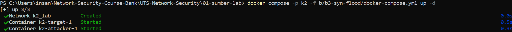
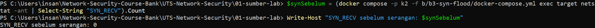
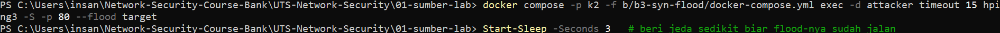
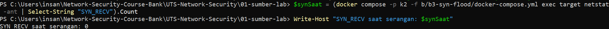
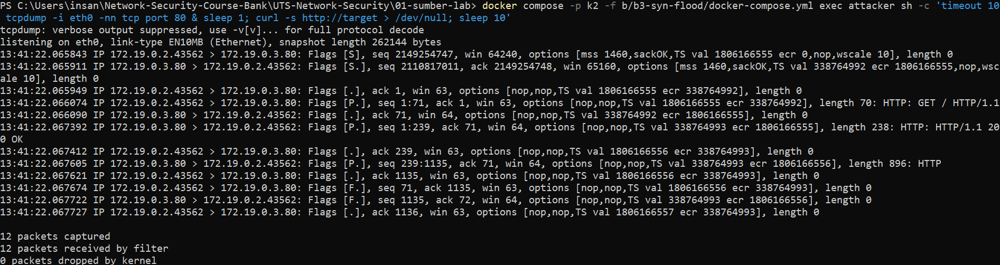
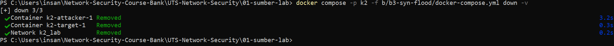

# TUGAS 6 (PERTEMUAN 6)
# SYN FLOOD DAN TCP THREE-WAY HANDSHAKE — KASUS 2 (K2)

## IDENTITAS DAN PARAMETER LAB

| Keterangan | Informasi |
|---|---|
| Nama | Insanul Firas |
| NIM | 24552011147 |
| Mata Kuliah | Keamanan Jaringan (Security Network) |
| Pertemuan | Pertemuan 6 |
| Tugas | SYN Flood dan Three-Way Handshake |
| Kasus | Kasus 2 (`k2`) |
| Sistem Operasi Host | Windows |
| Terminal | Windows PowerShell |
| Lingkungan Pengujian | Docker Desktop |
| Docker Compose Project | `k2` |
| Docker Image Attacker | `uts-kali-tools` |
| Service Target | `target` |
| Service Attacker | `attacker` |
| Web Server | Nginx |
| Port Pengujian | TCP 80 |
| Tools Pengujian | hping3, netstat, tcpdump, curl |

---

# 1. PENDAHULUAN

## 1.1 Tujuan Praktikum

Praktikum ini bertujuan untuk memahami mekanisme komunikasi TCP melalui proses Three-Way Handshake serta mempelajari salah satu bentuk serangan Denial of Service (DoS), yaitu SYN Flood.

Pengujian dilakukan menggunakan lingkungan Docker Compose yang terdiri dari dua service utama, yaitu `target` sebagai server tujuan dan `attacker` sebagai perangkat penyerang.

Pada praktikum ini, dilakukan pengamatan terhadap jumlah koneksi TCP dengan status `SYN_RECV` sebelum dan selama serangan berlangsung. Selanjutnya, dilakukan pengamatan terhadap paket TCP menggunakan `tcpdump` untuk memahami proses pembentukan koneksi melalui Three-Way Handshake.

Melalui praktikum ini, diharapkan dapat dipahami bagaimana proses pembentukan koneksi TCP bekerja, bagaimana serangan SYN Flood memanfaatkan proses tersebut, serta bagaimana mekanisme mitigasi dapat membantu melindungi server dari serangan yang membanjiri permintaan koneksi.

Adapun tujuan khusus praktikum ini adalah:

1. Memahami mekanisme TCP Three-Way Handshake.
2. Mengetahui fungsi paket SYN, SYN-ACK, dan ACK dalam pembentukan koneksi TCP.
3. Menjalankan simulasi SYN Flood menggunakan `hping3`.
4. Mengamati jumlah koneksi dengan status `SYN_RECV` sebelum dan selama serangan.
5. Melakukan analisis paket TCP menggunakan `tcpdump`.
6. Memahami perbedaan koneksi TCP normal dengan koneksi yang dihasilkan oleh serangan SYN Flood.
7. Mengetahui mekanisme SYN Cookies sebagai salah satu metode mitigasi SYN Flood.

## 1.2 Konsep Dasar TCP

Transmission Control Protocol (TCP) merupakan protokol transport yang digunakan untuk menyediakan komunikasi data yang berorientasi koneksi (*connection-oriented*).

Sebelum melakukan pertukaran data, TCP memerlukan proses pembentukan koneksi antara client dan server.

Proses tersebut dikenal sebagai Three-Way Handshake, yaitu pertukaran tiga paket utama:

- SYN (Synchronize)
- SYN-ACK (Synchronize-Acknowledgment)
- ACK (Acknowledgment)

Melalui proses tersebut, kedua perangkat melakukan sinkronisasi nomor urut (*sequence number*) dan mengonfirmasi kesiapan untuk melakukan komunikasi.

Setelah proses Three-Way Handshake selesai, koneksi TCP berada dalam kondisi `ESTABLISHED` dan dapat digunakan untuk pertukaran data.

## 1.3 Konsep Dasar SYN Flood

SYN Flood merupakan salah satu jenis serangan Denial of Service (DoS) yang memanfaatkan mekanisme pembentukan koneksi TCP.

Serangan ini dilakukan dengan mengirimkan sejumlah besar paket SYN kepada server tanpa menyelesaikan proses Three-Way Handshake.

Dalam kondisi normal, server akan menerima paket SYN, kemudian mengirimkan SYN-ACK sebagai balasan. Selanjutnya, server menunggu paket ACK dari client untuk menyelesaikan pembentukan koneksi.

Pada serangan SYN Flood, penyerang mengirimkan banyak permintaan SYN tetapi tidak menyelesaikan tahap terakhir handshake.

Akibatnya, server dapat memiliki banyak koneksi yang berada dalam kondisi setengah terbuka (*half-open connection*).

Apabila jumlah koneksi tersebut melebihi kapasitas antrean koneksi yang tersedia, server berpotensi mengalami gangguan dalam menerima koneksi baru yang sah.

---

# 2. PERSIAPAN LINGKUNGAN PENGUJIAN

## 2.1 Topologi Pengujian

Pengujian dilakukan menggunakan Docker Compose dengan dua service utama yang berada dalam satu lingkungan jaringan virtual.

Kedua service memiliki peran berbeda dalam simulasi SYN Flood.

| Service | Peran | Fungsi |
|---|---|---|
| `target` | Server tujuan | Menjalankan layanan web Nginx pada port TCP 80 |
| `attacker` | Penyerang | Menjalankan tools pengujian jaringan seperti hping3, tcpdump, dan curl |

Container `target` digunakan sebagai server yang menerima permintaan koneksi TCP, sedangkan container `attacker` digunakan untuk menjalankan simulasi SYN Flood dan melakukan pengamatan paket jaringan.

Web server Nginx pada service `target` digunakan sebagai layanan yang menjadi tujuan koneksi HTTP.

## 2.2 Struktur File Praktikum

File konfigurasi Docker Compose yang digunakan berada pada direktori:

```text
b/b3-syn-flood/docker-compose.yml
```

File tersebut berisi konfigurasi service yang diperlukan untuk menjalankan lingkungan simulasi SYN Flood.

Struktur direktori praktikum:

```text
01-sumber-lab/
│
├── hasil.md
│
├── b/
│   └── b3-syn-flood/
│       └── docker-compose.yml
│
└── screenshot/
    ├── 01.png
    ├── 02.png
    ├── 03.png
    ├── 04.png
    ├── 05.png
    └── 06.png
```

## 2.3 Menjalankan Lingkungan Docker Compose

Langkah pertama adalah menjalankan seluruh service yang telah didefinisikan pada file Docker Compose.

Perintah yang digunakan:

```powershell
docker compose -p k2 -f b/b3-syn-flood/docker-compose.yml up -d
```

Penjelasan parameter:

| Parameter | Fungsi |
|---|---|
| `docker compose` | Menjalankan perintah Docker Compose |
| `-p k2` | Menentukan nama project Docker Compose |
| `-f` | Menentukan lokasi file konfigurasi Compose |
| `b/b3-syn-flood/docker-compose.yml` | File konfigurasi lingkungan praktikum |
| `up` | Membuat dan menjalankan service |
| `-d` | Menjalankan container di latar belakang |

Setelah perintah dijalankan, Docker Compose akan membuat dan menjalankan service `target` dan `attacker` sesuai dengan konfigurasi yang telah ditentukan.

Dengan demikian, lingkungan simulasi telah dipersiapkan untuk melakukan pengujian koneksi TCP dan SYN Flood.

## 2.4 Dokumentasi Screenshot



**Gambar 1.** Proses menjalankan lingkungan praktikum menggunakan Docker Compose. Service `target` digunakan sebagai server Nginx, sedangkan service `attacker` digunakan untuk melakukan simulasi dan analisis jaringan.

---

# 3. PEMERIKSAAN KONDISI AWAL SERVER

## 3.1 Tujuan

Sebelum melakukan simulasi SYN Flood, terlebih dahulu dilakukan pemeriksaan terhadap kondisi koneksi TCP pada server target.

Pemeriksaan ini bertujuan untuk mengetahui jumlah koneksi yang berada dalam status `SYN_RECV` sebelum serangan dilakukan.

Status `SYN_RECV` merupakan salah satu status koneksi TCP yang menunjukkan bahwa server telah menerima paket SYN dan mengirimkan SYN-ACK, tetapi belum menerima ACK terakhir dari client.

Kondisi ini berkaitan langsung dengan proses Three-Way Handshake.

Dengan mengetahui jumlah koneksi `SYN_RECV` sebelum serangan, hasil pengamatan dapat dibandingkan dengan kondisi ketika serangan SYN Flood berlangsung.

## 3.2 Perintah Pemeriksaan

Perintah yang digunakan untuk memeriksa koneksi TCP pada server target adalah:

```powershell
docker compose -p k2 -f b/b3-syn-flood/docker-compose.yml exec target netstat -ant | Select-String "SYN_RECV"
```

Untuk menghitung jumlah baris yang memiliki status `SYN_RECV`, dapat digunakan perintah:

```powershell
docker compose -p k2 -f b/b3-syn-flood/docker-compose.yml exec target netstat -ant | Select-String "SYN_RECV" | Measure-Object -Line
```

Pada lingkungan Linux, perintah yang setara dengan pendekatan soal adalah:

```bash
netstat -ant | grep -c SYN_RECV
```

Penjelasan perintah:

- `docker compose exec target`: menjalankan perintah pada service target yang sedang aktif.
- `netstat -ant`: menampilkan informasi koneksi TCP dalam bentuk numerik.
- `Select-String "SYN_RECV"`: menyaring baris yang memiliki status SYN_RECV pada PowerShell.
- `grep -c SYN_RECV`: menghitung jumlah baris yang memiliki status SYN_RECV pada Linux.

## 3.3 Hasil Pemeriksaan Sebelum Serangan

Berdasarkan hasil pengujian yang didokumentasikan, jumlah koneksi dengan status `SYN_RECV` sebelum serangan adalah:

```text
Jumlah SYN_RECV sebelum serangan: 0
```

Hasil tersebut menunjukkan bahwa pada saat pemeriksaan awal tidak ditemukan koneksi TCP yang berada dalam status `SYN_RECV`.

Dengan kata lain, tidak terdapat koneksi setengah terbuka yang terdeteksi melalui pemeriksaan tersebut sebelum simulasi SYN Flood dilakukan.

Kondisi ini menjadi data pembanding untuk pengujian berikutnya.

## 3.4 Analisis Kondisi Awal

Pada kondisi normal, ketika tidak terdapat permintaan koneksi TCP yang belum diselesaikan, jumlah koneksi dengan status `SYN_RECV` dapat bernilai nol.

Hal tersebut merupakan kondisi yang wajar karena status `SYN_RECV` hanya muncul ketika server sedang menunggu penyelesaian proses Three-Way Handshake.

Dengan demikian, hasil pemeriksaan awal menunjukkan bahwa tidak ditemukan koneksi setengah terbuka pada saat pengamatan dilakukan.

## 3.5 Dokumentasi Screenshot



**Gambar 2.** Pemeriksaan jumlah koneksi TCP dengan status `SYN_RECV` pada service `target` sebelum serangan SYN Flood dijalankan. Hasil pengujian menunjukkan jumlah koneksi sebanyak 0.

---

# 4. SIMULASI SERANGAN SYN FLOOD

## 4.1 Tujuan

Tahap ini merupakan proses utama simulasi serangan SYN Flood.

Pengujian dilakukan menggunakan tools `hping3` yang dijalankan dari service `attacker` menuju service `target`.

hping3 merupakan salah satu tools pengujian jaringan yang memungkinkan pengguna membuat dan mengirimkan paket TCP, UDP, maupun ICMP dengan parameter tertentu.

Pada simulasi ini, hping3 digunakan untuk mengirimkan paket TCP SYN secara terus-menerus menuju port 80 pada server target.

Penggunaan paket SYN bertujuan untuk mensimulasikan banyak permintaan awal pembentukan koneksi TCP tanpa menyelesaikan seluruh tahapan Three-Way Handshake.

## 4.2 Perintah Serangan

Perintah yang digunakan:

```powershell
docker compose -p k2 -f b/b3-syn-flood/docker-compose.yml exec -d attacker timeout 15 hping3 -S -p 80 --flood target
```

Penjelasan parameter:

| Parameter | Fungsi |
|---|---|
| `docker compose` | Menjalankan perintah melalui Docker Compose |
| `-p k2` | Menggunakan project Docker Compose bernama `k2` |
| `exec -d attacker` | Menjalankan perintah pada service attacker dalam mode detached |
| `timeout 15` | Membatasi proses serangan maksimal selama 15 detik |
| `hping3` | Tools untuk membuat dan mengirim paket jaringan |
| `-S` | Mengatur flag TCP SYN pada paket |
| `-p 80` | Menentukan port tujuan TCP 80 |
| `--flood` | Mengirimkan paket secara terus-menerus dengan kecepatan tinggi |
| `target` | Menentukan server tujuan berdasarkan nama service Docker |

Perintah tersebut menjalankan hping3 pada container attacker dan mengirimkan paket TCP SYN menuju layanan web pada container target.

Opsi `timeout 15` digunakan untuk membatasi durasi pengujian agar proses tidak berjalan tanpa batas waktu.

Sementara itu, opsi `exec -d` membuat proses berjalan di latar belakang sehingga pemeriksaan server dapat dilakukan selama simulasi berlangsung.

## 4.3 Mekanisme Serangan

Pada kondisi normal, server akan menerima paket SYN dan memberikan balasan SYN-ACK kepada client.

Selanjutnya, server menunggu paket ACK sebagai konfirmasi terakhir dari client.

Dalam simulasi SYN Flood, penyerang mengirimkan banyak paket SYN ke server tanpa menyelesaikan proses handshake secara normal.

Apabila server menyimpan informasi koneksi sementara untuk setiap permintaan tersebut, jumlah koneksi setengah terbuka dapat meningkat dan berpotensi memenuhi kapasitas antrean koneksi.

Kondisi tersebut dapat menghambat penerimaan koneksi TCP baru dari client yang sah.

## 4.4 Hasil Pemeriksaan Selama Serangan

Setelah proses SYN Flood dijalankan, dilakukan pemeriksaan kembali terhadap koneksi TCP pada server target.

Perintah yang digunakan:

```powershell
docker compose -p k2 -f b/b3-syn-flood/docker-compose.yml exec target netstat -ant | Select-String "SYN_RECV"
```

Untuk menghitung jumlah koneksi:

```bash
netstat -ant | grep -c SYN_RECV
```

Berdasarkan hasil pengujian yang didokumentasikan, diperoleh jumlah koneksi sebagai berikut:

```text
Jumlah SYN_RECV saat serangan: 0
```

Hasil tersebut menunjukkan bahwa pemeriksaan tidak menemukan koneksi dengan status `SYN_RECV` selama pengamatan serangan berlangsung.

## 4.5 Analisis Hasil SYN Flood

Apabila dibandingkan dengan kondisi sebelum serangan, jumlah koneksi `SYN_RECV` tetap menunjukkan nilai yang sama, yaitu 0.

Hal tersebut menunjukkan bahwa tidak terdapat peningkatan koneksi setengah terbuka yang terdeteksi melalui pemeriksaan `netstat` pada saat pengujian.

Salah satu mekanisme yang dapat memengaruhi hasil tersebut adalah SYN Cookies.

SYN Cookies merupakan mekanisme perlindungan TCP yang dirancang untuk membantu server menghadapi kondisi ketika antrean koneksi setengah terbuka mengalami tekanan.

Dalam mekanisme ini, server dapat menyimpan informasi yang diperlukan untuk validasi koneksi melalui nilai sequence number pada respons SYN-ACK, sehingga tidak harus langsung mengalokasikan entri koneksi pada backlog untuk setiap permintaan SYN.

Apabila client mengirimkan ACK yang valid, server dapat memverifikasi informasi tersebut dan melanjutkan pembentukan koneksi.

Namun, nilai `SYN_RECV` yang tetap 0 tidak dengan sendirinya membuktikan bahwa SYN Cookies aktif atau bahwa seluruh paket serangan berhasil ditangani oleh mekanisme tersebut.

Untuk memastikan status SYN Cookies, diperlukan pemeriksaan parameter kernel:

```bash
cat /proc/sys/net/ipv4/tcp_syncookies
```

Interpretasi nilai:

| Nilai | Keterangan |
|---|---|
| `0` | SYN Cookies dinonaktifkan |
| `1` | SYN Cookies aktif ketika kondisi SYN backlog mengalami overflow |
| `2` | SYN Cookies selalu digunakan |

Dengan demikian, hasil pengujian menunjukkan bahwa jumlah koneksi `SYN_RECV` yang teramati tetap 0, sedangkan status mekanisme SYN Cookies perlu dikonfirmasi melalui pemeriksaan parameter kernel secara langsung.

## 4.6 Dokumentasi Screenshot



**Gambar 3.** Proses menjalankan simulasi SYN Flood menggunakan hping3 pada service `attacker`. Paket TCP SYN dikirimkan menuju port 80 pada service `target` dengan batas waktu pengujian selama 15 detik.



**Gambar 4.** Pemeriksaan kembali jumlah koneksi TCP berstatus `SYN_RECV` pada service `target` selama simulasi SYN Flood berlangsung. Hasil pengamatan menunjukkan jumlah koneksi tetap 0.

---

# 5. ANALISIS TCP THREE-WAY HANDSHAKE MENGGUNAKAN TCPDUMP

## 5.1 Tujuan

Setelah melakukan simulasi SYN Flood, tahap berikutnya adalah mengamati proses pembentukan koneksi TCP secara normal menggunakan tcpdump.

tcpdump merupakan tools yang digunakan untuk menangkap dan menganalisis paket jaringan yang melewati interface tertentu.

Pada praktikum ini, tcpdump dijalankan pada service `attacker` untuk mengamati lalu lintas TCP yang menggunakan port 80.

Selama proses penangkapan paket berlangsung, dilakukan satu permintaan HTTP normal menggunakan `curl` menuju server target.

Pengujian ini bertujuan untuk mengamati secara langsung tiga tahapan pembentukan koneksi TCP, yaitu:

1. SYN.
2. SYN-ACK.
3. ACK.

Selain itu, pengujian juga memperlihatkan pertukaran data HTTP setelah koneksi berhasil dibentuk.

## 5.2 Perintah yang Digunakan

Perintah yang dijalankan:

```powershell
docker compose -p k2 -f b/b3-syn-flood/docker-compose.yml exec attacker sh -c 'timeout 10 tcpdump -i eth0 -nn tcp port 80 & sleep 1; curl -s http://target > /dev/null; sleep 10'
```

Penjelasan parameter:

| Parameter | Fungsi |
|---|---|
| `exec attacker` | Menjalankan perintah pada service attacker |
| `sh -c` | Menjalankan rangkaian perintah shell |
| `timeout 10` | Membatasi proses tcpdump selama 10 detik |
| `tcpdump` | Menangkap dan menampilkan paket jaringan |
| `-i eth0` | Menentukan interface jaringan yang digunakan |
| `-nn` | Menampilkan alamat IP dan nomor port tanpa resolusi nama |
| `tcp port 80` | Menyaring paket TCP yang menggunakan port 80 |
| `&` | Menjalankan tcpdump di latar belakang |
| `sleep 1` | Memberikan jeda sebelum melakukan permintaan HTTP |
| `curl -s http://target` | Mengirim permintaan HTTP ke server target |
| `> /dev/null` | Mengabaikan output isi halaman HTTP |
| `sleep 10` | Memberikan waktu agar proses penangkapan paket selesai |

Melalui perintah tersebut, tcpdump dijalankan terlebih dahulu untuk menangkap paket TCP.

Setelah jeda satu detik, perintah curl mengirimkan permintaan HTTP menuju server Nginx pada service `target`.

Seluruh proses dilakukan untuk memperoleh bukti pertukaran paket TCP selama pembentukan koneksi dan komunikasi HTTP.

## 5.3 Hasil Penangkapan Paket

Berdasarkan dokumentasi hasil pengujian, diperoleh potongan output tcpdump sebagai berikut:

```text
13:41:22.065843 IP 172.19.0.2.43562 > 172.19.0.3.80: Flags [S], seq 2149254747, ...          ← SYN

13:41:22.065911 IP 172.19.0.3.80 > 172.19.0.2.43562: Flags [S.], seq 2110817011, ack 2149254748, ... ← SYN-ACK

13:41:22.065949 IP 172.19.0.2.43562 > 172.19.0.3.80: Flags [.], ack 1, ...                    ← ACK

13:41:22.066074 IP 172.19.0.2.43562 > 172.19.0.3.80: ... HTTP: GET / HTTP/1.1

13:41:22.066090 IP 172.19.0.3.80 > 172.19.0.2.43562: Flags [.], ack 71, ...

13:41:22.067392 IP 172.19.0.3.80 > 172.19.0.2.43562: ... HTTP: HTTP/1.1 200 OK

...

13:41:22.067674 IP 172.19.0.2.43562 > 172.19.0.3.80: Flags [F.], ...                          ← FIN

13:41:22.067722 IP 172.19.0.3.80 > 172.19.0.2.43562: Flags [F.], ...                          ← FIN

13:41:22.067727 IP 172.19.0.2.43562 > 172.19.0.3.80: Flags [.], ack 1136, ...                 ← ACK

12 packets captured, 0 packets dropped by kernel
```

Berdasarkan output tersebut, terdapat dua alamat IP utama yang terlibat dalam komunikasi:

| Perangkat | IP Address | Port |
|---|---|---|
| Attacker / Client | `172.19.0.2` | `43562` |
| Target / Server | `172.19.0.3` | `80` |

Port `43562` merupakan port sumber sementara (*ephemeral port*) yang digunakan client, sedangkan port 80 merupakan port layanan HTTP pada server target.

## 5.4 Analisis Paket SYN

Paket pertama yang terlihat pada hasil tcpdump adalah:

```text
172.19.0.2.43562 > 172.19.0.3.80: Flags [S]
```

Flag `[S]` menunjukkan bahwa paket tersebut memiliki flag TCP SYN.

Paket dikirimkan dari client `172.19.0.2` menuju server `172.19.0.3` pada port 80.

SYN digunakan untuk memulai proses pembentukan koneksi TCP.

Pada tahap ini, client mengirimkan nomor urut awal (*initial sequence number*) yang digunakan untuk sinkronisasi komunikasi antara kedua perangkat.

Dengan demikian, paket pertama menunjukkan bahwa client mulai meminta koneksi TCP kepada server.

## 5.5 Analisis Paket SYN-ACK

Paket kedua yang diterima adalah:

```text
172.19.0.3.80 > 172.19.0.2.43562: Flags [S.]
```

Flag `[S.]` menunjukkan kombinasi SYN dan ACK.

Paket ini dikirimkan oleh server sebagai respons terhadap permintaan koneksi dari client.

SYN berfungsi untuk mengirimkan nomor urut awal dari server, sedangkan ACK digunakan untuk mengonfirmasi nomor urut yang diterima dari client.

Pada tahap ini, server menunjukkan bahwa permintaan koneksi telah diterima dan server siap melanjutkan proses pembentukan koneksi.

## 5.6 Analisis Paket ACK

Paket ketiga yang terlihat adalah:

```text
172.19.0.2.43562 > 172.19.0.3.80: Flags [.]
```

Flag `[.]` menunjukkan paket TCP ACK.

Paket ini dikirimkan oleh client sebagai konfirmasi terhadap SYN-ACK yang diterima dari server.

Setelah paket ACK diterima dan diproses oleh server, proses TCP Three-Way Handshake dinyatakan selesai.

Koneksi kemudian berada dalam status `ESTABLISHED` dan dapat digunakan untuk melakukan pertukaran data.

## 5.7 Analisis Pertukaran Data HTTP

Setelah proses Three-Way Handshake selesai, client mengirimkan permintaan HTTP kepada server.

Berdasarkan hasil tcpdump, ditemukan paket:

```text
HTTP: GET / HTTP/1.1
```

Permintaan tersebut merupakan HTTP GET yang digunakan untuk meminta halaman utama dari server.

Selanjutnya, server memberikan respons:

```text
HTTP/1.1 200 OK
```

Kode status HTTP 200 OK menunjukkan bahwa permintaan berhasil diproses oleh server.

Hal tersebut memperlihatkan bahwa koneksi TCP tidak hanya berhasil dibentuk, tetapi juga dapat digunakan untuk melakukan pertukaran data HTTP secara normal.

## 5.8 Analisis Penutupan Koneksi

Setelah pertukaran data selesai, koneksi TCP ditutup menggunakan mekanisme FIN dan ACK.

Berdasarkan hasil pengamatan, terdapat paket:

```text
172.19.0.2.43562 > 172.19.0.3.80: Flags [F.]
```

Kemudian server memberikan respons:

```text
172.19.0.3.80 > 172.19.0.2.43562: Flags [F.]
```

Terakhir, client memberikan konfirmasi:

```text
172.19.0.2.43562 > 172.19.0.3.80: Flags [.]
```

Flag `[F.]` menunjukkan kombinasi FIN dan ACK, sedangkan `[.]` menunjukkan ACK.

Pertukaran tersebut merupakan bagian dari proses penutupan koneksi TCP setelah komunikasi HTTP selesai dilakukan.

## 5.9 Dokumentasi Screenshot



**Gambar 5.** Proses penangkapan paket TCP menggunakan tcpdump pada service `attacker` sambil melakukan permintaan HTTP normal menggunakan curl. Hasil pengamatan memperlihatkan paket SYN, SYN-ACK, ACK, pertukaran HTTP GET dan HTTP 200 OK, serta paket penutupan koneksi FIN/ACK.

---

# 6. PENJELASAN TCP THREE-WAY HANDSHAKE DAN SYN FLOOD

## 6.1 Mekanisme TCP Three-Way Handshake

TCP Three-Way Handshake merupakan proses pembentukan koneksi yang melibatkan tiga tahapan pertukaran paket antara client dan server.

Proses ini diperlukan untuk memastikan kedua perangkat siap melakukan komunikasi serta menyinkronkan nomor urut paket yang akan digunakan.

### 1. SYN (Synchronize)

Tahap pertama dimulai ketika client mengirimkan paket TCP dengan flag SYN kepada server.

Tujuannya adalah meminta pembentukan koneksi dan mengirimkan nomor urut awal milik client.

Dalam hasil pengujian, tahap ini ditunjukkan oleh:

```text
172.19.0.2.43562 > 172.19.0.3.80: Flags [S]
```

Artinya, client `172.19.0.2` mengirimkan permintaan koneksi menuju server `172.19.0.3` pada port 80.

### 2. SYN-ACK (Synchronize-Acknowledgment)

Setelah menerima paket SYN, server mengirimkan paket balasan yang memiliki flag SYN dan ACK.

Paket ini berfungsi untuk mengonfirmasi permintaan client sekaligus memberikan nomor urut awal dari sisi server.

Dalam hasil pengujian, tahap ini ditunjukkan oleh:

```text
172.19.0.3.80 > 172.19.0.2.43562: Flags [S.]
```

Artinya, server telah menerima permintaan koneksi dan memberikan respons kepada client.

### 3. ACK (Acknowledgment)

Tahap terakhir dilakukan ketika client mengirimkan paket ACK kepada server.

Paket ini berfungsi untuk mengonfirmasi bahwa respons SYN-ACK telah diterima.

Dalam hasil pengujian, tahap ini ditunjukkan oleh:

```text
172.19.0.2.43562 > 172.19.0.3.80: Flags [.]
```

Setelah ketiga tahapan tersebut selesai, koneksi TCP berada dalam kondisi `ESTABLISHED` dan dapat digunakan untuk melakukan pertukaran data.

## 6.2 Ringkasan Three-Way Handshake

| Tahap | Pengirim | Penerima | Flag TCP | Fungsi |
|---|---|---|---|---|
| Pertama | Client | Server | SYN `[S]` | Meminta pembentukan koneksi |
| Kedua | Server | Client | SYN-ACK `[S.]` | Memberikan respons dan konfirmasi |
| Ketiga | Client | Server | ACK `[.]` | Menyelesaikan pembentukan koneksi |

## 6.3 Pengertian SYN Flood Attack

SYN Flood merupakan serangan DoS yang memanfaatkan proses awal pembentukan koneksi TCP.

Pada komunikasi normal, setiap permintaan SYN yang diterima server akan direspons dengan SYN-ACK. Server kemudian menunggu ACK terakhir dari client.

Pada serangan SYN Flood, penyerang mengirimkan banyak paket SYN tanpa menyelesaikan proses handshake secara lengkap.

Akibatnya, server dapat menyimpan banyak informasi koneksi yang masih menunggu konfirmasi terakhir.

Koneksi yang belum menyelesaikan proses handshake tersebut disebut *half-open connection*.

Apabila jumlahnya terlalu besar dan melebihi kapasitas antrean koneksi, server dapat mengalami kesulitan dalam menerima permintaan koneksi baru.

## 6.4 Perbedaan Three-Way Handshake Normal dan SYN Flood

| Aspek | Three-Way Handshake Normal | SYN Flood |
|---|---|---|
| Paket SYN | Dikirimkan oleh client | Dikirimkan dalam jumlah besar |
| Paket SYN-ACK | Diterima sebagai respons server | Dapat dikirimkan oleh server sebagai respons terhadap SYN |
| Paket ACK | Dikirimkan untuk menyelesaikan koneksi | Tidak dikirimkan untuk menyelesaikan banyak permintaan SYN |
| Status Koneksi | `ESTABLISHED` setelah handshake selesai | Dapat menghasilkan banyak koneksi `SYN_RECV` |
| Tujuan | Membentuk komunikasi normal | Mengganggu ketersediaan layanan |
| Dampak | Komunikasi berjalan normal | Dapat membebani resource server |

## 6.5 Hubungan SYN Flood dengan Status SYN_RECV

Status `SYN_RECV` merupakan salah satu indikator yang dapat digunakan untuk mengamati koneksi TCP yang masih berada dalam tahap menunggu penyelesaian handshake.

Ketika server menerima SYN, server akan mengirimkan SYN-ACK dan menunggu ACK dari client.

Selama proses tersebut belum selesai, koneksi dapat berada dalam status `SYN_RECV`.

Pada serangan SYN Flood, jumlah koneksi setengah terbuka berpotensi meningkat karena penyerang tidak menyelesaikan proses handshake.

Oleh karena itu, pemeriksaan jumlah `SYN_RECV` dapat digunakan sebagai salah satu cara untuk mengamati kondisi koneksi TCP selama simulasi.

Namun, jumlah `SYN_RECV` tidak selalu menggambarkan seluruh paket SYN yang diterima server. Paket yang ditolak, diproses melalui mekanisme mitigasi, atau tidak berhasil masuk ke antrean koneksi tidak harus muncul sebagai entri `SYN_RECV`.

---

# 7. ANALISIS MEKANISME MITIGASI SYN COOKIES

## 7.1 Pengertian SYN Cookies

SYN Cookies merupakan mekanisme perlindungan pada TCP yang dirancang untuk membantu server menghadapi serangan SYN Flood.

Mekanisme ini memungkinkan server mengurangi kebutuhan penyimpanan informasi koneksi setengah terbuka ketika antrean SYN mengalami tekanan.

Pada mekanisme normal, server dapat menyimpan informasi koneksi sementara setelah menerima SYN dan mengirimkan SYN-ACK.

Sementara itu, dengan SYN Cookies, server dapat mengenkode informasi yang diperlukan untuk validasi koneksi ke dalam nomor urut (*sequence number*) pada paket SYN-ACK.

Ketika client mengirimkan ACK yang valid, server dapat memverifikasi informasi tersebut dan melanjutkan pembentukan koneksi tanpa harus mempertahankan seluruh state koneksi sejak awal.

## 7.2 Cara Kerja SYN Cookies

Secara umum, mekanisme SYN Cookies bekerja melalui tahapan berikut:

1. Server menerima paket SYN dari client.
2. Server membentuk SYN-ACK dengan sequence number khusus yang berisi informasi validasi.
3. Server tidak perlu langsung menyimpan seluruh informasi koneksi setengah terbuka seperti pada mekanisme normal.
4. Apabila client mengirimkan ACK yang valid, server memverifikasi nilai tersebut.
5. Setelah validasi berhasil, server melanjutkan pembentukan koneksi TCP.

Mekanisme ini membantu mengurangi penggunaan resource server akibat permintaan SYN yang tidak diselesaikan.

## 7.3 Pemeriksaan Status SYN Cookies

Untuk mengetahui apakah SYN Cookies aktif pada kernel Linux, dapat digunakan perintah berikut:

```bash
cat /proc/sys/net/ipv4/tcp_syncookies
```

Interpretasi hasil:

| Nilai | Keterangan |
|---|---|
| `0` | SYN Cookies dinonaktifkan |
| `1` | SYN Cookies digunakan ketika antrean SYN mengalami overflow |
| `2` | SYN Cookies selalu digunakan |

Pada konfigurasi Linux, nilai `1` umumnya menunjukkan bahwa mekanisme SYN Cookies diaktifkan ketika terjadi kondisi antrean SYN yang mengalami overflow.

## 7.4 Analisis Hasil Pengujian

Berdasarkan dokumentasi pengujian, jumlah koneksi `SYN_RECV` menunjukkan angka 0 baik sebelum maupun saat serangan berlangsung.

Hasil tersebut memperlihatkan bahwa tidak terdapat peningkatan koneksi setengah terbuka yang terdeteksi melalui pemeriksaan `netstat`.

Salah satu kemungkinan yang perlu diperhatikan adalah adanya mekanisme perlindungan TCP seperti SYN Cookies.

Namun, hasil `SYN_RECV` yang tetap 0 tidak dapat digunakan sebagai satu-satunya bukti bahwa SYN Cookies aktif.

Untuk memastikan hal tersebut, diperlukan pemeriksaan parameter kernel secara langsung.

Dengan demikian, hasil praktikum menunjukkan kondisi koneksi yang teramati, sedangkan efektivitas SYN Cookies perlu dikonfirmasi menggunakan informasi konfigurasi kernel dan pengamatan paket tambahan.

---

# 8. REKAPITULASI DAN ANALISIS HASIL PRAKTIKUM

## 8.1 Rekapitulasi Jumlah SYN_RECV

Berdasarkan hasil pengujian yang telah dilakukan, diperoleh perbandingan jumlah koneksi `SYN_RECV` sebagai berikut:

| Kondisi Pengujian | Jumlah SYN_RECV |
|---|---:|
| Sebelum serangan | **0** |
| Saat serangan berlangsung | **0** |

Berdasarkan tabel tersebut, jumlah koneksi dengan status `SYN_RECV` tidak mengalami perubahan selama pengamatan.

Pada kondisi awal tidak ditemukan koneksi setengah terbuka.

Setelah simulasi SYN Flood dijalankan, pemeriksaan kembali juga tidak menunjukkan adanya koneksi dengan status `SYN_RECV`.

Hasil ini merupakan temuan utama dari pengujian SYN Flood pada lingkungan Docker yang digunakan.

## 8.2 Rekapitulasi Paket Three-Way Handshake

Berdasarkan hasil penangkapan paket menggunakan tcpdump, diperoleh informasi sebagai berikut:

| No. | Jenis Paket | Flag TCP | Arah Komunikasi | Keterangan |
|---|---|---|---|---|
| 1 | SYN | `[S]` | Client → Server | Permintaan koneksi |
| 2 | SYN-ACK | `[S.]` | Server → Client | Respons server |
| 3 | ACK | `[.]` | Client → Server | Konfirmasi client |
| 4 | HTTP GET | - | Client → Server | Permintaan halaman web |
| 5 | HTTP 200 OK | - | Server → Client | Respons berhasil |
| 6 | FIN/ACK | `[F.]` | Client dan Server | Proses penutupan koneksi |

Pada hasil pengujian, terlihat bahwa ketiga paket pertama membentuk proses TCP Three-Way Handshake secara normal.

Setelah itu, komunikasi dilanjutkan dengan permintaan HTTP GET dan respons HTTP 200 OK.

Proses komunikasi kemudian diakhiri dengan pertukaran FIN dan ACK.

## 8.3 Analisis Keseluruhan

Berdasarkan seluruh tahapan praktikum, dapat diketahui bahwa simulasi SYN Flood dan analisis TCP Three-Way Handshake berhasil dijalankan dalam lingkungan Docker Compose.

Pengujian SYN Flood dilakukan menggunakan hping3 dengan mengirimkan paket TCP SYN menuju port 80 pada server target.

Pemeriksaan terhadap status koneksi TCP menunjukkan bahwa jumlah `SYN_RECV` tetap 0 sebelum maupun selama serangan berlangsung.

Hasil tersebut menunjukkan bahwa tidak ditemukan koneksi setengah terbuka melalui pemeriksaan yang dilakukan.

Selanjutnya, proses penangkapan paket menggunakan tcpdump berhasil memperlihatkan pertukaran paket SYN, SYN-ACK, dan ACK.

Ketiga paket tersebut membuktikan bahwa koneksi TCP normal dapat dibentuk antara client dan server.

Setelah koneksi terbentuk, permintaan HTTP berhasil diproses dan server memberikan respons `200 OK`.

Dengan demikian, pengujian ini memperlihatkan perbedaan antara proses pembentukan koneksi TCP secara normal dan konsep serangan SYN Flood yang berusaha mengganggu proses tersebut.

---

# 9. PEMBERSIHAN LINGKUNGAN PRAKTIKUM

## 9.1 Tujuan

Setelah seluruh tahapan pengujian selesai dilakukan, lingkungan Docker Compose dibersihkan agar container, jaringan, dan volume yang dibuat khusus untuk praktikum tidak terus berjalan atau menggunakan resource sistem.

Pembersihan dilakukan menggunakan perintah Docker Compose `down -v`.

## 9.2 Perintah Pembersihan

Perintah yang digunakan:

```powershell
docker compose -p k2 -f b/b3-syn-flood/docker-compose.yml down -v
```

Penjelasan parameter:

- `docker compose`: menjalankan perintah Docker Compose.
- `-p k2`: menentukan project yang akan dihentikan.
- `-f`: menentukan file konfigurasi Docker Compose.
- `down`: menghentikan dan menghapus container serta jaringan yang dibuat oleh project tersebut.
- `-v`: menghapus volume yang terkait dengan project.

Perintah tersebut digunakan untuk membersihkan lingkungan praktikum setelah seluruh pengujian selesai dilakukan.

## 9.3 Hasil Pembersihan

Setelah perintah dijalankan, service yang digunakan dalam simulasi dihentikan dan resource Docker Compose yang terkait dengan project `k2` dibersihkan sesuai konfigurasi.

Dengan demikian, lingkungan pengujian SYN Flood telah selesai digunakan.

## 9.4 Dokumentasi Screenshot



**Gambar 6.** Proses pembersihan lingkungan praktikum menggunakan perintah Docker Compose `down -v` setelah seluruh pengujian SYN Flood dan Three-Way Handshake selesai dilakukan.

---

# 10. KESIMPULAN

Berdasarkan pelaksanaan Tugas 6 (Pertemuan 6) mengenai SYN Flood dan TCP Three-Way Handshake pada Kasus 2 (`k2`), dapat disimpulkan bahwa praktikum berhasil memberikan pemahaman mengenai proses pembentukan koneksi TCP serta karakteristik serangan SYN Flood.

Pada tahap awal, lingkungan pengujian berhasil dijalankan menggunakan Docker Compose dengan dua service utama, yaitu `target` sebagai server Nginx dan `attacker` sebagai perangkat pengujian.

Simulasi SYN Flood dilakukan menggunakan hping3 dengan mengirimkan paket TCP SYN menuju port 80 pada server target.

Berdasarkan hasil pemeriksaan, jumlah koneksi dengan status `SYN_RECV` sebelum serangan adalah 0. Ketika serangan berlangsung, jumlah yang teramati juga tetap 0.

Hasil tersebut menunjukkan bahwa tidak ditemukan koneksi setengah terbuka melalui pemeriksaan netstat yang dilakukan. Namun, hasil ini belum cukup untuk memastikan bahwa SYN Cookies aktif tanpa pemeriksaan parameter kernel secara langsung.

Selanjutnya, analisis paket menggunakan tcpdump berhasil memperlihatkan proses TCP Three-Way Handshake yang terdiri dari tiga tahapan, yaitu SYN, SYN-ACK, dan ACK.

Setelah ketiga tahapan tersebut selesai, koneksi TCP berhasil dibentuk dan digunakan untuk melakukan komunikasi HTTP.

Hal ini dibuktikan melalui adanya permintaan `GET / HTTP/1.1` dan respons server `HTTP/1.1 200 OK`.

Selain itu, praktikum ini memberikan pemahaman mengenai SYN Flood sebagai serangan yang memanfaatkan permintaan koneksi TCP dalam jumlah besar tanpa menyelesaikan proses handshake.

Salah satu mekanisme mitigasi yang dapat digunakan untuk mengurangi dampak serangan tersebut adalah SYN Cookies, yang membantu server mengurangi kebutuhan penyimpanan informasi koneksi setengah terbuka ketika antrean SYN mengalami tekanan.

Secara keseluruhan, praktikum ini memberikan pemahaman mengenai mekanisme TCP Three-Way Handshake, karakteristik serangan SYN Flood, analisis paket menggunakan tcpdump, serta pentingnya mekanisme perlindungan untuk menjaga ketersediaan layanan jaringan.

---

# 11. LAMPIRAN DAN DOKUMENTASI

## 11.1 Daftar Screenshot

Berikut merupakan daftar dokumentasi visual yang digunakan sebagai bukti pelaksanaan praktikum:

| No. | Nama Screenshot | Keterangan |
|---|---|---|
| 1 | `01.png` | Menjalankan lingkungan Docker Compose |
| 2 | `02.png` | Pemeriksaan SYN_RECV sebelum serangan |
| 3 | `03.png` | Menjalankan simulasi SYN Flood menggunakan hping3 |
| 4 | `04.png` | Pemeriksaan SYN_RECV selama serangan |
| 5 | `05.png` | Penangkapan paket Three-Way Handshake menggunakan tcpdump |
| 6 | `06.png` | Pembersihan lingkungan Docker Compose |

## 11.2 Dokumentasi Keseluruhan

### A. Menjalankan Lingkungan Pengujian


**Gambar 1.** Inisialisasi service target dan attacker menggunakan Docker Compose.

### B. Pemeriksaan Sebelum Serangan


**Gambar 2.** Pemeriksaan kondisi awal koneksi TCP pada server target.

### C. Eksekusi SYN Flood


**Gambar 3.** Proses pengiriman paket TCP SYN menggunakan hping3 menuju port 80 pada server target.

### D. Pemeriksaan Selama Serangan


**Gambar 4.** Pemeriksaan jumlah koneksi setengah terbuka ketika simulasi SYN Flood berlangsung.

### E. Analisis Three-Way Handshake


**Gambar 5.** Hasil penangkapan paket TCP yang memperlihatkan pertukaran SYN, SYN-ACK, ACK, HTTP GET, HTTP 200 OK, dan proses penutupan koneksi.

### F. Pembersihan Lingkungan Pengujian


**Gambar 6.** Penghapusan lingkungan praktikum menggunakan perintah Docker Compose `down -v`.

